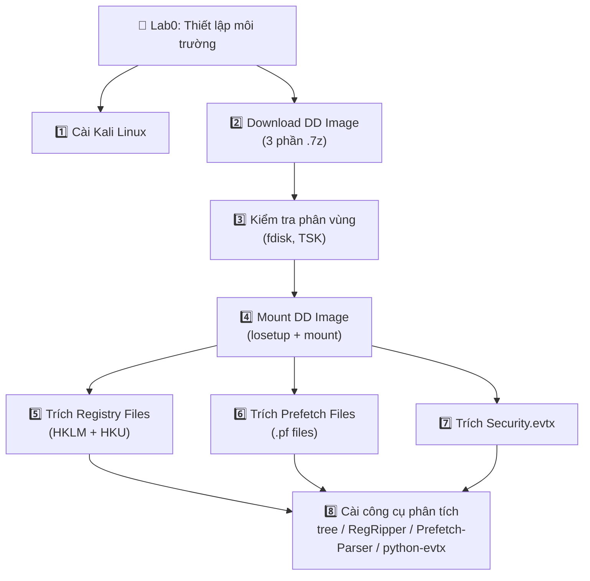

# Lab 00: Forensic Environment Setup & NIST Data Leakage Case Triage
### *Thiết lập Môi trường Điều tra số & Khảo sát Sơ bộ Vụ án Rò rỉ Dữ liệu NIST CFReDS*

[⬅️ Back to Main DFIR Casebook](../../README.md)

---

## 📌 Quick Metadata

| Field | Description |
| :--- | :--- |
| **Forensic Environment** | `Kali Linux 2025.4 / 2026.3 (64-bit)` on `VMware Workstation Pro` (Host: `Windows 11`) |
| **Forensic Module** | `01-Disk-and-FileSystem-Forensics` |
| **Target Dataset / Evidence** | `cfreds_2015_data_leakage_pc.dd (20 GB Raw Disk Image)` |
| **Core Forensic Toolstack** | `Kali Linux, fdisk, The Sleuth Kit (fls), losetup, RegRipper 3.0, Windows-Prefetch-Parser, python-evtx` |
| **MITRE ATT&CK / DFIR Focus** | `T1005 (Data from Local System), T1070 (Indicator Removal)` |

---

# 📋 BÁO CÁO TỔNG KẾT LAB 0: THIẾT LẬP MÔI TRƯỜNG PHÂN TÍCH PHÁP Y SỐ
**Môn học:** FRS301 - Digital Forensics  
**Case nghiên cứu:** NIST CFReDS Data Leakage Case (PC DD Image)  
**Ngày thực hiện:** 30/09/2026  

---

## 🎯 1. Mục tiêu đã hoàn thành
1. ✅ **Giải nén ảnh đĩa:** Đã giải nén 3 file `.7z.001`, `.7z.002`, `.7z.003` thành tệp raw image `cfreds_2015_data_leakage_pc.dd` (20 GB).
2. ✅ **Phân tích bảng phân vùng (Partition Table):**
   - Phân vùng 1 (Sector `2048`, size 100MB): System Reserved Volume (NTFS).
   - Phân vùng 2 (Sector `206848`, size ~20GB): Phân vùng hệ điều hành Windows chính (NTFS).
3. ✅ **Trích xuất Registry Hives:**
   - **HKLM:** `SAM`, `SYSTEM`, `SECURITY`, `SOFTWARE`, `DEFAULT` từ `Windows/System32/config/`.
   - **HKU / Users:** `informant_NTUSER.DAT`, `admin11_NTUSER.DAT`, `temporary_NTUSER.DAT`, `Default_NTUSER.DAT`.
4. ✅ **Trích xuất Prefetch Files:**
   - Trích xuất toàn bộ 106 tệp `.pf` và `.db` từ `Windows/Prefetch/` (bao gồm `CHROME.EXE`, `GOOGLEDRIVESYNC.EXE`, `ERASER.EXE`, `CCLEANER64.EXE`, `OUTLOOK.EXE`, ...).
5. ✅ **Trích xuất Event Log Files:**
   - Trích xuất `Security.evtx`, `System.evtx`, `Application.evtx` từ `Windows/System32/winevt/Logs/`.
6. ✅ **Cài đặt & Cấu hình bộ công cụ phân tích:**
   - `tree` (cấu trúc thư mục).
   - `tools/rip` (RegRipper 3.0 CLI với đầy đủ thư viện Perl `Parse::Win32Registry`).
   - `tools/parse_prefetch.py` & thư viện Python `windowsprefetch`.
   - `tools/parse_evtx.py` & thư viện Python `python-evtx`.

---

## 📂 2. Cấu trúc thư mục Artifacts & Tools

```text
Lab0/
├── artifacts/
│   ├── logs/
│   │   ├── Application.evtx
│   │   ├── Security.evtx
│   │   └── System.evtx
│   ├── prefetch/
│   │   ├── CHROME.EXE-D999B1BA.pf
│   │   ├── GOOGLEDRIVESYNC.EXE-841A0D94.pf
│   │   ├── ERASER.EXE-CE61944A.pf
│   │   └── ... (106 files)
│   └── registry/
│       ├── HKLM/
│       │   ├── SAM, SYSTEM, SOFTWARE, SECURITY, DEFAULT
│       └── Users/
│           ├── informant_NTUSER.DAT
│           ├── admin11_NTUSER.DAT
│           ├── temporary_NTUSER.DAT
│           └── Default_NTUSER.DAT
├── tools/
│   ├── rip                     # RegRipper 3.0 executable wrapper
│   ├── parse_prefetch.py       # Prefetch parser CLI script
│   ├── parse_evtx.py           # EVTX parser CLI script
│   ├── regripper/              # RegRipper 3.0 source & plugins
│   ├── perl_lib/               # Perl dependencies (Parse::Win32Registry)
│   └── Windows-Prefetch-Parser/ # Windows Prefetch Parser repository
├── venv/                       # Môi trường ảo Python
├── cfreds_2015_data_leakage_pc.dd
├── Lab0_Overview.md
└── LAB0_SUMMARY.md
```

---

## 🛠️ 3. Hướng dẫn sử dụng nhanh các công cụ

### 3.1 Phân tích Windows Registry (`RegRipper 3.0`)
Chạy trực tiếp qua wrapper script `tools/rip`:
```bash
# Phân tích thông tin người dùng trong file SAM
./tools/rip -r artifacts/registry/HKLM/SAM -p samparse

# Phân tích thông tin hệ thống trong hive SYSTEM
./tools/rip -r artifacts/registry/HKLM/SYSTEM -p compname

# Chạy toàn bộ plugin tự động theo hive
./tools/rip -r artifacts/registry/Users/informant_NTUSER.DAT -a
```

### 3.2 Phân tích Prefetch Files
Sử dụng môi trường python đã tích hợp:
```bash
# Phân tích 1 file prefetch
./venv/bin/python3 tools/parse_prefetch.py artifacts/prefetch/CHROME.EXE-D999B1BA.pf

# Liệt kê tóm tắt toàn bộ file prefetch trong thư mục
./venv/bin/python3 tools/parse_prefetch.py artifacts/prefetch/
```

### 3.3 Phân tích Windows Event Logs (`.evtx`)
```bash
# Xem 5 bản ghi đầu tiên trong Security.evtx
./venv/bin/python3 tools/parse_evtx.py artifacts/logs/Security.evtx 5
```

---

## 🔍 4. Phát hiện sơ bộ ban đầu (Initial Reconnaissance)
- **Tài khoản người dùng chính (SAM):**
  - `informant` (RID: 1000, Admin, Gợi ý mật khẩu: `IAMAN`, Đăng nhập lần cuối: 25/03/2015 14:45:59 UTC).
  - `admin11` (RID: 1001, Admin).
  - `ITechTeam` (RID: 1002, Admin).
  - `temporary` (RID: 1003, Standard User).
- **Các ứng dụng đáng ngờ qua Prefetch:**
  - `GOOGLEDRIVESYNC.EXE` (Dịch vụ đồng bộ Google Drive).
  - `ERASER.EXE` & `ERASER 6.2.0.2962.EXE` (Công cụ xóa dữ liệu vĩnh viễn / Anti-forensics).
  - `CCLEANER64.EXE` (Công cụ dọn dẹp dấu vết hệ thống).
  - `CHROME.EXE`, `IEXPLORE.EXE`, `OUTLOOK.EXE`.


---

# 📁 Lab0 – Setting Up an Initial Lab Environment
> **File:** `NIST_Data_Leakage_00_Env_Setting.pptx` &nbsp;|&nbsp; **Tổng số slides:** 59

---

## 🗺️ Mục lục (Table of Contents)

| #  | Phần | Nội dung |
|----|------|----------|
| 1  | Case Description | Mô tả kịch bản rò rỉ dữ liệu của NIST |
| 2  | Lab Setup | Các bước cài đặt môi trường lab |
| 3  | Exam DD Image | Kiểm tra phân vùng & file trong ảnh đĩa DD |
| 4  | Registry Files | Trích xuất file Registry từ ảnh DD |
| 5  | Prefetch Files | Trích xuất file Prefetch từ ảnh DD |
| 6  | Event Log Files | Trích xuất Security Event Log từ ảnh DD |
| 7  | Install Software | Cài đặt các công cụ hỗ trợ |

---

## 🔍 1. Mô tả kịch bản (Data Leakage Case)

> **Nguồn:** [NIST CFReDS Data Leakage Case](https://cfreds-archive.nist.gov/data_leakage_case/data-leakage-case.html)  
> **Đáp án tham khảo:** [leakage-answers.pdf](https://cfreds-archive.nist.gov/data_leakage_case/leakage-answers.pdf)

### Kịch bản

- **Nhân vật chính:** *Iaman Informant* – Quản lý bộ phận phát triển công nghệ tại công ty quốc tế **OOO**.
- **Chính sách bảo mật của OOO:**
  - Cấm mang thiết bị lưu trữ (HDD, SSD, USB, CD/DVD) qua cổng kiểm tra an ninh.
  - File bảo mật chỉ được truy cập trong giờ cho phép (10:00–16:00).
  - Thiết bị không được ủy quyền không được mang vào công ty.

### Diễn biến vụ rò rỉ

1. Mr. Informant nhận lời từ **Spy Conspirator** (nhân viên công ty đối thủ) để đổi lấy tiền.
2. Họ liên lạc qua email giả vờ như quan hệ công việc.
3. Mr. Informant gửi mẫu dữ liệu bảo mật qua cloud storage cá nhân.
4. Mr. Conspirator yêu cầu giao dữ liệu trực tiếp qua thiết bị lưu trữ (USB, CD).
5. **Kết cục:** Mr. Informant bị phát hiện tại trạm kiểm tra an ninh. Thiết bị (USB + CD) được kiểm tra sơ bộ bằng write blocker nhưng ban đầu không tìm thấy bằng chứng. Toàn bộ thiết bị được chuyển đến **phòng thí nghiệm pháp y số** để phân tích sâu hơn.

---

## 🛠️ 2. Các bước thiết lập Lab

```
1. Install Kali Linux (Optional)
2. Get the NIST data leakage case DD image
3. Exam files in the DD image
4. Extract registry files from the DD image
5. Extract prefetch event log files from the DD image
6. Extract security event log files from the DD image
7. Install: tree, RegRipper 3.0, Windows-Prefetch-Parser, Python-evtx
```

### 2.1 Cài đặt Kali Linux (Tuỳ chọn)
- Hướng dẫn: [https://github.com/frankwxu/digital-forensics-lab](https://github.com/frankwxu/digital-forensics-lab)

### 2.2 Download DD Image
```bash
# Download 3 phần của DD image
wget https://cfreds-archive.nist.gov/data_leakage_case/images/pc/cfreds_2015_data_leakage_pc.7z.001
wget https://cfreds-archive.nist.gov/data_leakage_case/images/pc/cfreds_2015_data_leakage_pc.7z.002
wget https://cfreds-archive.nist.gov/data_leakage_case/images/pc/cfreds_2015_data_leakage_pc.7z.003

# Giải nén và verify MD5
```

---

## 🗂️ 3. Kiểm tra ảnh DD (Exam DD Image)

### Phân vùng đĩa (`fdisk`)
- Xác định phân vùng nào là **system volume** (khởi động hệ điều hành).
- Phân biệt: **boot volume** (core OS) vs **system volume** (khởi động ban đầu).

### Liệt kê file/thư mục
Dùng **Sleuth Kit (TSK)** với tùy chọn `-o` (offset của phân vùng):

| Ký hiệu | Ý nghĩa |
|---------|---------|
| `d` | Directory |
| `r/r` | Regular file (allocated) |
| Metadata address | Địa chỉ cấu trúc dữ liệu file system |

**Loại metadata theo hệ thống:**
| File System | Metadata | Thiết bị |
|------------|----------|---------|
| FAT/exFAT | Directory entry | USB |
| NTFS | MFT Entry | Windows |
| UFS | Inode | Camera số, điện thoại |
| ExtX | Inode | Linux |
| HFS | Catalog record | iOS |

---

## 🗃️ 4. Trích xuất Registry Files

### Windows Registry là gì?
- Cơ sở dữ liệu phân cấp lưu trữ cài đặt cấp thấp của Windows và các ứng dụng.
- Được sử dụng bởi: **Kernel, Device drivers, Services, SAM, User interface**.

### 5 Root Keys chính

| Key | Viết tắt | Chức năng |
|-----|----------|-----------|
| HKEY_CLASSES_ROOT | HKCR | Thông tin về kiểu file và COM objects |
| HKEY_CURRENT_USER | HKCU | Cài đặt của user hiện tại đang đăng nhập |
| HKEY_LOCAL_MACHINE | HKLM | Thông tin phần cứng và phần mềm máy tính |
| HKEY_USERS | HKU | Thông tin tất cả user đã từng đăng nhập |
| HKEY_CURRENT_CONFIG | HKCC | Con trỏ/shortcut đến key khác |

> [!TIP]
> **HKCU** là "kho báu" cho điều tra viên – lưu trữ biến môi trường, cài đặt desktop, kết nối mạng, máy in, ưu tiên ứng dụng, layout bàn phím của user đang đăng nhập.

### HKCU – File Hive locations
```
C:\Users\IEUser\Ntuser.dat
C:\Users\ssh_Server\Ntuser.dat
C:\Users\Default User\Ntuser.dat
```

### Cách truy cập Registry từ DD Image – Mounting

```bash
# Bước 1: Tạo loop device (thiết bị ảo)
sudo losetup --partscan --find --show --read-only <image.dd>

# Bước 2: Tạo mount point (thư mục)
mkdir /mnt/nist_dataleak_pc_dd2/

# Bước 3: Mount phân vùng vào mount point
sudo mount /dev/loop0p2 /mnt/nist_dataleak_pc_dd2/

# Unmount
umount /mnt/nist_dataleak_pc_dd2/
```

> [!NOTE]
> Kali 2020 có thể tự động tạo mount point `/media/YOUR_Account/CB48`.

### Sao chép Registry Hive Files về thư mục lab
```bash
# Copy HKEY_LOCAL_MACHINE hive files (5 files)
# Copy HKEY_USERS hive files (4 files, tìm các user trong PC trước)
```

---

## 📋 5. Trích xuất Prefetch Files

### Prefetch là gì?
- **Cache:** Bộ nhớ lưu tạm để cải thiện hiệu năng.
- **Prefetching:** Nạp sẵn tài nguyên (instructions, data) vào cache trước khi cần dùng.
- Tài nguyên được chọn dựa trên hành vi hàng ngày của user.
- **Forensic use:** Theo dõi lịch sử thực thi chương trình.

### Các lệnh

```bash
# Tìm file .pf trong DD image (dùng TSK + regex PCRE)
# -r: recursive, -F: files only, -d: deleted files, -P: PCRE
# \: escape ký tự đặc biệt

# Copy thư mục Prefetch
cp -avr <source_Prefetch> ./Prefetch

# Verify (kiểm tra file chrome.exe.pf)
ls ./Prefetch/*.pf
```

> [!NOTE]
> Tham khảo PCRE regex: [https://www.debuggex.com/cheatsheet/regex/pcre](https://www.debuggex.com/cheatsheet/regex/pcre)

---

## 📝 6. Trích xuất Security Event Log Files

### Event Log là gì?
- Windows ghi lại các sự kiện để debug, được tạo bởi **Event Viewer** (`eventvwr.msc`).
- Định dạng file: **`.evtx`** (binary độc quyền, chỉ xem được bằng Event Viewer).

### Các lệnh

```bash
# Tìm Security.evtx trong DD image
# -r: Recurse on directory entries

# Tìm và hiển thị đường dẫn đầy đủ
# Copy Security.evtx vào thư mục lab
```

---

## 🔧 7. Cài đặt Công cụ

### 7.1 Tree
```bash
# Xem trợ giúp
tree --help

# Hiển thị cấu trúc thư mục hiện tại
tree .
```

### 7.2 RegRipper 3.0
> **Mục đích:** Trích xuất/phân tích thông tin (keys, values, data) từ Windows Registry.
- **Loại:** Open-source (Windows & Linux), viết bằng Perl.
- **Hai công cụ:** CLI (`rip`) và GUI.

```bash
# Download script cài đặt RegRipper 3.0
# Verify script
# Cấp quyền thực thi
chmod +x <script>

# Chạy script cài đặt
# Test RegRipper 3.0
```

### 7.3 Windows-Prefetch-Parser
```bash
# Cài đặt qua pip (nếu Python ≥ 3.9)
pip install windows-prefetch-parser

# Hoặc build từ GitHub
git clone https://github.com/PoorBillionaire/Windows-Prefetch-Parser.git
cd Windows-Prefetch-Parser
python3 setup.py build
python3 setup.py install
```

### 7.4 Python-evtx (Windows Event Log Parser)
```bash
# Cài đặt qua apt
sudo apt-get update
sudo apt-get install python3-evtx

# Verify cài đặt
```
> **Mục đích:** Pure Python parser cho file `.evtx`, cung cấp truy cập lập trình vào File/Chunk headers, record templates, và event entries.

---

## 📌 Tóm tắt nhanh




---
