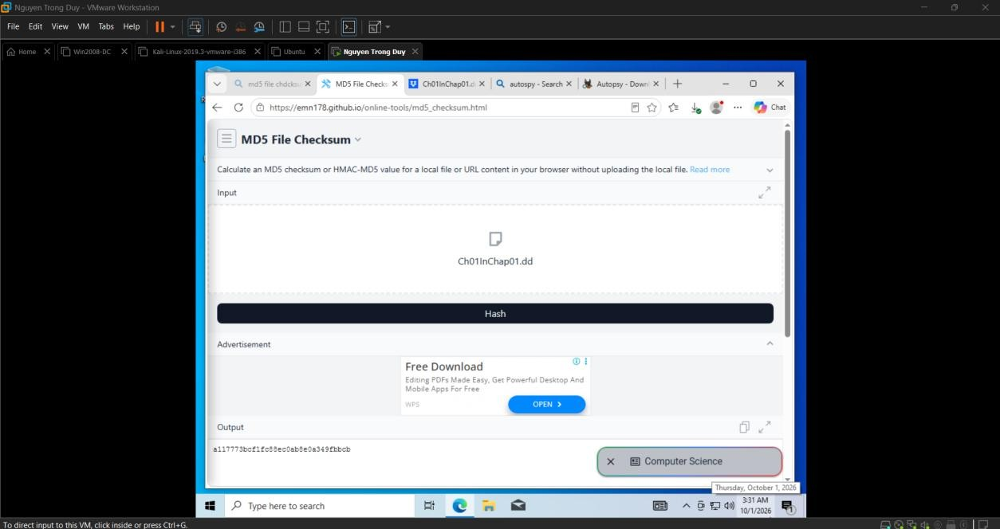
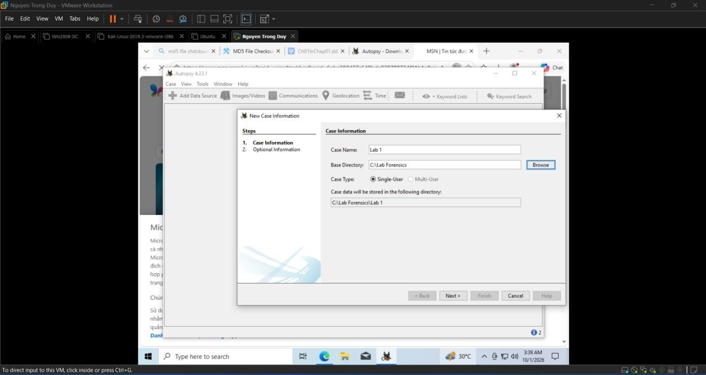
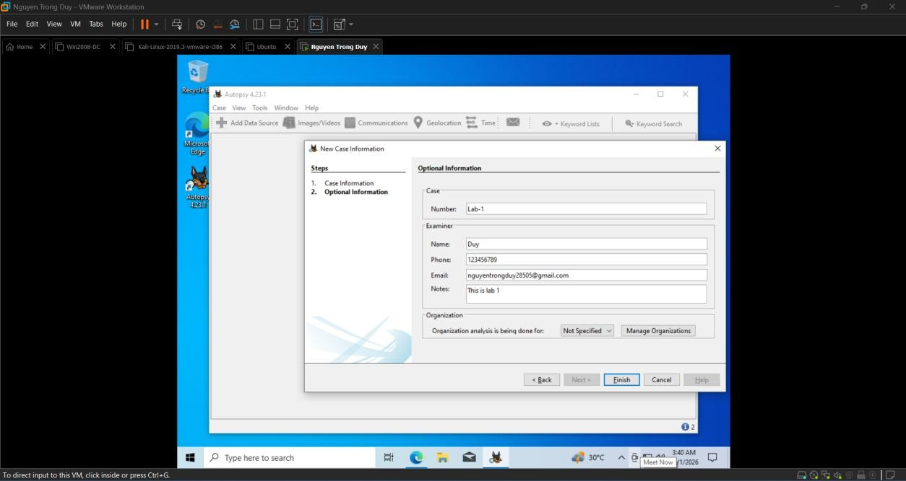
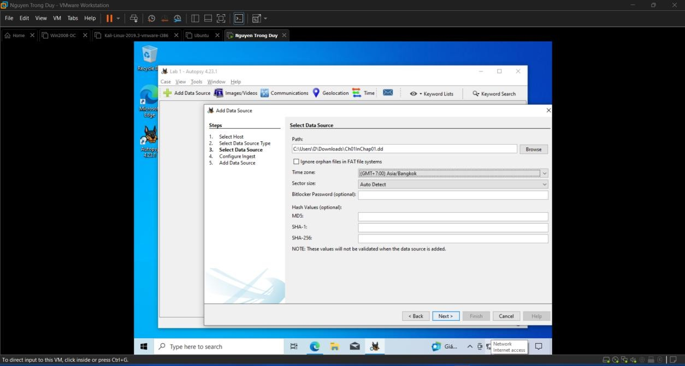
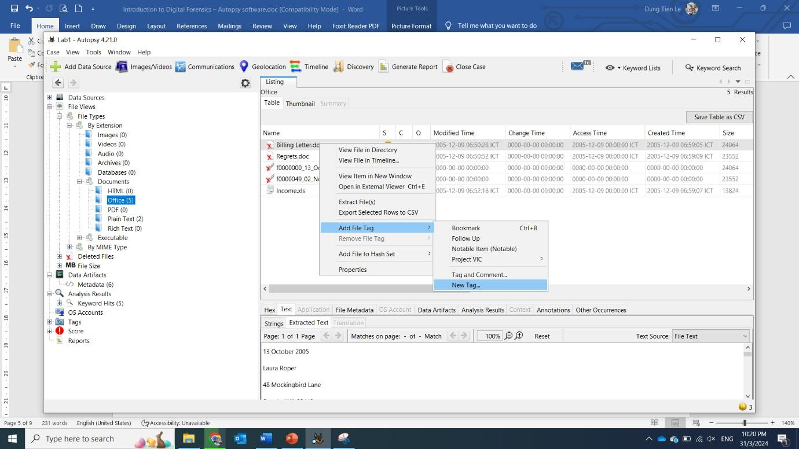
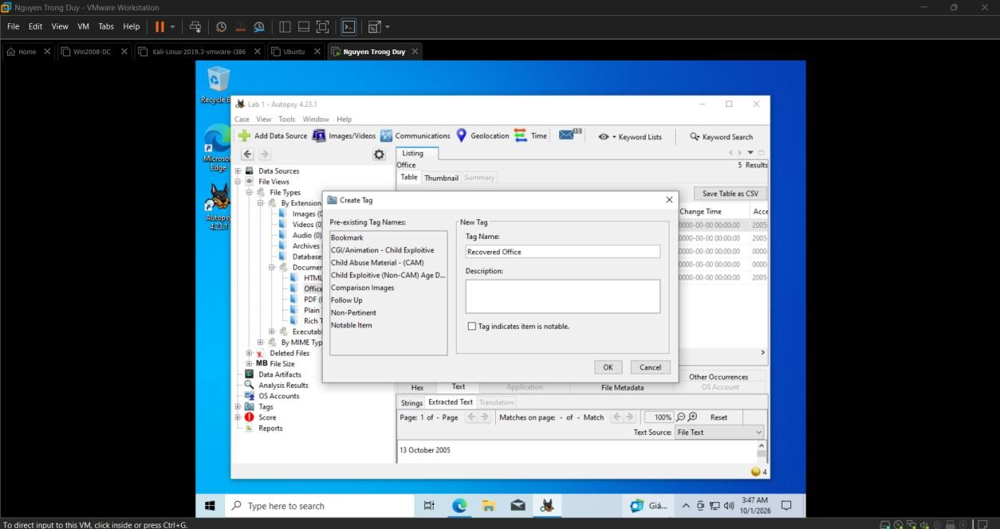
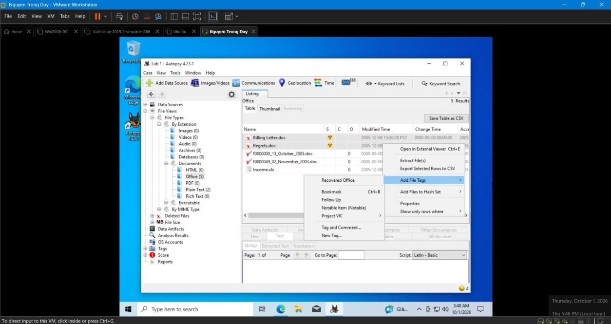
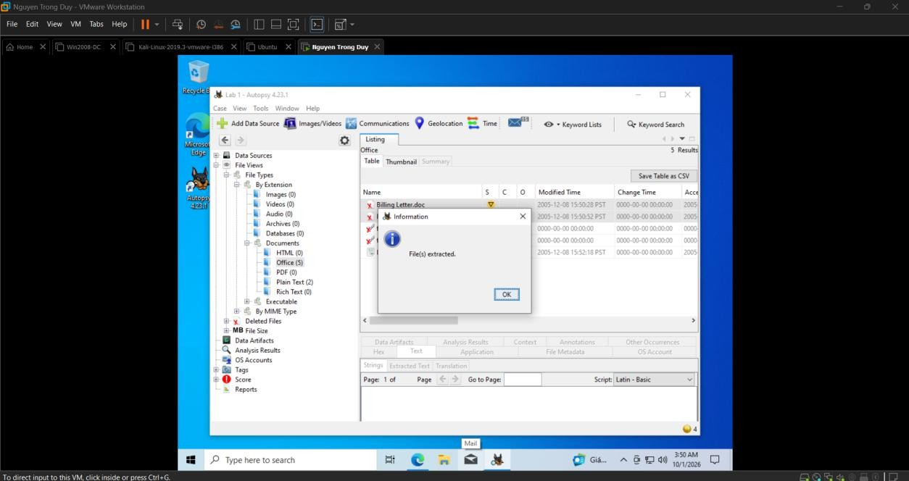
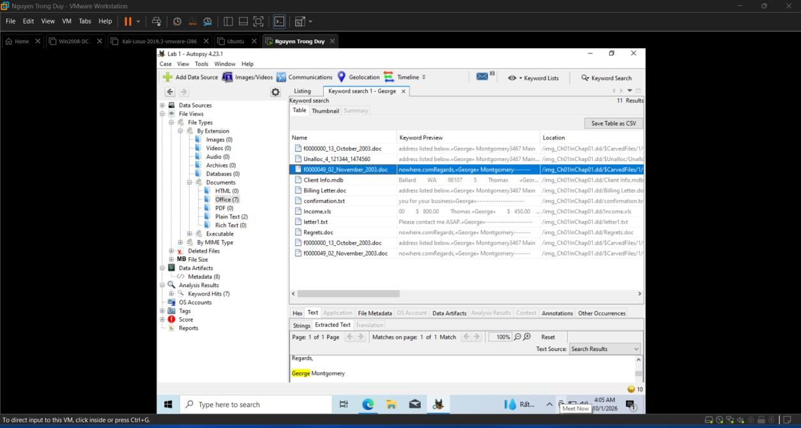
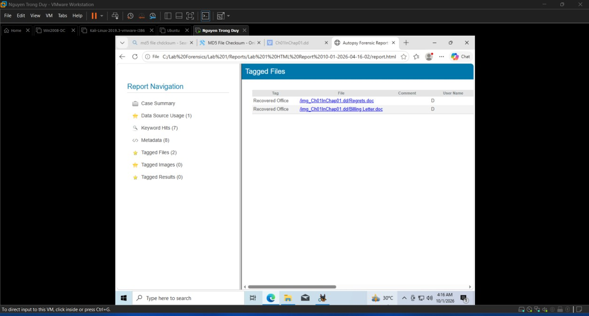

# Lab 01: Digital Forensics Case Management & Evidence Triage with Autopsy
### *Quản lý Hồ sơ Điều tra & Phân tích Bằng chứng Số với Autopsy*

[⬅️ Back to Main DFIR Casebook](../../README.md)

---

## 📌 Quick Metadata

| Field | Description |
| :--- | :--- |
| **Forensic Environment** | `Kali Linux 2025.4 / 2026.3 (64-bit)` on `VMware Workstation Pro` (Host: `Windows 11`) |
| **Forensic Module** | `01-Disk-and-FileSystem-Forensics` |
| **Target Dataset / Evidence** | `Ch01InChap01.dd (FAT12 Disk Image, 1.44 MB)` |
| **Core Forensic Toolstack** | `Autopsy 4.21.0, MD5/SHA-1 Hash Verifier, Keyword Search & File Tagging` |
| **MITRE ATT&CK / DFIR Focus** | `Forensic Case Management, Chain of Custody Verification, Deleted Artifact Triage` |

---

## 1. Tổng quan & Bối cảnh Điều tra (Overview & Objectives)

### 1.1. Bối cảnh và Mục tiêu

[Trong bài lab này, tiến hành thực hiện điều tra một USB drive thuộc sở hữu của George Montgomery. Nhiệm vụ là khôi phục các file Word, hình ảnh và tìm kiếm từ khóa bằng phần mềm Autopsy. Mục tiêu chính là làm quen với quy trình điều tra số cơ bản: tạo case, thêm dữ liệu, khôi phục file đã xóa, gắn tag và xuất báo cáo.]

### 1.2. Môi trường và Công cụ Thực hành

| Thành phần | Tên / Phiên bản | Ghi chú (cấu hình, nguồn tải…) |
| --- | --- | --- |
| Máy thật (host) – hệ điều hành | Window 11 |  |
| Phần mềm ảo hoá | VMware |  |
| Máy ảo sử dụng | Window 10 |  |
| Công cụ điều tra 1 | Autopsy 4.x |  |
| Công cụ điều tra 2 | MD5 Online Tool | Kiểm tra hash |

### 1.3. Dữ liệu Bằng chứng & Kiểm tra Tính toàn vẹn (Hash Verification)

| Tên file / nguồn dữ liệu | Thuật toán | Hash trước phân tích | Hash sau phân tích | Khớp? |
| --- | --- | --- | --- | --- |
| Ch01InChap01.dd | MD5 | a117773bcf1fc88ec0ab8e0a349fbbcb | a117773bcf1fc88ec0ab8e0a349fbbcb | Có |
|  | SHA-1 |  | Không áp dụng |  |

Giá trị tham chiếu (theo tài liệu lab, nếu có): [a117773bcf1fc88ec0ab8e0a349fbbcb]

## 2. Quy trình Điều tra & Thực nghiệm Kỹ thuật (Forensic Investigation Workflow)

### Bước 1. Check hash code online

**a) Mô tả thao tác:** Truy cập trang web https://emm178.github.io/online-tools/md5_checksum.html, tải file Ch01InChap01.dd lên để tính mã MD5.

**b) Câu lệnh / cấu hình đã sử dụng :** Không có

**c) Ảnh minh chứng:**

*Hình 1.1. Giá trị Hash MD5 của file Ch01InChap01.dd*

**d) Kết quả & diễn giải:** Hash MD5 của file là a117773bcf1fc88ec0ab8e0a349fbbcb. Giá trị này dùng để xác minh tính toàn vẹn của bằng chứng, đảm bảo file không bị thay đổi trong quá trình điều tra.

### Bước 2. Create a case and add a Data Source (Disk Image) to Autopsy.

**a) Mô tả thao tác:** Tạo case mới trong Autopsy với Case Name là Lab 1, Base Directory chọn thư mục lưu, Case Type chọn Single-User. Điền Optional Information gồm Case Number Lab-1, Examiner Name : Duy, Phone : 123456789, Email : nguyentrongduy@gmail.com, Notes This is lab 1. Nhấn Finish. Sau khi tạo case, thêm Data Source. Chọn Generate new host name based on data source name. Chọn loại Disk Image or VM File. Browse đến file Ch01InChap01.dd, chọn time zone GMT+7 Asia/Bangkok. Giữ nguyên các module ingest mặc định. Nhấn Finish để bắt đầu ingest dữ liệu. Sau khi ingest xong, tìm file đã xóa. Trong cây thư mục bên trái, chọn Deleted Files. Autopsy hiển thị danh sách các file đã xóa gồm Billing Letter.doc, Regrets.doc, f000000_13_October_2003.doc, f000049_02_November_2003.doc, Income.xls.

**b) Câu lệnh / cấu hình đã sử dụng :** Không có

**c) Ảnh minh chứng:**

*Hình 2.1. Create a case with name Lab 1*

*Hình 2.2. Details of the case*

*Hình 2.3. Choosing the disk image file and setting the time zone.*

*Hình 2.4. Find deleted files and Tag the file*

**d) Kết quả & diễn giải:** Case Lab1 được tạo thành công. Autopsy ingest dữ liệu từ file image Ch01InChap01.dd. Sau khi hoàn tất, chọn Deleted Files thấy 5 file đã xóa gồm 4 file Word và 1 file Excel. Đây là các bằng chứng tiềm năng cần khôi phục và phân tích ở các bước sau.

### Bước 3. Create a tag for reporting

**a) Mô tả thao tác:** Trong danh sách Deleted Files, click chuột phải vào file Billing Letter.doc, chọn Add File Tag, sau đó chọn New Tag. Trong cửa sổ Create Tag, nhập Tag Name là Recovered office, Description là Recovered office doc. Nhấn OK để tạo tag. Sau đó gắn tag này cho các file đã khôi phục khác như Regrets.doc.

**b) Câu lệnh / cấu hình đã sử dụng :** Không có

**c) Ảnh minh chứng:**

*Hình 3.1. Create Tag window with Tag Name Recovered office*

*Hình 3.2. Add File Tag menu*

**d) Kết quả & diễn giải:** Tag Recovered office được tạo thành công và gắn cho các file đã khôi phục. Việc gắn tag giúp phân loại và đánh dấu các file quan trọng, hỗ trợ quá trình báo cáo và tìm kiếm sau này. Các file được gắn tag sẽ xuất hiện trong phần Tagged Files của báo cáo HTML.

### Bước 4. Extract deleted files and search keywords

**a) Mô tả thao tác:** Trong danh sách Deleted Files, click chuột phải vào file Billing Letter.doc, chọn Extract File. Chọn thư mục lưu file đã khôi phục. Autopsy hiển thị thông báo File(s) extracted. Thực hiện tương tự cho các file Regrets.doc, f000000_13_October_2003.doc, f000049_02_November_2003.doc, Income.xls.

**b) Câu lệnh / cấu hình đã sử dụng :** Không có

**c) Ảnh minh chứng:**

*Hình 4.1. Extract File menu when right-clicking on a deleted file*

*Hình 4.2. Keyword Search results for George Montgomery*

**d) Kết quả & diễn giải:** Các file đã xóa được khôi phục thành công ra thư mục bên ngoài. Điều tra viên có thể mở file để kiểm tra nội dung. Từ khóa George Montgomery xuất hiện trong 11 kết quả, bao gồm các file đã xóa và file khác. Điều này xác nhận mối liên hệ giữa các file với chủ sở hữu USB là George Montgomery. Kết quả tìm kiếm giúp thu hẹp phạm vi bằng chứng cần phân tích.

### Bước 5. Generate Forensic Reports in Autopsy

**a) Mô tả thao tác:** Chọn Generate Report trên thanh công cụ. Trong cửa sổ Generate Report, chọn HTML Report. Nhấn Next và Finish để xuất báo cáo. Mở file báo cáo HTML để xem kết quả.

**b) Câu lệnh / cấu hình đã sử dụng :** Không có

**c) Ảnh minh chứng:**

*Hình 5.1.Tagged Files section in the HTML report.*

**d) Kết quả & diễn giải:** Báo cáo HTML được tạo thành công, chứa danh sách các file đã gắn tag Recovered office như Billing Letter.doc và Regrets.doc. Báo cáo cũng hiển thị kết quả tìm kiếm từ khóa và thông tin case. Đây là sản phẩm cuối cùng của quá trình điều tra, dùng để lưu trữ và trình bày bằng chứng.

## 3. Tổng hợp Kết quả Điều tra (Forensic Findings)

### 3.1. Bảng tổng hợp kết quả điều tra (Forensic Findings Summary)

## 4. Phân tích Chuyên sâu & Giải đáp Kỹ thuật (In-Depth Forensic Analysis)

#### ❓ Câu 1. Tại sao cần kiểm tra hash trước khi phân tích?

**Trả lời:** Trả lời: Kiểm tra hash đảm bảo tính toàn vẹn của bằng chứng. Nếu hash trước và sau phân tích khớp nhau, chứng minh file không bị thay đổi trong quá trình điều tra, đảm bảo giá trị pháp lý của bằng chứng.

#### ❓ Câu 2. Autopsy đã tìm thấy những file đã xóa nào?

**Trả lời:** Autopsy tìm thấy 5 file đã xóa gồm Billing Letter.doc, Regrets.doc, f000000_13_October_2003.doc, f000049_02_November_2003.doc, Income.xls.

#### ❓ Câu 3. Tầm quan trọng của việc gắn tag trong điều tra số ?

**Trả lời:** Gắn tag giúp phân loại và đánh dấu các file quan trọng, hỗ trợ việc báo cáo và tìm kiếm sau này. Tag Recovered office giúp điều tra viên dễ dàng xác định các file Word đã khôi phục.

## 5. Kết luận, Xử lý Sự cố & Bài học Kinh nghiệm (Conclusions & Lessons Learned)

### 5.1. Kết luận Điều tra

Quá trình điều tra đã khôi phục thành công 5 file đã xóa từ USB của George Montgomery, bao gồm các file Word và Excel. Từ khóa George Montgomery xuất hiện trong 11 kết quả, xác nhận mối liên hệ với chủ sở hữu. Báo cáo HTML đã được xuất để lưu trữ kết quả.

### 5.3. Bài học Rút ra (Key Takeaways)

Quá trình điều tra đã nắm được quy trình cơ bản của điều tra số: tạo case, thêm dữ liệu, khôi phục file, gắn tag, tìm kiếm từ khóa và xuất báo cáo. Kỹ năng sử dụng Autopsy là nền tảng quan trọng cho các bài lab tiếp theo.
