# Lab 03: Forensic Bit-Stream USB Image Acquisition & Integrity Verification
### *Thu thập Ảnh đĩa Pháp y (Bit-Stream Acquisition) với FTK Imager & tiện ích dd*

[⬅️ Back to Main DFIR Casebook](../../README.md)

---

## 📌 Quick Metadata

| Field | Description |
| :--- | :--- |
| **Forensic Environment** | `Kali Linux 2025.4 / 2026.3 (64-bit)` on `VMware Workstation Pro` (Host: `Windows 11`) |
| **Forensic Module** | `01-Disk-and-FileSystem-Forensics` |
| **Target Dataset / Evidence** | `Physical USB Storage Media -> Raw (.001 / .dd) Bit-Stream Image` |
| **Core Forensic Toolstack** | `AccessData FTK Imager, Linux dd Utility, fdisk, md5sum, sha1sum` |
| **MITRE ATT&CK / DFIR Focus** | `Forensic Acquisition Standards (ISO/IEC 27037), Cryptographic Chain of Custody` |

---

## 1. Tổng quan & Bối cảnh Điều tra (Overview & Objectives)

### 1.1. Bối cảnh và Mục tiêu

Trong lĩnh vực điều tra số (Digital Forensics), việc thu thập bằng chứng từ các thiết bị lưu trữ ngoại vi như USB là một bước vô cùng quan trọng, bởi thiết bị này thường chứa các dữ liệu nhạy cảm, tệp tin bị xóa hoặc dấu vết hành vi của đối tượng. Nhiệm vụ của điều tra viên là phải tạo ra một bản sao kỹ thuật số (forensic image) hoàn chỉnh của thiết bị để phục vụ quá trình phân tích, đồng thời đảm bảo tuyệt đối không làm thay đổi hay can thiệp vào dữ liệu gốc.

Mục tiêu của bài lab này là giúp sinh viên nắm vững và thực hành thành thạo quy trình thu thập hình ảnh (Image Acquisition) của một thiết bị USB. Thông qua việc sử dụng công cụ FTK Imager để tạo ảnh đĩa vật lý (Physical Drive) với định dạng Raw (dd) và công cụ dòng lệnh dd để sao chép dữ liệu thô, điều tra viên sẽ hiểu rõ cơ chế hoạt động của các công cụ này. Quan trọng nhất, bài lab nhấn mạnh việc kiểm tra mã băm (MD5 và SHA-1) trước và sau khi thu thập nhằm chứng minh tính toàn vẹn của bằng chứng số (Chain of Custody).

### 1.2. Môi trường và Công cụ Thực hành

| Thành phần | Tên / Phiên bản | Ghi chú (cấu hình, nguồn tải…) |
| --- | --- | --- |
| Máy thật (host) – hệ điều hành | Windows 11 Home (6.3.26200) | CPU: 13th Gen Intel Core i7-1355U, RAM: 16 GB |
| Phần mềm ảo hoá | Không có |  |
| Máy ảo sử dụng | Không có |  |
| Công cụ điều tra 1 | Exterro FTK Imager 8.3.0.27 | Công cụ tạo ảnh đĩa chuyên dụng cho Windows |
| Công cụ điều tra 2 | dd utility cho Windows (v0.5) | Công cụ dòng lệnh mã nguồn mở để sao chép dữ liệu thô |

### 1.3. Dữ liệu Bằng chứng & Kiểm tra Tính toàn vẹn (Hash Verification)

| Tên file / nguồn dữ liệu | Thuật toán | Hash trước phân tích | Hash sau phân tích | Khớp? |
| --- | --- | --- | --- | --- |
| usb_image.001 | MD5 | d3b945efe4a8c726c718c681bd4aa8e7 | d3b945efe4a8c726c718c681bd4aa8e7 | ☑ Có ☐ Không |
|  | SHA-1 | 69225b75ed2079a057363f396147f334853cdd98 | 69225b75ed2079a057363f396147f334853cdd98 | ☑  Có  ☐ Không |
|  |  |  |  | ☐ Có  ☐ Không |

Giá trị tham chiếu (theo tài liệu lab, nếu có): [...]

## 2. Quy trình Điều tra & Thực nghiệm Kỹ thuật (Forensic Investigation Workflow)

### Bước 1. Cài đặt FTK Imager

**a) Mô tả thao tác:**  Điều tra viên truy cập trang chủ của AccessData để tải xuống phiên bản FTK Imager 4.5. Sau khi tải về, tiến hành cài đặt phần mềm trên máy tính Windows (Host).

**b) Câu lệnh / cấu hình đã sử dụng (Không có (Thao tác đồ họa).):**

```bash
Không có (Thao tác đồ họa).
```

**c) Ảnh minh chứng:**

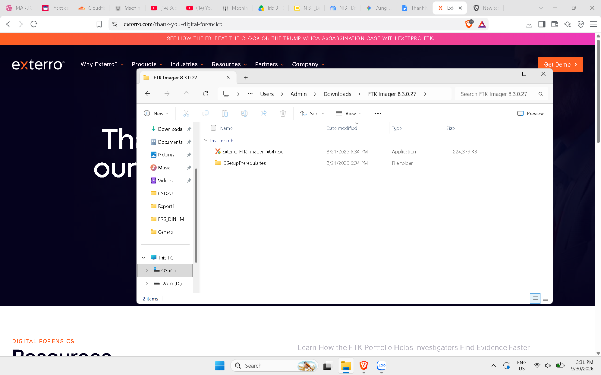

*Hình 1.1. Trang tải xuống FTK Imager 4.5 từ AccessData.*

**d) Kết quả & diễn giải:** Cài đặt thành công FTK Imager. Đây là công cụ chuyên dụng giúp tạo bản sao kỹ thuật số (forensic image) của thiết bị lưu trữ, đảm bảo không làm thay đổi dữ liệu gốc.

### Bước 2. Kết nối USB và kiểm tra

**a) Mô tả thao tác:** Cắm USB Flash Drive vào cổng USB của máy tính. Copy một vài tệp tin bất kỳ vào USB để làm dữ liệu mẫu. Mở "This PC" để kiểm tra xem hệ điều hành đã nhận diện USB chưa.

**b) Câu lệnh / cấu hình đã sử dụng (Không có (Thao tác đồ họa).):**

```bash
Không có (Thao tác đồ họa).
```

**c) Ảnh minh chứng:**

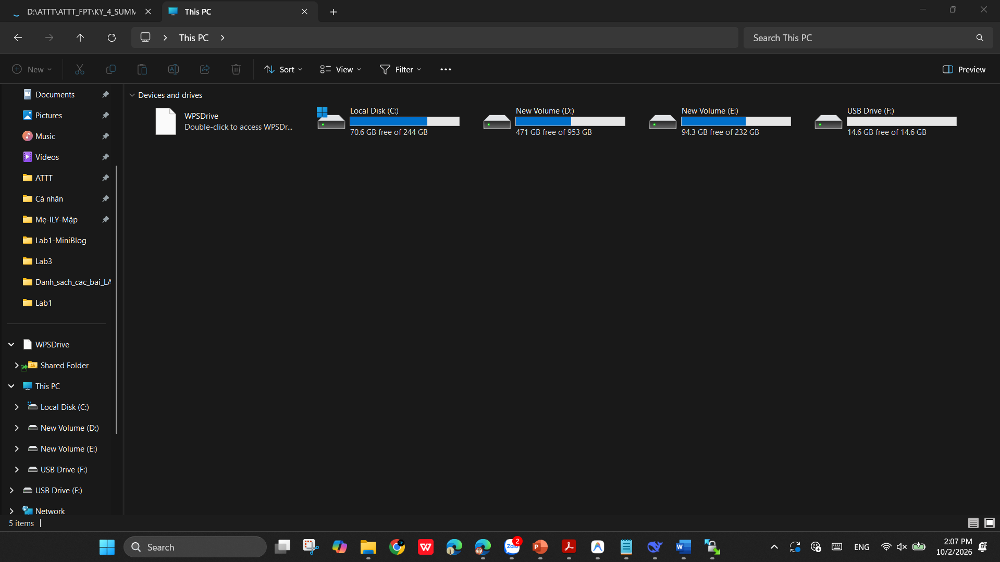

*Hình 2.1. ESD_ISO (F:) được nhận diện với dung lượng trống*

**d) Kết quả & diễn giải:** Máy tính đã nhận diện USB là ổ đĩa F: với dung lượng 57.7 GB. Việc kiểm tra này đảm bảo thiết bị hoạt động bình thường trước khi tiến hành thu thập dữ liệu pháp y.

### Bước 3. Thu thập hình ảnh USB bằng FTK Imager

**a) Mô tả thao tác:** Mở FTK Imager. Chọn File -> Create Disk Image.... Tại hộp thoại "Select Source", chọn Physical Drive. Chọn ổ đĩa USB từ danh sách (Kingston DataTraveler 3.0). Nhấn Finish. Tại hộp thoại "Create Image", nhấn Add... để chọn đích lưu file. Chọn định dạng Raw (dd). Đặt tên file là usb_image và chọn thư mục lưu tại C:\Users\Admin\Desktop\Forensic_Working_Space\. Nhấn Start để bắt đầu quá trình tạo ảnh. Nhập thông tin Case Number: FSCS727-001, Evidence Number: EV-001, Examiner: Frank Xu.

**b) Câu lệnh / cấu hình đã sử dụng (Không có lệnh (Thao tác bằng đồ họa).):**

```bash
Không có lệnh (Thao tác bằng đồ họa)
```

**c) Ảnh minh chứng:**

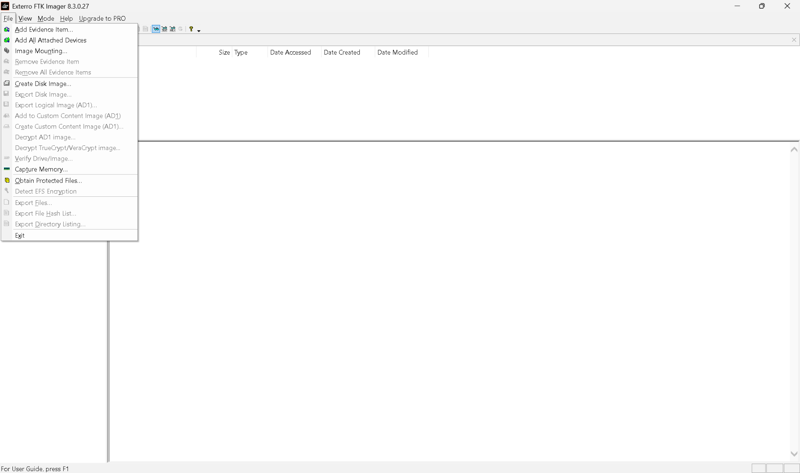

*Hình 3.1. Chọn Source Evidence Type là Physical Drive.*

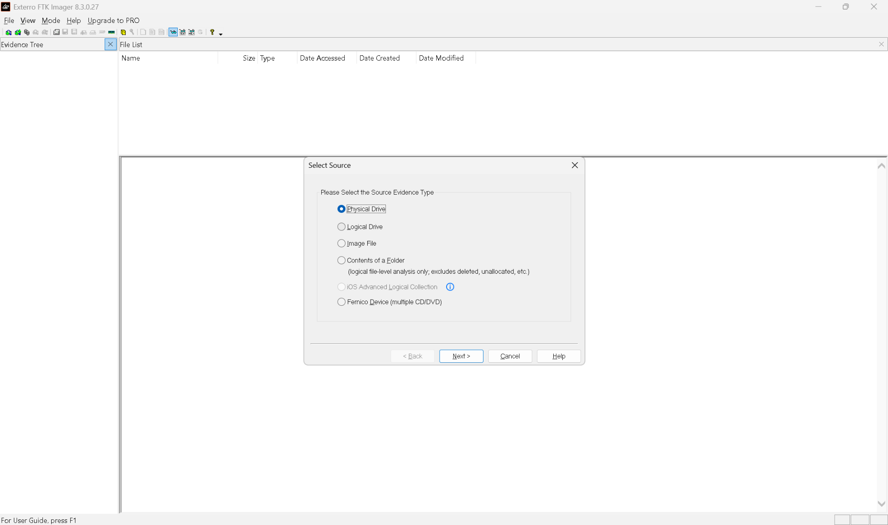

*Hình 3.2. Chọn USB Drive từ danh sách.*

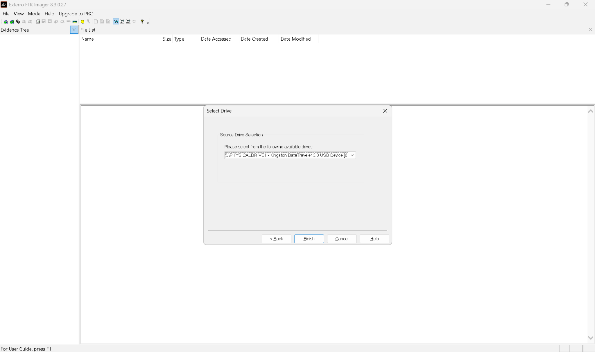

*Hình 3.2. Chọn USB Drive từ danh sách.*

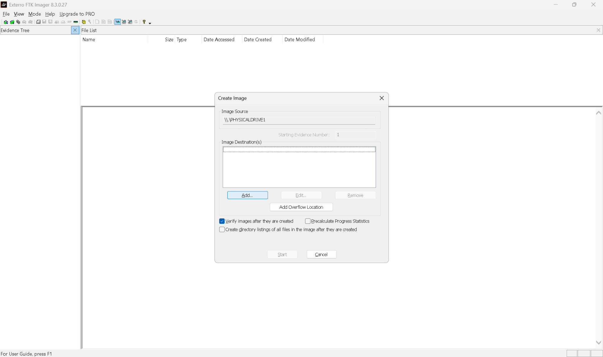

*Hình 3.3. Chọn USB Drive từ danh sách.*

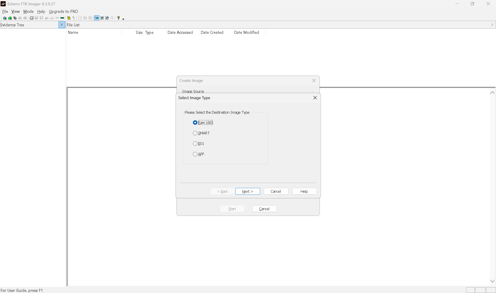

*Hình 3.4. Chọn định dạng ảnh đích là Raw (dd).*

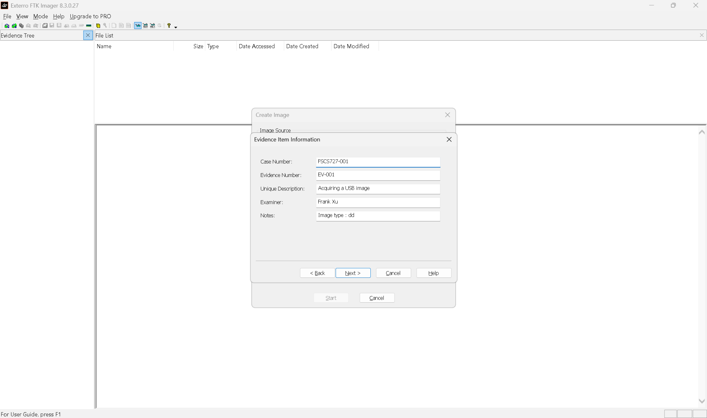

*Hình 3.5. Kiểm tra thông tin file*


*Hình 3.6. Lưu thông tin tại folder”Forensic_Working_Space” đã tạo*

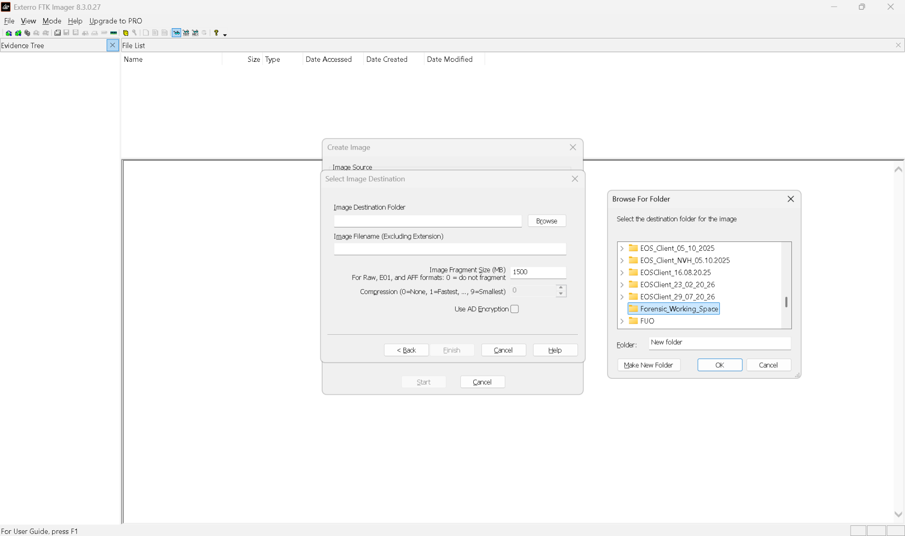

*Hình 3.6. Lưu thông tin tại folder”Forensic_Working_Space” đã tạo*

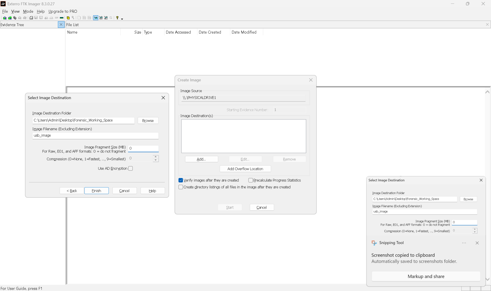

*Hình 3.7. Điền thông tin và kiểm tra thư mục*


*Hình 3.8. Xác nhận thông tin trước khi quá trình tạo ảnh diễn ra*

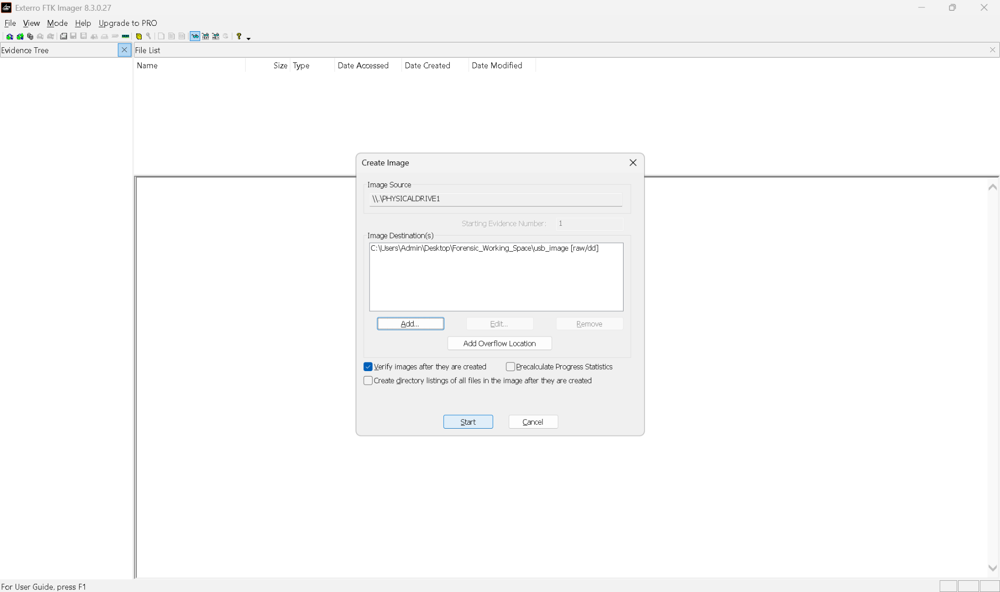

*Hình 3.8. Xác nhận thông tin trước khi quá trình tạo ảnh diễn ra*

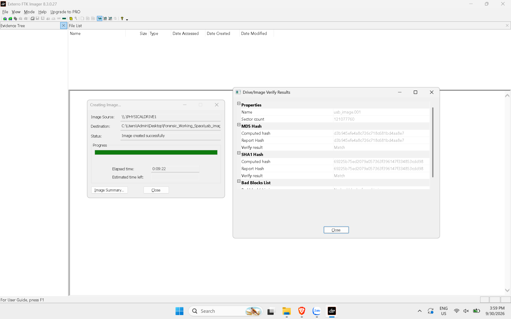

*Hình 3.9. Quá trình tạo ảnh đang diễn ra.*

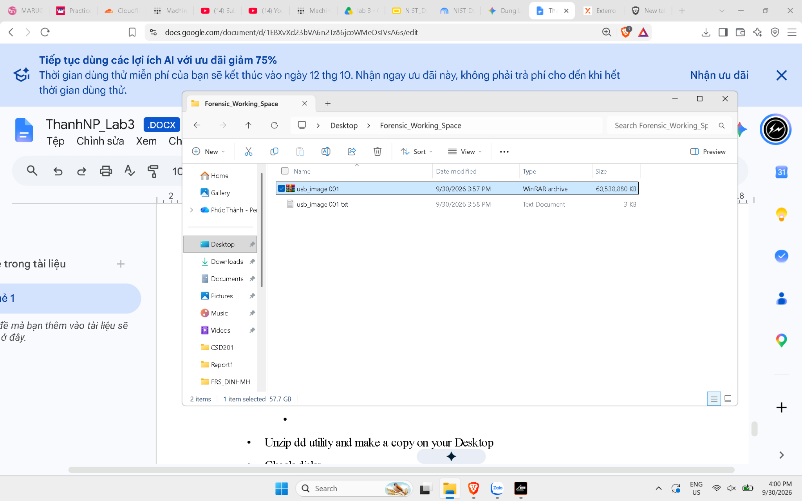

*Hình 3.9. Kết quả xác minh Drive/Image Verify Results (MD5 và SHA1 khớp).*

**d) Kết quả & diễn giải:** FTK Imager đã tạo thành công file usb_image.001 với dung lượng 59120 MB và file text usb_image.001.txt. Quá trình xác minh mã băm (Hash Verification) đã thành công, chứng minh bản sao hình ảnh hoàn toàn giống với dữ liệu gốc trên USB, đảm bảo tính toàn vẹn của bằng chứng.

### Bước 4. Thu thập hình ảnh USB bằng dd utility

**a) Mô tả thao tác:** Giải nén công cụ dd và sao chép vào Desktop. Mở Command Prompt (CMD). Di chuyển đến thư mục chứa dd. Chạy lệnh dd --list để liệt kê các ổ đĩa khả dụng. Xác định đường dẫn Volume của USB. Chạy lệnh dd để sao chép dữ liệu thô từ USB sang ổ C.

b) Câu lệnh / cấu hình đã sử dụng ().

```bash
cd C:\Users\Admin\Desktop\dd-0.5
dd --list
dd if=\\.\Volume{6d634efd-0000-0000-0000-501f00000000} of=c:\usb.img
```

**c) Ảnh minh chứng:**

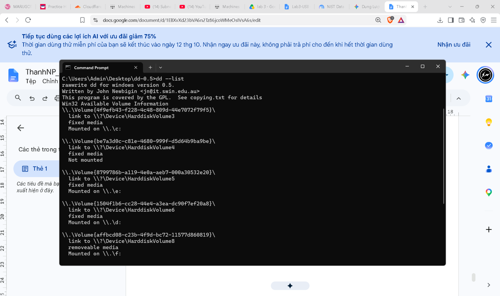

*Hình 4.1. Kết quả lệnh dd --list hiển thị danh sách các ổ đĩa*

- Quá trình sao chép dữ liệu bằng lệnh dd.

**d) Kết quả & diễn giải:** Lệnh dd --list đã liệt kê thành công các ổ đĩa. Lệnh dd đã sao chép thành công dữ liệu từ USB sang file c:\usb.img. Đây là phương pháp thu thập dữ liệu cấp thấp (low-level) thay thế cho FTK Imager, thường được sử dụng trong môi trường Linux hoặc khi cần tự động hóa.

## 3. Tổng hợp Kết quả Điều tra (Forensic Findings)

### 3.1. Bảng tổng hợp kết quả điều tra (Forensic Findings Summary)

## 4. Phân tích Chuyên sâu & Giải đáp Kỹ thuật (In-Depth Forensic Analysis)

#### ❓ Câu 1. Sự khác biệt giữa việc thu thập ảnh đĩa vật lý (Physical Drive) và ảnh đĩa logic (Logical Drive) là gì?

**Trả lời:** Thu thập ảnh đĩa vật lý (Physical Drive) sẽ sao chép toàn bộ cấu trúc của thiết bị lưu trữ, bao gồm cả các phân vùng, vùng chưa cấp phát (unallocated space), và các tệp tin đã bị xóa. Trong khi đó, ảnh đĩa logic (Logical Drive) chỉ sao chép dữ liệu trong một phân vùng cụ thể (ví dụ ổ C:), bỏ qua vùng chưa cấp phát. Trong điều tra số, ảnh đĩa vật lý được ưu tiên vì nó bảo toàn được nhiều bằng chứng ẩn hơn.

#### ❓ Câu 2. Tại sao việc kiểm tra mã băm (Hash Verification) lại quan trọng trong quy trình thu thập bằng chứng?

**Trả lời:** Mã băm (MD5, SHA-1) hoạt động như một "dấu vân tay" kỹ thuật số của dữ liệu. Việc kiểm tra mã băm trước và sau khi tạo ảnh giúp chứng minh rằng bản sao (image) hoàn toàn giống với dữ liệu gốc trên USB, không bị thay đổi, mất mát hay can thiệp trong quá trình thu thập. Điều này đảm bảo tính toàn vẹn của bằng chứng (Chain of Custody) trước tòa án.

#### ❓ Câu 3. So sánh ưu nhược điểm của việc thu thập ảnh bằng FTK Imager và bằng công cụ dd?

**Trả lời:** FTK Imager: Ưu điểm là giao diện đồ họa thân thiện, tự động tính toán và xác minh mã hash, hỗ trợ nhiều định dạng ảnh (E01, SMART, AFF). Nhược điểm là yêu cầu cài đặt phần mềm và có thể chạy chậm hơn trên các hệ thống cũ.

dd utility: Ưu điểm là công cụ dòng lệnh nhẹ, có sẵn trên hầu hết các hệ điều hành Unix/Linux, tốc độ nhanh, linh hoạt. Nhược điểm là không có giao diện đồ họa, đòi hỏi người dùng phải nhớ cú pháp chính xác, và không tự động xác minh hash (phải dùng lệnh riêng).

## 5. Kết luận, Xử lý Sự cố & Bài học Kinh nghiệm (Conclusions & Lessons Learned)

### 5.1. Kết luận Điều tra

Đã thực hiện thành công quy trình thu thập hình ảnh (Image Acquisition) của một thiết bị USB Kingston DataTraveler 3.0 (59GB). Bằng cách sử dụng FTK Imager 8.3.0.27, quá trình điều tra đã tạo ra bản sao kỹ thuật số usb_image.001 với định dạng Raw (dd). Kết quả kiểm tra mã băm MD5 (d3b945efe4a8c726c718c681bd4aa8e7) và SHA-1 (69225b75ed2079a057363f396147f334853cdd98) cho thấy bản sao hoàn toàn khớp với dữ liệu gốc, đảm bảo tính toàn vẹn của bằng chứng. Điều tra viên cũng đã thực hành thành công việc thu thập dữ liệu bằng công cụ dòng lệnh dd, tạo ra file usb.img. Bài lab giúp điều tra viên hiểu rõ tầm quan trọng của việc bảo toàn dữ liệu gốc và quy trình làm việc chuẩn trong điều tra số.

### 5.2. Nhật ký Xử lý Sự cố Kỹ thuật (Troubleshooting Log)

| STT | Khó khăn / lỗi gặp phải | Giải pháp xử lý kỹ thuật |
| --- | --- | --- |
| 1 | Không xác định được đường dẫn Volume của USB khi dùng dd --list | Quá trình điều tra đã đối chiếu dung lượng ổ đĩa và thử nghiệm trên từng Volume để tìm ra đúng đường dẫn của USB. |
| 2 | Quá trình tạo ảnh bằng FTK Imager mất nhiều thời gian | Quá trình điều tra đã kiên nhẫn chờ đợi và không ngắt quãng để đảm bảo quá trình tạo ảnh và xác minh hash hoàn tất. |
| 3 | File log của FTK Imager bị nhầm định dạng | Quá trình điều tra đã kiểm tra kỹ thư mục đầu ra và xác nhận file text được tạo tự động cùng tên với file ảnh. |

### 5.3. Bài học Rút ra (Key Takeaways)

Qua bài lab này, quá trình điều tra đã rút ra được các bài học quan trọng:

Hiểu rõ quy trình thu thập bằng chứng số từ thiết bị lưu trữ ngoại vi.

Biết cách sử dụng thành thạo FTK Imager và công cụ dòng lệnh dd.

Nhận thức được tầm quan trọng của việc kiểm tra mã băm (Hash) để đảm bảo tính toàn vẹn của bằng chứng.

Kỹ năng làm việc điều tra viên, phân chia công việc và tổng hợp báo cáo hiệu quả.

## 6. Tài liệu Tham khảo (References)

[1] Tài liệu hướng dẫn thực hành Lab 3: USB_Image_Acquisition, môn FRS301, Trường Đại học FPT.

[2] AccessData, "FTK Imager User Guide", AccessData Group.

[2] John Newbigin, "dd for Windows version 0.5", Chrysocome.net.
