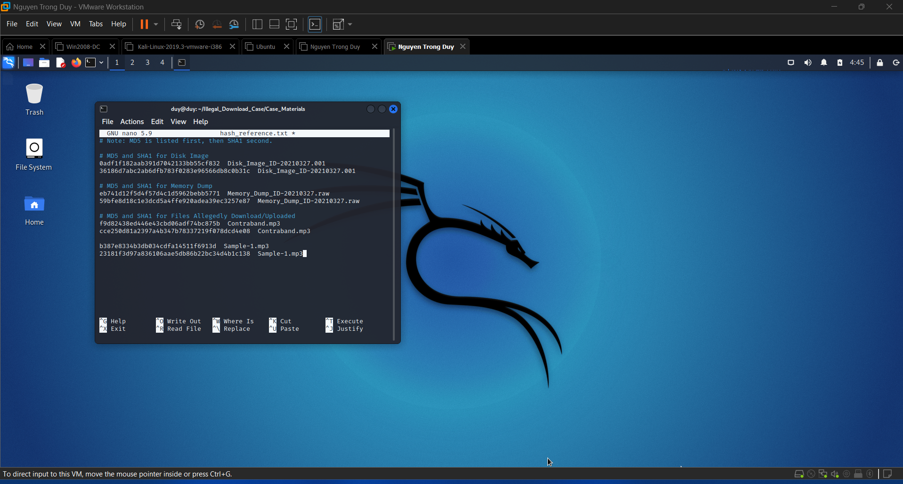
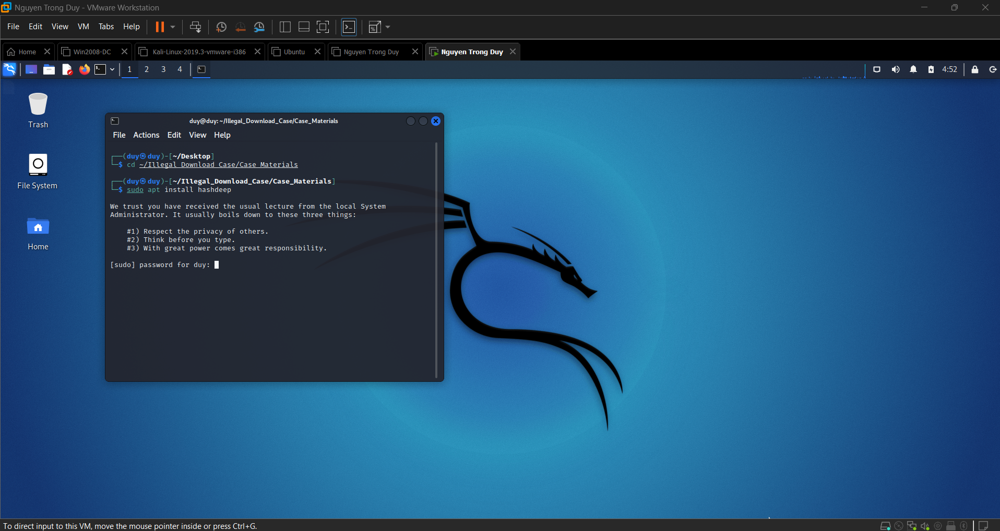
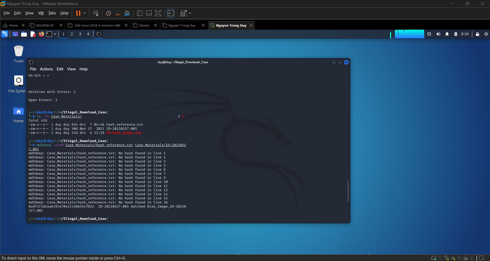
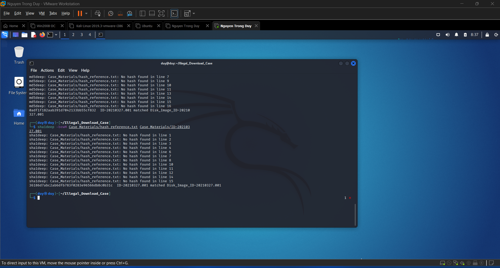
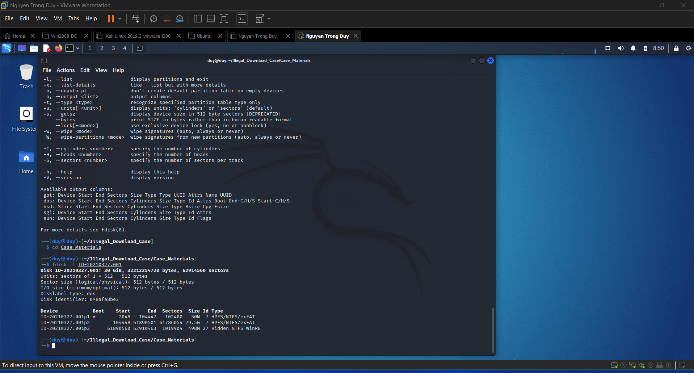
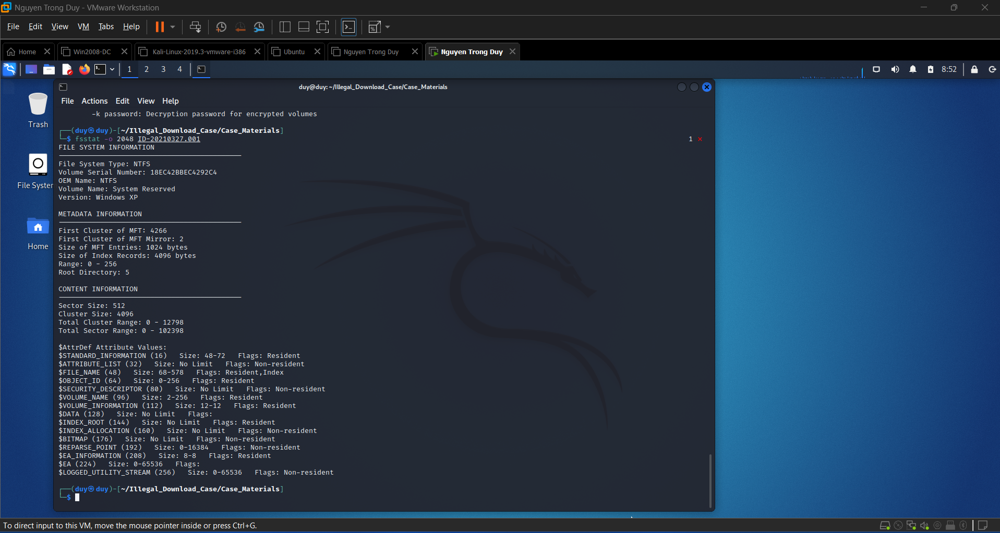
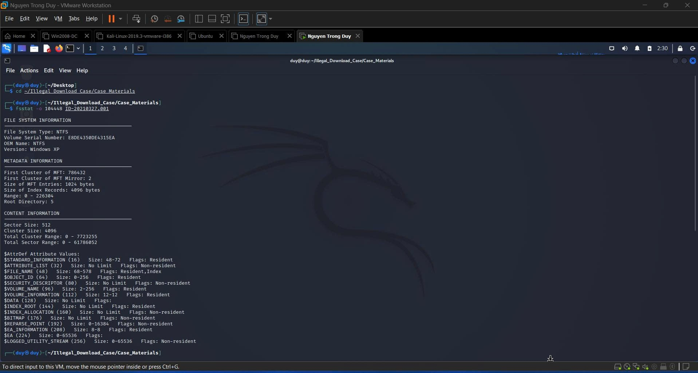
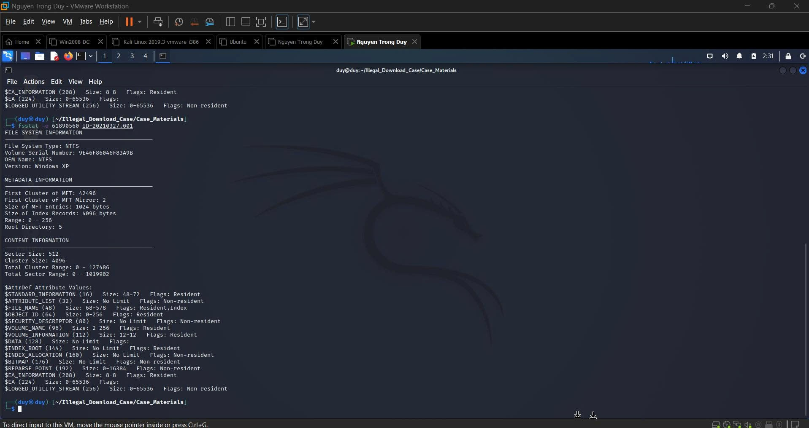

# Lab 04: Disk Image Geometry, MBR/GPT Partition Table & Volume Analysis
### *Phân tích Cấu trúc Ảnh đĩa, Bảng Phân vùng (Partition Table) & Hệ điều hành*

[⬅️ Back to Main DFIR Casebook](../../README.md)

---

## 📌 Quick Metadata

| Field | Description |
| :--- | :--- |
| **Forensic Environment** | `Kali Linux 2025.4 / 2026.3 (64-bit)` on `VMware Workstation Pro` (Host: `Windows 11`) |
| **Forensic Module** | `01-Disk-and-FileSystem-Forensics` |
| **Target Dataset / Evidence** | `cfreds_2015_data_leakage_pc.dd (20 GB Raw PC Image)` |
| **Core Forensic Toolstack** | `The Sleuth Kit (mmls, fsstat, fls), fdisk, md5sum, sha1sum` |
| **MITRE ATT&CK / DFIR Focus** | `Storage Volume Geometry, NTFS Partition Offset Calculation (Sector 2048 & 206848)` |

---

## 1. Tổng quan & Bối cảnh Điều tra (Overview & Objectives)

### 1.1. Bối cảnh và Mục tiêu

Trong bài lab này, tiến hành thực hiện điều tra một vụ án liên quan đến hành vi tải xuống bất hợp pháp ("Illegal Download Case"). Nhiệm vụ của điều tra viên là xác minh tính toàn vẹn của ảnh đĩa (disk image), xác định hệ điều hành, tên hệ thống, tài khoản và các phân vùng trên ảnh đĩa. Mục tiêu chính bao gồm: (1) kiểm tra hash MD5/SHA1 của ảnh đĩa so với giá trị tham chiếu, (2) sử dụng fdisk để xem bảng phân vùng, (3) sử dụng fsstat để xác định loại file system và serial number của từng phân vùng.

### 1.2. Môi trường và Công cụ Thực hành

| Thành phần | Tên / Phiên bản | Ghi chú (cấu hình, nguồn tải…) |
| --- | --- | --- |
| Máy thật (host) – hệ điều hành | Windows 11 |  |
| Phần mềm ảo hoá | VMWare |  |
| Máy ảo sử dụng | Kali Linux 2025.4 / 2026.3 (64-bit) | Cấu hình RAM 4GB, ổ cứng 80GB trên VMware Workstation Pro |
| Công cụ điều tra 1 | hashdeep / md5deep / sha1deep | Cài bằng sudo apt install hashdeep |
| Công cụ điều tra 2 | fdisk, fsstat | Có sẵn trên Kali |

### 1.3. Dữ liệu Bằng chứng & Kiểm tra Tính toàn vẹn (Hash Verification)

| Tên file / nguồn dữ liệu | Thuật toán | Hash trước phân tích | Hash sau phân tích | Khớp? |
| --- | --- | --- | --- | --- |
| Disk_Image_ID-20210327.001 | MD5 | 0ad1f182ab3181b702423305b5cfe832 | 0ad1f182ab3181b702423305b5cfe832 | ☑ Có |
| Disk_Image_ID-20210327.001 | SHA-1 | 36186d7abc2a6bfd783f0283e96566db8c0b31c | 36186d7abc2a6bfd783f0283e96566db8c0b31c | ☑ Có |

Giá trị tham chiếu (theo tài liệu lab, nếu có):

MD5: 0ad1f182ab3181b702423305b5cfe832

SHA1: 36186d7abc2a6bfd783f0283e96566db8c0b31c

## 2. Quy trình Điều tra & Thực nghiệm Kỹ thuật (Forensic Investigation Workflow)

### Bước 1. Verify the integrity of the disk image

**a) Mô tả thao tác:** Tạo folder lab Illegal_Download_Case trong /home, tạo folder Case_Materials, tải disk image bằng wget, tạo file hash_reference.txt bằng nano để lưu giá trị hash tham chiếu, cài đặt hashdeep/md5deep/sha1deep.

**b) Câu lệnh / cấu hình đã sử dụng :**

```bash
mkdir Illegal_Download_Case
cd Illegal_Download_Case
pwd
mkdir Case_Materials
cd Case_Materials
wget -q https://www.dropbox.com/s/1fop1ooadb2yshu/Disk_Image_ID-20210327.001
nano hash_reference.txt
sudo apt install hashdeep
```

**c) Ảnh minh chứng:**



*Hình 1.1. Tạo file hash_reference.txt bằng Nano để lưu giá trị hash tham chiếu*



*Hình 1.2. Cài đặt công cụ hashdeep bằng lệnh sudo apt install hashdeep*

**d) Kết quả & diễn giải:** Quá trình điều tra đã tạo xong thư mục làm việc Illegal_Download_Case/Case_Materials, tải thành công disk image 30GB, tạo file hash_reference.txt chứa giá trị MD5/SHA1 tham chiếu và cài đặt thành công công cụ hashdeep. Đây là bước chuẩn bị bắt buộc để phục vụ xác minh tính toàn vẹn bằng chứng ở bước sau. Không có bất thường.

### Bước 2. Generate MD5 and SHA1 hash of the disk image

**a) Mô tả thao tác:** Di chuyển vào folder lab, sử dụng md5deep và sha1deep để tính hash của disk image và so sánh với giá trị trong hash_reference.txt

**b) Câu lệnh / cấu hình đã sử dụng :**

```bash
cd Illegal_Download_Case
md5deep Case_Materials/Disk_Image_ID-20210327.001 -bewM Case_Materials/hash_reference.txt
sha1deep Case_Materials/Disk_Image_ID-20210327.001 -bewM Case_Materials/hash_reference.txt
```

**c) Ảnh minh chứng:**



*Hình 2.1. Chạy md5deep — kết quả matched*



*Hình 2.1. Chạy sha1deep— kết quả matched*

**d) Kết quả & diễn giải:** MD5 và SHA1 của disk image khớp với giá trị trong hash_reference.txt. Điều này chứng minh ảnh đĩa không bị thay đổi trong quá trình tải và lưu trữ, đảm bảo tính toàn vẹn của bằng chứng.

### Bước 3. Identify the OS, name, accounts, and partitions

**a) Mô tả thao tác:** Sử dụng fdisk -l để xem bảng phân vùng của disk image. Sau đó dùng fsstat với offset tương ứng để xác định file system, serial number của từng phân vùng.

**b) Câu lệnh / cấu hình đã sử dụng:**

```bash
cd Case_Materials
fdisk -l Disk_Image_ID-20210327.001
fsstat -o 2048 Disk_Image_ID-20210327.001
fsstat -o 104448 Disk_Image_ID-20210327.001
fsstat -o 61890560 Disk_Image_ID-20210327.001
```

**c) Ảnh minh chứng:**



*Hình 3.1. Chạy fdisk -l để xem bảng phân vùng của disk image*



*Hình 3.2. Chạy fsstat -o 2048 để xem thông tin file system của Partition 1*



*Hình 3.3. Chạy fsstat -o 104448 để xem thông tin file system của Partition 2*



*Hình 3.4. Chạy fsstat -o 61890560 để xem thông tin file system của Partition 3*

**d) Kết quả & diễn giải:** fdisk -l cho thấy disk image có 3 phân vùng NTFS: Partition 1 (System Reserved, 50MB, bootable), Partition 2 (29.5GB), Partition 3 (498MB, Hidden NTFS WinRe). fsstat xác định hệ điều hành là Windows XP, với serial number lần lượt là 18EC42BBEC4292C4, E8DE4350DE4315EA và 9E46F86046F83A9B. Các offset này là cơ sở để truy cập đúng phân vùng khi phân tích sâu. Không có bất thường.

## 3. Tổng hợp Kết quả Điều tra (Forensic Findings)

### 3.1. Bảng tổng hợp kết quả điều tra (Forensic Findings Summary)

| STT | Hạng mục | Đối tượng / Giá trị | Mô tả |
| --- | --- | --- | --- |
| 1 | Disk Image | Disk_Image_ID-20210327.001 | 30 GiB, 62914560 sectors, disk identifier 0x8afa8be3 |
| 2 | MD5 | 0ad1f182ab3181b702423305b5cfe832 | Khớp với hash tham chiếu trong hash_reference.txt |
| 3 | SHA1 | 36186d7abc2a6bfd783f0283e96566db8c0b31c | Khớp với hash tham chiếu trong hash_reference.txt |
| 4 | Partition 1 | System Reserved, NTFS, 50MB, Boot | Start 2048, End 104447, Sectors 102400, Serial 18EC42BBEC4292C4 |
| 5 | Partition 2 | NTFS, 29.5GB | Start 104448, end 61890501, serial E8DE4350DE4315EA |
| 6 | Partition 3 | Hidden NTFS WinRe, 498MB | Start 61890560, end 62910463, serial 9E46F86046F83A9B |

## 4. Phân tích Chuyên sâu & Giải đáp Kỹ thuật (In-Depth Forensic Analysis)

#### ❓ Câu 1. Phân vùng nào là phân vùng boot? Vì sao?

**Trả lời:** Partition 1 (System Reserved) là phân vùng boot vì có flag Boot trong bảng phân vùng. Đây là phân vùng BIOS dùng để khởi động hệ điều hành.

#### ❓ Câu 2. Mục đích của việc xác minh hash của disk image là gì?

**Trả lời:** Đảm bảo tính toàn vẹn bằng chứng theo chain of custody. Hash khớp chứng tỏ disk image không bị thay đổi trong quá trình tải và xử lý, đảm bảo giá trị pháp lý.

#### ❓ Câu 3. fdisk và fsstat cung cấp những thông tin gì?

**Trả lời:** fdisk cung cấp bảng phân vùng (thứ tự, boot, start/end, sectors, size, file system). fsstat cung cấp chi tiết file system (loại, serial number, OEM name, volume name, hệ điều hành).

## 5. Kết luận, Xử lý Sự cố & Bài học Kinh nghiệm (Conclusions & Lessons Learned)

### 5.1. Kết luận Điều tra

Quá trình điều tra đã xác minh thành công tính toàn vẹn của disk image trong vụ án Illegal Download Case với cả MD5 và SHA1 đều khớp giá trị tham chiếu. Qua phân tích bằng fdisk và fsstat, xác định disk image chứa hệ điều hành Windows XP với 3 phân vùng NTFS: Partition 1 (System Reserved, 50MB, bootable), Partition 2 (29.5GB) và Partition 3 (498MB, Hidden NTFS WinRe). Đây là bước đầu tiên trong quy trình điều tra, tạo cơ sở để phân tích sâu nội dung các file bị tải xuống bất hợp pháp ở các bước tiếp theo.

### 5.3. Bài học Rút ra (Key Takeaways)

Điều tra viên hiểu được tầm quan trọng của xác minh hash trong điều tra số và quy trình chain of custody. Biết cách dùng fdisk và fsstat để phân tích cấu trúc phân vùng và file system. Đây là kỹ năng cần thiết cho công việc điều tra số thực tế.

## 6. Tài liệu Tham khảo (References)

Sleuth Kit – fsstat https://www.sleuthkit.org/sleuthkit/man/fsstat.html
