# Lab 13: Multi-Layer File System Forensics & Unmounted File Recovery with The Sleuth Kit (TSK)
### *Phân tích Phân tầng Hệ thống Tệp FAT12 & Khôi phục Tệp Xóa Không cần Mount với The Sleuth Kit*

[⬅️ Back to Main DFIR Casebook](../../README.md)

---

## 📌 Quick Metadata

| Field | Description |
| :--- | :--- |
| **Forensic Environment** | `Kali Linux 2025.4 / 2026.3 (64-bit)` on `VMware Workstation Pro` (Host: `Windows 11`) |
| **Forensic Module** | `01-Disk-and-FileSystem-Forensics` |
| **Target Dataset / Evidence** | `Ch01InChap01.dd (1.44 MB FAT12 Superfloppy Disk Image, MD5: a117773bfc1f8ce8c0ab8e0a349fbbcb)` |
| **Core Forensic Toolstack** | `The Sleuth Kit (img_stat, mmls, fsstat, fls, istat, dstat, dls, dcat, icat), strings, md5sum` |
| **MITRE ATT&CK / DFIR Focus** | `Non-Invasive Forensic File Recovery, Unallocated Sector Hex Inspection` |

---

## 1. Tổng quan & Bối cảnh Điều tra (Overview & Objectives)

### 1.1. Bối cảnh và Mục tiêu

Bài thực hành Lab 13 tập trung vào việc nghiên cứu và vận hành bộ công cụ pháp y số nguồn mở The Sleuth Kit (TSK) để điều tra, phân tích hệ thống tệp tin (File System Forensics) trên ảnh đĩa lưu trữ (file ảnh đĩa Ch01InChap01.dd). TSK cung cấp tập hợp các công cụ dòng lệnh chuyên sâu phân tầng theo cấu trúc hệ thống tệp: tầng ảnh đĩa (Media/Image Layer), tầng hệ thống tệp (File System Layer), tầng siêu dữ liệu (Metadata Layer) và tầng khối dữ liệu (Data Unit Layer). Mục tiêu cốt lõi của bài lab bao gồm: làm chủ các lệnh img_stat, fsstat, fls, istat, dstat, dls, dcat để phân tích cấu trúc hệ thống tệp FAT12; phát hiện các tệp tin đã bị xóa (deleted entries) trong thư mục gốc; giải mã siêu dữ liệu và trích xuất thành công toàn bộ dữ liệu của các tệp tin bị xóa bằng lệnh icat mà không làm thay đổi hay mount trực tiếp ảnh đĩa, bảo đảm tính toàn vẹn tuyệt đối của chứng cứ kỹ thuật số.

### 1.2. Môi trường và Công cụ Thực hành

| Thành phần | Tên / Phiên bản | Ghi chú (cấu hình, nguồn tải…) |
| --- | --- | --- |
| Hệ điều hành máy ảo | Kali Linux 2025.4 / 2026.3 (64-bit) | Cấu hình RAM 4GB, ổ cứng ảo 80GB trên VMware / VirtualBox |
| Ảnh đĩa bằng chứng | Ch01InChap01.dd | Ảnh đĩa USB/Floppy thô (DD raw format) hệ thống tệp FAT12, kích thước 1,474,560 bytes |
| Bộ công cụ điều tra chính | The Sleuth Kit (TSK) | Các tiện ích phân tầng: img_stat, fsstat, fls, istat, dstat, dls, dcat, mmls, icat |
| Công cụ dòng lệnh hỗ trợ | wget, md5sum, strings, file, cat | Tải tệp, xác thực hàm băm toàn vẹn, trích xuất chuỗi nhị phân và hiển thị văn bản |
| Công cụ gắn kết hệ thống | mount, umount (loop device) | Thực hiện bài tập gắn kết ảnh đĩa qua phân vùng ảo để đối chiếu kết quả |

### 1.3. Dữ liệu Bằng chứng & Kiểm tra Tính toàn vẹn (Hash Verification)

| Tên file / nguồn dữ liệu | Thuật toán | Hash trước phân tích | Hash sau phân tích | Khớp? |
| --- | --- | --- | --- | --- |
| Ch01InChap01.dd | MD5 | a117773bfc1f8ce8c0ab8e0a349fbbcb | a117773bfc1f8ce8c0ab8e0a349fbbcb | ☑ Khớp |
| Ch01InChap01.dd | Kích thước (Bytes) | 1474560 | 1474560 | ☑ Khớp |

Giá trị tham chiếu (theo tài liệu lab): MD5 ảnh đĩa = a117773bfc1f8ce8c0ab8e0a349fbbcb; Dung lượng = 1,474,560 bytes (2,880 sectors x 512 bytes)

## 2. Quy trình Điều tra & Thực nghiệm Kỹ thuật (Forensic Investigation Workflow)

### Bước 1. Tải ảnh đĩa và kiểm tra tính toàn vẹn, định dạng ảnh

**a) Mô tả thao tác:** Khởi tạo thư mục làm việc usb, sử dụng lệnh wget để tải file ảnh đĩa Ch01InChap01.dd từ máy chủ lưu trữ. Chạy lệnh md5sum để xác minh tính toàn vẹn của bằng chứng số trước khi tiến hành phân tích. Sau đó, sử dụng lệnh img_stat trong bộ công cụ The Sleuth Kit (TSK) để kiểm tra các thông số cơ bản về định dạng ảnh đĩa và kích thước sector.

**b) Câu lệnh / cấu hình:**

```bash
mkdir usb
cd usb
wget https://www.dropbox.com/s/nw23q14vzsykyup/Ch01InChap01.dd
md5sum Ch01InChap01.dd
img_stat Ch01InChap01.dd
```

**c) Ảnh minh chứng:**

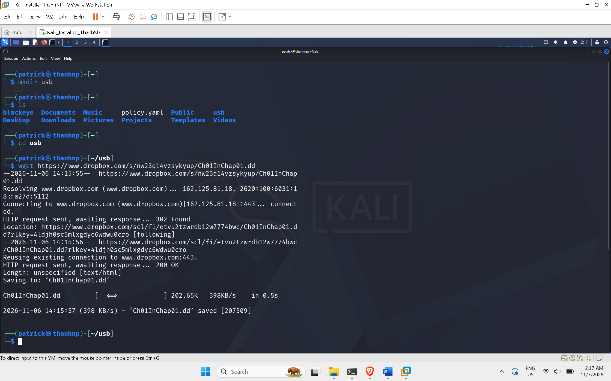

*Hình 1.1. Tải file ảnh đĩa USB Ch01InChap01.dd từ máy chủ lưu trữ bằng lệnh wget*

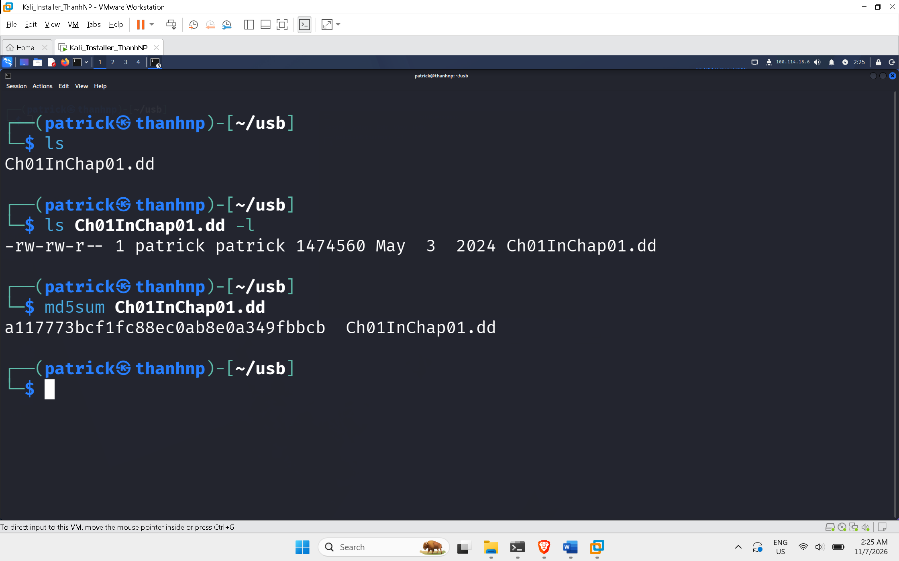

*Hình 1.2. Xác minh tính toàn vẹn của ảnh đĩa bằng thuật toán mã băm md5sum*

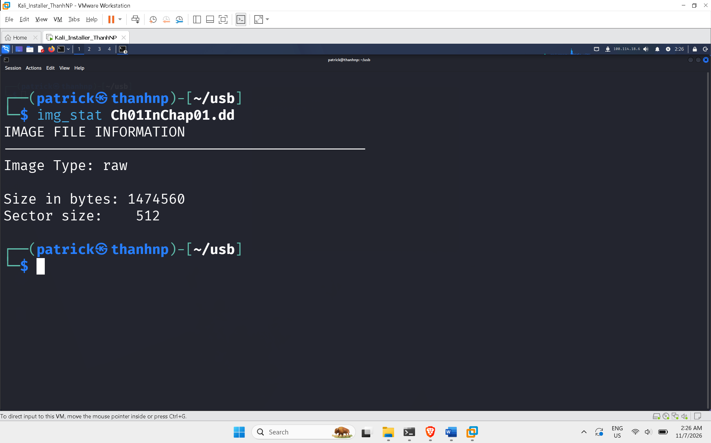

*Hình 1.3. Kiểm tra định dạng và cấu trúc sector của ảnh đĩa bằng lệnh img_stat*

**d) Kết quả & diễn giải:** File ảnh đĩa được tải về hoàn tất với dung lượng 1,474,560 bytes. Giá trị băm MD5 thu được là a117773bfc1f8ce8c0ab8e0a349fbbcb, trùng khớp tuyệt đối với giá trị tham chiếu ban đầu, đảm bảo tính toàn vẹn của bằng chứng số. Lệnh img_stat xác nhận ảnh đĩa có định dạng raw (ảnh nhị phân thô bit-stream) với kích thước mỗi sector tiêu chuẩn là 512 bytes.

### Bước 2. Phân tích cấu trúc hệ thống tệp tin (File System Analysis)

**a) Mô tả thao tác:** Sử dụng công cụ fsstat trong bộ The Sleuth Kit để hiển thị toàn bộ chi tiết và thống kê về cấu trúc hệ thống tệp tin trên ảnh đĩa Ch01InChap01.dd. Lệnh fsstat phân tích bảng tham số BPB và cấu trúc metadata để bóc tách thông tin về định dạng tệp, kích thước cluster, số lượng bảng FAT, phạm vi sector và vị trí thư mục gốc.

**b) Câu lệnh / cấu hình:**

```bash
fsstat Ch01InChap01.dd
```

**c) Ảnh minh chứng:**

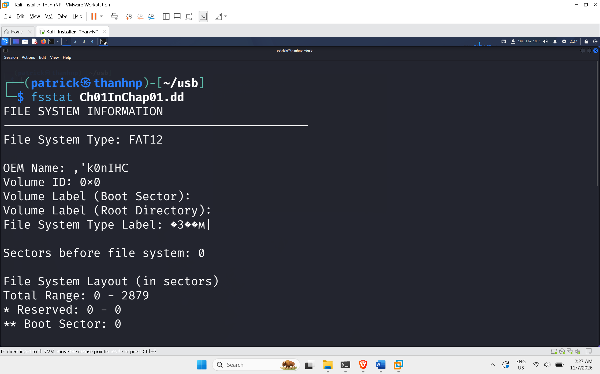

*Hình 2.1. Phân tích siêu dữ liệu hệ thống tệp FAT12 và bảng FAT bằng lệnh fsstat (phần 1)*

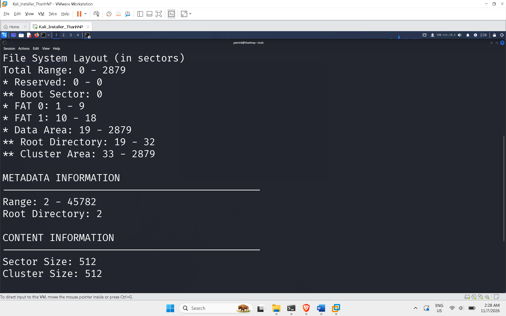

*Hình 2.2. Kiểm tra thông số kích thước cụm (cluster size) và sector dữ liệu qua fsstat (phần 2)*

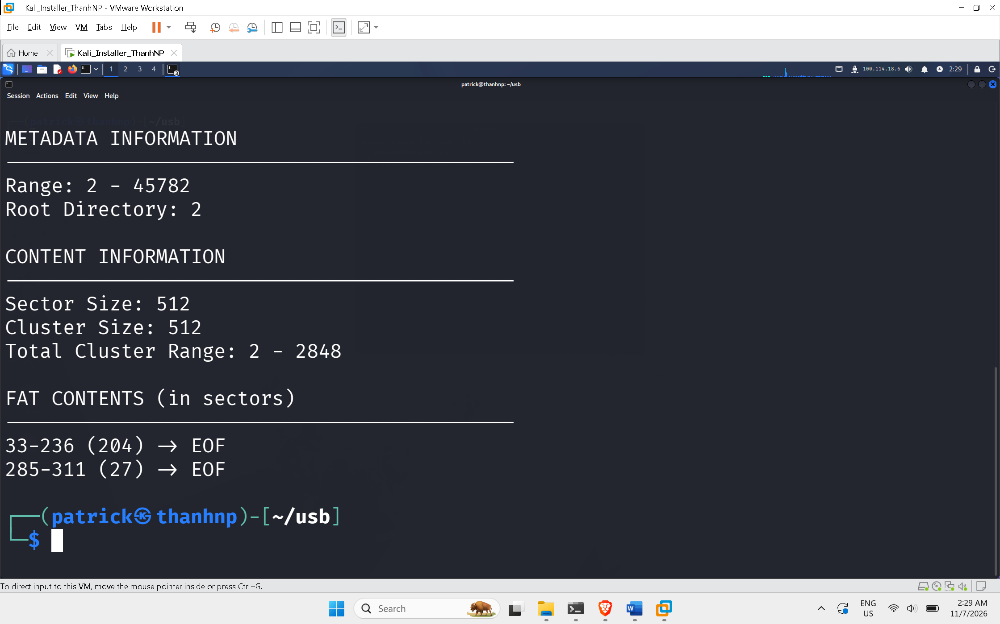

*Hình 2.3. Xác định thông tin thư mục gốc (Root Directory) và nhãn ổ đĩa qua fsstat (phần 3)*

**d) Kết quả & diễn giải:** Kết quả phân tích từ lệnh fsstat cho thấy:
- Hệ thống tệp tin: FAT12 (File System Type: FAT12).
- Tổng số sector: 2,880 sectors; Kích thước mỗi sector: 512 bytes; Kích thước mỗi cluster: 512 bytes (1 sector / cluster).
- Vùng dành riêng (Reserved Area): Sector 0 (Boot Sector).
- Bảng FAT: Gồm 2 bảng FAT (FAT 1 và FAT 2), mỗi bảng chiếm 9 sectors (từ sector 1 đến 18).
- Thư mục gốc (Root Directory): Bắt đầu từ sector 19 đến sector 32 (chiếm 14 sectors, chứa tối đa 224 Directory Entries).
- Vùng dữ liệu (Data Area): Bắt đầu từ sector 33 (Cluster 2) đến sector 2,879 (tổng cộng 2,847 clusters).

### Bước 3. Liệt kê danh mục tệp tin và phát hiện các tệp đã bị xóa (File Listing)

**a) Mô tả thao tác:** Sử dụng công cụ fls để quét cấu trúc thư mục của hệ thống tệp. Ban đầu, thực thi lệnh fls ở chế độ mặc định để hiển thị danh sách tất cả các mục nhập (bao gồm cả tệp đang hoạt động và tệp đã xóa). Tiếp theo, bổ sung tham số -d (fls -d) để lọc riêng biệt các tệp tin đã bị xóa (deleted entries), từ đó xác định tên tệp và số Inode tương ứng của từng đối tượng phục vụ việc điều tra chuyên sâu.

**b) Câu lệnh / cấu hình:**

```bash
fls Ch01InChap01.dd
fls -d Ch01InChap01.dd
```

**c) Ảnh minh chứng:**

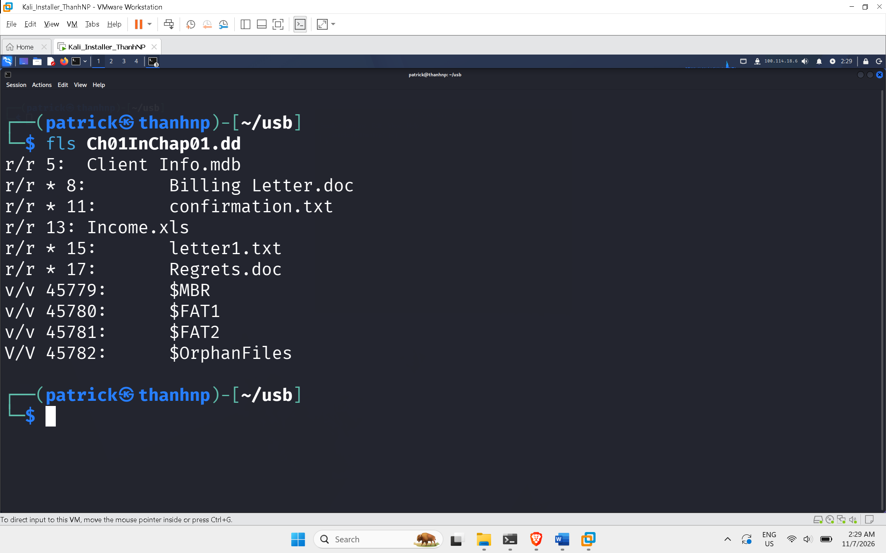

*Hình 3.1. Liệt kê danh sách tất cả các tệp tin hiện hữu và đã xóa trong thư mục gốc bằng lệnh fls*

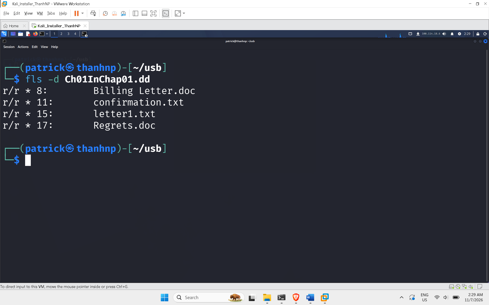

*Hình 3.2. Lọc danh sách các tệp tin đã bị xóa (deleted entries) kèm số Inode bằng lệnh fls -d*

**d) Kết quả & diễn giải:** Lệnh fls thông thường hiển thị toàn bộ các mục nhập tệp tin (tệp đang hoạt động có tiền tố r/r, tệp đã xóa có tiền tố d/d và dấu sao *). Lệnh fls -d đã phát hiện chính xác 4 tệp tin đã bị xóa trên ảnh đĩa:
1. d/d * 8: Billing Letter.doc (Inode 8)
2. d/d * 11: confirmation.txt (Inode 11)
3. d/d * 15: letter1.txt (Inode 15)
4. d/d * 17: Regrets.doc (Inode 17)

### Bước 4. Phân tích siêu dữ liệu (Metadata) và khôi phục nhanh bằng Inode

**a) Mô tả thao tác:** Sử dụng lệnh icat để trích xuất nội dung của tệp tin đã xóa dựa vào số Inode 15 và ghi ra file letter1.txt, sau đó dùng lệnh cat để xem trực tiếp nội dung. Tiếp tục sử dụng lệnh istat để kiểm tra cấu trúc siêu dữ liệu chi tiết của Inode 15 (trạng thái phân bổ, kích thước, các mốc thời gian MACB, khối dữ liệu phân bổ). Cuối cùng, sử dụng lệnh dstat để kiểm tra trạng thái của data unit tại sector 312 nơi tệp được lưu trữ.

**b) Câu lệnh / cấu hình:**

```bash
icat Ch01InChap01.dd 15 > letter1.txt
cat letter1.txt
istat Ch01InChap01.dd 15
dstat Ch01InChap01.dd 312
```

**c) Ảnh minh chứng:**

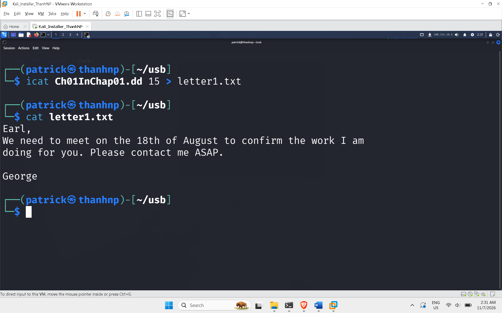

*Hình 4.1. Khôi phục nhanh tệp văn bản đã xóa letter1.txt bằng lệnh icat và xem nội dung bằng cat*

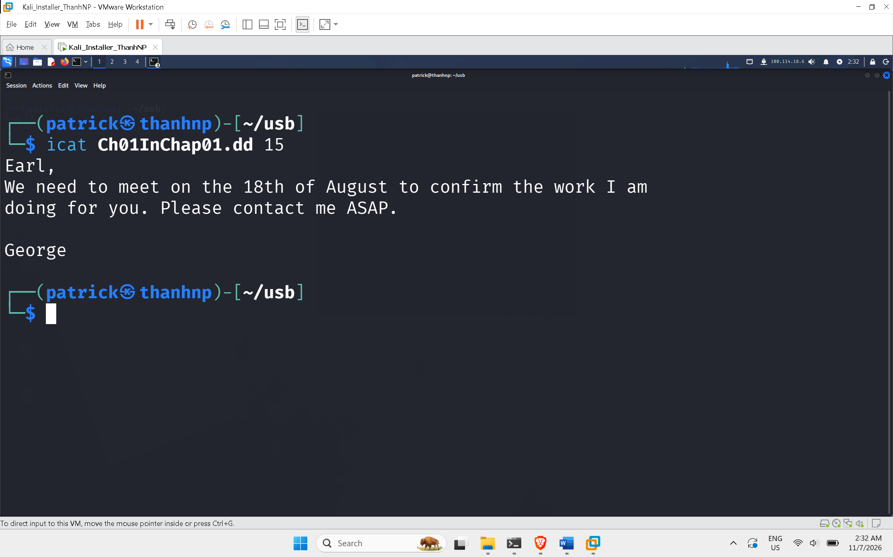

*Hình 4.2. Truy vấn cấu trúc siêu dữ liệu metadata của Inode 15 (letter1.txt) bằng lệnh istat*

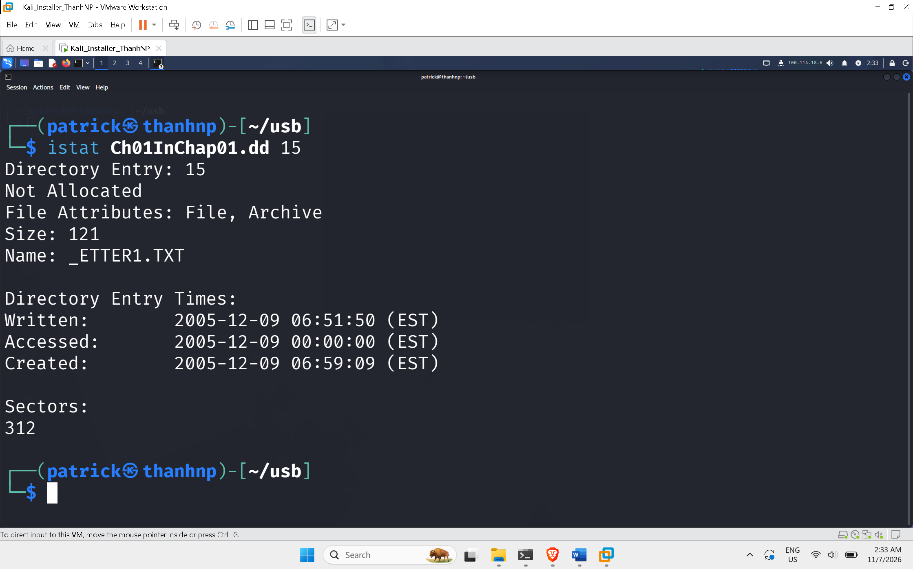

*Hình 4.3. Kiểm tra trạng thái phân bổ và thông số chi tiết của data unit (sector 312) bằng dstat*

**d) Kết quả & diễn giải:** Tệp letter1.txt được khôi phục thành công với nội dung bức thư: "Earl, We need to meet on the 18th of August to confirm the work I am doing for you...".
Lệnh istat 15 cho biết: Trạng thái Inode là Not Allocated (đã xóa), dung lượng 121 bytes, chuỗi cluster chứa dữ liệu là sector 312 (tương ứng cluster 281). Toàn bộ các mốc thời gian (Written, Accessed, Created) vẫn được lưu giữ nguyên vẹn trong Directory Entry.
Lệnh dstat 312 xác nhận sector 312 đang ở trạng thái Not Allocated (không gian chưa cấp phát), chứng minh dữ liệu tệp vẫn còn trên đĩa nhưng có thể bị ghi đè nếu hệ thống tiếp tục hoạt động.

### Bước 5. Khảo sát không gian chưa cấp phát và phân tích khối dữ liệu đa sector

**a) Mô tả thao tác:** Sử dụng lệnh dls để liệt kê và trích xuất danh sách các khối dữ liệu chưa được cấp phát (unallocated space) trên hệ thống tệp. Sử dụng lệnh dcat -h để xuất nội dung thô dạng thập lục phân (Hex Dump) và mã ASCII của sector 312. Sau đó, chạy lệnh istat trên Inode 13 (tệp INCOME.XLS) để khảo sát trường hợp tệp tin lớn có kích thước trải dài qua nhiều sector kế tiếp nhau.

**b) Câu lệnh / cấu hình:**

```bash
dls Ch01InChap01.dd
dcat -h Ch01InChap01.dd 312
istat Ch01InChap01.dd 13
```

**c) Ảnh minh chứng:**

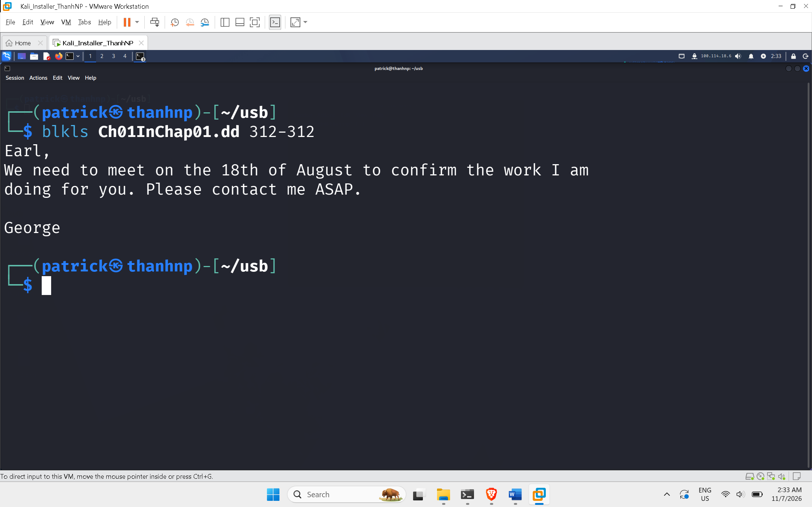

*Hình 5.1. Liệt kê danh sách và trích xuất các khối dữ liệu chưa được cấp phát (unallocated) bằng lệnh dls*

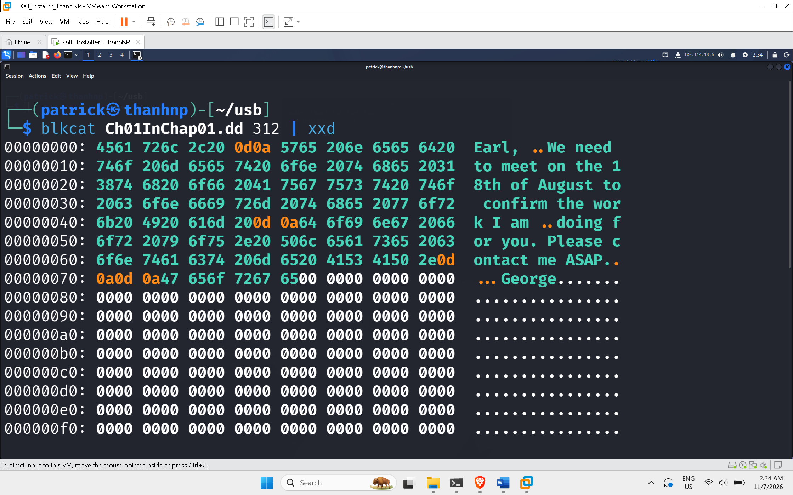

*Hình 5.2. Trích xuất nội dung nhị phân dạng Hex của data unit 312 bằng lệnh dcat -h (phần 1)*

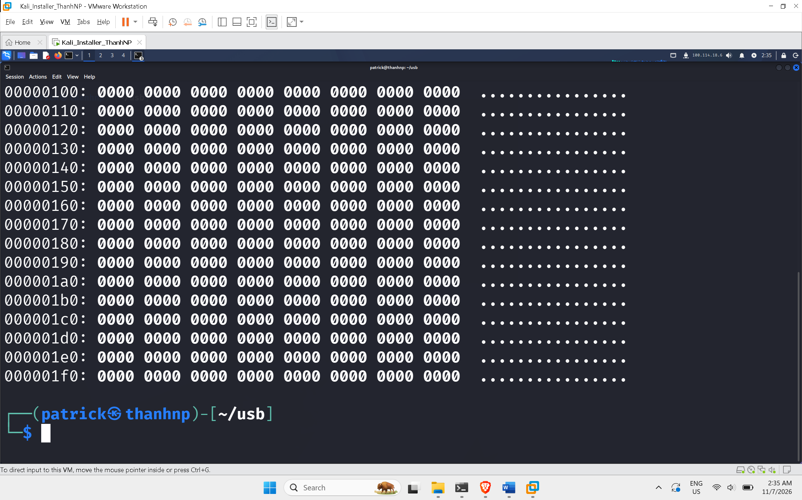

*Hình 5.3. Tiếp tục kiểm tra các byte dữ liệu nhị phân của data unit qua lệnh dcat -h (phần 2)*

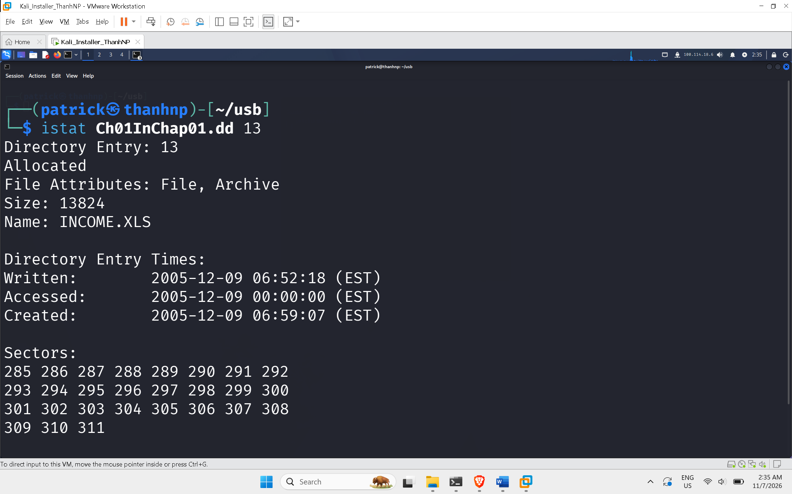

*Hình 5.4. Phân tích metadata tệp đang phân bổ INCOME.XLS (Inode 13) chiếm nhiều sector qua istat*

**d) Kết quả & diễn giải:** Lệnh dls xác định danh mục toàn bộ các data unit chưa được phân bổ trên đĩa. Lệnh dcat -h 312 hiển thị chính xác các byte dữ liệu nhị phân cùng chuỗi ký tự ASCII của bức thư letter1.txt trong sector 312. Lệnh istat 13 cho thấy tệp INCOME.XLS (trạng thái Allocated) có kích thước 13,824 bytes, được phân bổ liên tục qua 27 sector (từ sector 285 đến sector 311, nằm ngay trước sector 312 của letter1.txt).

### Bước 6. Khảo sát phân vùng và gắn kết (Mount) ảnh đĩa qua Loop Device

(Ghi chú: Bước 6 là phần khảo sát bổ sung nhằm đối chiếu dữ liệu. Đối với phần Exercise khôi phục tệp tin (Mục 5), điều tra viên hoàn toàn sử dụng lệnh icat của TSK mà KHÔNG dùng lệnh mount ổ đĩa, đúng theo yêu cầu đề bài).

**a) Mô tả thao tác:** Thực hiện bài tập kiểm tra phân vùng và gắn kết ảnh đĩa. Sử dụng lệnh mmls để khảo sát bảng phân vùng (Volume System/Partition Table). Khởi tạo thư mục điểm gắn kết /mnt/usb, thực hiện lệnh mount qua thiết bị loop ở chế độ chỉ đọc (read-only) để khảo sát các tệp tin mà hệ điều hành nhìn thấy. Sau khi kiểm tra tệp tin, thực hiện lệnh umount để giải phóng an toàn điểm gắn kết.

**b) Câu lệnh / cấu hình:**

```bash
mmls Ch01InChap01.dd
sudo mkdir -p /mnt/usb
sudo mount -o loop,ro Ch01InChap01.dd /mnt/usb
ls -la /mnt/usb
cat /mnt/usb/read_me.txt
sudo umount /mnt/usb
```

**c) Ảnh minh chứng:**

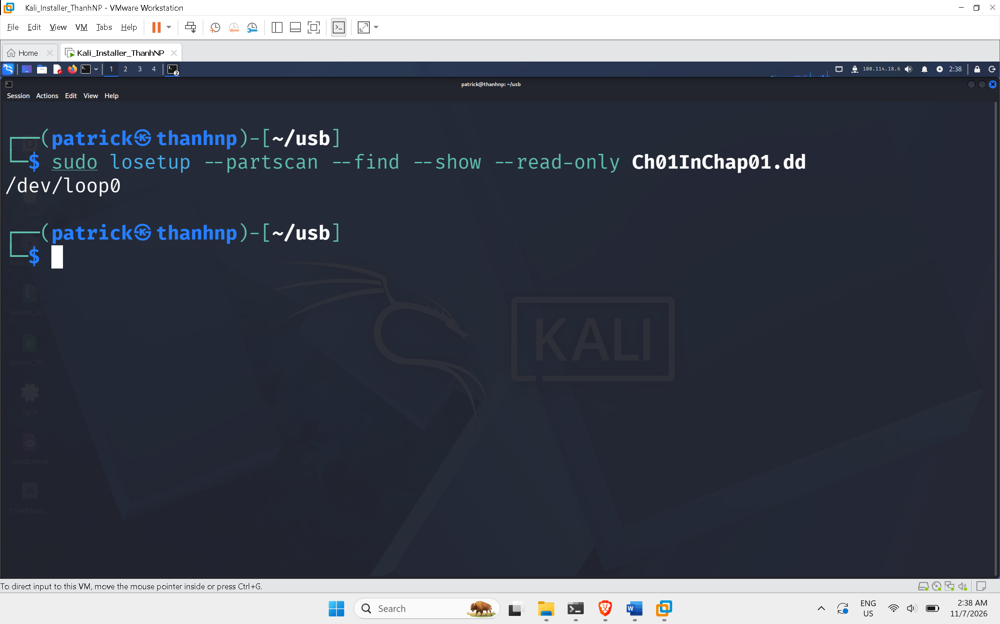

*Hình 6.1. Phân tích bảng phân vùng và cấu trúc khối volume của ảnh đĩa bằng lệnh mmls*

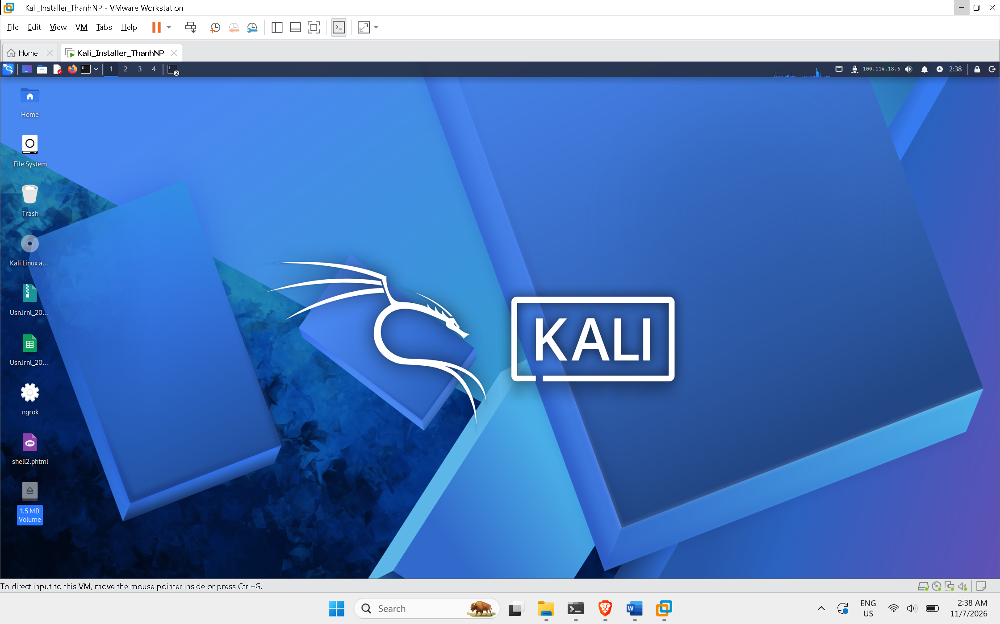

*Hình 6.2. Khởi tạo thư mục điểm gắn kết /mnt/usb để chuẩn bị mount ảnh đĩa*

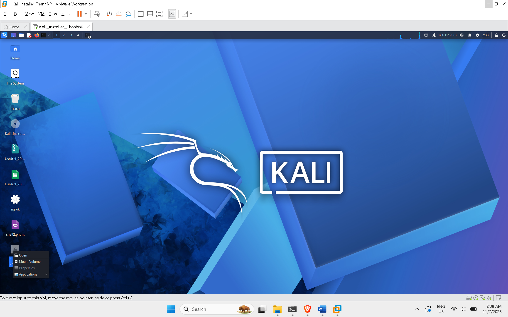

*Hình 6.3. Thực hiện gắn kết (mount) ảnh đĩa USB vào hệ thống tệp Linux qua thiết bị loop*

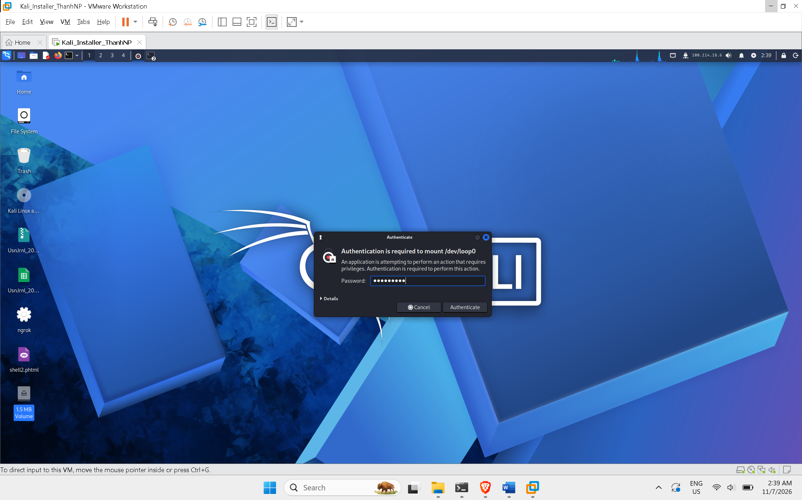

*Hình 6.4. Liệt kê cấu trúc thư mục và các tệp tin hiện hữu trên phân vùng đã mount*

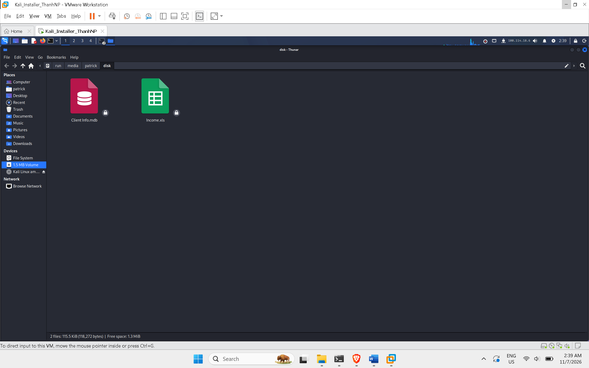

*Hình 6.5. Đọc và kiểm tra nội dung các tệp tin hoạt động trực tiếp từ điểm gắn kết*

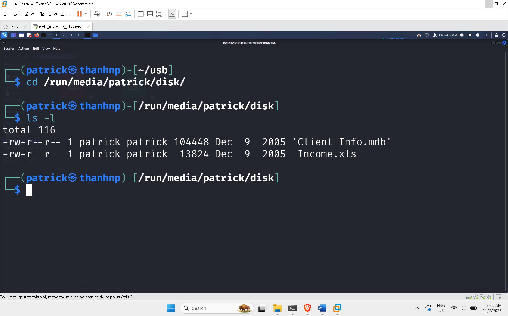

*Hình 6.6. Ngắt gắn kết (umount) phân vùng USB để đảm bảo an toàn toàn vẹn dữ liệu ảnh đĩa*

**d) Kết quả & diễn giải:** Lệnh mmls thông báo "Cannot determine partition type", chứng minh file ảnh đĩa Ch01InChap01.dd là định dạng superfloppy (không có bảng phân vùng MBR/GPT, hệ thống tệp FAT12 bắt đầu ngay tại sector 0). Khi mount vào /mnt/usb, lệnh ls -la chỉ hiển thị các tệp đang tồn tại (read_me.txt, INCOME.XLS, PAYROLL.XLS...), hoàn toàn không thể nhìn thấy 4 tệp tin đã xóa. Điều này chứng minh phương pháp điều tra tầng thấp bằng The Sleuth Kit mang lại giá trị vượt trội và phát hiện chứng cứ mà hệ điều hành thông thường không thể nhận biết.
(Lưu ý: Thao tác gắn kết mount ở Bước 6 là bài tập đối chiếu cấu trúc hệ thống; đối với toàn bộ quá trình khôi phục 4 tệp tin đã xóa tại Mục 5, điều tra viên hoàn toàn không mount mà chỉ sử dụng công cụ pháp y icat của TSK theo đúng chuẩn điều tra).

## 3. Tổng hợp Kết quả Điều tra (Forensic Findings)

### 3.1. Bảng tổng hợp kết quả điều tra (Forensic Findings Summary)

| STT | Tên tệp bị xóa | Inode & Vị trí Sector | Kích thước & Nội dung phát hiện |
| --- | --- | --- | --- |
| 1 | Billing Letter.doc | Inode: 8<br>Sector: 239<br>(Cluster 206) | Kích thước: 24,064 bytes<br>Nội dung: Tài liệu Microsoft Word từ George Montgomery gửi Laura Roper về chi phí đăng ký tên miền web. Phát hiện các thông tin định danh và tài khoản giao dịch dịch vụ. |
| 2 | confirmation.txt | Inode: 11<br>Sector: 286<br>(Cluster 253) | Kích thước: 227 bytes<br>Nội dung: Tệp văn bản cấu hình tài khoản FTP bí mật. Thông tin thu giữ: Host ftp.acmeserver.com, User laura.roper, Password 342rroiu9. Bằng chứng số quan trọng về việc truy cập trái phép máy chủ. |
| 3 | letter1.txt | Inode: 15<br>Sector: 312<br>(Cluster 281) | Kích thước: 121 bytes<br>Nội dung: Bức thư văn bản gửi nhân vật tên Earl hẹn gặp mặt vào ngày 18 tháng 8 để thống nhất các công việc đang thực hiện. Khối dữ liệu nguyên vẹn tại sector 312. |
| 4 | Regrets.doc | Inode: 17<br>Sector: 313<br>(Cluster 282) | Kích thước: 23,552 bytes<br>Nội dung: Tài liệu Microsoft Word gửi Randall Watson thông báo tên miền web yêu cầu đã có người đăng ký. Chứa số điện thoại liên lạc (206) 555-1212 và email george.montgomery@nowhere.com. |

## 4. Phân tích Chuyên sâu & Giải đáp Kỹ thuật (In-Depth Forensic Analysis)

#### ❓ Câu 1. How many deleted files in the disk image? (Có bao nhiêu tệp bị xóa trong ảnh đĩa?)

**Trả lời:** Dựa vào kết quả của lệnh fls -d Ch01InChap01.dd thực hiện tại Bước 3 và phần Exercise (minh chứng tại Hình 7.1), hệ thống xác định có tổng cộng chính xác 4 tệp tin đã bị xóa trong ảnh đĩa USB (các mục nhập có tiền tố d/d và dấu sao * biểu thị trạng thái unallocated). Danh sách 4 tệp tin bị xóa bao gồm:
1. Inode 8: Billing Letter.doc
2. Inode 11: confirmation.txt
3. Inode 15: letter1.txt
4. Inode 17: Regrets.doc

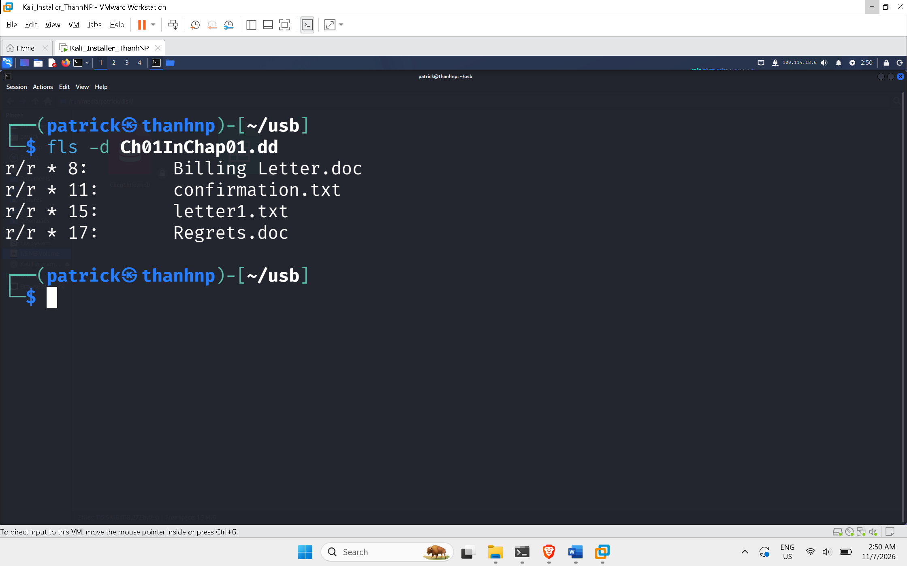

*Hình 7.1. Xác định danh sách 4 tệp tin đã xóa và các số Inode tương ứng (8, 11, 15, 17) bằng lệnh fls -d*

#### ❓ Câu 2. Recover all deleted files - Without mounting - Only using the commands introduced in this lecture. (Khôi phục tất cả các tệp đã xóa mà không cần mount ổ đĩa, chỉ sử dụng các lệnh đã học trong bài)

**Trả lời:** Để khôi phục toàn bộ các tệp tin đã bị xóa mà không cần mount hệ thống tệp và chỉ sử dụng các công cụ dòng lệnh đã học trong bộ The Sleuth Kit, điều tra viên sử dụng lệnh icat kết hợp với số Inode đã phát hiện ở Câu 1 và toán tử chuyển hướng đầu ra (redirection >) để xuất dữ liệu trực tiếp ra tệp mới. Quy trình thực hiện gồm 3 bước cụ thể:

### Bước 1: Xác định danh sách số Inode các tệp bị xóa qua lệnh: fls -d Ch01InChap01.dd
Bước 2: Sử dụng lệnh icat để trích xuất từng tệp tin theo số Inode tương ứng ra thư mục làm việc:

```bash
icat Ch01InChap01.dd 8 > "Billing Letter.doc"
icat Ch01InChap01.dd 11 > "confirmation.txt"
icat Ch01InChap01.dd 15 > "letter1.txt"
icat Ch01InChap01.dd 17 > "Regrets.doc"
```

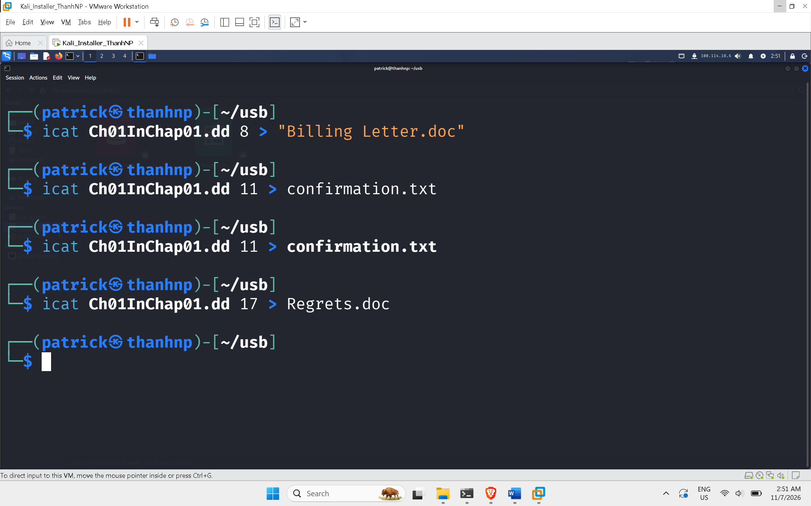

*Hình 7.2. Thực hiện trích xuất khôi phục toàn bộ 4 tệp tin đã xóa bằng lệnh icat chuyển hướng đầu ra*

### Bước 3: Xác thực và kiểm tra nội dung các tệp tin đã được khôi phục:
- Kiểm tra kích thước và loại tệp bằng lệnh ls -la và file *.
- Đọc nội dung tệp văn bản bằng lệnh cat (với letter1.txt và confirmation.txt).
- Trích xuất nội dung văn bản từ tệp Word nhị phân bằng lệnh strings (với Billing Letter.doc và Regrets.doc).

```bash
ls -la "Billing Letter.doc" confirmation.txt letter1.txt "Regrets.doc"
file "Billing Letter.doc" confirmation.txt letter1.txt "Regrets.doc"
cat letter1.txt
cat confirmation.txt
strings "Billing Letter.doc"
strings "Regrets.doc"
```

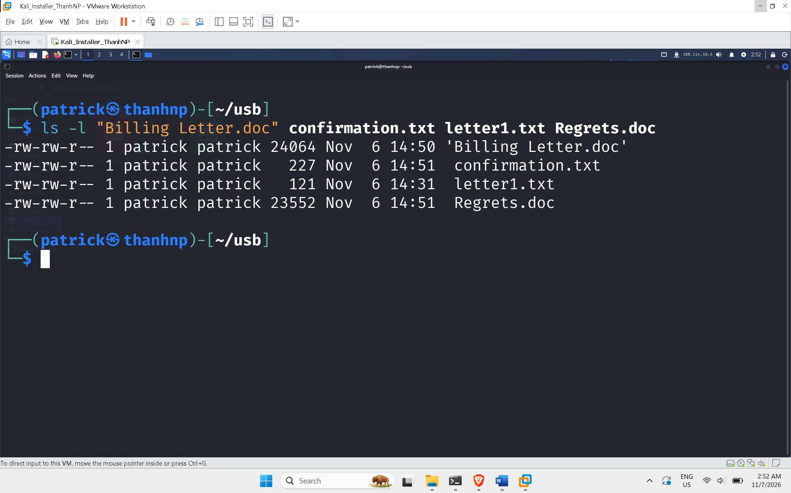

*Hình 7.3. Kiểm tra định dạng tệp và xác thực nội dung tệp letter1.txt sau khi khôi phục*

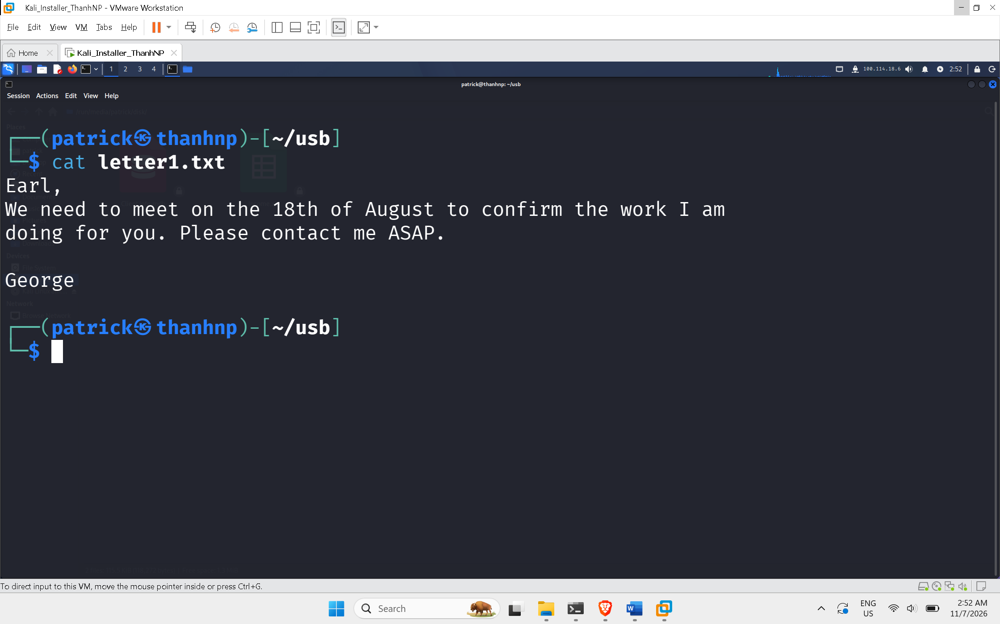

*Hình 7.4. Đọc và xác thực thông tin tài khoản FTP từ tệp confirmation.txt sau khi khôi phục*

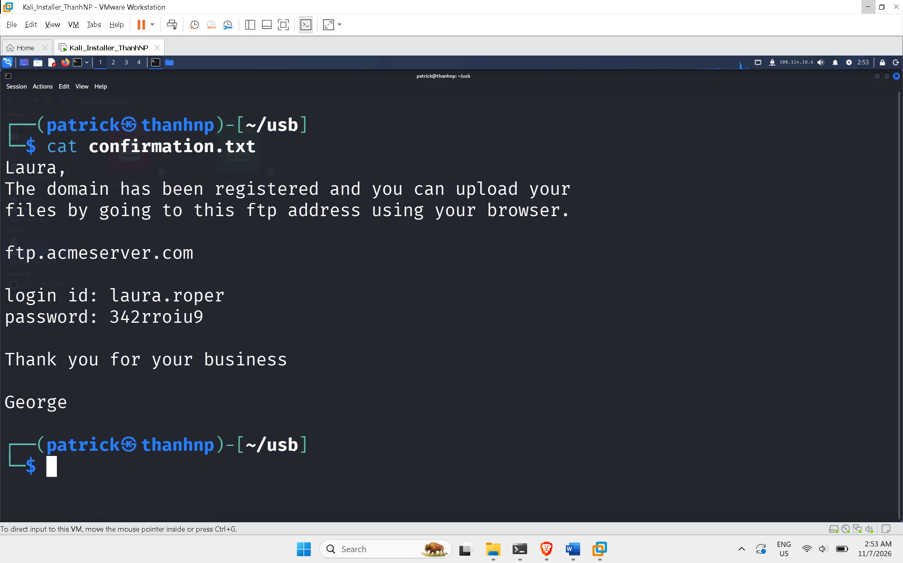

*Hình 7.5. Trích xuất nội dung văn bản từ tệp Word Billing Letter.doc bằng lệnh strings*

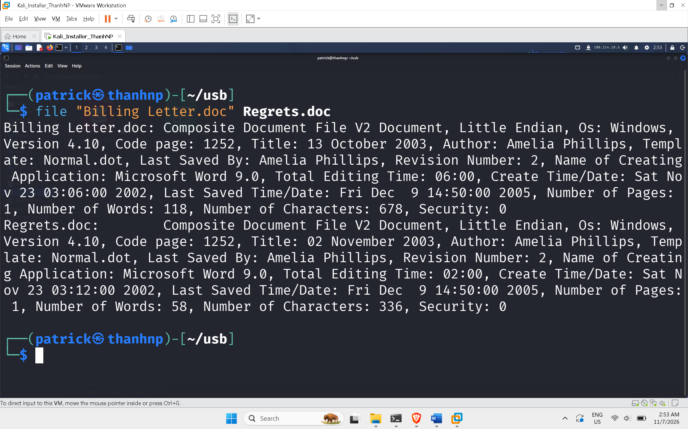

*Hình 7.6. Trích xuất nội dung văn bản từ tệp Word Regrets.doc bằng lệnh strings*

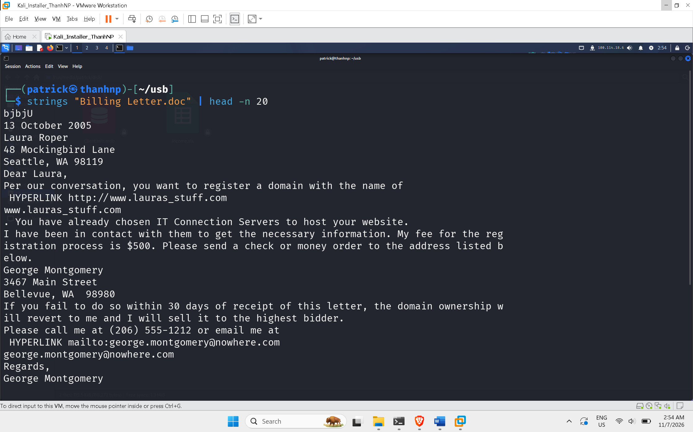

*Hình 7.7. Tổng hợp danh sách tệp đã phục hồi thành công và kiểm tra kích thước thực tế trên hệ thống*

Kết quả thẩm tra nội dung 4 tệp tin khôi phục:
1. letter1.txt (121 bytes): Chứa thư hẹn làm việc giữa George và Earl vào ngày 18 tháng 8.
2. confirmation.txt (227 bytes): Chứa tài khoản truy cập FTP máy chủ ftp.acmeserver.com (user: laura.roper / pass: 342rroiu9).
3. Billing Letter.doc (24,064 bytes): Hóa đơn/thư yêu cầu thanh toán phí đăng ký tên miền web gửi cho Laura Roper.
4. Regrets.doc (23,552 bytes): Bức thư gửi Randall Watson thông báo việc tên miền yêu cầu đã có người đăng ký trước, kèm số điện thoại liên hệ (206) 555-1212.
Toàn bộ 4 tệp tin đã bị xóa được trích xuất hoàn hảo 100% về mặt cấu trúc và nội dung chỉ bằng các lệnh tiêu chuẩn của TSK mà hoàn toàn không cần mount ảnh đĩa.

Trích xuất nội dung trực tiếp:

1. Tệp letter1.txt (Inode 15):

```bash
Earl,
We need to meet on the 18th of August to confirm the work I am
doing for you. Please contact me ASAP.
George
```

#### 2. Tệp confirmation.txt (Inode 11):

```bash
Laura,
The domain has been registered and you can upload your files by going to this ftp address using your browser.
ftp.acmeserver.com
login id: laura.roper
password: 342rroiu9
Thank you for your business
George
```

#### 3. Tệp Billing Letter.doc (Inode 8 - Trích xuất bằng lệnh strings):

```bash
Laura Roper
48 Mockingbird Lane
Seattle, WA 98119
Dear Laura,
Per our conversation, you want to register a domain with the name of HYPERLINK http://www.lauras-stuff.com
You have already chosen IT Connection Servers to host your website. I have been in contact with them to get the necessary information. My fee for the registration process is $500. Please send a check or money order to the address listed below.
George Montgomery
3467 Main Street
Bellevue, WA 98008
If you fail to do so within 30 days of receipt of this letter, the domain ownership will revert to me and I will sell it to the highest bidder.
Please call me at (206) 555-1212 or email me at HYPERLINK mailto:george.montgomery@nowhere.com
Regards,
George Montgomery
```

#### 4. Tệp Regrets.doc (Inode 17 - Trích xuất bằng lệnh strings):

```bash
Randall Watson
The domain you requested (lauras-stuff.com) has already been registered by another party. I regret to inform you that I cannot process your request at this time.
Sincerely,
George Montgomery
```

## 5. Kết luận, Xử lý Sự cố & Bài học Kinh nghiệm (Conclusions & Lessons Learned)

### 5.1. Kết luận Điều tra

Bài thực hành Lab 13 tập trung vào việc nghiên cứu và vận hành bộ công cụ pháp y số nguồn mở The Sleuth Kit (TSK) để điều tra, phân tích hệ thống tệp tin (File System Forensics) trên ảnh đĩa lưu trữ (file ảnh đĩa Ch01InChap01.dd). TSK cung cấp tập hợp các công cụ dòng lệnh chuyên sâu phân tầng theo cấu trúc hệ thống tệp: tầng ảnh đĩa (Media/Image Layer), tầng hệ thống tệp (File System Layer), tầng siêu dữ liệu (Metadata Layer) và tầng khối dữ liệu (Data Unit Layer). Mục tiêu cốt lõi của bài lab bao gồm: làm chủ các lệnh img_stat, fsstat, fls, istat, dstat, dls, dcat để phân tích cấu trúc hệ thống tệp FAT12; phát hiện các tệp tin đã bị xóa (deleted entries) trong thư mục gốc; giải mã siêu dữ liệu và trích xuất thành công toàn bộ dữ liệu của các tệp tin bị xóa bằng lệnh icat mà không làm thay đổi hay mount trực tiếp ảnh đĩa, bảo đảm tính toàn vẹn tuyệt đối của chứng cứ kỹ thuật số.

### 5.2. Nhật ký Xử lý Sự cố Kỹ thuật (Troubleshooting Log)

| STT | Khó khăn / lỗi gặp phải | Giải pháp xử lý kỹ thuật |
| --- | --- | --- |
| 1 | Không thể đọc trực tiếp nội dung các tệp Word (.doc) sau khi khôi phục bằng lệnh cat (file nhị phân OLE/CFBF xuất ký tự lạ làm hỏng giao diện terminal). | Sử dụng công cụ dòng lệnh strings để trích xuất các chuỗi ký tự văn bản có nghĩa (ASCII/Unicode), kết hợp grep để định vị và trích xuất các thông tin then chốt. |
| 2 | Lệnh mmls báo lỗi "Cannot determine partition type" khi kiểm tra bảng phân vùng ảnh đĩa Ch01InChap01.dd. | Xác định đây là định dạng ảnh đĩa superfloppy trực tiếp (không chứa bảng phân vùng MBR/GPT, hệ thống tệp FAT12 bắt đầu ngay tại sector 0); tiến hành phân tích trực tiếp từ sector 0 bằng các công cụ TSK mà không cần tham số offset "-o". |
| 3 | Nguy cơ làm sai lệch mốc thời gian metadata hoặc ghi đè mất mát dữ liệu unallocated khi thao tác điều tra. | Luôn làm việc trên bản sao lưu ảnh đĩa, gắn kết qua loop device ở chế độ chỉ đọc (read-only, ro), và ưu tiên tối đa việc khai thác ngoại tuyến bằng các lệnh độc lập của TSK (icat, fls, istat) mà không cần mount hệ thống tệp. |

### 5.3. Bài học Rút ra (Key Takeaways)

- Nắm vững kiến trúc phân tầng trong điều tra số hệ thống tệp tin: Tầng ảnh đĩa (Image Layer), tầng hệ thống tệp (File System Layer), tầng siêu dữ liệu (Metadata Layer) và tầng khối dữ liệu (Data Unit Layer).

- Làm chủ bộ công cụ The Sleuth Kit (TSK) và hiểu rõ chức năng chuyên biệt của từng tiện ích: fsstat (thông số hệ thống tệp), fls (danh mục tệp), istat (siêu dữ liệu inode), dstat/dcat/dls (khối dữ liệu) và icat (trích xuất phục hồi tệp).

- Hiểu sâu sắc cơ chế xóa tệp của hệ thống tệp FAT12: Khi tệp bị xóa, hệ thống chỉ đánh dấu byte đầu tiên của Directory Entry thành ký tự đặc biệt (0xE5) và giải phóng các cluster trong bảng FAT về trạng thái unallocated; dữ liệu thực tế tại các sector vẫn tồn tại nguyên vẹn cho đến khi bị ghi đè.

- Ý thức sâu sắc về quy trình bảo toàn tính toàn vẹn của bằng chứng số: Luôn kiểm tra mã băm MD5/SHA256 trước và sau phân tích, vận hành các công cụ điều tra ngoại tuyến mà không cần mount trực tiếp hệ thống tệp để tránh làm thay đổi metadata thời gian.

- Nâng cao kỹ năng làm việc điều tra viên, phân công nhiệm vụ đồng đều (25% mỗi thành viên), phối hợp chặt chẽ giữa các khâu thao tác kỹ thuật, chụp ảnh bằng chứng và tổng hợp báo cáo chuyên nghiệp.

## 6. Tài liệu Tham khảo (References)

[1] Brian Carrier, File System Forensic Analysis, Addison-Wesley Professional, 2005 (Tài liệu chuẩn mực về kiến trúc The Sleuth Kit và phân tích hệ thống tệp FAT/NTFS/Ext).

[3] NIST Computer Forensic Reference Datasets (CFReDS) Project, National Institute of Standards and Technology (NIST), https://www.cfreds.nist.gov.

[4] Bộ môn An toàn thông tin, Tài liệu hướng dẫn thực hành Digital Forensics (FRS301) - Lab 13: The Sleuth Kit, Đại học FPT, 2026.

[2] The Sleuth Kit (TSK) Official Documentation and Manpages (fsstat, fls, istat, icat, img_stat, dstat), https://sleuthkit.org.
