# Lab 02: Raw Data Carving & Unallocated Space File Reconstruction
### *Kỹ thuật Data Carving & Khôi phục Dữ liệu từ Không gian Chưa cấp phát*

[⬅️ Back to Main DFIR Casebook](../../README.md)

---

## 📌 Quick Metadata

| Field | Description |
| :--- | :--- |
| **Forensic Environment** | `Kali Linux 2025.4 / 2026.3 (64-bit)` on `VMware Workstation Pro` (Host: `Windows 11`) |
| **Forensic Module** | `02-Data-Carving-and-AntiForensics` |
| **Target Dataset / Evidence** | `usb_fat_carving.001 (120 MB Raw USB Image) & Corrupted Word Document` |
| **Core Forensic Toolstack** | `Bless / GHex Hex Editor, Foremost, Magic Bytes (SOI 0xFFD8 / EOI 0xFFD9), dd` |
| **MITRE ATT&CK / DFIR Focus** | `T1070.004 (File Deletion Recovery), Raw Binary Signature Carving` |

---

## 1. Tổng quan & Bối cảnh Điều tra (Overview & Objectives)

### 1.1. Bối cảnh và Mục tiêu

Bài lab này giới thiệu kỹ thuật Data Carving (khôi phục dữ liệu) – một phương pháp quan trọng trong điều tra số khi các tệp tin bị ẩn, bị hỏng header hoặc bị xóa. Bài lab mô phỏng hai tình huống thực tế: (1) một tệp ảnh bị ẩn bên trong một tệp Word bị hỏng header, và (2) một USB chứa các tệp đã bị xóa hoặc các cluster bị ghi đè một phần. Mục tiêu chính là: làm quen với hex editor để phân tích cấu trúc tệp, sử dụng công cụ dd để trích xuất dữ liệu thô, và sử dụng Scalpel để tự động carve các tệp JPG từ ảnh USB.

### 1.2. Môi trường và Công cụ Thực hành

| Thành phần | Tên / Phiên bản | Ghi chú (cấu hình, nguồn tải…) |
| --- | --- | --- |
| Máy thật (host) – hệ điều hành | Windows 11 Home | Hỗ trợ chạy máy ảo |
| Phần mềm ảo hoá | VMware Workstation Pro | Dùng để chạy máy ảo Kali Linux |
| Máy ảo sử dụng | Kali Linux 2025.4 | Cấu hình RAM 4GB, ổ cứng 1 - 80GB, ổ cứng 2 - 40GB, |
| Công cụ điều tra 1 | Scalpel v1.60 | Công cụ carve dựa trên header/footer |
| Công cụ điều tra 2 | dd utility | Công cụ sao chép dữ liệu thô cấp thấp |
| Công cụ hỗ trợ | GHex / hexedit | Hex editor để xem cấu trúc tệp nhị phân |
| Công cụ hỗ trợ | 7z, fdisk, fls, md5sum | Giải nén, xem partition, liệt kê tệp, tính hash |
| Công cụ hỗ trợ | ImageMagick (display) | Hiển thị ảnh đã carve |
| Dữ liệu đầu vào 1 | File_carving.docx | Tệp Word bị hỏng, chứa ảnh ẩn |
| Dữ liệu đầu vào 2 | 120M.7z | File nén chứa ảnh USB (120MB |

### 1.3. Dữ liệu Bằng chứng & Kiểm tra Tính toàn vẹn (Hash Verification)

| Tên file / nguồn dữ liệu | Thuật toán | Hash trước phân tích | Hash sau phân tích | Khớp? |
| --- | --- | --- | --- | --- |
| File_carving.docx | MD5 | 9b1439ffd4a30d86a08299e659210590 | 9b1439ffd4a30d86a08299e659210590 | ☑ Có  ☐ Không |
| 120M.7z | MD5 | dfe7b5424e54cd<br>1bf50d5df47aceeb3c | dfe7b5424e54cd1bf50d5df47aceeb3c | ☑ Có  ☐ Không |
| 120M.7z | SHA-256 | 2d2a3d93c9ec65bcad9f89c9894429ea72caa8add07726a3b96ec9a6ab6a58ce | 2d2a3d93c9ec65bcad9f89c9894429ea72caa8add07726a3b96ec9a6ab6a58ce | ☑ Có  ☐ Không |
| usb_fat_carving.001 | MD5 | ba4a1d0ba49f4a6667b00a3b3e85e604 | ba4a1d0ba49f4a6667b00a3b3e85e604 |  |
| usb_fat_carving.001.txt | MD5 | 568d6b183c03ff6f3e01e3915846be60 |  |  |

Giá trị tham chiếu (theo tài liệu lab, nếu có):

20M.7z (theo đề bài): MD5 = dfe7b5424e54cd1bf50d5df47aceeb3c,

SHA256 = 2d2a3d93c9ec65bcad9f89c9894429ea72caa8add07726a3b96ec9a6ab6a58ce

## 2. Quy trình Điều tra & Thực nghiệm Kỹ thuật (Forensic Investigation Workflow)

### Phần 1 Trích xuất ảnh từ tài liệu Word bị hỏng

### Bước 1. Chuẩn bị các tệp cần thiết

**a) Mô tả thao tác:** Tạo thư mục làm việc carvingLab, tải tệp File_carving.docx từ GitHub của giảng viên về máy ảo Kali, sau đó tính mã băm MD5 để ghi nhận giá trị ban đầu của bằng chứng.

**b) Câu lệnh / cấu hình đã sử dụng:**

```bash
mkdir carvingLab
cd carvingLab
wget https://raw.githubusercontent.com/frankwxu/digital-forensics-lab/main/Basic_Computer_Skills_for_Forensics/file_carving/File_Carving_Manually/File_carving.docx
ls -l
md5sum File_carving.docx
```

**c) Ảnh minh chứng:**

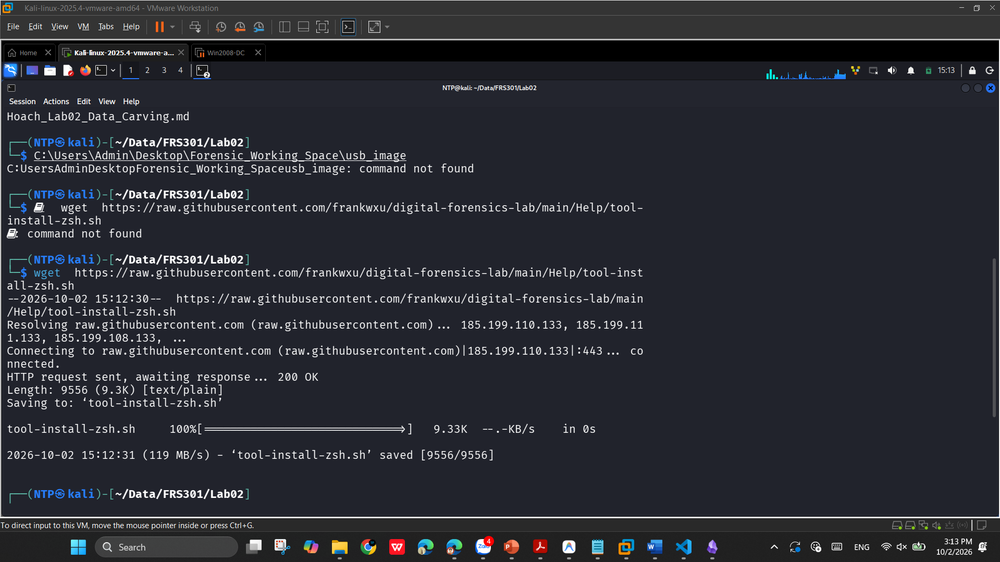

*Hình 1.1. Chuẩn bị tệp File_carving.docx và kiểm tra mã MD5.*

**d) Kết quả & diễn giải:** Tệp File_carving.docx được tải thành công với kích thước 97,702 bytes. Mã MD5 được ghi nhận là 9b1439ffd4a30d86a08299e659210590, dùng để xác minh tính toàn vẹn của bằng chứng sau khi carve.

### Bước 2. Xem tệp trong hex editor

**a) Mô tả thao tác:** Cài đặt hex editor bless (hoặc sử dụng GHex), sau đó mở tệp File_carving.docx để xem cấu trúc nhị phân bên trong. Quá trình điều tra đã tìm kiếm signature của ảnh JPEG (FFD8FFE0) để xác định vị trí header.

**b) Câu lệnh / cấu hình đã sử dụng:**

```bash
┌──(NTP㉿kali)-[~/Data/FRS301/Lab02]
└─$     sudo apt update                                                                                        
    sudo apt install -y ghex hexedit imagemagick
```

**c) Ảnh minh chứng:**

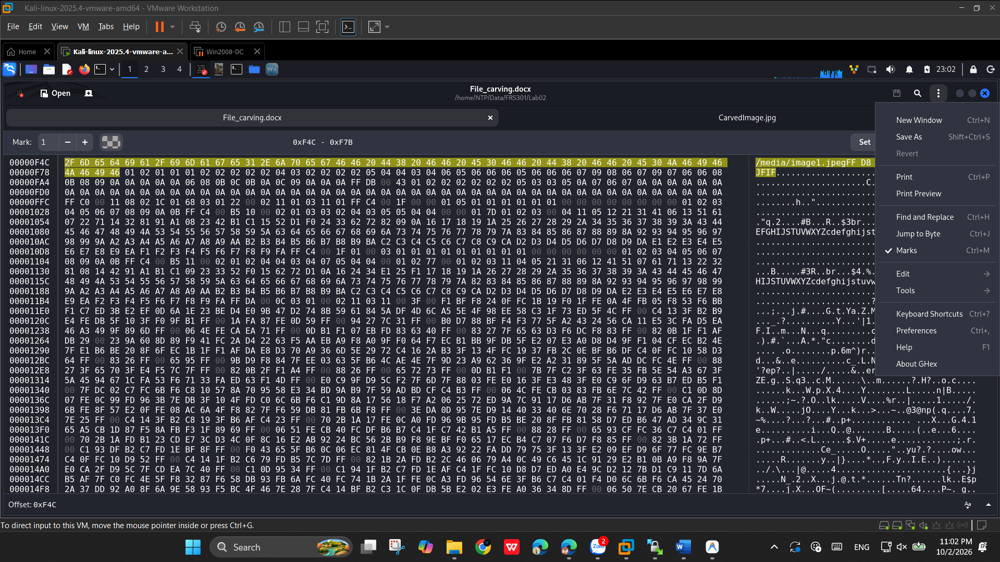

*Hình 2.1. Tìm kiếm signature FFD8FFE0 (header JPEG) trong hex editor.*

**d) Kết quả & diễn giải:** Signature FFD8FFE0 của ảnh JPEG được tìm thấy tại offset 0F5E (hex) = 3934 (thập phân). Đây là điểm bắt đầu của dữ liệu ảnh bị ẩn bên trong tệp Word.

### Bước 3. Tìm offset header và trailer

**a) Mô tả thao tác:** Tiếp tục sử dụng hex editor để tìm signature kết thúc ảnh JPEG (FFD9) – trailer. Ghi nhận offset của trailer là 15B93 (hex) = 88979 (thập phân). Tính toán kích thước vùng dữ liệu ảnh cần trích xuất.

**b) Câu lệnh / cấu hình đã sử dụng:**

```bash
# Tìm kiếm FFD9 trong hex editor
# Tính toán:
(0F5E)₁₆ = (3934)₁₀
(15B93)₁₆ = (88979)₁₀
# Kích thước = 88979 - 3934 + 1 = 85046 bytes
```

**c) Ảnh minh chứng:**

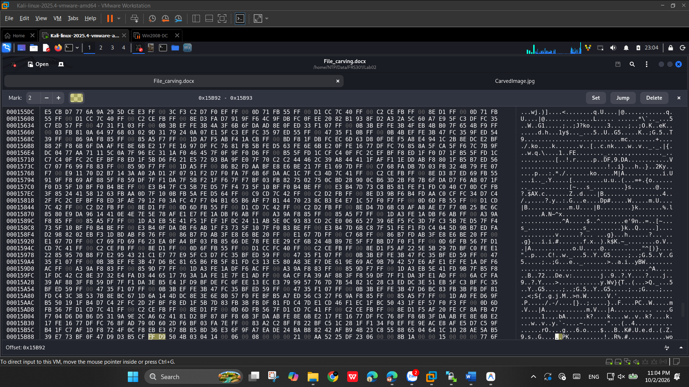

*Hình 3.1. Tìm kiếm signature FFD9 (trailer JPEG) trong hex editor.*

**d) Kết quả & diễn giải:** Trailer FFD9 được xác định tại offset 15B93. Vùng dữ liệu ảnh JPEG nằm từ offset 3934 đến 88979, tương ứng với kích thước 85,046 bytes.

### Bước 4. Trích xuất và hiển thị ảnh đã carve

**a) Mô tả thao tác:** Sử dụng công cụ dd để trích xuất vùng dữ liệu từ offset 3934, với kích thước 85046 bytes, lưu thành tệp CarvedImage.jpg. Sau đó dùng lệnh display của ImageMagick để hiển thị ảnh đã carve.

**b) Câu lệnh / cấu hình đã sử dụng:**

```bash
dd if=File_carving.docx of=CarvedImage.jpg bs=1 skip=3934 count=85046
ls -l
file CarvedImage.jpg
display CarvedImage.jpg
```

**c) Ảnh minh chứng:**

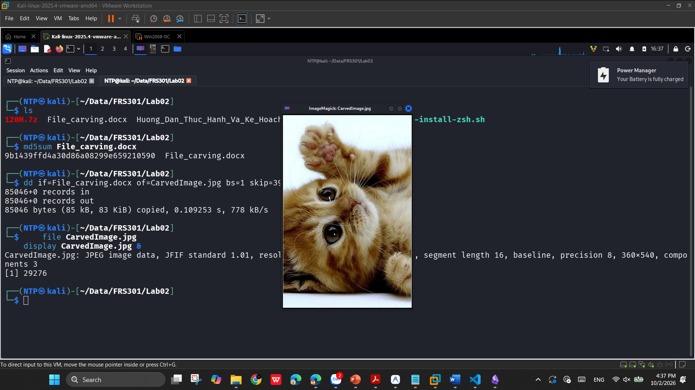

*Hình 4.1. Trích xuất ảnh bằng dd và hiển thị ảnh CarvedImage.jpg.*

**d) Kết quả & diễn giải:**

```bash
85046+0 records in
85046+0 records out
85046 bytes (85 kB, 83 KiB) copied, 0.109253 s, 778 kB/s
-rw-r--r-- 1 root root 85046 Sep 23 23:27 CarvedImage.jpg
CarvedImage.jpg: JPEG image data, JFIF standard 1.01, resolution (DPI), density 220x220, segment length 16, baseline, precision 8, 360x540, components 3
```

Quá trình carve thủ công đã thành công. Ảnh CarvedImage.jpg được trích xuất với kích thước 85,046 bytes, hiển thị hình ảnh một chú mèo con. Kỹ thuật này chứng minh khả năng khôi phục dữ liệu ẩn ngay cả khi tệp chứa bị hỏng header.

### Phần 2 – Carving/Khôi phục ảnh USB

### Bước 1. Chuẩn bị ảnh USB

**a) Mô tả thao tác:** Tải tệp nén 120M.7z từ GitHub, tính mã hash (MD5, SHA-256) để xác minh tính toàn vẹn. Giải nén tệp để lấy ảnh USB usb_fat_carving.001 và file log usb_fat_carving.001.txt. Kiểm tra mã hash của ảnh USB sau khi giải nén.

**b) Câu lệnh / cấu hình đã sử dụng:**

```bash
wget https://raw.githubusercontent.com/frankwxu/digital-forensics-lab/main/Basic_Computer_Skills_for_Forensics/file_carving/usb_image/120M.7z
ls -l 120M.7z
md5sum 120M.7z
sha256sum 120M.7z
7z e 120M.7z
md5sum usb_fat_carving.001
md5sum usb_fat_carving.001.txt
cat usb_fat_carving.001.txt | grep "checksum"
```

```bash
dfe7b5424e54cd1bf50d5df47aceeb3c  120M.7z
2d2a3d93c9ec65bcad9f89c9894429ea72caa8add07726a3b96ec9a6ab6a58ce  120M.7z
124780544 bytes (119 MiB) usb_fat_carving.001
ba4a1d0ba49f4a6667b00a3b3e85e604  usb_fat_carving.001
568d6b183c03ff6f3e01e3915846be60  usb_fat_carving.001.txt
MD5 checksum:  ba4a1d0ba49f4a6667b00a3b3e85e604 : verified
SHA1 checksum: bcc2d49fd49c9521ecb1739f6542c6bf327375ef : verified
```

**c) Ảnh minh chứng:**

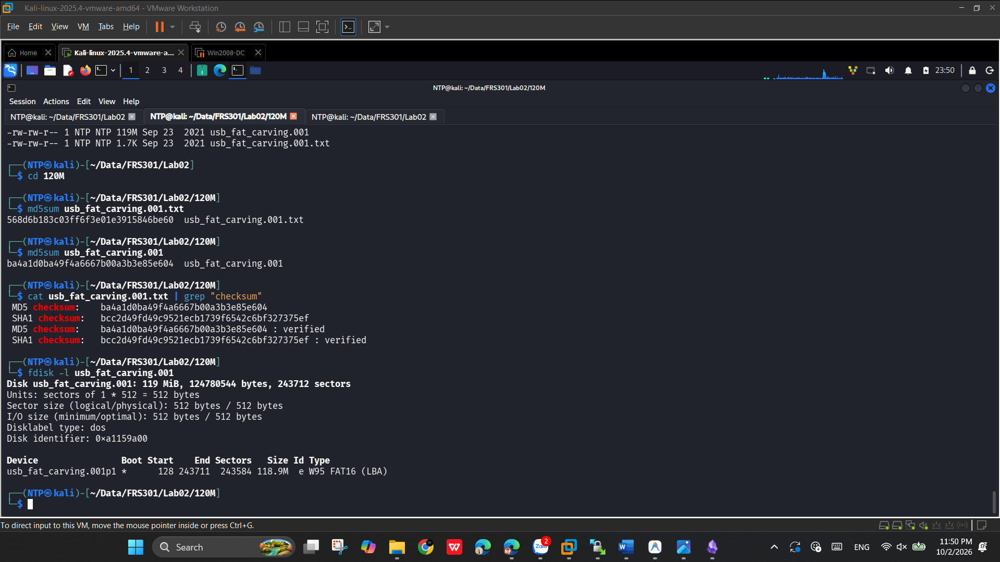

*Hình 5.1. Giải nén 120M.7z và xác minh mã hash của usb_fat_carving.00.*

**d) Kết quả & diễn giải:** Ảnh USB usb_fat_carving.001 có kích thước 124,780,544 bytes (khoảng 119 MB). Mã MD5 và SHA1 khớp với giá trị trong file log, xác nhận bằng chứng không bị thay đổi trong quá trình giải nén

### Bước 2. Kiểm tra nội dung USB

**a) Mô tả thao tác:** Sử dụng fdisk để xem cấu trúc partition của ảnh USB. Xác định partition FAT16 bắt đầu tại sector 128. Sử dụng fls để liệt kê các tệp tin trong partition, bao gồm các tệp đã bị xóa (đánh dấu *).

**b) Câu lệnh / cấu hình đã sử dụng:**

```bash
fdisk -l usb_fat_carving.001
fls -o 128 usb_fat_carving.001
```

```bash
Disk usb_fat_carving.001: 119 MiB, 124780544 bytes, 243712 sectors
Units: sectors of 1 * 512 = 512 bytes
Device            Boot Start    End Sectors  Size Id Type
usb_fat_carving.001p1 *    128 243711  243584 118.9M  e W95 FAT16 (LBA)
```

**c) Ảnh minh chứng:**

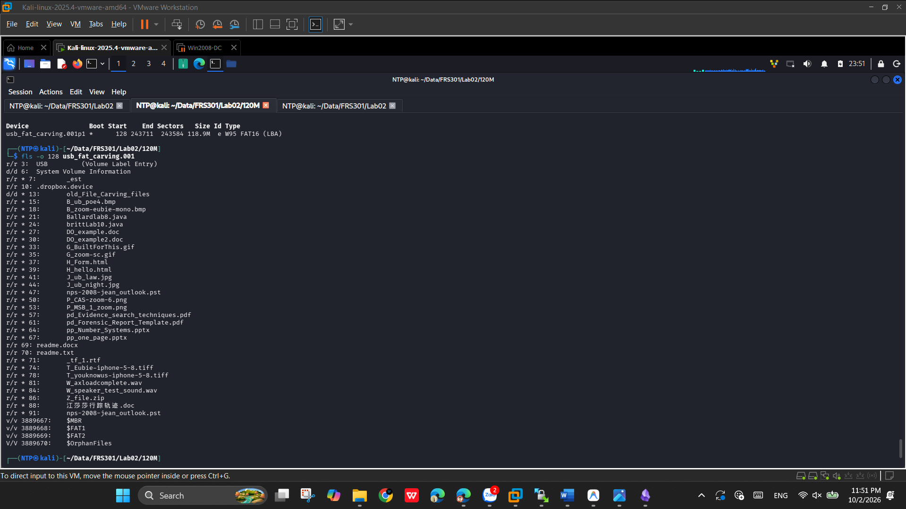

Hình6.1. Xem cấu trúc partition bằng fdisk và liệt kê tệp bằng fls.

**d) Kết quả & diễn giải:** Ảnh USB có một partition FAT16 bắt đầu tại sector 128. Nhiều tệp tin đã bị xóa được phát hiện, bao gồm các tệp hình ảnh (B_usb_photo.bmp, J_ub_law.jpg, J_ub_night.jpg), tài liệu (DO_example.doc), và các tệp khác. Điều này cho thấy USB có chứa dữ liệu cần khôi phục.

### Bước 3. Cấu hình và chạy Scalpel

**a) Mô tả thao tác:** Chỉnh sửa file cấu hình /etc/scalpel/scalpel.conf để bật carve cho định dạng JPG (bỏ comment dòng jpg). Sau đó chạy Scalpel với tham số -o output để carve các tệp JPG từ ảnh USB.

**b) Câu lệnh / cấu hình đã sử dụng:**

```bash
sudo nano /etc/scalpel/scalpel.conf
# Bỏ comment dòng:
# jpg y 5242880 \xff\xd8\xff\xe0\x00\x10 \xff\xd9
# jpg y 5242880 \xff\xd8\xff\xe1 \xff\xd9

scalpel usb_fat_carving.001 -o output
```

```bash
Scalpel version 1.60
Opening target "/home/NTP/Data/FRS301/Lab02/120M/usb_fat_carving.001"
Image file pass 1/2.
usb_fat_carving.001: 100.0% |*************************| 119.0 MB 00:00 ETA
Carving files from image.
Image file pass 2/2.
usb_fat_carving.001: 100.0% |*************************| 119.0 MB 00:00 ETA
Processing of image file complete. Cleaning up...
Done.
Scalpel is done, files carved = 17, elapsed = 1 seconds.
```

**c) Ảnh minh chứng:**

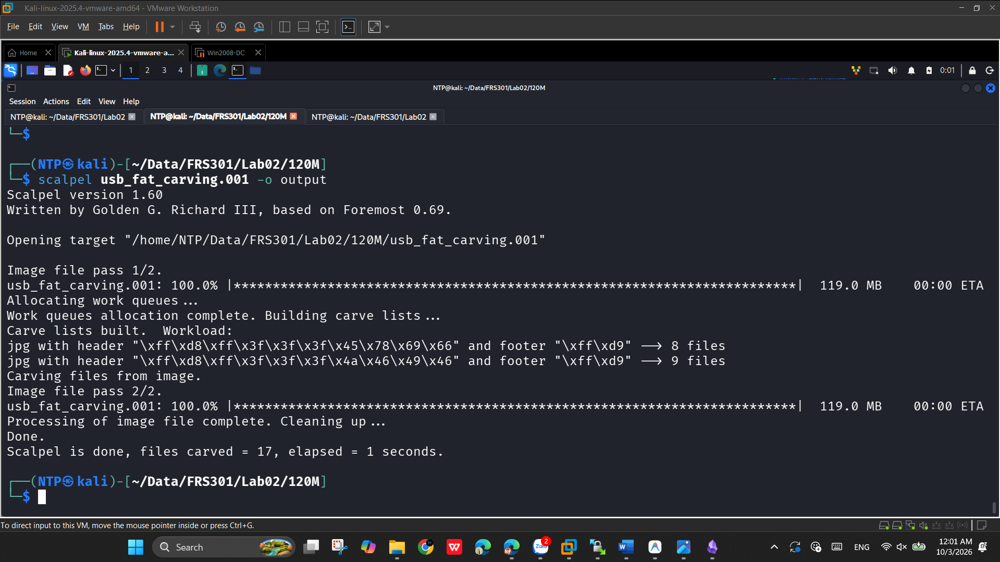

Hình7.1. Chạy Scalpel để carve ảnh JPG từ USB image.

**d) Kết quả & diễn giải:** Scalpel đã carve thành công 17 tệp JPG từ ảnh USB. Quá trình carve chỉ mất 1 giây nhờ thuật toán tối ưu của Scalpel. Kết quả này chứng minh hiệu quả của việc tự động hóa quá trình carving so với phương pháp thủ công.

### Bước 4. Hiển thị ảnh đã carve

**a) Mô tả thao tác:** Sử dụng tree để xem cấu trúc thư mục output và file audit.txt. Hiển thị hai ảnh JPG đã carve bằng lệnh display của ImageMagick.

**b) Câu lệnh / cấu hình đã sử dụng:**

```bash
tree output
cat output/audit.txt
display -resize 500x600 output/jpg-0-0/00000000.jpg
display -resize 500x600 output/jpg-1-0/00000008.jpg
```

```bash
Kết quả:
Scalpel version 1.60 audit file
Started at Fri Oct  2 23:58:58 2026
Command line:
scalpel usb_fat_carving.001 -o output

The following files were carved:
File          Start      Chop  Length    Extracted From
00000000.jpg  3897344    NO    3048148   usb_fat_carving.001
00000001.jpg  5285888    NO    1659604   usb_fat_carving.001
...
00000016.jpg  36671488   NO    2889262   usb_fat_carving.001

Completed at Fri Oct  2 23:58:59 2026
```

**c) Ảnh minh chứng:**

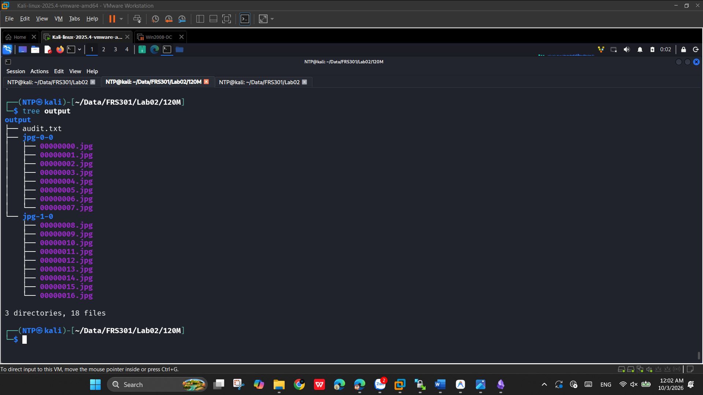

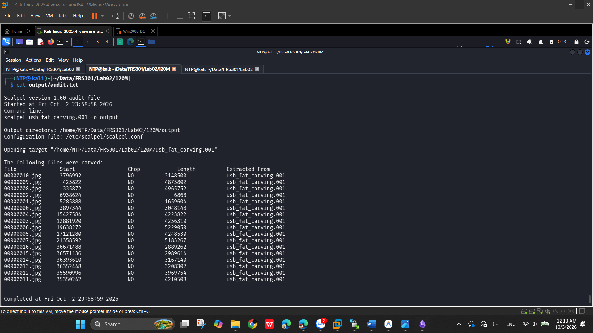

Hình8.1. Cấu trúc thư mục output và file audit.txt.

**c) Ảnh minh chứng:**

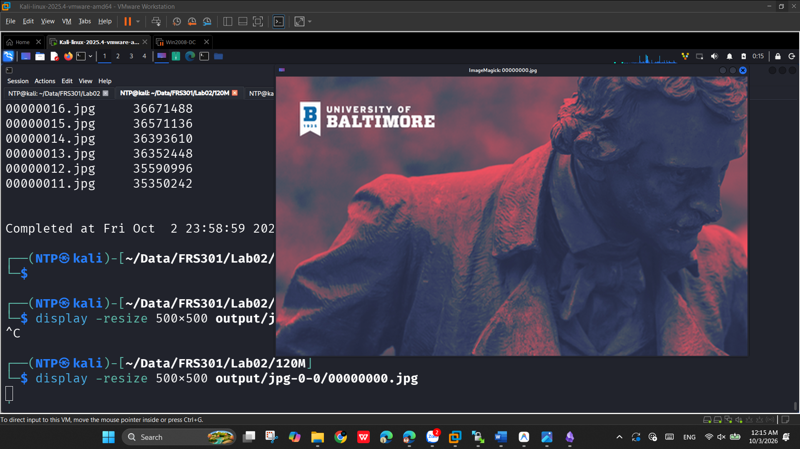

Hình8.2. Hiển thị ảnh 00000000.jpg (tượng University of Baltimore).

**c) Ảnh minh chứng:**

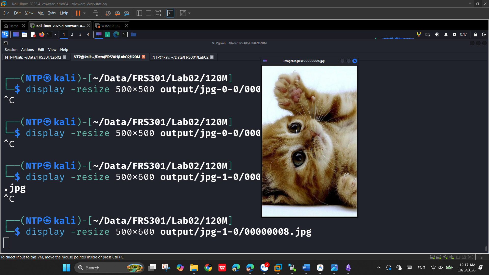

Hình8.3. Hiển thị ảnh 00000008.jpg (mèo con)

**d) Kết quả & diễn giải:** Thư mục output chứa 2 thư mục con (jpg-0-0 và jpg-1-0) với tổng cộng 18 tệp JPG (bao gồm cả file audit.txt). File audit.txt ghi lại chi tiết vị trí (offset), kích thước của từng tệp đã carve. Hai ảnh được hiển thị thành công: một ảnh tượng University of Baltimore và một ảnh mèo con, chứng minh dữ liệu đã được khôi phục chính xác.

## 3. Tổng hợp Kết quả Điều tra (Forensic Findings)

### 3.1. Bảng tổng hợp kết quả điều tra (Forensic Findings Summary)

| STT | Timestamp /<br>Hạng mục | Đối tượng / Giá trị | Mô tả / Nhận định |
| --- | --- | --- | --- |
| 1 | MD5 File_carving.docx | 9b1439ffd4a30d86a08299e659210590 | Mã hash của tệp Word bị hỏng |
| 2 | Header JPEG (offset) | 0F5E (hex) = 3934 (dec) | Vị trí bắt đầu ảnh ẩn trong file Word |
| 3 | Trailer JPEG (offset) | 15B93 (hex) = 88979 (dec) | Vị trí kết thúc ảnh ẩn |
| 4 | Kích thước ảnh carve | 85,046 bytes | Kích thước ảnh CarvedImage.jpg |
| 5 | MD5 usb_fat_carving.001 | ba4a1d0ba49f4a6667b00a3b3e85e604 | Mã hash của ảnh USB |
| 6 | Số tệp carve được | 17 tệp JPG | Kết quả từ Scalpel |
| 7 | Thời gian carve | ~1 giây | Hiệu suất của Scalpel |

## 4. Phân tích Chuyên sâu & Giải đáp Kỹ thuật (In-Depth Forensic Analysis)

#### ❓ Câu 1. Data Carving là gì và tại sao kỹ thuật này quan trọng trong điều tra số?

**Trả lời:** Data Carving là kỹ thuật khôi phục dữ liệu từ các vùng chưa cấp phát (unallocated space) hoặc từ các tệp bị hỏng header/footer, dựa trên việc nhận diện các signature (magic numbers) đặc trưng của từng định dạng tệp. Kỹ thuật này quan trọng vì nó cho phép điều tra viên khôi phục các bằng chứng số ngay cả khi hệ thống tệp bị hỏng, tệp bị xóa, hoặc dữ liệu bị ẩn bên trong các tệp khác. Trong bài lab, quá trình điều tra đã áp dụng thành công để trích xuất ảnh từ một file Word bị hỏng và khôi phục 17 ảnh JPG từ USB image..

#### ❓ Câu 2. Sự khác biệt giữa carving thủ công (dùng hex editor + dd) và carving tự động (dùng Scalpel) là gì?

**Trả lời:**

Carving thủ công: Yêu cầu người thực hiện phải hiểu rõ cấu trúc tệp, tự tìm kiếm signature bằng hex editor, tính toán offset và kích thước, sau đó dùng dd để trích xuất. Phương pháp này cho độ chính xác cao nhưng tốn thời gian và chỉ phù hợp với số lượng ít tệp.

Carving tự động (Scalpel): Sử dụng file cấu hình chứa các signature của nhiều định dạng tệp, tự động quét toàn bộ ảnh và trích xuất tất cả các tệp khớp. Phương pháp này nhanh chóng, hiệu quả với số lượng lớn tệp nhưng có thể tạo ra một số false positives (tệp không hợp lệ).

#### ❓ Câu 3. Tại sao cần phải kiểm tra mã hash trước và sau khi carve?

**Trả lời:** Mã hash (MD5, SHA-1, SHA-256) được sử dụng để đảm bảo tính toàn vẹn của bằng chứng (Chain of Custody). Việc kiểm tra hash trước khi carve giúp xác nhận dữ liệu gốc không bị thay đổi trong quá trình thu thập. Sau khi carve, hash của tệp kết quả được so sánh với hash của dữ liệu nguồn (nếu có) để chứng minh rằng quá trình carve không làm sai lệch dữ liệu. Trong bài lab, quá trình điều tra đã xác minh MD5 của usb_fat_carving.001 khớp với giá trị trong file log, đảm bảo bằng chứng không bị thay đổi.

## 5. Kết luận, Xử lý Sự cố & Bài học Kinh nghiệm (Conclusions & Lessons Learned)

### 5.1. Kết luận Điều tra

#### Carving thủ công: Trích xuất thành công ảnh CarvedImage.jpg (85,046 bytes) từ tệp File_carving.docx bị hỏng, sử dụng hex editor để xác định offset header (3934) và trailer (88979), sau đó dùng dd để trích xuất.

#### Carving tự động: Sử dụng Scalpel để carve 17 tệp JPG từ ảnh USB usb_fat_carving.001 (119 MB). Kết quả được ghi lại trong file audit.txt với đầy đủ thông tin về offset và kích thước từng tệp. Hai ảnh tiêu biểu đã được hiển thị thành công.

### 5.2. Nhật ký Xử lý Sự cố Kỹ thuật (Troubleshooting Log)

| STT | Khó khăn / lỗi gặp phải | Giải pháp xử lý kỹ thuật |
| --- | --- | --- |
| 1 | Kali 2025.4 không còn hỗ trợ công cụ bless | Quá trình điều tra đã chuyển sang sử dụng GHex và hexedit để thay thế, cả hai đều có sẵn trong Kali. |
| 2 | File cấu hình scalpel.conf mặc định comment tất cả các định dạng | Quá trình điều tra đã mở file bằng nano, tìm đến dòng jpg và bỏ comment (xóa dấu #) để bật carve cho JPG. |
| 3 | Cần xác định chính xác offset trong hex editor | Quá trình điều tra đã sử dụng chức năng "Find" để tìm signature FFD8FFE0 (header) và FFD9 (trailer), sau đó ghi lại offset hiển thị trên thanh trạng thái. |

### 5.3. Bài học Rút ra (Key Takeaways)

Qua bài lab này, quá trình điều tra đã rút ra được các bài học quan trọng:

Hiểu rõ nguyên lý của kỹ thuật Data Carving và ứng dụng trong điều tra số.

Biết cách sử dụng hex editor để phân tích cấu trúc nhị phân của tệp tin.

Thành thạo công cụ dd để trích xuất dữ liệu thô theo offset và kích thước xác định.

Biết cách cấu hình và sử dụng Scalpel để tự động carve nhiều tệp tin.

Nhận thức được tầm quan trọng của việc xác minh mã hash để đảm bảo tính toàn vẹn của bằng chứng.

Kỹ năng làm việc điều tra viên, phân chia công việc và tổng hợp báo cáo hiệu quả.

## 6. Tài liệu Tham khảo (References)

[1] Tài liệu hướng dẫn thực hành Lab 2: Data Carving, môn FRS301, Trường Đại học FPT.

[2] Frank Xu, "Digital Forensics Lab - File Carving", GitHub repository. [Online]. Available: https://github.com/frankwxu/digital-forensics-lab

[3] Golden G. Richard III, "Scalpel: A Frugal, High Performance File Carver", 2005.

[4] AccessData, "FTK Imager User Guide", AccessData Group.
