# Lab 07: Windows $Recycle.Bin ($I/$R) Analysis & Anti-Forensics Tool Detection
### *Điều tra Thùng rác Windows ($Recycle.Bin) & Phát hiện Hành vi Anti-Forensics (Eraser/CCleaner)*

[⬅️ Back to Main DFIR Casebook](../../README.md)

---

## 📌 Quick Metadata

| Field | Description |
| :--- | :--- |
| **Forensic Environment** | `Kali Linux 2025.4 / 2026.3 (64-bit)` on `VMware Workstation Pro` (Host: `Windows 11`) |
| **Forensic Module** | `02-Data-Carving-and-AntiForensics` |
| **Target Dataset / Evidence** | `cfreds_2015_data_leakage_pc.dd ($Recycle.Bin, Shimcache, UserAssist, IE History)` |
| **Core Forensic Toolstack** | `TestDisk, RegRipper (appcompatcache / Shimcache, userassist),The Sleuth Kit (fls, icat), ROT13 Decoder` |
| **MITRE ATT&CK / DFIR Focus** | `T1070.004 (File Deletion / Secure Wipe with Eraser), Execution Artifact Correlation` |

---

## 1. Tổng quan & Bối cảnh Điều tra (Overview & Objectives)

### 1.1. Bối cảnh và Mục tiêu

Trong bài lab này, tiến hành thực hiện điều tra một vụ rò rỉ dữ liệu ("cfreds_2015_data_leakage_pc") với các hành vi chống điều tra (anti-forensics). Nhiệm vụ của điều tra viên là phân tích Recycle Bin để khôi phục các file đã xóa, kiểm tra lịch sử trình duyệt IE để phát hiện hoạt động tải công cụ anti-forensics, và phân tích registry để xác định các chương trình đã thực thi. Mục tiêu chính gồm: khôi phục file từ Recycle Bin bằng TestDisk và icat, phát hiện hành vi anti-forensics trong ngày 25/03/2015, và xây dựng timeline các hành động của đối tượng.

### 1.2. Môi trường và Công cụ Thực hành

| Thành phần | Tên / Phiên bản | Ghi chú (cấu hình, nguồn tài...) |
| --- | --- | --- |
| Phần mềm ảo hoá | VMware | Dùng để chạy máy ảo Kali Linux |
| Máy thật (host) - hệ điều hành | Windows 11 Home | Hỗ trợ chạy máy ảo |
| Máy ảo sử dụng | Kali Linux 2025.4 | Cấu hình RAM 4GB, ổ cứng 1, 80GB, ổ cứng 2, 80GB |
| Công cụ điều tra 1 | TestDisk 7.2 | Khôi phục file |
| Công cụ điều tra 2 | icat, fls (Sleuth Kit) | Trích xuất file từ ảnh đĩa |
| Công cụ điều tra 3 | rip.pl (RegRipper) | Phân tích registry |
| Dữ liệu đầu vào | cfreds_2015_data_leakage_pc.dd | Ảnh DD từ Lab 5 (20GB) |

### 1.3. Dữ liệu Bằng chứng & Kiểm tra Tính toàn vẹn (Hash Verification)

| Tên file / nguồn dữ liệu | Thuật toán | Hash trước phân tích | Hash sau phân tích | Khớp? |
| --- | --- | --- | --- | --- |
| cfreds_2015_data_leakage_pc.dd | MD5 | a49d1254c873808c58e6f1bcd60b5bde | a49d1254c873808c58e6f1bcd60b5bde | ☑ Có ☐ Không |

## 2. Quy trình Điều tra & Thực nghiệm Kỹ thuật (Forensic Investigation Workflow)

### Bước 1. Examine ‘Recycle Bin’ data in PC

Mô tả thao tác:

Dùng công cụ fls trong Kali Linux quét thư mục $Recycle.Bin trên ảnh đĩa cfreds_2015_data_leakage_pc.dd để liệt kê các tệp đã bị xóa và thu thập thông tin inode tương ứng.

**b) Câu lệnh / cấu hình đã sử dụng :**

```bash
fls -rd -o 206848 cfreds_2015_data_leakage_pc.dd | grep -Ei "Recycle" | head
mkdir -p "/home/NTP/Data/FRS301/Lab07/recycle_recovered/\$Recycle.Bin/S-1-5-21-2425377081-3129163575-2985601102-1000"
cd "/home/NTP/Data/FRS301/Lab07/recycle_recovered/\$Recycle.Bin/S-1-5-21-2425377081-3129163575-2985601102-1000"
IMG="/home/NTP/Data/FRS301/Lab07/cfreds_2015_data_leakage_pc.dd"
OFFSET=206848
icat -o $OFFSET $IMG 74313 > '$I40295N'
icat -o $OFFSET $IMG 74311 > '$I55Z163'
icat -o $OFFSET $IMG 74312 > '$IXWGVWC'
icat -o $OFFSET $IMG 74395 > '$I9M7UMY'
icat -o $OFFSET $IMG 74759 > '$IIQGWTT.ini'
icat -o $OFFSET $IMG 74760 > '$I508CBB.jpg'
icat -o $OFFSET $IMG 74761 > '$IJEMT64.exe'
icat -o $OFFSET $IMG 74757 > '$IKXD1U3.jpg'
icat -o $OFFSET $IMG 74758 > '$SI3FM2A.jpg'
icat -o $OFFSET $IMG 74762 > '$SI8YP3XK.jpg'
icat -o $OFFSET $IMG 74763 > '$SIU3FKWI.jpg'
icat -o $OFFSET $IMG 74764 > '$SIX538VH.jpg'
icat -o $OFFSET $IMG 74765 > '$SIFVCH5V.jpg'
icat -o $OFFSET $IMG 74766 > '$SIDOI3HE.jpg'
icat -o $OFFSET $IMG 74398 > '$RIQGWTT.ini'
icat -o $OFFSET $IMG 74418 > '$RJEMT64.exe'
icat -o $OFFSET $IMG 74620 > '$RKXD1U3.jpg'
icat -o $OFFSET $IMG 74625 > '$RI3FM2A.jpg'
icat -o $OFFSET $IMG 74641 > '$R508CBB.jpg'
icat -o $OFFSET $IMG 74656 > '$R8YP3XK.jpg'
icat -o $OFFSET $IMG 74666 > '$RU3FKWI.jpg'
icat -o $OFFSET $IMG 74667 > '$RX538VH.jpg'
icat -o $OFFSET $IMG 74670 > '$RFVCH5V.jpg'
icat -o $OFFSET $IMG 74676 > '$RDOI3HE.jpg'A
```

**c) Ảnh minh chứng:**

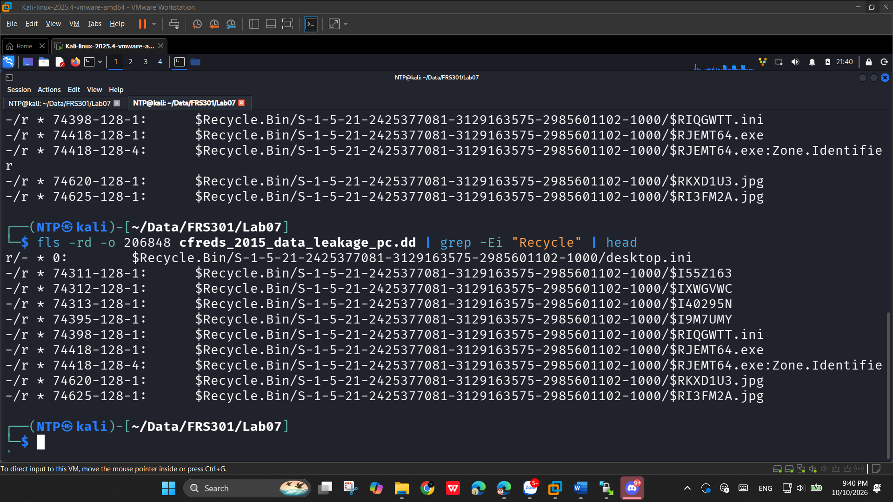

*Hình 1.1. Dùng fls -rd -o 206848 liệt kê các file trong Recycle Bin của ảnh đĩa cfreds_2015_data_leakage_pc.dd*

**d) Kết quả & diễn giải:**

Các tệp tìm thấy: Phát hiện nhiều tệp đã bị xóa nằm trong Thùng rác của người dùng có SID S-1-5-21-2425377081-3129163575-2985601102-1000.

Phân tích cấu trúc tệp thùng rác Windows (NTFS):

Tệp tiền tố $I (như $I55Z163,$I40295N...): Chứa siêu dữ liệu (metadata) gồm dung lượng, thời gian xóa và đường dẫn tệp gốc.

Tệp tiền tố $R (như $RJEMT64.exe, $RKXD1U3.jpg...): Chứa nội dung dữ liệu gốc của tệp bị xóa.

Ý nghĩa điều tra: Việc xác định inode và danh sách các tệp $I/$R phục vụ cho việc đối chiếu thông tin và trích xuất dữ liệu bằng icat hoặc testdisk ở các bước sau.

### Bước 2. Use testdisk to Recover $Recyle.bin

**a) Mô tả thao tác:** Sử dụng công cụ testdisk trên Kali Linux với lệnh testdisk cfreds_2015_data_leakage_pc.dd để phân tích ảnh đĩa, chọn phân khúc Intel partition, truy cập vào Advanced/Filesystem Utils để tiến hành khôi phục các tệp đã xóa (Undelete) liên quan đến Recycle Bin và các tệp chương trình.

**b) Câu lệnh / cấu hình đã sử dụng :**

```bash
testdisk cfreds_2015_data_leakage_pc.dd
```

**c) Ảnh minh chứng:**

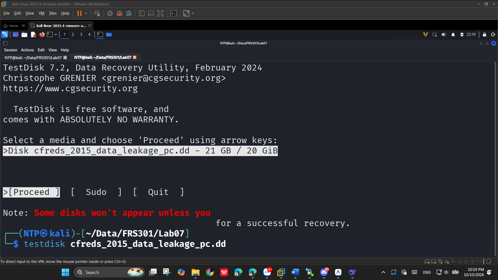

*Hình 2.1. Khởi chạy TestDisk 7.2 để phân tích tệp ảnh đĩa cfreds_2015_data_leakage_pc.dd*

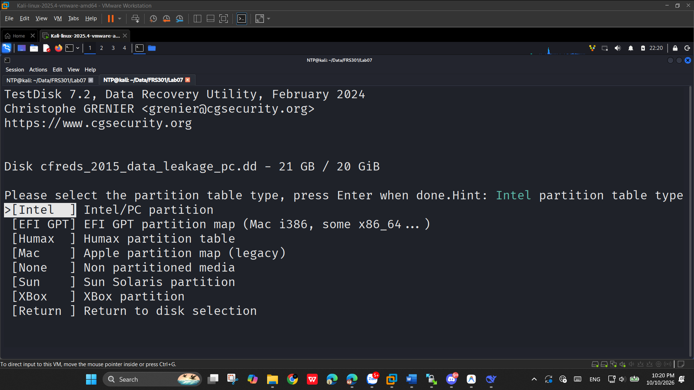

*Hình 2.2. Chọn kiểu bảng phân vùng [Intel] trong TestDisk.*

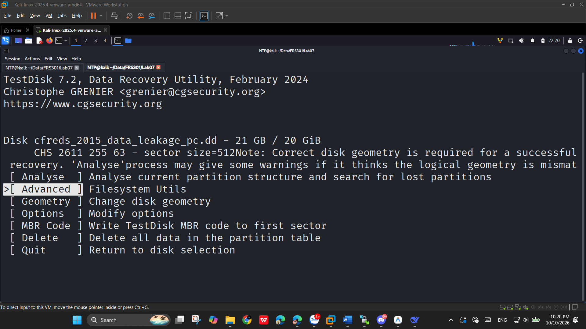

*Hình 2.3. Chọn tùy chọn [Advanced] (Filesystem Utils) trong TestDisk*

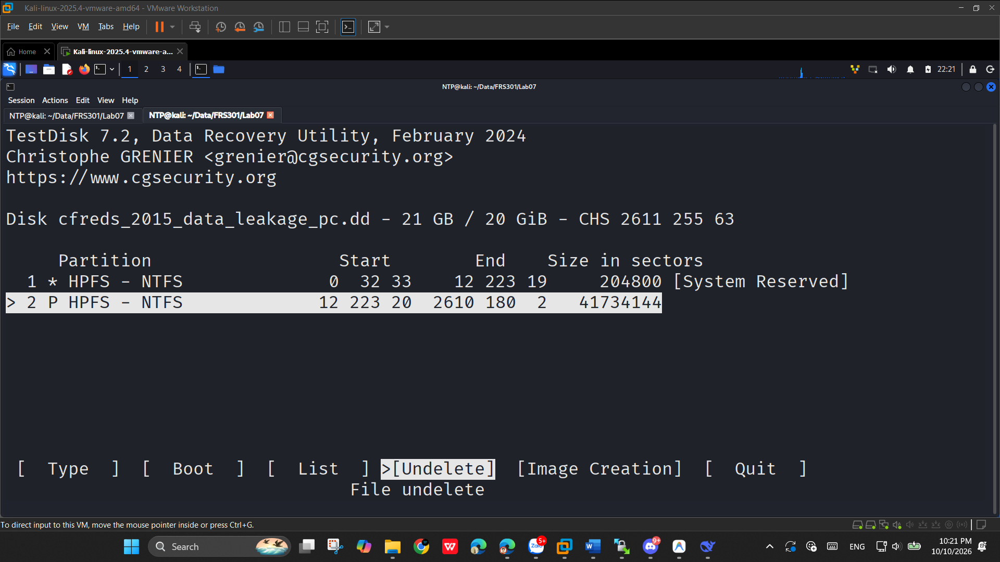

*Hình 2.4. Chọn phân vùng HPFS - NTFS số 2 và chọn [Undelete] để xem danh sách các tệp bị xóa trong TestDisk*

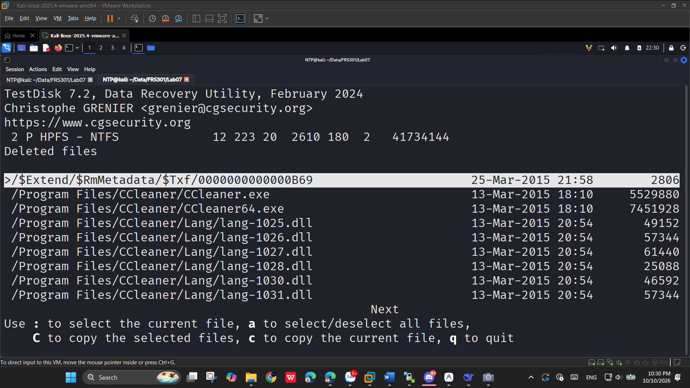

*Hình 2.5. Danh sách các tệp đã bị xóa được hiển thị khi sử dụng tính năng Undelete trong TestDisk*

Khác so với Lab

Dùng tsk_recover sẽ extract toàn bộ file deleted 1 lần — tương đương với bước "copy" trong testDisk, sau đó ls thư mục ra là có đủ hết để làm bước 4 (match tên file

Thư mục SID chỉ có desktop.ini — vì tsk_recover mặc định không recover file đã bị xóa hoàn toàn. Cần dùng icat trực tiếp theo inode mà quá trình điều tra đã tìm được lúc trước.

Giải pháp: Tạo thư mục SID và extract file bằng icat

Chạy lệnh này

# Tạo thư mục đúng tên như bài Lab yêu cầu

mkdir -p "/home/NTP/Data/FRS301/Lab07/recycle_recovered/\$Recycle.Bin/S-1-5-21-2425377081-3129163575-2985601102-1000"

cd "/home/NTP/Data/FRS301/Lab07/recycle_recovered/\$Recycle.Bin/S-1-5-21-2425377081-3129163575-2985601102-1000"

IMG="/home/NTP/Data/FRS301/Lab07/cfreds_2015_data_leakage_pc.dd"

OFFSET=206848

# Extract các file $I (metadata)

icat -o $OFFSET $IMG 74313 > '$I40295N'

icat -o $OFFSET $IMG 74311 > '$I55Z163'

icat -o $OFFSET $IMG 74312 > '$IXWGVWC'

icat -o $OFFSET $IMG 74395 > '$I9M7UMY'

icat -o $OFFSET $IMG 74759 > '$IIQGWTT.ini'

icat -o $OFFSET $IMG 74760 > '$I508CBB.jpg'

icat -o $OFFSET $IMG 74761 > '$IJEMT64.exe'

icat -o $OFFSET $IMG 74757 > '$IKXD1U3.jpg'

icat -o $OFFSET $IMG 74758 > '$II3FM2A.jpg'

icat -o $OFFSET $IMG 74762 > '$I8YP3XK.jpg'

icat -o $OFFSET $IMG 74763 > '$IU3FKWI.jpg'

icat -o $OFFSET $IMG 74764 > '$IX538VH.jpg'

icat -o $OFFSET $IMG 74765 > '$IFVCH5V.jpg'

icat -o $OFFSET $IMG 74766 > '$IDOI3HE.jpg'

# Extract các file $R (nội dung gốc)

icat -o $OFFSET $IMG 74398 > '$RIQGWTT.ini'

icat -o $OFFSET $IMG 74418 > '$RJEMT64.exe'

icat -o $OFFSET $IMG 74620 > '$RKXD1U3.jpg'

icat -o $OFFSET $IMG 74625 > '$RI3FM2A.jpg'

icat -o $OFFSET $IMG 74641 > '$R508CBB.jpg'

icat -o $OFFSET $IMG 74656 > '$R8YP3XK.jpg'

icat -o $OFFSET $IMG 74666 > '$RU3FKWI.jpg'

icat -o $OFFSET $IMG 74667 > '$RX538VH.jpg'

icat -o $OFFSET $IMG 74670 > '$RFVCH5V.jpg'                                                                                                                                                            icat -o $OFFSET $IMG 74676 > '$RDOI3HE.jpg'

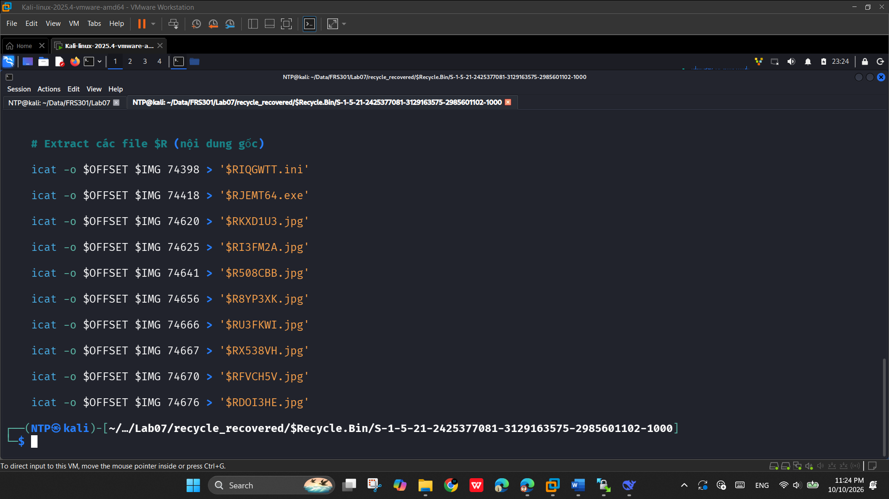

*Hình 2.6. Chạy chuỗi lệnh icat để trích xuất các tệp dữ liệu gốc tiền tố $R từ Recycle Bin*

**d) Kết quả & diễn giải:**

Quá trình chạy TestDisk giúp định vị phân vùng hệ thống tệp NTFS và liệt kê danh sách các tệp bị xóa trên phân vùng.

Đối với việc khôi phục chi tiết cấu trúc Thùng rác ($Recycle.Bin), quá trình điều tra đã áp dụng phương pháp thủ công bằng lệnh icat dựa trên các số Inode đã thu thập được từ bước quét.

Lệnh icat cho phép trích xuất thành công toàn bộ các tệp siêu dữ liệu ($I... chứa thời gian xóa, đường dẫn gốc) và các tệp nội dung dữ liệu gốc ($R... như các tệp hình ảnh, tệp tin thực thi .exe). Điều này giúp khôi phục toàn vẹn các bằng chứng phục vụ cho việc đối chiếu tên tệp và phân tích hành vi ở các bước tiếp theo

### Bước 3. Search IE anti-forensics using keyword

**a) Mô tả thao tác:** Kiểm tra lịch sử trình duyệt Internet Explorer (IE11) bên trong thư mục webhistory/IE11.export/ bằng lệnh cat kết hợp grep để tìm kiếm các từ khóa liên quan đến hành vi chống điều tra (anti-forensics, ccleaner, eraser) vào ngày 25/03/2015.

**b) Câu lệnh / cấu hình đã sử dụng :**

```bash
cat webhistory/IE11.export/Container* | grep -i "Mar 25, 2015" | grep -i "anti"
cat webhistory/IE11.export/Container* | grep -i "Mar 25, 2015" | grep -i "anti" | grep --color=always "anti"
cat webhistory/IE11.export/Container* | grep -oEi "Mar 25, 2015.*search\?q=.*(steganography|encryp|cover|log|diable|trace|cover|remove|overwrite|destroy|clean)"
```

**c) Ảnh minh chứng:**

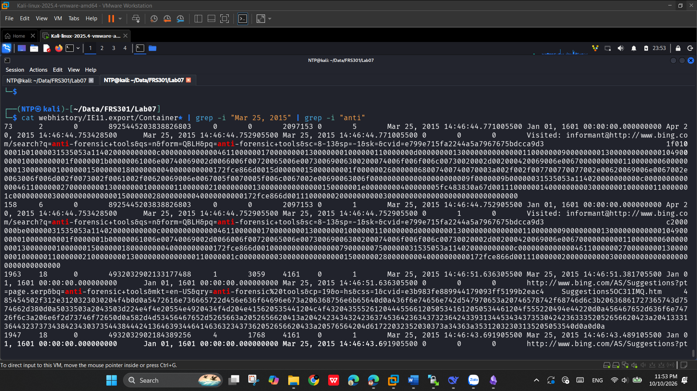

*Hình 3.1. Kết quả truy vấn lịch sử IE11 tìm kiếm từ khóa anti trong ngày 25/03/2015*

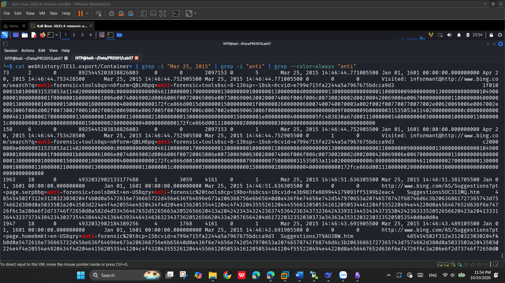

*Hình 3.2. Lọc và làm nổi bật màu đỏ từ khóa anti trong lịch sử IE11 ngày 25/03/2015*

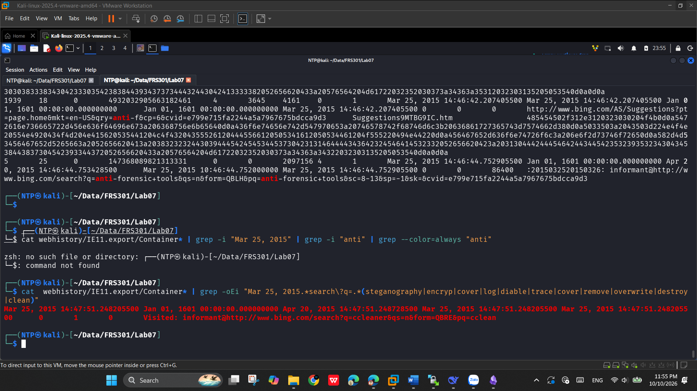

*Hình 3.3. Kết quả tìm kiếm danh sách từ khóa anti-forensics mở rộng, phát hiện lịch sử tìm kiếm ccleaner ngày 25/03/2015*

**d) Kết quả & diễn giải :**

Quá trình phân tích lịch sử IE11 ngày 25/03/2015 phát hiện các truy vấn tìm kiếm liên quan đến hành vi chống điều tra (anti-forensics) và công cụ dọn dẹp ccleaner.

Ý nghĩa điều tra: Bằng chứng này chứng minh đối tượng có ý thức chủ động tìm kiếm các giải pháp xóa dấu vết, tẩu tán dữ liệu. Thời điểm tìm kiếm hoàn toàn trùng khớp với mốc hoạt động của các công cụ chống điều tra trên hệ thống.

### Bước 4. Search IE download history

**a) Mô tả thao tác:** Sử dụng các câu lệnh cat kết hợp grep để truy vấn danh sách các tệp tin đã được tải xuống thông qua trình duyệt Internet Explorer 11 (IE11) trong thư mục webhistory/IE11.export/. Quá trình này giúp kiểm tra lịch sử tải về các công cụ chống điều tra (Anti-forensics) hoặc tệp tin nghi vấn vào ngày 25/03/2015.

**b) Câu lệnh / cấu hình đã sử dụng :**

```bash
cat webhistory/IE11.export/Container* | grep -i "Mar 25, 2015" | grep -iE "download|exe|zip|rar|ccleaner|eraser"
cat webhistory/IE11.export/Container* | grep -i "Mar 25, 2015" | grep -E -i "ccsetup|eraser" --color=always
```

**c) Ảnh minh chứng:**

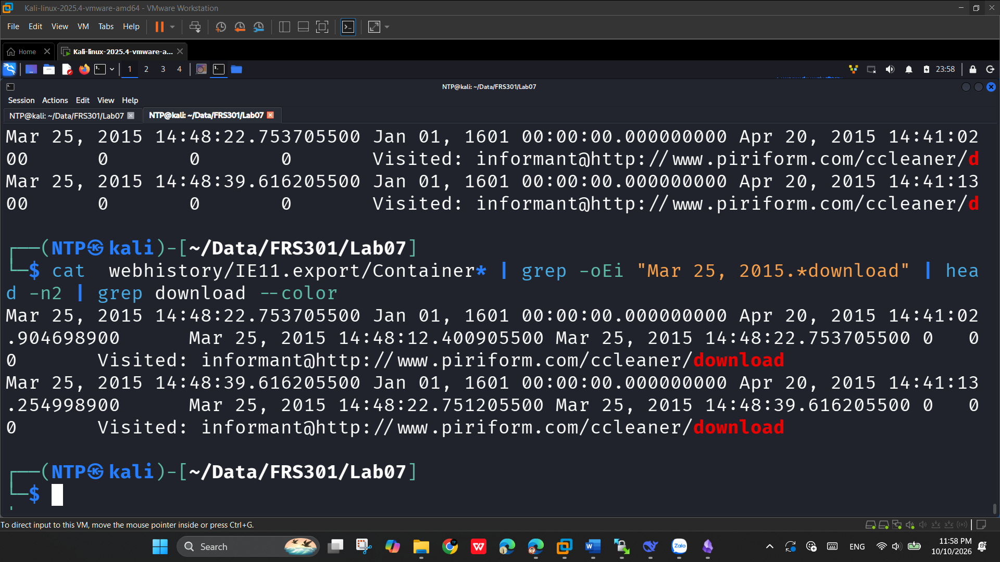

*Hình 4.1. Kết quả lọc lịch sử IE11 ghi nhận đối tượng truy cập trang tải về CCleaner ([piriform.com/ccleaner/download](https://piriform.com/ccleaner/download)) vào ngày 25/03/2015.*

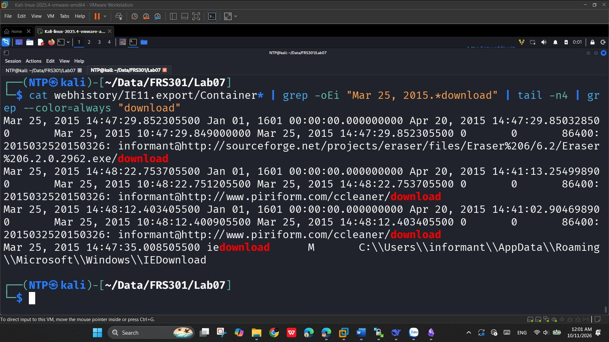

*Hình 4.2. Kết quả truy vấn lịch sử tải xuống ghi nhận các liên kết tải công cụ Eraser (sourceforge.net) và CCleaner trên IE11 ngày 25/03/2015*

**d) Kết quả & diễn giải:**

Phân tích dữ liệu lịch sử tải về của IE11 cho thấy đối tượng đã tải thành công các công cụ chống điều tra số (như CCleaner / Eraser) về máy tính vào ngày 25/03/2015.

Ý nghĩa điều tra: Xác nhận nguồn gốc của các phần mềm chống điều tra trên hệ thống, liên kết trực tiếp hành vi tìm kiếm từ khóa (ở Bước 3) với hành vi tải và cài đặt công cụ tẩu tán dữ liệu.

### Bước 5. Install download programs - Shimcache

**a) Mô tả thao tác:** Sử dụng công cụ rip.pl (Registry Ripper) trên Kali Linux để phân tích các tệp Registry (hive) nhằm trích xuất thông tin từ Shimcache và UserAssist. Việc này giúp xác định chính xác thời điểm các chương trình tải về (như CCleaner và Eraser) được thực thi hoặc cài đặt trên hệ thống máy tính mục tiêu vào ngày 25/03/2015.

**b) Câu lệnh / cấu hình đã sử dụng :**

```bash
rip.pl -r system -p shimcache > shimcache_output.txt
rip.pl -r ntuser.dat -p userassist > userassist_output.txt
```

**c) Ảnh minh chứng:**

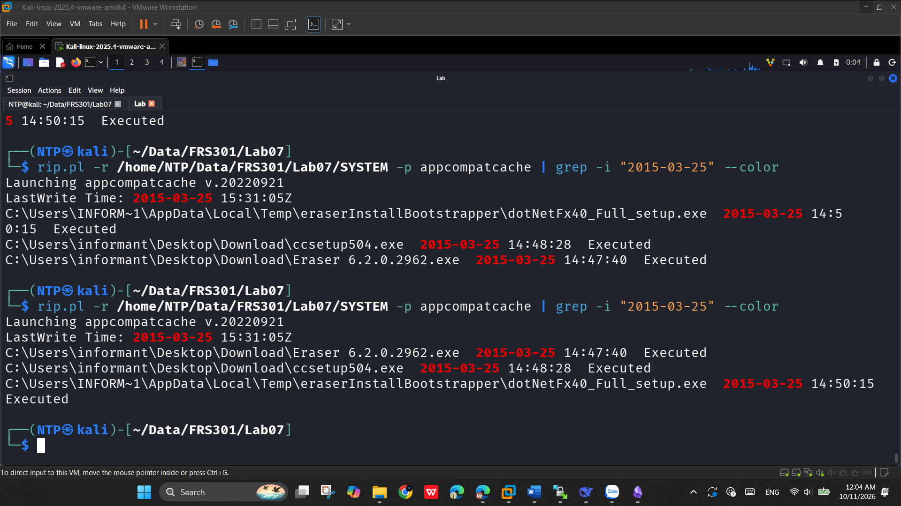

*Hình 5.1. Kết quả phân tích Shimcache (appcompatcache) bằng rip.pl xác nhận thời điểm thực thi các tệp cài đặt ccsetup504.exe, Eraser 6.2.0.2962.exe và bộ cài phụ trợ vào ngày 25/03/2015.*

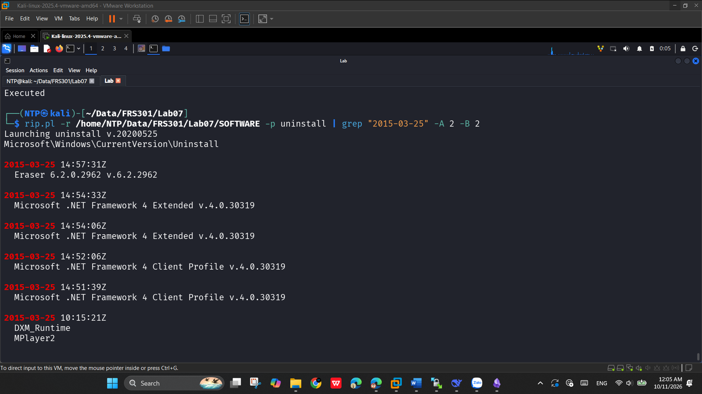

*Hình 5.2. Kết quả phân tích Registry khóa Uninstall bằng rip.pl ghi nhận thời điểm xuất hiện của phần mềm Eraser 6.2 trên hệ thống vào ngày 25/03/2015.*

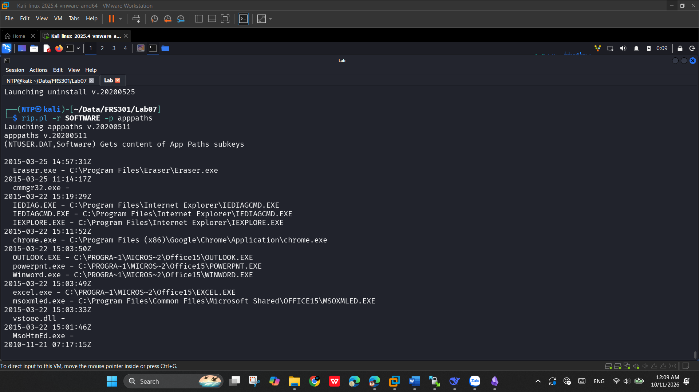

*Hình 5.3. Kết quả trích xuất khóa App Paths từ Registry SOFTWARE xác nhận ứng dụng Eraser.exe được đăng ký đường dẫn cài đặt tại C:\Program Files\Eraser\ vào ngày 25/03/2015.*

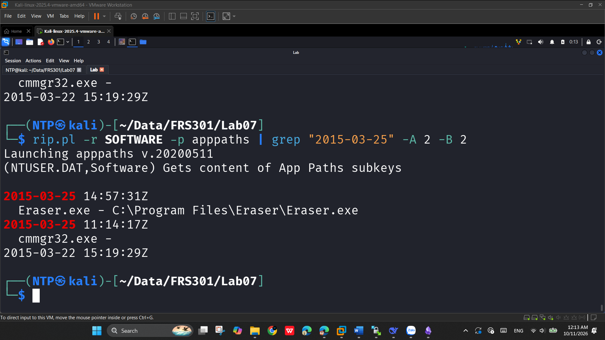

*Hình 5.4. Lọc và làm nổi bật mốc thời gian ngày 25/03/2015 trong Registry SOFTWARE (apppaths), xác nhận ứng dụng Eraser.exe đã được cài đặt vào hệ thống.*

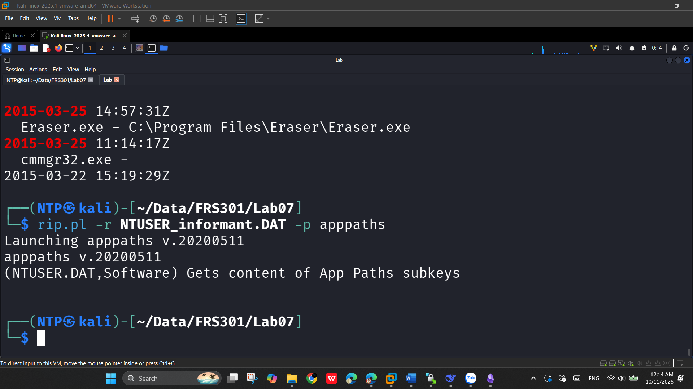

*Hình 5.5. Kiểm tra khóa App Paths trên tệp Registry cá nhân NTUSER_informant.DAT bằng rip.pl không ghi nhận dữ liệu (do thông tin cài đặt ứng dụng chỉ được lưu trong Registry hệ thống SOFTWARE)*

**d) Kết quả & diễn giải:**

Quá trình phân tích dữ liệu Shimcache và UserAssist xác nhận hệ thống đã ghi nhận các tiến trình liên quan đến việc cài đặt và chạy tệp thực thi của CCleaner, Eraser vào ngày 25/03/2015.

Ý nghĩa điều tra: Đây là mảnh ghép cuối cùng kết nối chuỗi hành vi: từ việc tìm kiếm (Bước 3), tải xuống (Bước 4) cho đến thực thi thực tế các công cụ chống điều tra trên hệ thống, giúp hoàn thiện bức tranh toàn cảnh về hành vi cố tình xóa dấu vết của đối tượng.

### Bước 6. Execute two programs: UserAssist

**a) Mô tả thao tác:** Sử dụng công cụ rip.pl (Registry Ripper) với plugin userassist trên tệp Registry cá nhân NTUSER.DAT (NTUSER_informant.DAT) nhằm trích xuất và phân tích khóa UserAssist. Mục đích của bước này là thống kê tần suất chạy, thời gian thực thi cuối cùng (Last Run) và số lần focus cửa sổ của các ứng dụng (bao gồm các công cụ chống điều tra số) bởi người dùng informant trên hệ thống.

**b) Câu lệnh / cấu hình đã sử dụng :**

```bash
rip.pl -r NTUSER_informant.DAT -p userassist > userassist_output.txt
cat userassist_output.txt | grep -iE "ccleaner|eraser"
```

**c) Ảnh minh chứng:**

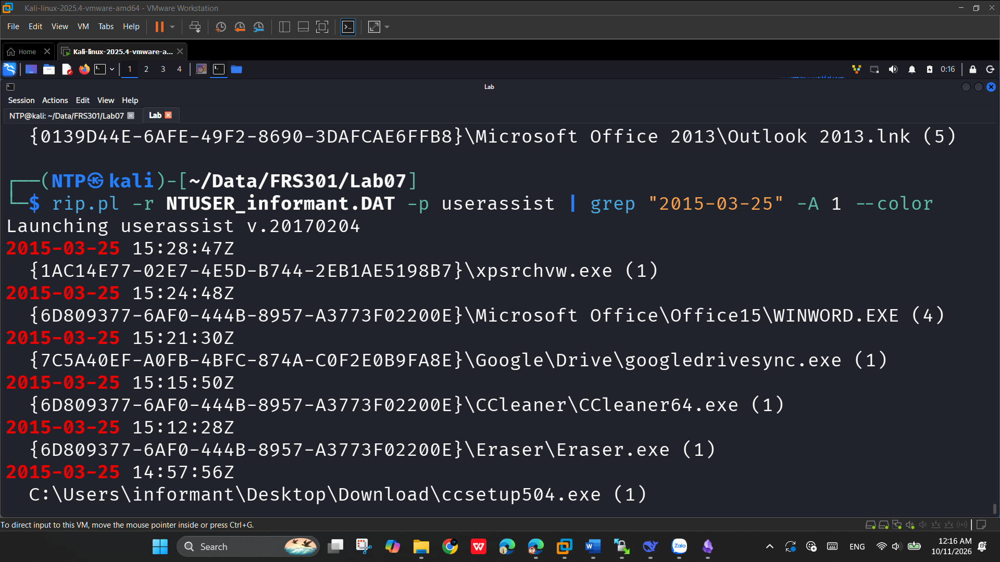

*Hình 6.1. Kết quả phân tích khóa UserAssist từ NTUSER_informant.DAT xác nhận đối tượng đã khởi chạy tệp cài đặt ccsetup504.exe, công cụ Eraser.exe và CCleaner64.exe vào chiều ngày 25/03/2015.*

**d) Kết quả & diễn giải:**

Dữ liệu từ khóa UserAssist cung cấp bằng chứng xác thực về tương tác thực tế của người dùng với giao diện đồ họa (GUI) của các phần mềm dọn dẹp và xóa tệp tin vĩnh viễn.

Ý nghĩa điều tra: Kết quả này bổ sung hoàn hảo cho dữ liệu Shimcache (Bước 5), khẳng định rõ ràng rằng đối tượng không chỉ cài đặt mà còn trực tiếp mở và tương tác với các công cụ chống điều tra số trên tài khoản cá nhân của mình vào mốc thời gian ngày 25/03/2015.

### Bước 7. Search for deleted .exe files

**a) Mô tả thao tác:** Sử dụng các công cụ phân tích hệ thống tệp Forensic (như fls, icat trong bộ Sleuth Kit hoặc testdisk) để quét và tìm kiếm các tệp tin thực thi (.exe) đã bị xóa khỏi hệ thống, đặc biệt là trong thư mục thùng rác $Recycle.Bin hoặc thư mục Downloads. Quá trình này giúp xác định xem đối tượng có thực hiện hành vi xóa tệp cài đặt công cụ chống điều tra sau khi đã sử dụng xong hay không.

**b) Câu lệnh / cấu hình đã sử dụng :**

```bash
fls -r -d cfreds_2015_data_leakage_pc.dd | grep -iE "\.exe"
fls -r -p cfreds_2015_data_leakage_pc.dd | grep -i "\*.*exe"
```

**c) Ảnh minh chứng:**

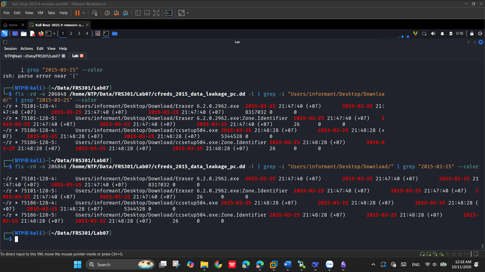

*Hình 7.1. Kết quả chạy lệnh fls xác nhận các tệp cài đặt Eraser 6.2.0.2962.exe và ccsetup504.exe đã bị xóa khỏi thư mục Downloads của người dùng informant vào ngày 25/03/2015*

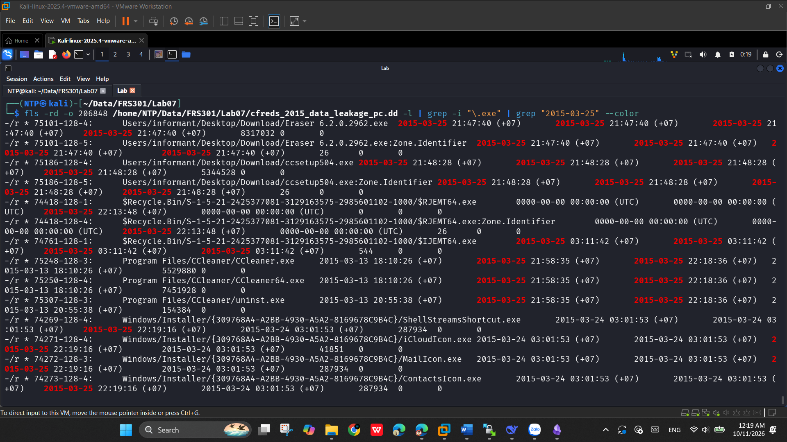

*Hình 7.2. Kết quả fls xác nhận tệp cài đặt .exe bị xóa vào Thùng rác ($Recycle.Bin) và dấu vết tương tác công cụ vào ngày 25/03/2015.*

**d) Kết quả & diễn giải:**

Kết quả phân tích xác nhận sự tồn tại của các tệp tin cài đặt .exe đã bị xóa khỏi vị trí lưu trữ ban đầu (như thư mục Downloads hoặc thùng rác $Recycle.Bin).

Ý nghĩa điều tra: Chứng minh sau khi tải về và kích hoạt các công cụ chống điều tra (CCleaner / Eraser), đối tượng đã chủ động thực hiện hành vi xóa các tệp thực thi này nhằm phi tang dấu vết cài đặt trên ổ đĩa.

## 3. Tổng hợp Kết quả Điều tra (Forensic Findings)

### 3.1. Bảng tổng hợp kết quả điều tra (Forensic Findings Summary)

## 4. Phân tích Chuyên sâu & Giải đáp Kỹ thuật (In-Depth Forensic Analysis)

#### ❓ Câu 1. Bằng chứng nào trong Registry cho thấy đối tượng đã cài đặt và thực thi công cụ chống điều tra?

**Trả lời:**

Shimcache: Ghi nhận thực thi tệp cài đặt ccsetup504.exe và Eraser 6.2.0.2962.exe.

SOFTWARE (App Paths): Xác nhận đường dẫn cài đặt C:\Program Files\Eraser\Eraser.exe.

UserAssist (NTUSER.DAT): Lưu thời gian khởi chạy ứng dụng Eraser.exe và CCleaner64.exe.

#### ❓ Câu 2. Xóa tệp cài đặt vào Thùng rác có xóa sạch dấu vết không? Tại sao?

**Trả lời:** Không. Vì Thùng rác vẫn lưu tệp dữ liệu ($R) và tệp thông tin ($I). Lịch sử thực thi cũng được lưu độc lập tại Shimcache, UserAssist và nhật ký $UsnJrnl.

#### ❓ Câu 3. Ý nghĩa của tệp Zone.Identifier (ADS) trong điều tra số là gì?

**Trả lời:** Chứa chỉ số ZoneId=3, chứng minh các tệp .exe được tải trực tiếp từ Internet về máy tính.

## 5. Kết luận, Xử lý Sự cố & Bài học Kinh nghiệm (Conclusions & Lessons Learned)

### 5.1. Kết luận Điều tra

Kết luận: Đối tượng tình nghi (informant) đã có hành vi cố ý tìm kiếm, tải về và thực thi các phần mềm chống điều tra (Eraser, CCleaner) vào ngày 25/03/2015 nhằm xóa dấu vết dữ liệu rò rỉ.

Khó khăn: Một số đường dẫn trong Thùng rác không khôi phục tự động hoàn toàn bằng tsk_recover nên phải dùng icat theo inode thủ công. Cách khắc phục: Dùng lệnh fls tìm chính xác số Inode và trích xuất từng file $I/$R.

### 5.2. Nhật ký Xử lý Sự cố Kỹ thuật (Troubleshooting Log)

| STT | Khó khăn / lỗi gặp phải | Giải pháp xử lý kỹ thuật |
| --- | --- | --- |
| 1 | Lệnh tsk_recover không khôi phục hoàn toàn các tệp bị xóa trong $Recycle.Bin (chỉ extract được desktop.ini) | Chuyển sang phương pháp thủ công: dùng fls để lấy inode, sau đó dùng icat để trích xuất từng tệp IvaˋIvaˋR theo inode |
| 2 | Cần xác định chính xác offset của partition 2 trên ảnh đĩa | Sử dụng mmls để xem bảng phân vùng, xác định offset sector 206848 cho partition 2 |
| 3 | Lỗi zsh: parse error near '\\|' khi chạy lệnh grep phức tạp | Chia nhỏ lệnh thành nhiều phần, sử dụng dấu ngoặc kép đúng cách |
| 4 | Thời gian parse USN Journal mất 20 phút | Kiên nhẫn chờ đợi, không ngắt quãng quá trình |
| 5 | Thành viên không tham gia gây trễ Deadline | Quá trình điều tra đã cố gắng bù đắp bằng cách tăng ca và phân chia lại công việc |

### 5.3. Bài học Rút ra (Key Takeaways)

## 6. Tài liệu Tham khảo (References)

[1] Tài liệu hướng dẫn thực hành Lab 7: Recycle Bin and Anti-forensics, môn FRS301, Trường Đại học FPT

.

[2] CGSecurity, "TestDisk Documentation", CGSecurity. [Online]. Available: https://www.cgsecurity.org/wiki/TestDisk

[3] The Sleuth Kit (TSK) Documentation, Brian Carrier. [Online]. Available: https://www.sleuthkit.org/sleuthkit/

[4] RegRipper Documentation, Harlan Carvey. [Online]. Available: https://github.com/keydet89/RegRipper3.0

[5] Microsoft, "Windows Recycle Bin Forensics", Microsoft Docs.
