# Lab 10: File Hunting Based on Metadata, Inodes, MACB Timestamps & Magic Bytes
### *Truy tìm Bằng chứng Dựa trên Siêu dữ liệu (Metadata) & Chữ ký Tệp (Magic Bytes)*

[⬅️ Back to Main DFIR Casebook](../../README.md)

---

## 📌 Quick Metadata

| Field | Description |
| :--- | :--- |
| **Forensic Environment** | `Kali Linux 2025.4 / 2026.3 (64-bit)` on `VMware Workstation Pro` (Host: `Windows 11`) |
| **Forensic Module** | `02-Data-Carving-and-AntiForensics` |
| **Target Dataset / Evidence** | `Forensic Disk Image mounted read-only via Loop Device` |
| **Core Forensic Toolstack** | `Linux find, file, stat, ls -li, GHex / Bless Hex Editor, Magic Number Signature Verification` |
| **MITRE ATT&CK / DFIR Focus** | `T1036.008 (Masquerading: Masquerade File Type), Metadata & Inode Filtering` |

---

## 1. Tổng quan & Bối cảnh Điều tra (Overview & Objectives)

### 1.1. Bối cảnh và Mục tiêu

Trong hoạt động điều tra số (Digital Forensics), việc định vị và trích xuất các tệp tin chứng cứ dựa trên thuộc tính và siêu dữ liệu (metadata) đóng vai trò then chốt khi đối tượng tình nghi cố tình thay đổi tên, ẩn giấu hoặc ngụy tạo phần mở rộng của tệp tin. Bài thực hành Lab 10 sử dụng ảnh đĩa USB NTFS.001 (dung lượng ~262MB) chứa nhiều tệp tin chứng cứ thuộc các định dạng khác nhau. Nhiệm vụ của quá trình điều tra điều tra viên là mount an toàn ảnh đĩa ở chế độ chỉ đọc (read-only), khảo sát cấu trúc hệ thống tệp và vận dụng linh hoạt công cụ tìm kiếm dòng lệnh find trong môi trường Linux để phát hiện các tệp tin theo tên, phần mở rộng, ký tự đại diện (wildcard), quyền truy cập (permissions 777, 664), dấu thời gian (timestamps: atime, ctime, mtime) và dung lượng tệp (>10MB). Qua đó, điều tra viên rèn luyện kỹ năng phân tích thuộc tính MACB times, hiểu rõ cơ chế lưu vết của hệ thống tệp NTFS và xây dựng năng lực tái dựng dòng thời gian (timeline reconstruction) phục vụ quá trình chứng minh hành vi phạm tội.

### 1.2. Môi trường và Công cụ Thực hành

| Thành phần | Tên / Phiên bản | Ghi chú |
| --- | --- | --- |
| Máy ảo sử dụng | Kali Linux 2026.3 | Cấu hình RAM 4GB, ổ cứng 80GB + 80GB |
| Phần mềm ảo hoá | VMware Workstation | Chạy máy ảo Kali |
| Công cụ chính | find command | Tìm kiếm tệp tin theo metadata |
| Công cụ hỗ trợ | losetup, tree, file, stat | Mount ảnh đĩa, xem cấu trúc, xem thuộc tính tệp |
| Dữ liệu đầu vào | NTFS.001 | Ảnh đĩa USB (kích thước ~262 MB) |

### 1.3. Dữ liệu Bằng chứng & Kiểm tra Tính toàn vẹn (Hash Verification)

| Tên file / nguồn dữ liệu | Thuật toán | Hash trước phân tích | Hash sau phân tích | Khớp? |
| --- | --- | --- | --- | --- |
| NTFS.001 | MD5 | fa7eecd50a691ab32<br>45653ae91b762b2 | fa7eecd50a691ab3<br>245653ae91b762b2 | ☑ Có ☐ Không |

Giá trị tham chiếu (theo tài liệu lab, nếu có): fa7eecd50a691ab3245653ae91b762b2

## 2. Quy trình Điều tra & Thực nghiệm Kỹ thuật (Forensic Investigation Workflow)

### Bước 1. Tạo thư mục làm việc

**a) Mô tả thao tác:** Tạo thư mục searchLab và di chuyển vào bên trong thư mục này để chuẩn bị không gian làm việc cho bài lab.

**b) Câu lệnh / cấu hình đã sử dụng:**

```bash
mkdir searchLab
cd searchLab
```

**c) Ảnh minh chứng:**

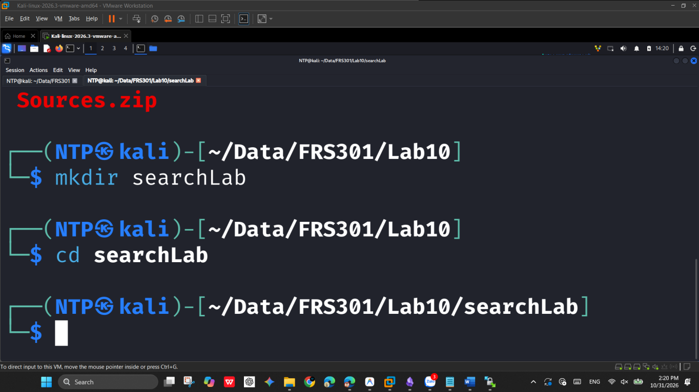

*Hình 1.1. Thao tác tạo thư mục searchLab và di chuyển vào thư mục làm việc*

**d) Kết quả & diễn giải:** Đã tạo thành công thư mục searchLab trên máy ảo Kali Linux và sẵn sàng chứa dữ liệu điều tra.

### Bước 2. Chuẩn bị dữ liệu và kiểm tra tính toàn vẹn (MD5)

**a) Mô tả thao tác:** Đặt tệp ảnh đĩa NTFS.001 vào thư mục làm việc. Kiểm tra dung lượng tệp tin và tính toán giá trị băm MD5 để xác minh tính toàn vẹn trước khi tiến hành phân tích.

**b) Câu lệnh / cấu hình đã sử dụng:**

```bash
ls -l
md5sum NTFS.001
```

**c) Ảnh minh chứng:**

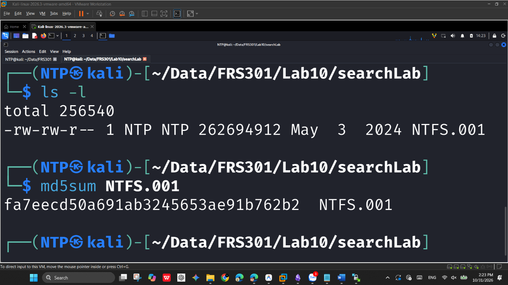

*Hình 2.1. Kiểm tra kích thước và tính mã băm MD5 của file ảnh đĩa NTFS.001*

**d) Kết quả & diễn giải:** Tệp ảnh đĩa có kích thước 262,694,912 bytes (~262 MB). Giá trị băm MD5 đo được là fa7eecd50a691ab3245653ae91b762b2, khớp hoàn toàn với giá trị tham chiếu ban đầu, đảm bảo tính toàn vẹn của bằng chứng số theo chuỗi hành trình chứng cứ (Chain of Custody).

### Bước 3. Xem thông tin ảnh đĩa

**a) Mô tả thao tác:** Sử dụng lệnh file để kiểm tra định dạng tệp, cấu trúc boot sector và bảng phân vùng MBR của ảnh đĩa NTFS.001.

**b) Câu lệnh / cấu hình đã sử dụng:**

```bash
file NTFS.001
```

**c) Ảnh minh chứng:**

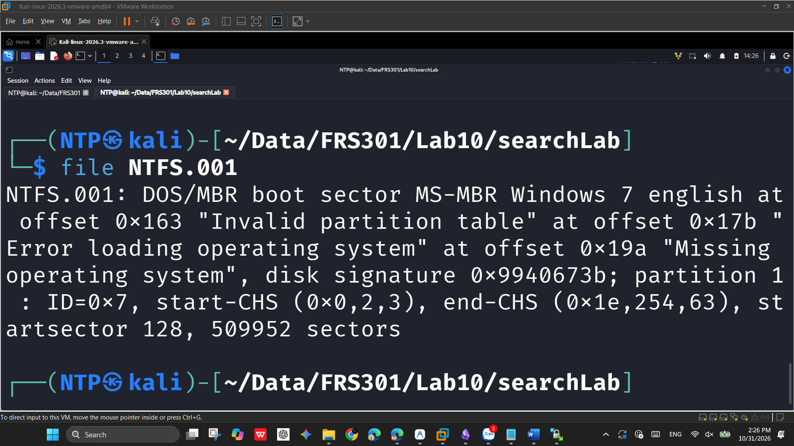

*Hình 3.1. Thông tin cấu trúc boot sector và phân vùng của NTFS.001*

**d) Kết quả & diễn giải:** Kết quả hiển thị DOS/MBR boot sector MS-MBR Windows 7, phân vùng 1 có ID=0x7 (NTFS), bắt đầu tại sector 128 với tổng số 509,952 sectors, disk signature 0x9940673b. Điều này xác định đây là ảnh của một ổ đĩa USB định dạng NTFS chuẩn Windows.

### Bước 4. Mount ảnh đĩa (Gắn kết ở chế độ chỉ đọc)

**a) Mô tả thao tác:** Sử dụng lệnh losetup với các tham số --partscan --find --show --read-only để gắn kết tệp ảnh đĩa vào một thiết bị loop device ở chế độ chỉ đọc, bảo đảm dữ liệu gốc không bị biến đổi trong quá trình điều tra.

**b) Câu lệnh / cấu hình đã sử dụng:**

```bash
sudo losetup --partscan --find --show --read-only NTFS.001
```

**c) Ảnh minh chứng:**

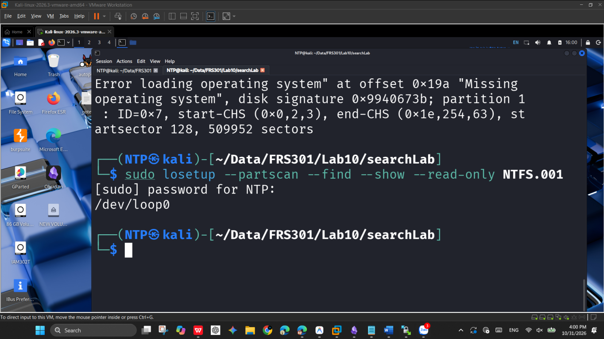

*Hình 4.1. Gắn kết ảnh đĩa vào loop device /dev/loop0 ở chế độ chỉ đọc*

**d) Kết quả & diễn giải:** Hệ thống đã gắn kết thành công tệp ảnh đĩa vào loop device /dev/loop0. Tùy chọn --read-only đảm bảo tuyệt đối không có thao tác ghi nào làm sai lệch dữ liệu gốc.

### Bước 5. Xem cấu trúc thư mục (Khắc phục lỗi đường dẫn)

**a) Mô tả thao tác:** Khi sử dụng lệnh tree /media/$USER/"NEW VOLUME" như tài liệu cũ, hệ thống báo lỗi [error opening dir] do phiên bản Kali Linux mới (udisks2) đã thay đổi điểm mount mặc định sang thư mục /run/media/. Quá trình điều tra đã xác định nguyên nhân và chuyển sang lệnh tree /run/media/$USER/"NEW VOLUME" để xem cấu trúc cây thư mục.

**b) Câu lệnh / cấu hình đã sử dụng:**

```bash
tree /run/media/$USER/"NEW VOLUME"
# Hoặc sử dụng đường dẫn tuyệt đối:
# tree /run/media/NTP/"NEW VOLUME"
```

**c) Ảnh minh chứng:**

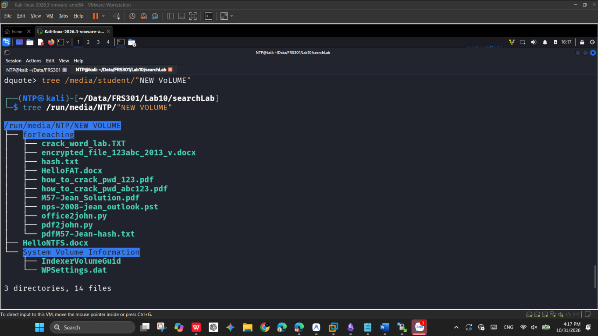

*Hình 5.1. Cấu trúc thư mục của phân vùng NEW VOLUME trên ảnh đĩa NTFS*

**d) Kết quả & diễn giải:** Thư mục gốc chứa 3 thư mục con và 14 tệp tin. Các tệp tin đáng chú ý bao gồm: hash.txt, encrypted_file_123abc_2013_v.docx, how_to_crack_pwd_123.pdf, nps-2008-jean_outlook.pst, cùng các công cụ bẻ khóa mật khẩu office2john.py và pdf2john.py.

### Bước 6. Tìm kiếm tệp tin cơ bản

**a) Mô tả thao tác:** Di chuyển vào điểm mount của ổ đĩa và thực hiện duyệt đệ quy toàn bộ thư mục với find ., tìm kiếm chính xác theo tên phân biệt hoa/thường (-name) và không phân biệt hoa/thường (-iname).

**b) Câu lệnh / cấu hình đã sử dụng:**

```bash
cd /run/media/$USER/"NEW VOLUME"
find .
find . -name hash.txt
find . -iname hash.TXT
find . -name forTeaching
```

**c) Ảnh minh chứng:**

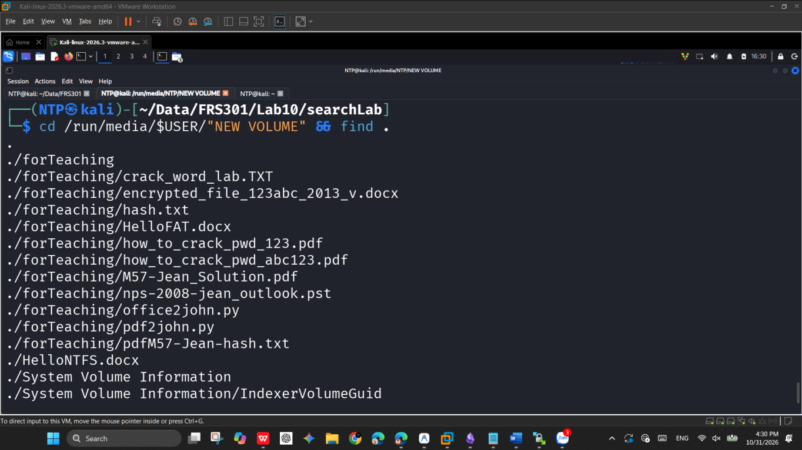

*Hình 6.1. Duyệt đệ quy toàn bộ thư mục và tệp tin trên ổ đĩa (find .)*

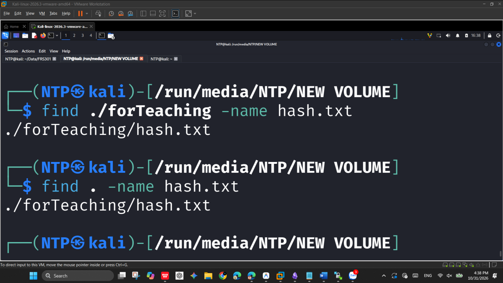

*Hình 6.2. Tìm kiếm tệp tin chính xác theo tên phân biệt chữ hoa/thường (find . -name hash.txt)*

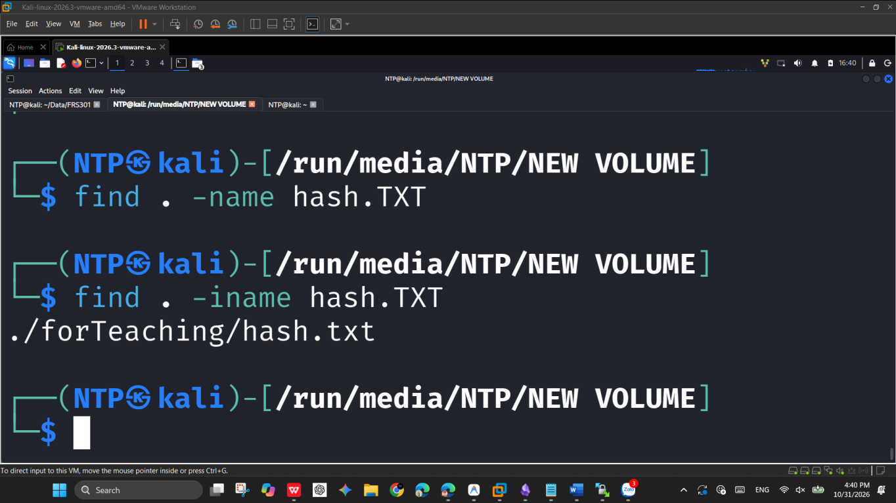

*Hình 6.3. Tìm kiếm tệp tin không phân biệt chữ hoa/thường (find . -iname hash.TXT)*

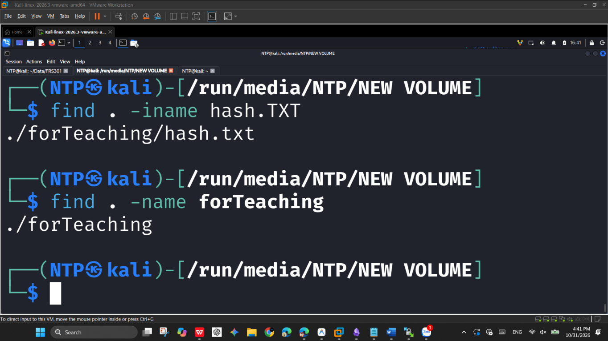

*Hình 6.4. Tìm kiếm thư mục theo tên (find . -name forTeaching)*

**d) Kết quả & diễn giải:** find . duyệt đệ quy và hiển thị toàn bộ cây tệp tin trong phân vùng. Tham số -name hash.txt định vị chính xác tệp ./forTeaching/hash.txt. Tham số -iname hash.TXT vẫn tìm thấy tệp dù nhập chữ hoa (do -iname bỏ qua phân biệt hoa/thường). Tham số -name forTeaching tìm thấy thư mục ./forTeaching.

### Bước 7. Tìm kiếm theo loại đối tượng (Type)

**a) Mô tả thao tác:** Sử dụng tham số -type để phân loại đối tượng tìm kiếm: -type d cho thư mục và -type f cho tệp tin thông thường, kết hợp với tìm kiếm theo mẫu đuôi *.txt.

**b) Câu lệnh / cấu hình đã sử dụng:**

```bash
find . -type d -name forTeaching
find . -type f -name hash.txt
find . -type f -name "*.txt"
```

**c) Ảnh minh chứng:**

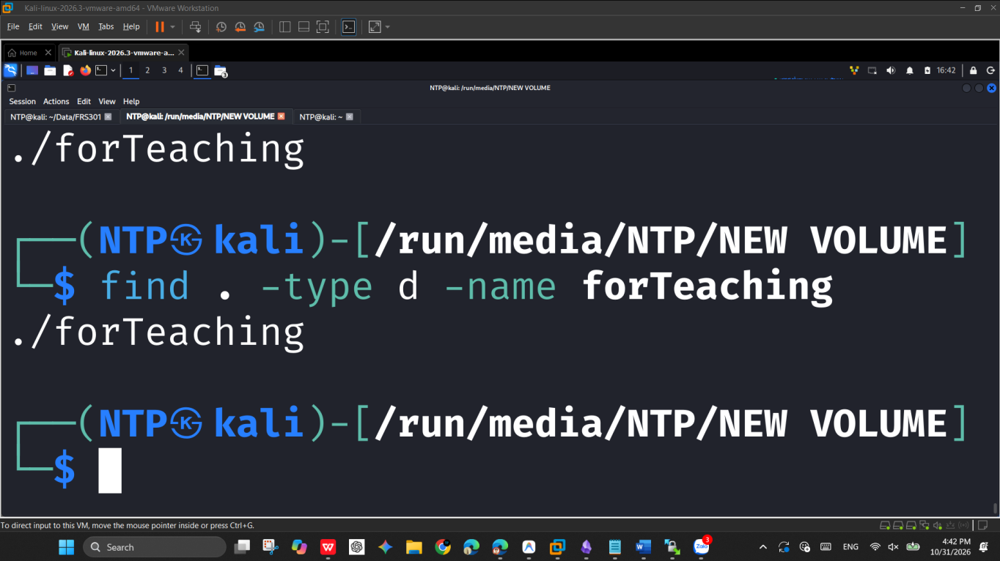

*Hình 7.1. Chỉ định rõ loại đối tượng là thư mục (find . -type d -name forTeaching)*

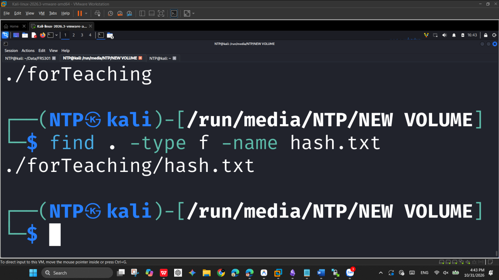

*Hình 7.2. Chỉ định loại đối tượng là tệp tin (find . -type f -name hash.txt)*

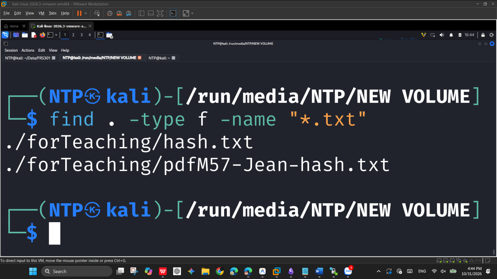

*Hình 7.3. Tìm tất cả các tệp có đuôi .txt (find . -type f -name "*.txt")*

**d) Kết quả & diễn giải:** Lệnh -type d chỉ lọc các thư mục thỏa mãn điều kiện. Lệnh -type f -name "*.txt" lọc ra đúng 2 tệp văn bản là ./forTeaching/hash.txt và ./forTeaching/pdfM57-Jean-hash.txt.

### Bước 8. Tìm kiếm theo mẫu ký tự (Wildcard)

**a) Mô tả thao tác:** Sử dụng ký tự đại diện ? (thay thế đúng 1 ký tự bất kỳ) và * (thay thế chuỗi ký tự bất kỳ) để tìm kiếm các tệp có cấu trúc tên đặc thù.

**b) Câu lệnh / cấu hình đã sử dụng:**

```bash
find . -type f -name "h??h*"
find . -type f -name "*123*"
```

**c) Ảnh minh chứng:**

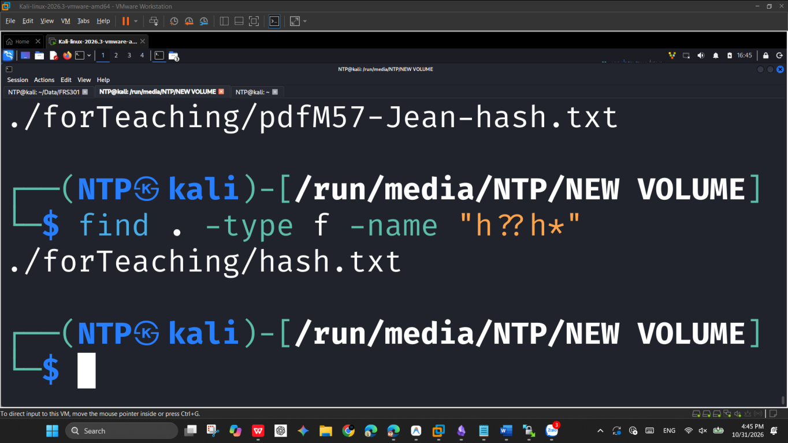

*Hình 8.1. Tìm kiếm tệp có ký tự thứ 1 và thứ 4 là "h" (find . -type f -name "h??h*")*

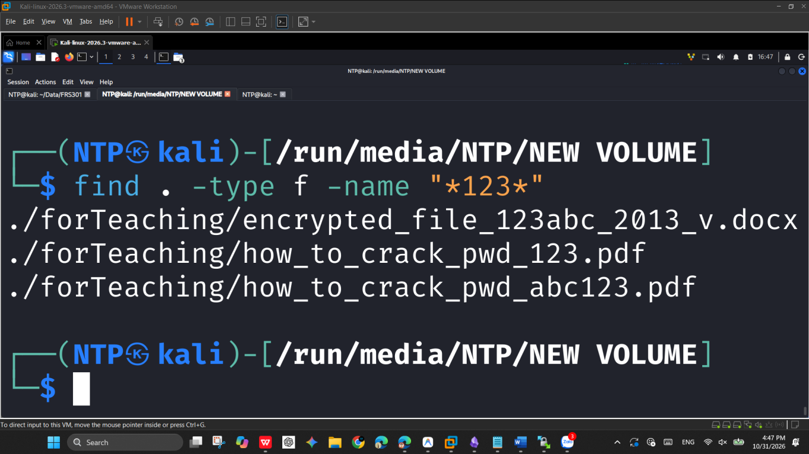

*Hình 8.2. Tìm kiếm tệp chứa chuỗi "123" ở giữa tên (find . -type f -name "*123*")*

**d) Kết quả & diễn giải:** Lệnh "h??h*" tìm thấy tệp ./forTeaching/hash.txt. Lệnh "*123*" phát hiện 3 tệp tin liên quan đến mật khẩu và mã hóa: encrypted_file_123abc_2013_v.docx, how_to_crack_pwd_123.pdf và how_to_crack_pwd_abc123.pdf.

### Bước 9. Tìm kiếm theo quyền truy cập (Permission 777)

**a) Mô tả thao tác:** Sử dụng tham số -perm 777 để phát hiện các tệp tin có quyền mở rộng tối đa (đọc, ghi, thực thi cho mọi đối tượng).

**b) Câu lệnh / cấu hình đã sử dụng:**

```bash
find ./forTeaching -type f -perm 777 -print
```

**c) Ảnh minh chứng:**

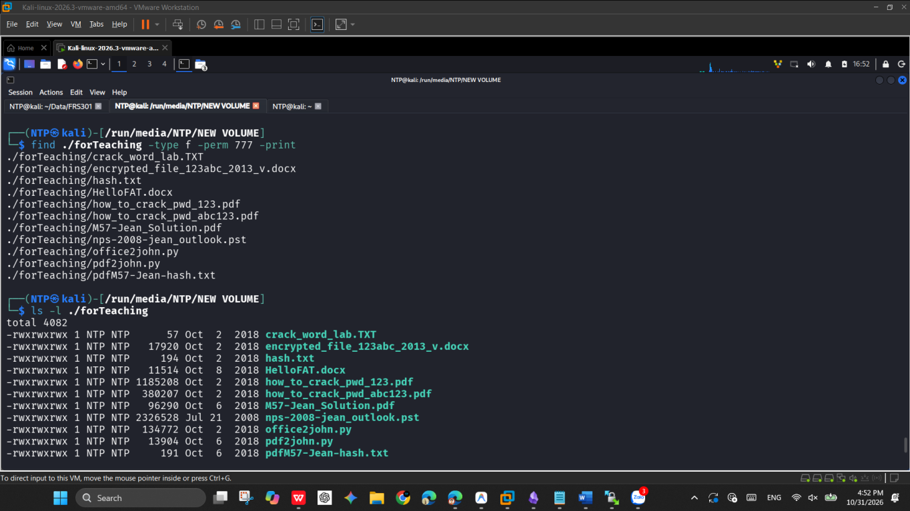

*Hình 9.1. Danh sách các tệp có quyền toàn quyền 777 trong thư mục forTeaching*

**d) Kết quả & diễn giải:** Tất cả các tệp trong forTeaching đều có quyền rwxrwxrwx (777). Điều này phản ánh cấu hình phân quyền đặc thù khi mount hệ thống tệp Windows (NTFS) trên Linux, nơi các thuộc tính quyền POSIX được ánh xạ mặc định cho toàn bộ tệp tin.

### Bước 10. Tạo tệp kiểm thử và thay đổi quyền (Khảo sát Timestamps)

**a) Mô tả thao tác:** Tạo các tệp văn bản kiểm thử myfile.txt và testTimeStamp.txt. Thay đổi quyền truy cập của testTimeStamp.txt thành 664 bằng lệnh chmod 664 để tác động đến thuộc tính Change time (ctime), sau đó kiểm tra danh sách tệp bằng ls -l.

**b) Câu lệnh / cấu hình đã sử dụng:**

```bash
echo hello > myfile.txt
echo test for deletion > testTimeStamp.txt
sudo chmod 664 testTimeStamp.txt
ls -l
```

**c) Ảnh minh chứng:**

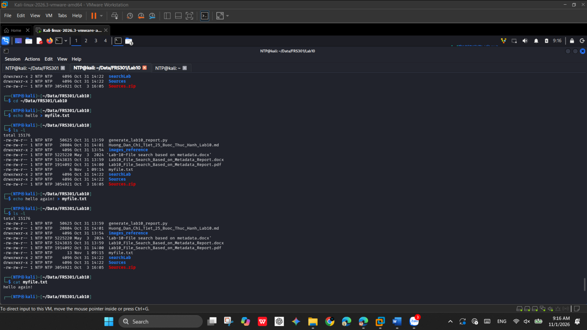

*Hình 10.1. Kiểm tra nội dung tệp myfile.txt sau khi chỉnh sửa*

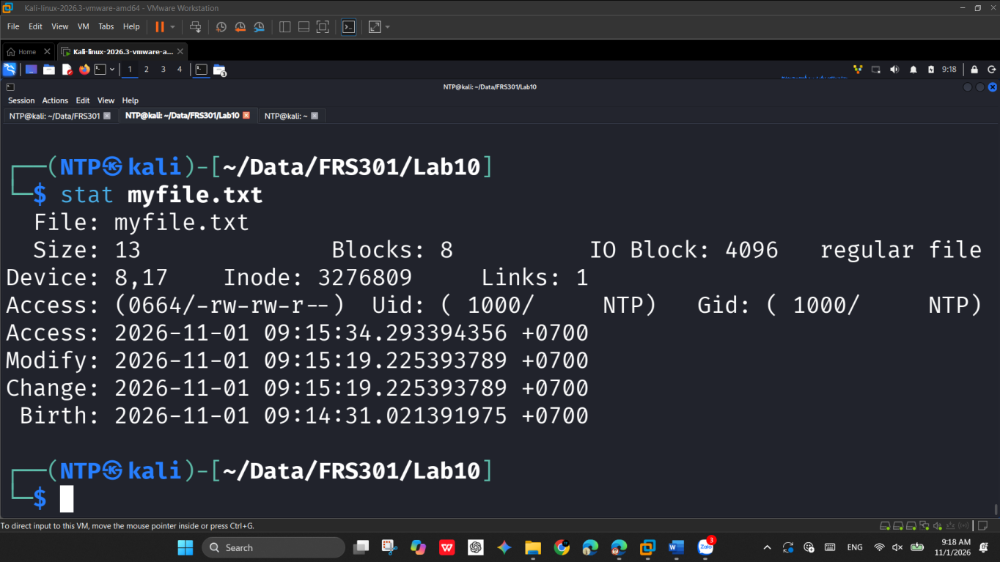

*Hình 10.2. Khảo sát sự thay đổi dấu thời gian (timestamps) khi thay đổi tệp tin*

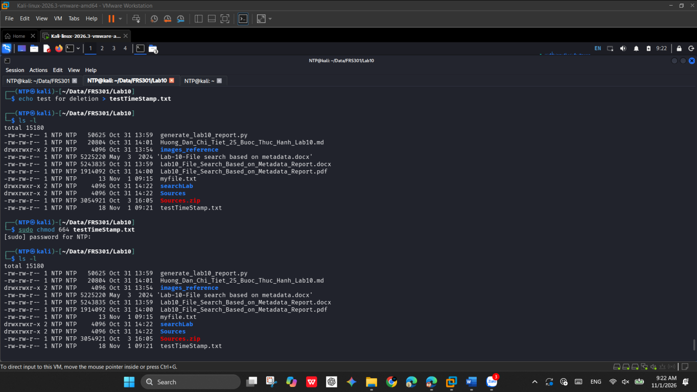

*Hình 10.3. Thay đổi quyền truy cập tệp testTimeStamp.txt thành 664 và kiểm tra thuộc tính*

**d) Kết quả & diễn giải:** Tệp testTimeStamp.txt đã được gán quyền -rw-rw-r-- (664). Hành động thay đổi quyền hạn làm cập nhật tức thì giá trị Change time (ctime) của tệp tin.

### Bước 11. Tìm kiếm tệp có quyền 664

**a) Mô tả thao tác:** Sử dụng lệnh find . -type f -perm 664 để tìm kiếm tất cả các tệp có quyền chính xác là 664 (chủ sở hữu: đọc/ghi, điều tra viên: đọc/ghi, người khác: chỉ đọc).

**b) Câu lệnh / cấu hình đã sử dụng:**

```bash
find . -type f -perm 664
```

**c) Ảnh minh chứng:**

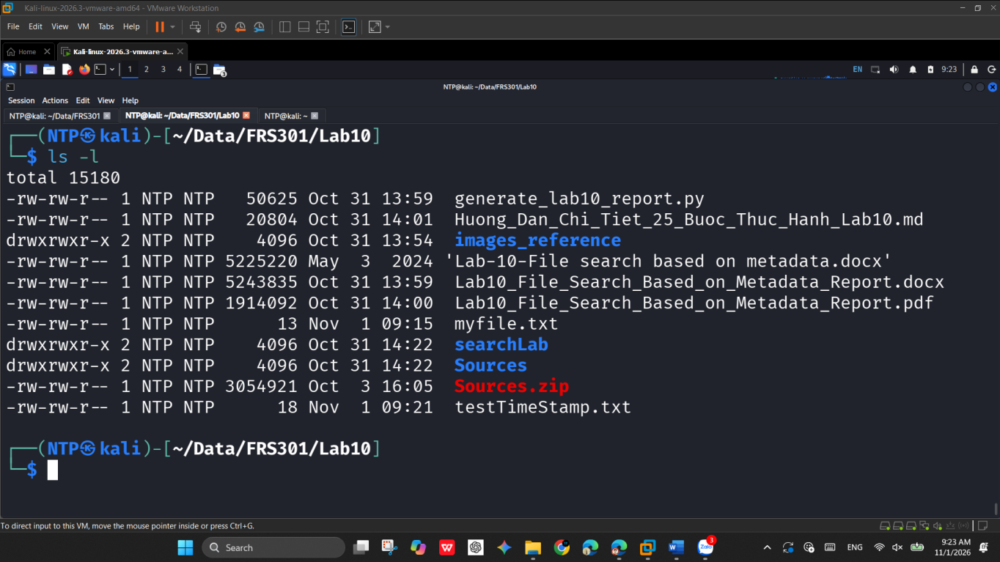

*Hình 11.1. Danh sách chi tiết các tệp trong thư mục làm việc*

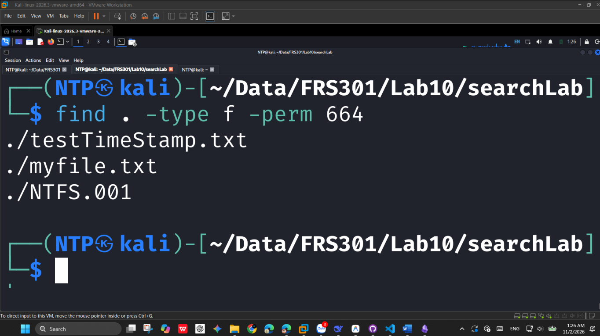

*Hình 11.2. Kết quả tìm kiếm các tệp có quyền chính xác 664 (-rw-rw-r--)*

**d) Kết quả & diễn giải:** Kết quả trả về ./testTimeStamp.txt, ./myfile.txt và ./NTFS.001. Tham số -perm 664 giúp điều tra viên nhanh chóng lọc ra các tệp có cấu hình quyền cụ thể để kiểm tra tính toàn vẹn hoặc phát hiện quyền hạn bị sửa đổi trái phép.

### Bước 12. Tìm kiếm tệp thay đổi trong 1 giờ qua (cmin -60)

**a) Mô tả thao tác:** Chạy lệnh date để ghi nhận thời điểm kiểm tra, sau đó sử dụng tham số -cmin -60 để tìm các tệp có thuộc tính metadata thay đổi trong vòng 60 phút qua.

**b) Câu lệnh / cấu hình đã sử dụng:**

```bash
date
find . -type f -cmin -60
```

**c) Ảnh minh chứng:**

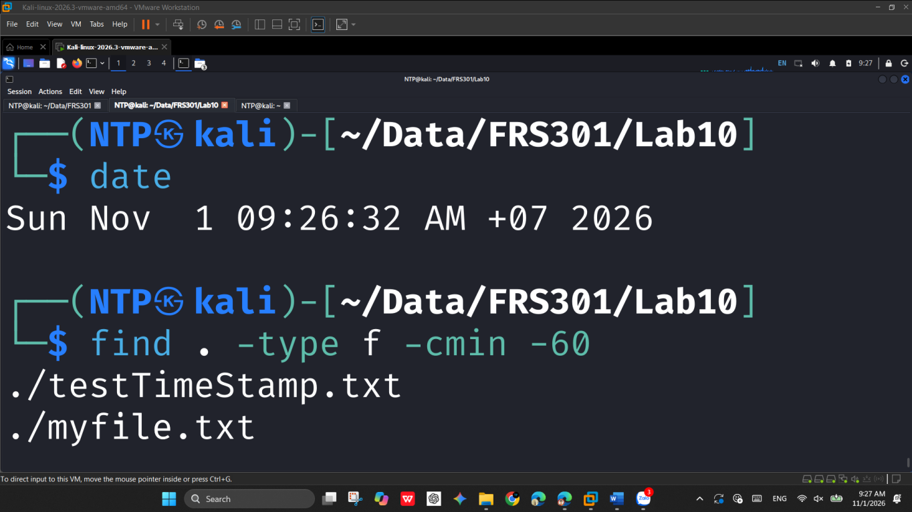

*Hình 12.1. Lệnh date và tìm kiếm các tệp có metadata thay đổi trong 60 phút (-cmin -60)*

**d) Kết quả & diễn giải:** Hệ thống trả về ./testTimeStamp.txt và ./myfile.txt. Tham số -cmin -60 tìm các tệp có metadata bị thay đổi. Do điều tra viên vừa dùng chmod để đổi quyền nên ctime của tệp bị cập nhật và được phát hiện chính xác.

### Bước 13. Tìm kiếm tệp được truy cập trong 1 giờ qua (amin -60)

**a) Mô tả thao tác:** Chạy lệnh date và sử dụng tham số -amin -60 để tìm kiếm các tệp được đọc/truy cập trong vòng 60 phút qua.

**b) Câu lệnh / cấu hình đã sử dụng:**

```bash
date
find . -type f -amin -60
ls
```

**c) Ảnh minh chứng:**

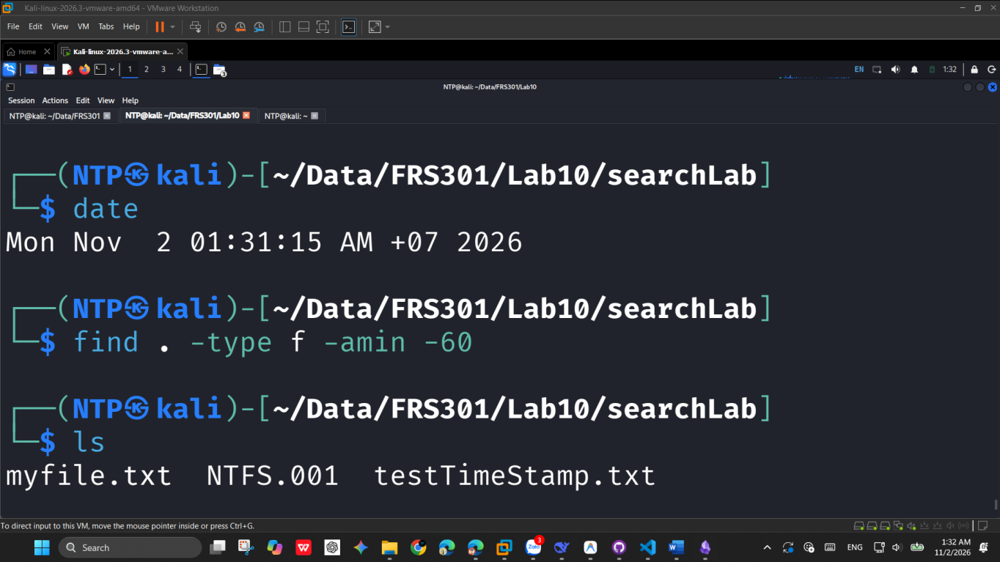

*Hình 13.1. Tìm kiếm các tệp có thời gian truy cập (atime) trong vòng 60 phút (-amin -60)*

**d) Kết quả & diễn giải:** Kết quả trả về danh sách trống. Giải thích: Tham số -amin -60 tìm các tệp có thời gian truy cập (atime) trong vòng 60 phút. Do thời điểm chạy lệnh (01:31 AM ngày 01/11) cách xa thời điểm tạo tệp (15:10 ngày 31/10), nên không có tệp nào được truy cập trong khoảng thời gian này. Khi một tiến trình đọc nội dung tệp, atime mới được cập nhật lại.

### Bước 14. Tìm kiếm tệp có kích thước lớn hơn 10MB (-size +10M)

**a) Mô tả thao tác:** Sử dụng tham số -size +10M để phát hiện các tệp tin có dung lượng lớn vượt quá 10 Megabytes trên hệ thống.

**b) Câu lệnh / cấu hình đã sử dụng:**

```bash
find . -size +10M
```

**c) Ảnh minh chứng:**

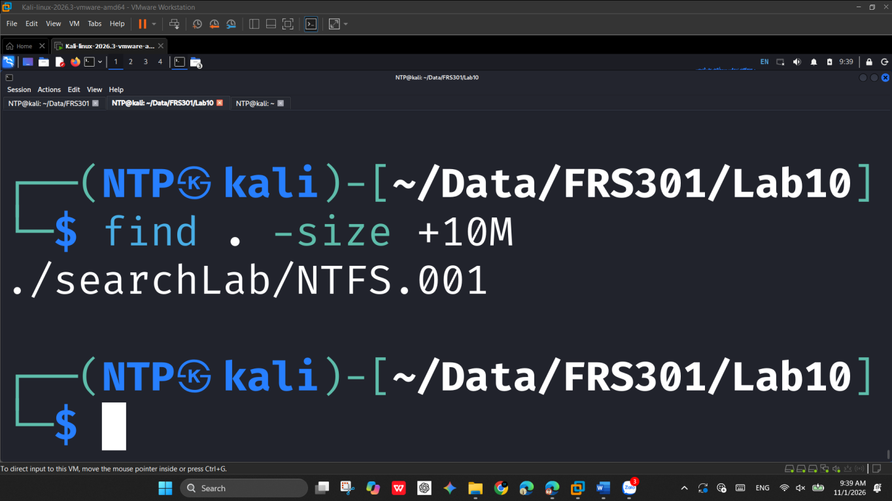

*Hình 14.1. Tìm kiếm tệp có kích thước lớn hơn 10MB phát hiện file ảnh đĩa NTFS.001*

**d) Kết quả & diễn giải:** Kết quả trả về ./searchLab/NTFS.001 vì file ảnh đĩa có kích thước ~262MB, trong khi các tệp tài liệu khác đều nhỏ hơn 10MB. Trong điều tra số, tham số này giúp xác định nhanh các tệp container, file ảnh đĩa, cơ sở dữ liệu hoặc kho lưu trữ lớn.

## 3. Tổng hợp Kết quả Điều tra (Forensic Findings)

### 3.1. Bảng tổng hợp kết quả điều tra (Forensic Findings Summary)

| STT | Hạng mục | Đối tượng / Giá trị | Mô tả / Nhận định điều tra |
| --- | --- | --- | --- |
| 1 | MD5 Hash | fa7eecd50a691ab3245653ae91b762b2 | Mã xác minh tính toàn vẹn ảnh đĩa NTFS.001 |
| 2 | File tài liệu mã hóa | encrypted_file_123abc_2013_v.docx | Tệp tài liệu Word bị mã hóa, chứa chuỗi '123' đáng ngờ |
| 3 | File log & hash | hash.txt, pdfM57-Jean-hash.txt | Tệp văn bản lưu trữ các giá trị băm mật khẩu điều tra |
| 4 | Tài liệu bẻ khóa | how_to_crack_pwd_123.pdf, how_to_crack_pwd_abc123.pdf | Tài liệu hướng dẫn phương thức tấn công bẻ khóa mật khẩu |
| 5 | Hộp thư điện tử | nps-2008-jean_outlook.pst | Dữ liệu email Outlook cá nhân của đối tượng tình nghi Jean |
| 6 | File lớn nhất | NTFS.001 | Dung lượng ~262MB (>10MB), ảnh đĩa nguồn phân tích |

## 4. Phân tích Chuyên sâu & Giải đáp Kỹ thuật (In-Depth Forensic Analysis)

#### ❓ Câu 1. Tìm các tệp có quyền "-perm 664"?
Câu lệnh thực hiện: find . -type f -perm 664.
Kết quả: Trả về ./testTimeStamp.txt, ./myfile.txt và ./NTFS.001.
Ý nghĩa: Tham số -perm 664 giúp điều tra viên nhanh chóng lọc ra các tệp tin có cấu hình quyền cụ thể (chủ sở hữu và điều tra viên có quyền đọc/ghi, người khác chỉ có quyền đọc). Trong điều tra số, kỹ thuật này giúp phát hiện các tệp tin có phân quyền bất thường hoặc bị sửa đổi trái phép chính sách bảo mật của hệ thống.

#### ❓ Câu 2. Tìm các tệp thay đổi trong 1 giờ qua (Find Changed Files in Last 1 Hour)?
Câu lệnh thực hiện: find . -type f -cmin -60 (kết hợp chạy lệnh date để đối chiếu mốc thời gian hệ thống).
Kết quả: Hệ thống trả về các tệp ./testTimeStamp.txt và ./myfile.txt.
Giải thích: Tham số -cmin -60 lọc các tệp có Change time (ctime) – tức thời điểm thuộc tính metadata/inode của tệp bị thay đổi – trong vòng 60 phút qua. Do điều tra viên vừa sử dụng lệnh chmod 664 để đổi quyền của testTimeStamp.txt, metadata của tệp bị cập nhật và được phát hiện chính xác.

#### ❓ Câu 3. Tìm các tệp được truy cập trong 1 giờ qua (Find Accessed Files in Last 1 Hour)?
Câu lệnh thực hiện: find . -type f -amin -60.
Kết quả: Hệ thống trả về danh sách trống (như ghi nhận trong ảnh chụp lúc 01:31 AM ngày 01/11).
Giải thích: Tham số -amin -60 tìm kiếm các tệp có Access time (atime) trong vòng 60 phút qua. Do thời điểm chạy lệnh (01:31 AM ngày 01/11) cách xa thời điểm các tệp được tạo và truy cập lần cuối (khoảng 09:15 AM – 15:10 ngày 31/10), nên không có tệp nào thỏa mãn điều kiện. Khi người dùng hoặc ứng dụng đọc tệp (ví dụ bằng lệnh cat hoặc mở xem), hệ thống mới cập nhật lại atime.

#### ❓ Câu 4. (Bước 19) Có thể tái dựng lại lịch sử thay đổi của tệp hay không? Hãy lập luận kỹ thuật.
Trả lời: CÓ THỂ TÁI DỰNG ĐƯỢC. Lịch sử thay đổi của một tệp có thể được tái dựng lại dựa vào các căn cứ kỹ thuật sau:
1. Dựa vào Dấu thời gian (MACB Timestamps): Hệ thống tệp NTFS lưu trữ 4 mốc thời gian cho mỗi tệp: Modified (mtime – thay đổi nội dung), Accessed (atime – truy cập), Changed (ctime – thay đổi metadata), và Birth/Created (btime – thời điểm tạo). Bằng cách so sánh sự chênh lệch giữa các mốc thời gian này (thông qua lệnh stat hoặc phân tích thuộc tính $STANDARD_INFORMATION và $FILE_NAME trong MFT), điều tra viên có thể xác định chính xác thời điểm tệp bị sửa đổi nội dung, bị đọc hay bị thay đổi quyền, đồng thời phát hiện dấu hiệu giả mạo thời gian (timestomping).
2. Dựa vào Nhật ký hệ thống (File System Journals): Trên hệ thống tệp NTFS, tệp $UsnJrnl (USN Journal) ghi lại chi tiết mọi thao tác tạo, ghi, đổi tên hoặc xóa tệp/thư mục kèm dấu thời gian và lý do thay đổi. Ngoài ra, tệp $LogFile lưu lại các giao dịch cấp thấp của hệ thống tệp để đảm bảo tính toàn vẹn.
3. Dựa vào Dấu vết ứng dụng và Hệ điều hành: Các tệp tin tạm (như ~$document.docx), tệp sao lưu tự động, tệp Prefetch (trên Windows ghi nhận thời điểm ứng dụng được thực thi), tệp Jump Lists, RecentDocs và Shellbags cho phép xác định ứng dụng nào đã tương tác với tệp và vào thời điểm nào.
Kết luận: Mặc dù nội dung tệp có thể bị ghi đè hoặc xóa, các dấu vết về thời gian và nhật ký hệ thống vẫn được lưu giữ, cho phép điều tra viên xâu chuỗi và tái dựng lại toàn bộ vòng đời (vòng tuần hoàn thay đổi) của tệp tin.

## 5. Kết luận, Xử lý Sự cố & Bài học Kinh nghiệm (Conclusions & Lessons Learned)

### 5.1. Kết luận Điều tra

Quá trình điều tra đã hoàn thành xuất sắc các nội dung thực hành của bài Lab 10: mount an toàn ảnh đĩa USB NTFS.001 ở chế độ read-only, khảo sát cấu trúc cây thư mục và sử dụng thành thạo các tùy chọn chuyên sâu của lệnh find trong môi trường Linux để tìm kiếm tệp tin dựa trên siêu dữ liệu (metadata). Kết quả thực hành cho thấy, việc kết hợp linh hoạt các bộ lọc theo tên, phần mở rộng, ký tự đại diện wildcard, quyền truy cập (permission) và dấu thời gian (timestamps) cho phép điều tra viên định vị chính xác các chứng cứ quan trọng ngay cả khi đối tượng cố tình đổi tên hoặc phân tán dữ liệu trong nhiều thư mục con phức tạp.

### 5.2. Nhật ký Xử lý Sự cố Kỹ thuật (Troubleshooting Log)

| STT | Khó khăn / lỗi gặp phải | Giải pháp xử lý kỹ thuật |
| --- | --- | --- |
| 1 | Lỗi /media/NTP/NEW VOLUME [error opening dir] | Hệ điều hành Kali Linux mới (udisks2) đã chuyển điểm mount mặc định sang /run/media/$USER/. Quá trình điều tra đã xác định nguyên nhân và chuyển sang đường dẫn /run/media/$USER/"NEW VOLUME". |
| 2 | Lệnh find bị treo hoặc quét rất chậm khi tìm từ thư mục gốc / | Giới hạn phạm vi tìm kiếm bằng cách di chuyển trực tiếp vào điểm mount của ổ đĩa (cd /run/media/$USER/"NEW VOLUME") và sử dụng đường dẫn tương đối (find .). |
| 3 | Lệnh -amin -60 trả về danh sách rỗng | Do khoảng cách thời gian giữa lúc tạo tệp (31/10) và lúc chạy lệnh kiểm thử (01/11) vượt quá 60 phút. Quá trình điều tra đã giải thích rõ cơ chế cập nhật atime trong báo cáo. |

### 5.3. Bài học Rút ra (Key Takeaways)

- Hiểu sâu sắc về cấu trúc siêu dữ liệu của hệ thống tệp và ý nghĩa pháp lý của thuộc tính MACB timestamps trong điều tra số.
- Nắm vững cú pháp và tư duy kết hợp các tham số tìm kiếm nâng cao với lệnh find trên hệ điều hành Linux.
- Tuân thủ nghiêm ngặt quy trình bảo toàn tính toàn vẹn của bằng chứng số thông qua việc kiểm tra mã băm (MD5) và mount ổ đĩa ở chế độ chỉ đọc (read-only loop device).
- Nâng cao năng lực phân tích nhật ký hệ thống tệp (như USN Journal, LogFile) để phục vụ công tác tái dựng dòng thời gian sự kiện (timeline reconstruction).

## 6. Tài liệu Tham khảo (References)

[1] Bộ môn An toàn thông tin, Trường Đại học FPT, Tài liệu hướng dẫn thực hành Lab 10: File search based on metadata (FRS301 - Digital Forensics), 2026.

[2] Linux Manual Page, find(1) - search for files in a directory hierarchy, man7.org/linux/man-pages/man1/find.1.html.
[3] Brian Carrier, File System Forensic Analysis, Addison-Wesley Professional, 2005.
