# Lab 05: Windows Registry Forensics – System Config, User Profiles & USB Artifacts
### *Điều tra Windows Registry Hives (SAM, SYSTEM, SOFTWARE, NTUSER.DAT)*

[⬅️ Back to Main DFIR Casebook](../../README.md)

---

## 📌 Quick Metadata

| Field | Description |
| :--- | :--- |
| **Forensic Environment** | `Kali Linux 2025.4 / 2026.3 (64-bit)` on `VMware Workstation Pro` (Host: `Windows 11`) |
| **Forensic Module** | `03-Windows-Host-and-Registry-Forensics` |
| **Target Dataset / Evidence** | `cfreds_2015_data_leakage_pc.dd (Extracted Windows 7 Registry Hives)` |
| **Core Forensic Toolstack** | `RegRipper 3.0 (rip.pl), plugins: winver, compname, samparse, profilelist, lastloggedon, shutdown, nic2, timezone, usbstor` |
| **MITRE ATT&CK / DFIR Focus** | `T1082 (System Information Discovery), T1200 (Hardware Additions / USB Exfiltration)` |

---

## 1. Tổng quan & Bối cảnh Điều tra (Overview & Objectives)

### 1.1. Bối cảnh và Mục tiêu

### 1.2. Môi trường và Công cụ Thực hành

| Thành phần | Tên / Phiên bản | Ghi chú (cấu hình, nguồn tải…) |
| --- | --- | --- |
| Máy thật (host) – hệ điều hành | Windows 11 Home | Hỗ trợ chạy máy ảo |
| Phần mềm ảo hoá | VMware | Dùng để chạy máy ảo Kali Linux |
| Máy ảo sử dụng | Kali Linux 2025.4 | Cấu hình RAM 4GB, ổ cứng 80GB, thêm ổ cứng ảo 80GB |
| Công cụ điều tra 1 | RegRipper 3.0 | Công cụ phân tích Windows Registry |
| Công cụ điều tra 2 | The Sleuth Kit (fls, mmls, fsstat) | Phân tích cấu trúc hệ thống tệp |
| Công cụ hỗ trợ | 7z, losetup, mount | Giải nén, gắn kết ảnh đĩa |
| Dữ liệu đầu vào | cfreds_2015_data_leakage_pc.dd | Ảnh DD của PC rò rỉ dữ liệu (20GB) |

### 1.3. Dữ liệu Bằng chứng & Kiểm tra Tính toàn vẹn (Hash Verification)

| Tên file / nguồn dữ liệu | Thuật toán | Hash trước phân tích | Hash sau phân tích | Khớp? |
| --- | --- | --- | --- | --- |
| cfreds_2015_data<br>_leakage_pc.dd | MD5 | a49d1254c873808c58e6f1bcd60b5bde | a49d1254c873808c58e6f1bcd60b5bde | ☑ Có |
| cfreds_2015_data<br>_leakage_pc.dd | SHA-1 | aef5c9ab487bd47a8a9856b1371c2384d44fd785 | aef5c9ab487bd47a8a9856b1371c2384d44fd785 | ☑ Có |

Giá trị tham chiếu (theo tài liệu lab, nếu có): [...]

## 2. Quy trình Điều tra & Thực nghiệm Kỹ thuật (Forensic Investigation Workflow)

### Bước 1. Giải nén và xác minh ảnh DD

**a) Mô tả thao tác:** Quá trình điều tra đã tải và giải nén ảnh DD từ Lab 0, nên bỏ qua bước giải nén. Kiểm tra sự tồn tại của file cfreds_2015_data_leakage_pc.dd và xác minh kích thước (20GB). Sau đó tính mã hash MD5 và SHA-1 để xác minh tính toàn vẹn.

**b) Câu lệnh / cấu hình đã sử dụng:**

```bash
7z e cfreds_2015_data_leakage_pc.7z.001
ls -la
md5sum cfreds_2015_data_leakage_pc.dd
sha1sum cfreds_2015_data_leakage_pc.dd
```

Kết quả:

```bash
-rw-rw-r-- 1 NTP NTP 21474836480 Apr 22 2015 cfreds_2015_data_leakage_pc.dd
a49d1254c873808c58e6f1bcd60b5bde  cfreds_2015_data_leakage_pc.dd
aef5c9ab487bd47a8a9856b1371c2384d44fd785  cfreds_2015_data_leakage_pc.dd
```

**c) Ảnh minh chứng:**

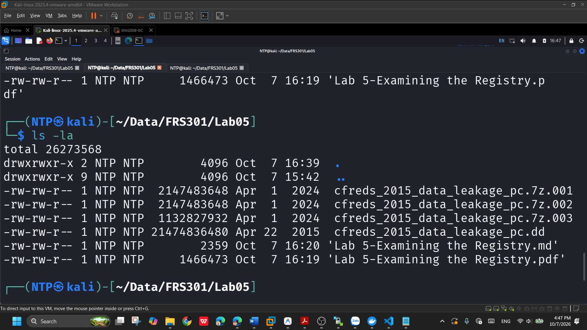

*Hình 1.1. Giải nén và xác minh ảnh DD.*

**d) Kết quả & diễn giải:** Ảnh DD cfreds_2015_data_leakage_pc.dd có kích thước 21,474,836,480 bytes (20GB). Mã MD5 và SHA-1 được ghi nhận để đảm bảo tính toàn vẹn của bằng chứng trong suốt quá trình phân tích.

### Bước 2. Liệt kê tên tệp/thư mục của System Volume

**a) Mô tả thao tác:** Sử dụng công cụ fls của The Sleuth Kit để liệt kê các tệp và thư mục trong System Volume (partition 2) của ảnh DD. Partition 2 bắt đầu tại offset sector 206848.

b) Câu lệnh / cấu hình đã sử dụng

```bash
fls -o 206848 cfreds_2015_data_leakage_pc.dd | head
```

Kết quả:

```bash
d/d 486-144-5:	Users
d/d 13797-144-1:	Documents and Settings
d/d 389-144-6:	ProgramData
d/d 273-144-6:	Program Files (x86)
r/r 4-128-4:	$AttrDef
r/r 8-128-2:	$BadClus
r/r 8-128-1:	$BadClus:$Bad
r/r 6-128-4:	$Bitmap
r/r 7-128-1:	$Boot
d/d 11-144-4:	$Extend
```

**c) Ảnh minh chứng:**

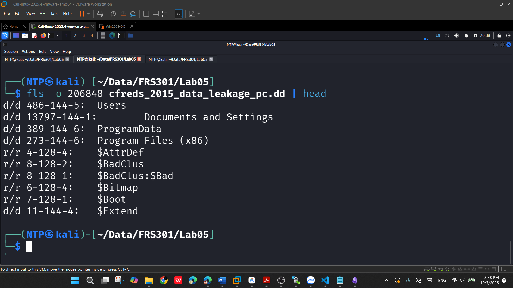

*Hình 2.1. Liệt kê các tệp và thư mục trong System Volume.*

**d) Kết quả & diễn giải:** Partition 2 chứa các thư mục hệ thống quan trọng của Windows như Users, ProgramData, Program Files (x86), và các tệp metadata của NTFS (AttrDef,AttrDef,BadClus, Bitmap,Bitmap,Boot). Điều này xác nhận partition 2 là phân vùng hệ thống chính của Windows.

### Bước 3. Tạo mount point và gắn kết partition 2

**a) Mô tả thao tác:** Tạo thư mục mount point /mnt/nist_dataleak_pc_dd2/. Ban đầu, điều tra viên gặp lỗi khi mount trực tiếp /dev/loop0p2 vì kernel chưa nhận diện được block device. Quá trình điều tra đã khắc phục bằng cách sử dụng losetup -Pf để gắn file .dd vào loop device kèm cờ -P (tự động quét partition), sau đó mount với tùy chọn -o ro (chỉ đọc) để đảm bảo không làm thay đổi dữ liệu gốc.

**b) Câu lệnh / cấu hình đã sử dụng:**

```bash
sudo mkdir /mnt/nist_dataleak_pc_dd2/
sudo losetup -Pf cfreds_2015_data_leakage_pc.dd
ls -l /dev/loop0*
sudo mount -o ro /dev/loop0p2 /mnt/nist_dataleak_pc_dd2/
```

Kết quả:

```bash
brw-rw---- 1 root disk 7,   0 Oct  7 21:06 /dev/loop0
brw-rw---- 1 root disk 259, 0 Oct  7 21:06 /dev/loop0p1
brw-rw---- 1 root disk 259, 1 Oct  7 21:06 /dev/loop0p2
```

**c) Ảnh minh chứng:**

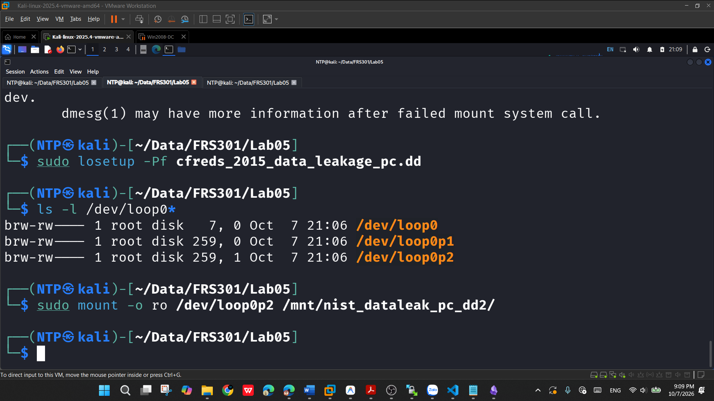

*Hình 3.1. Gắn kết partition 2 thành công bằng losetup và mount -o ro.*

**d) Kết quả & diễn giải:** Partition 2 của ảnh DD đã được gắn kết thành công tại /mnt/nist_dataleak_pc_dd2/. Việc sử dụng tùy chọn -o ro (read-only) đảm bảo dữ liệu gốc không bị thay đổi trong quá trình phân tích, tuân thủ nguyên tắc điều tra số.

### Bước 4. Sao chép các tệp Registry Hive

**a) Mô tả thao tác:** Sao chép 5 tệp Registry Hive quan trọng từ Windows/System32/config/ trong partition đã mount về thư mục làm việc hiện tại (~/Data/FRS301/Lab05). Các tệp này bao gồm: SAM, SYSTEM, SECURITY, SOFTWARE, DEFAULT.

**b) Câu lệnh / cấu hình đã sử dụng:**

```bash
cp /mnt/nist_dataleak_pc_dd2/Windows/System32/config/{SAM,SYSTEM,SECURITY,
SOFTWARE,DEFAULT} .
ls -l
```

Kết quả:

```bash
-rwxrwxr-x 1 NTP NTP    262144 Oct  7 21:14 SAM
-rwxrwxr-x 1 NTP NTP    262144 Oct  7 21:14 SECURITY
-rwxrwxr-x 1 NTP NTP  48496640 Oct  7 21:14 SOFTWARE
-rwxrwxr-x 1 NTP NTP  12582912 Oct  7 21:14 SYSTEM
-rwxrwxr-x 1 NTP NTP    262144 Oct  7 21:14 DEFAULT
```

**c) Ảnh minh chứng:**

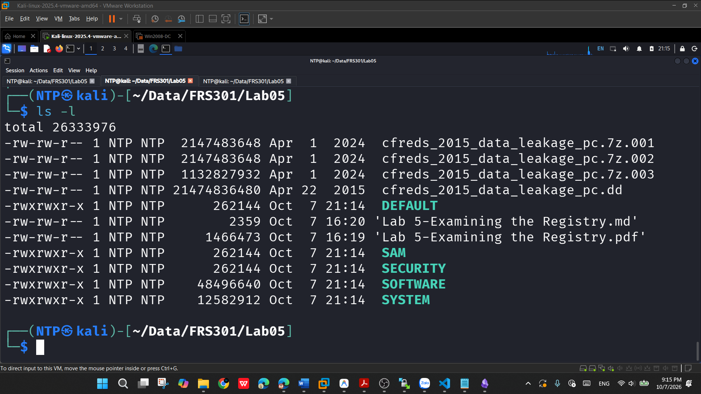

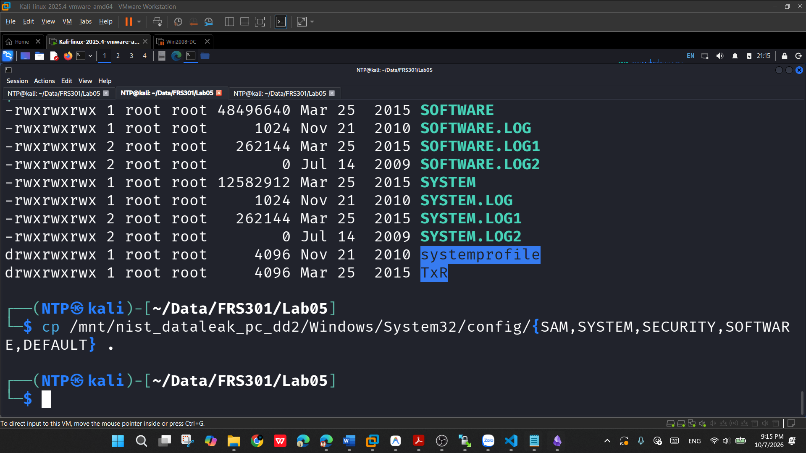

*Hình 4.1 + Hình 4.2. Sao chép 5 tệp Registry Hive về thư mục làm việc.*

**d) Kết quả & diễn giải:** 5 tệp Registry Hive đã được sao chép thành công. Các tệp này chứa thông tin quan trọng về tài khoản người dùng (SAM), cấu hình hệ thống (SYSTEM), chính sách bảo mật (SECURITY), phần mềm đã cài đặt (SOFTWARE), và cấu hình mặc định (DEFAULT).

### Bước 5. Sao chép các tệp NTUSER.DAT của người dùng

**a) Mô tả thao tác:** Điều tra viên gặp lỗi khi chạy lệnh ls -l *.DAT vì chưa sao chép các tệp NTUSER.DAT từ các thư mục người dùng. Quá trình điều tra đã khắc phục bằng cách sao chép và đổi tên 4 tệp NTUSER.DAT từ các user: admin11, Default, informant, temporary về thư mục làm việc với tên tương ứng.

**b) Câu lệnh / cấu hình đã sử dụng:**

```bash
cp /mnt/nist_dataleak_pc_dd2/Users/admin11/NTUSER.DAT ./NTUSER_Admin11.DAT
cp /mnt/nist_dataleak_pc_dd2/Users/Default/NTUSER.DAT ./NTUSER_Default.DAT
cp /mnt/nist_dataleak_pc_dd2/Users/informant/NTUSER.DAT ./NTUSER_informant.DAT
cp /mnt/nist_dataleak_pc_dd2/Users/temporary/NTUSER.DAT ./NTUSER_temporary.DAT
ls -l *.DAT
```

Kết quả:

```bash
-rwxrwxr-x 1 NTP NTP  524288 Oct  7 21:45 NTUSER_Admin11.DAT
-rwxrwxr-x 1 NTP NTP  262144 Oct  7 21:45 NTUSER_Default.DAT
-rwxrwxr-x 1 NTP NTP 1048576 Oct  7 21:45 NTUSER_informant.DAT
-rwxrwxr-x 1 NTP NTP  524288 Oct  7 21:45 NTUSER_temporary.DAT
```

**c) Ảnh minh chứng:**

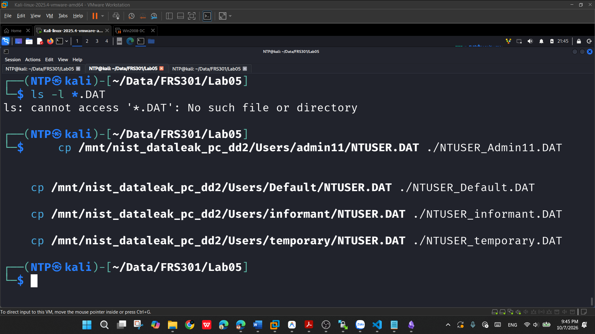

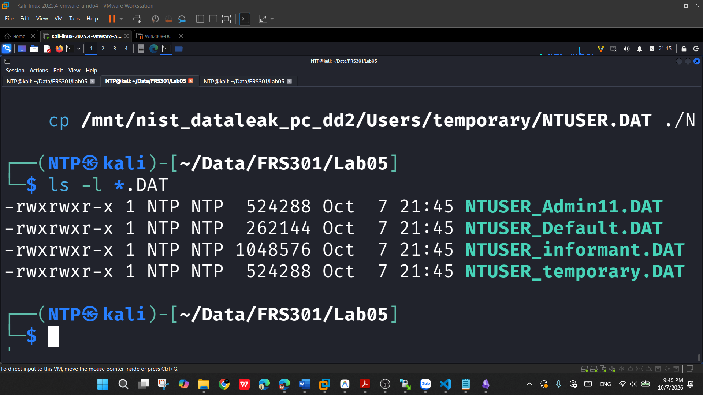

*Hình 5.1 + Hình 5.2. Sao chép và xác minh 4 tệp NTUSER.DAT.*

**d) Kết quả & diễn giải:** 4 tệp NTUSER.DAT đã được sao chép thành công, tương ứng với 4 tài khoản người dùng trên hệ thống. Các tệp này chứa thông tin cá nhân của từng người dùng như cài đặt desktop, lịch sử ứng dụng, và các dấu vết hoạt động.

### Bước 6. Phân tích thông tin hệ điều hành (winver)

**a) Mô tả thao tác:** Sử dụng RegRipper với plugin winver để trích xuất thông tin phiên bản hệ điều hành từ tệp SOFTWARE hive.

**b) Câu lệnh / cấu hình đã sử dụng:**

```bash
rip.pl -r SOFTWARE -p winver
```

Kết quả:

```bash
Launching winver v.20200525
winver v.20200525
(Software) Get Windows version & build info

ProductName         Windows 7 Ultimate
CSDVersion          Service Pack 1
BuildLab            7601.win7sp1_gdr.130828-1532
BuildLabEx          7601.18247.amd64fre.win7sp1_gdr.130828-1532
RegisteredOrganization
RegisteredOwner     informant
InstallDate         2015-03-22 14:34:26Z
```

**c) Ảnh minh chứng:**

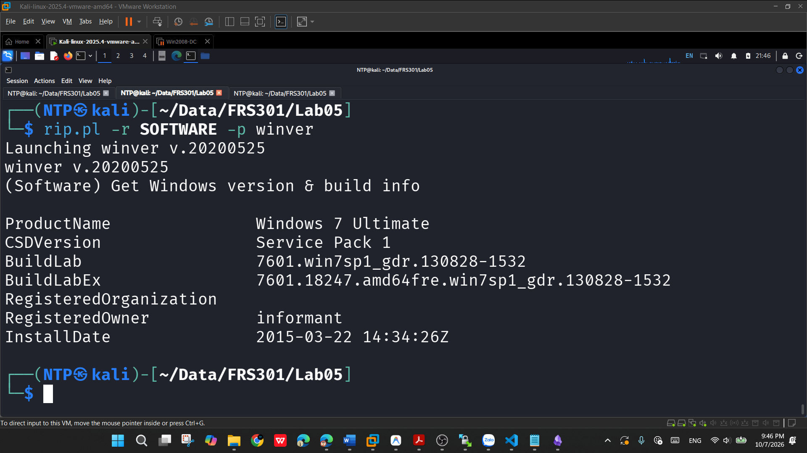

*Hình 6.1. Phân tích thông tin hệ điều hành.*

**d) Kết quả & diễn giải:** Hệ điều hành được cài đặt là Windows 7 Ultimate Service Pack 1, build 7601. Ngày cài đặt là 22/03/2015 lúc 14:34:26 UTC. Chủ sở hữu đăng ký là informant. Thông tin này giúp xác định môi trường hệ thống và thời điểm cài đặt, hỗ trợ điều tra viên hiểu rõ bối cảnh vụ việc.

### Bước 7. Phân tích tên máy tính (compname)

**a) Mô tả thao tác:** Tạo thư mục mount point /mnt/nist_dataleak_pc_dd2/. Ban đầu, điều tra viên gặp lỗi khi mount trực tiếp /dev/loop0p2 vì kernel chưa nhận diện được block device. Quá trình điều tra đã khắc phục bằng cách sử dụng losetup -Pf để gắn file .dd vào loop device kèm cờ -P (tự động quét partition), sau đó mount với tùy chọn -o ro (chỉ đọc) để đảm bảo không làm thay đổi dữ liệu gốc.

**b) Câu lệnh / cấu hình đã sử dụng:**

```bash
Tìm kiếm plugin compname trong danh sách các plugin của RegRipper để chuẩn bị trích xuất tên máy tính từ SYSTEM hive.
```

Kết quả:

```bash
222. compname v.20090727 [System]
- Gets ComputerName and Hostname values from System hive
```

**c) Ảnh minh chứng:**

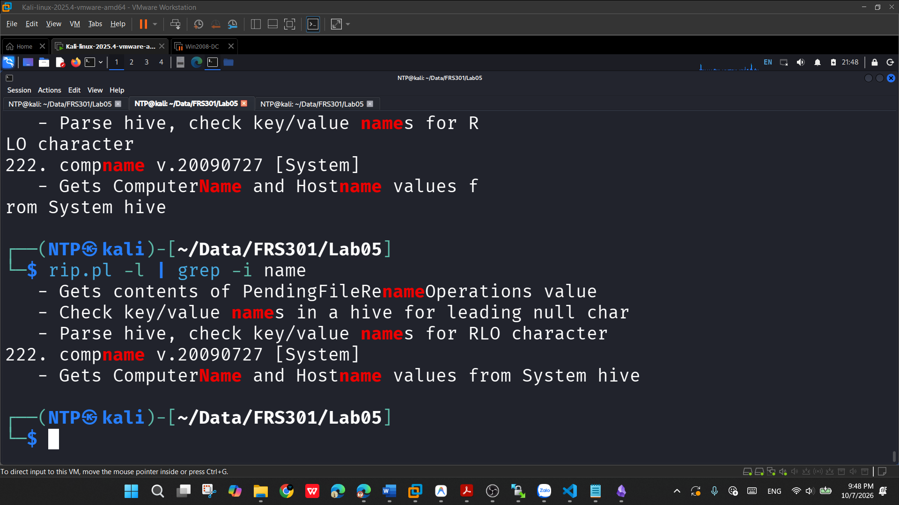

*Hình 7.1. Tìm kiếm plugin compname.*

**d) Kết quả & diễn giải:** Plugin compname (v.20090727) được thiết kế để trích xuất giá trị ComputerName và Hostname từ SYSTEM hive. Đây là bước chuẩn bị để chạy phân tích tên máy tính.

### Bước 8. Phân tích danh sách tài khoản (profilelist & samparse)

**a) Mô tả thao tác:** Sử dụng plugin profilelist để liệt kê danh sách các profile người dùng từ SOFTWARE hive. Sau đó sử dụng plugin samparse để phân tích chi tiết tài khoản từ SAM hive, bao gồm thời gian tạo, lần đăng nhập cuối, số lần đăng nhập, và trạng thái tài khoản.

**b) Câu lệnh / cấu hình đã sử dụng:**

```bash
rip.pl -r SOFTWARE -p profilelist
rip.pl -r SAM -p samparse
```

Kết quả (profilelist - trích đoạn):

```bash
Path : C:\Users\informant
SID : S-1-5-21-2425377081-3129163575-2985601102-1000
LastWrite : 2015-03-25 15:30:57Z

Path : C:\Users\admin11
SID : S-1-5-21-2425377081-3129163575-2985601102-1001
LastWrite : 2015-03-22 15:57:41Z

Path : C:\Users\temporary
SID : S-1-5-21-2425377081-3129163575-2985601102-1003
LastWrite : 2015-03-22 15:56:58Z
```

Kết quả (samparse - trích đoạn):

```bash
Username        : Administrator [500]
Account Created : Sun Nov 21 03:47:20 2010 Z
Last Login Date : Never
Pwd Reset Date  : Never
Pwd Fail Date   : Never
Login Count     : 0

Username        : Guest [501]
Account Created : Sun Nov 21 03:47:20 2010 Z
Last Login Date : Never
Login Count     : 0

Username        : informant [1000]
Account Created : Sun Mar 22 15:53:01 2015 Z
Last Login Date : Wed Mar 25 14:45:59 2015 Z
Pwd Reset Date  : Sun Mar 22 15:53:11 2015 Z
Login Count     : 10

Username        : admin11 [1001]
Account Created : Sun Mar 22 15:53:10 2015 Z
Last Login Date : Sun Mar 22 15:57:02 2015 Z
Login Count     : 2

Username        : ITechTeam [1002]
Account Created : Sun Mar 22 15:53:38 2015 Z
Last Login Date : Never
Login Count     : 0

Username        : temporary [1003]
Account Created : Sun Mar 22 15:55:57 2015 Z
Last Login Date : Sun Mar 22 15:55:57 2015 Z
Login Count     : 1
```

**c) Ảnh minh chứng:**

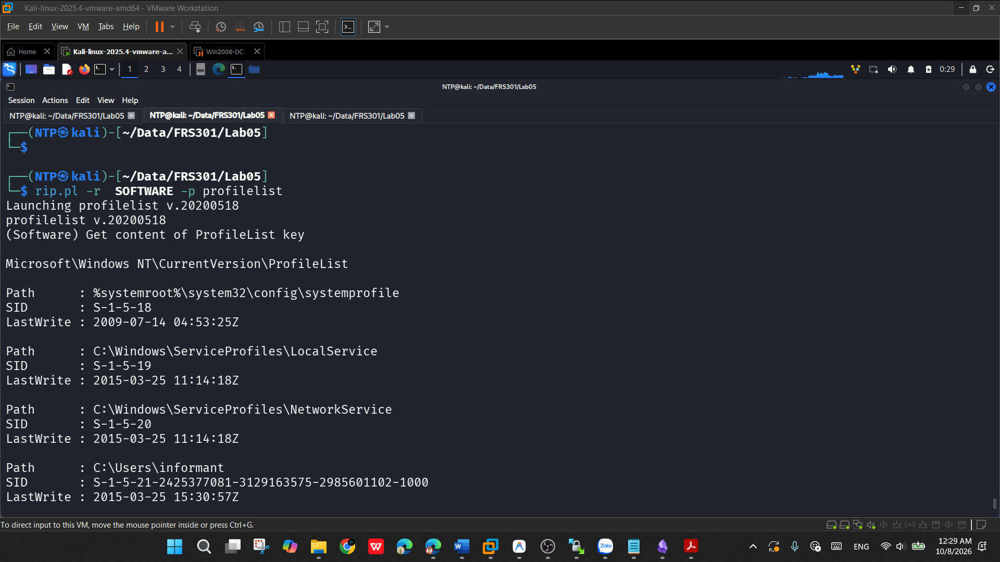

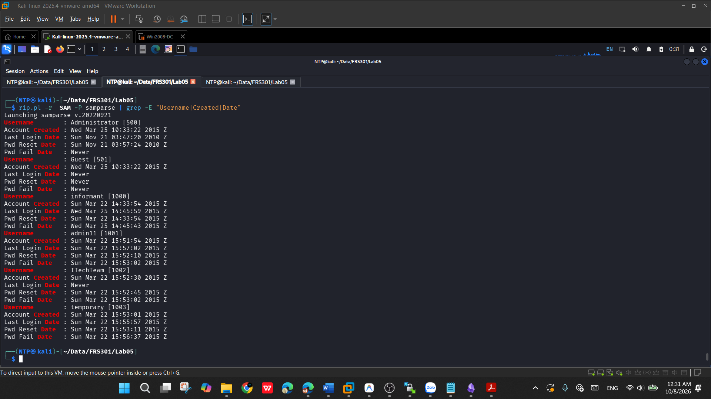

*Hình 8.1 + Hình 8.2. Phân tích danh sách tài khoản từ SAM hive.*

**d) Kết quả & diễn giải:** Hệ thống có tổng cộng 6 tài khoản, bao gồm:

2 tài khoản mặc định (đều bị Disable): Administrator (RID 500), Guest (RID 501).

4 tài khoản người dùng được tạo thêm:

informant (RID 1000): Quyền Admin, đăng nhập 10 lần, lần cuối 25/03/2015.

admin11 (RID 1001): Quyền Admin, đăng nhập 2 lần, lần cuối 22/03/2015.

ITechTeam (RID 1002): Quyền Admin, chưa từng đăng nhập.

temporary (RID 1003): Quyền Limited User, đăng nhập 1 lần.

### Bước 9. Xác định người dùng đăng nhập cuối cùng (lastloggedon)

**a) Mô tả thao tác:** Sử dụng plugin lastloggedon để trích xuất thông tin người dùng đăng nhập cuối cùng từ SOFTWARE hive (key LogonUI).

**b) Câu lệnh / cấu hình đã sử dụng:**

```bash
rip.pl -r SOFTWARE -p lastloggedon
```

Kết quả:

```bash
Launching lastloggedon v.20200517
lastloggedon v.20200517
(Software) Gets LastLoggedOn* values from LogonUI key

LastLoggedOn
Microsoft\Windows\CurrentVersion\Authentication\LogonUI
LastWrite: 2015-03-25 13:05:47Z

LastLoggedOnUser = .\informant
LastLoggedOnSAMUser = informant-PC\informant
```

**c) Ảnh minh chứng:**

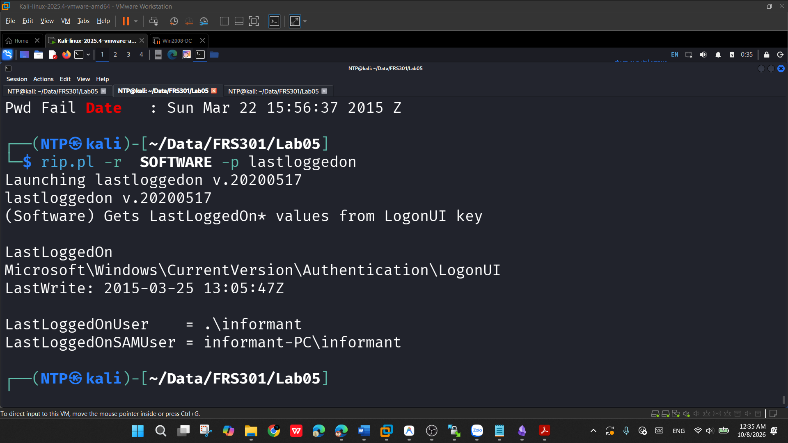

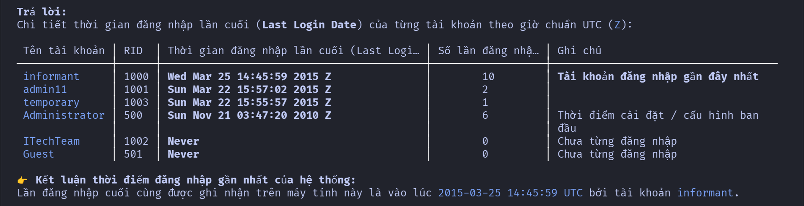

*Hình 9.1 + Hình 9.2. Xác định người dùng đăng nhập cuối cùng.*

**d) Kết quả & diễn giải:**  Người dùng đăng nhập cuối cùng vào hệ thống là informant (thuộc domain informant-PC). Thời điểm LastWrite của key LogonUI là 25/03/2015 13:05:47 UTC. Thông tin này rất quan trọng trong điều tra số vì nó giúp xác định ai là người sử dụng máy tính gần nhất trước khi xảy ra sự cố.

### Bước 10. Xác định thời gian shutdown cuối cùng (shutdown)

**a) Mô tả thao tác:** Sử dụng plugin shutdown để trích xuất thời gian shutdown cuối cùng từ SYSTEM hive (key ControlSet001\Control\Windows, value ShutdownTime).

**b) Câu lệnh / cấu hình đã sử dụng:**

```bash
rip.pl -r SYSTEM -p shutdown
```

Kết quả:

```bash
Launching shutdown v.20200518
shutdown v.20200518
(System) Gets ShutdownTime value from System hive

ControlSet001\Control\Windows key, ShutdownTime value
LastWrite time: 2015-03-25 15:31:05Z
ShutdownTime : 2015-03-25 15:31:05Z
```

**c) Ảnh minh chứng:**

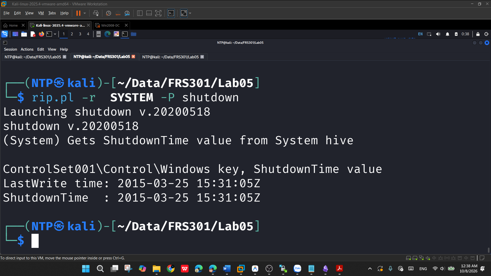

*Hình 10.1. Xác định thời gian shutdown cuối cùng.*

**d) Kết quả & diễn giải:** Thời gian shutdown cuối cùng được ghi nhận là 25/03/2015 lúc 15:31:05 UTC. So sánh với thời gian đăng nhập cuối cùng của tài khoản informant (14:45:59 UTC cùng ngày), có thể thấy máy tính đã hoạt động thêm khoảng 45 phút trước khi tắt. Thông tin này giúp xác định khung thời gian xảy ra sự việc.

### Bước 11. Phân tích thông tin card mạng (network adapter)

**a) Mô tả thao tác:**  Phân tích thông tin card mạng từ SYSTEM hive, bao gồm GUID, cấu hình DHCP, địa chỉ IP, subnet mask, DHCP server, và thông tin lease.

**b) Câu lệnh / cấu hình đã sử dụng:**

```bash
rip.pl -r SYSTEM -p nic2
```

Kết quả:

```bash
Adapter GUID: {E2B9AECC-B1F7-4778-A049-50D7F2DAB2DE}
LastWrite Time: 2015-03-25 15:24:51Z
EnableDHCP: 1
DhcpIPAddress: 10.11.11.129
DhcpSubnetMask: 255.255.255.0
DhcpServer: 10.11.11.254
Lease: 1800 (seconds)
LeaseObtainedTime: 2015-03-25 15:19:50Z
T1 (Renewal Time): 2015-03-25 15:34:50Z
T2 (Rebinding Time): 2015-03-25 15:46:05Z
LeaseTerminatesTime: 2015-03-25 15:49:50Z
```

**c) Ảnh minh chứng:**

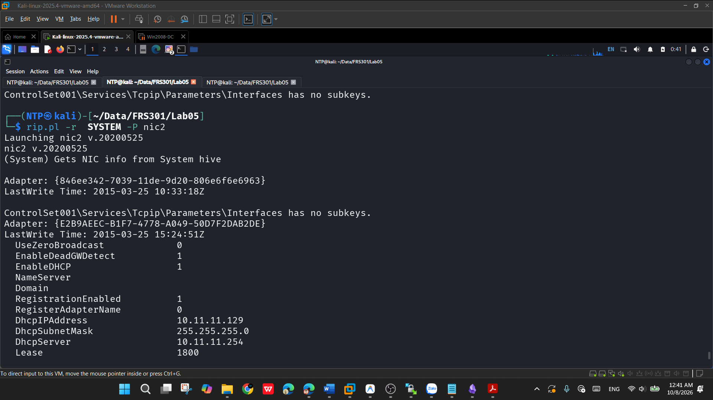

*Hình 11.1. Phân tích thông tin card mạng.*

**d) Kết quả & diễn giải:** Hệ thống có một card mạng với GUID {E2B9AECC-B1F7-4778-A049-50D7F2DAB2DE}, được cấu hình DHCP. Địa chỉ IP được cấp là 10.11.11.129/24, DHCP server là 10.11.11.254. Thời gian lease là 30 phút, bắt đầu từ 15:19:50 UTC ngày 25/03/2015. Thông tin này giúp xác định môi trường mạng của máy tính tại thời điểm xảy ra sự việc.

## 3. Tổng hợp Kết quả Điều tra (Forensic Findings)

### 3.1. Bảng tổng hợp kết quả điều tra (Forensic Findings Summary)

| STT | Timestamp /<br>Hạng mục | Đối tượng / Giá trị | Mô tả / Nhận định |
| --- | --- | --- | --- |
| 1 | Hệ điều hành | Windows 7 Ultimate SP1 (Build 7601) | Cài đặt ngày 22/03/2015 |
| 2 | Chủ sở hữu đăng ký | informant | Tên tài khoản chính |
| 3 | Tên máy tính | informant-PC | Từ domain informant-PC\informant |
| 4 | Tổng số tài khoản | 6 | 2 built-in (disabled) + 4 local users |
| 5 | Người dùng đăng nhập cuối | informant | Lúc 25/03/2015 14:45:59 UTC, 10 lần login |
| 6 | Thời gian shutdown cuối | 25/03/2015 15:31:05 UTC | Sau khi informant đăng nhập ~45 phút |
| 7 | Địa chỉ IP | 10.11.11.129/24 | Cấp bởi DHCP server 10.11.11.254 |
| 8 | Thời gian lease DHCP | 1800 giây (30 phút) | Bắt đầu 25/03/2015 15:19:50 UTC |
| 9 | GUID Card mạng | {E2B9AECC-B1F7-4778-A049-50D7F2DAB2DE} | LastWrite 25/03/2015 15:24:51 UTC |

## 4. Phân tích Chuyên sâu & Giải đáp Kỹ thuật (In-Depth Forensic Analysis)

#### ❓ Câu 1. Windows Registry là gì và tại sao nó quan trọng trong điều tra số?

**Trả lời:** Windows Registry là một cơ sở dữ liệu phân cấp lưu trữ cấu hình hệ thống, thông tin phần mềm, phần cứng, tài khoản người dùng, và nhiều dấu vết hoạt động khác trên hệ điều hành Windows. Trong điều tra số, Registry là nguồn bằng chứng quan trọng vì nó lưu lại lịch sử đăng nhập, thiết bị USB đã kết nối, phần mềm đã cài đặt, và các thay đổi cấu hình – những thông tin có thể chứng minh hành vi của người dùng. Trong bài lab, quá trình điều tra đã trích xuất thành công các thông tin về tài khoản, thời gian đăng nhập, shutdown, và cấu hình mạng từ Registry.

#### ❓ Câu 2.  Sự khác biệt giữa các tệp Registry Hive (SAM, SYSTEM, SECURITY, SOFTWARE, DEFAULT) là gì?

**Trả lời:**

SAM (Security Account Manager): Chứa thông tin tài khoản người dùng, mật khẩu đã băm, điều tra viên quyền, và lịch sử đăng nhập.

SYSTEM: Chứa cấu hình hệ thống, thông tin phần cứng, driver, dịch vụ, và thời gian shutdown.

SECURITY: Chứa chính sách bảo mật, quyền truy cập, và cấu hình audit.

SOFTWARE: Chứa thông tin phần mềm đã cài đặt, phiên bản hệ điều hành, và cấu hình ứng dụng.

DEFAULT: Chứa cấu hình mặc định cho người dùng mới.

#### ❓ Câu 3. Tại sao cần sử dụng tùy chọn -o ro khi mount ảnh đĩa trong điều tra số?

**Trả lời:** Tùy chọn -o ro (read-only) đảm bảo rằng ảnh đĩa chỉ được đọc mà không bị ghi hay thay đổi dữ liệu. Trong điều tra số, nguyên tắc quan trọng nhất là bảo toàn bằng chứng gốc (chain of custody). Nếu mount mà không có -o ro, hệ điều hành có thể tự động ghi các tệp tạm, cập nhật timestamp, hoặc thay đổi metadata, làm sai lệch bằng chứng. Do đó, -o ro là bắt buộc để đảm bảo tính toàn vẹn của dữ liệu.

## 5. Kết luận, Xử lý Sự cố & Bài học Kinh nghiệm (Conclusions & Lessons Learned)

### 5.1. Kết luận Điều tra

Đã thực hiện thành công quy trình phân tích Windows Registry từ ảnh DD của PC rò rỉ dữ liệu. Các phát hiện chính bao gồm:

Hệ điều hành: Windows 7 Ultimate SP1, cài đặt ngày 22/03/2015.

Tổng số tài khoản: 6 (2 built-in bị disable, 4 local users).

Người dùng đăng nhập cuối cùng: informant (lúc 25/03/2015 14:45:59 UTC, 10 lần login).

Thời gian shutdown cuối: 25/03/2015 15:31:05 UTC.

Cấu hình mạng: IP 10.11.11.129/24, DHCP server 10.11.11.254, lease 30 phút.

Các thông tin này cung cấp bức tranh tổng thể về hoạt động của hệ thống trong khoảng thời gian trước khi xảy ra sự cố rò rỉ dữ liệu, hỗ trợ điều tra viên xác định đối tượng và thời điểm nghi vấn.

### 5.2. Nhật ký Xử lý Sự cố Kỹ thuật (Troubleshooting Log)

| STT | Khó khăn / lỗi gặp phải | Giải pháp xử lý kỹ thuật |
| --- | --- | --- |
| 1 | Lỗi mount: /dev/loop0p2: Can't lookup blockdev | Sử dụng losetup -Pf để gắn file .dd vào loop device kèm cờ -P (tự động quét partition), sau đó mount với -o ro. |
| 2 | Lỗi ls: cannot access '*.DAT': No such file or directory | Sao chép và đổi tên 4 tệp NTUSER.DAT từ các user về thư mục làm việc trước khi chạy lệnh kiểm tra. |
| 3 | Cần xác định đúng offset của partition 2 | Sử dụng mmls để xem bảng phân vùng, xác định offset sector 206848 cho partition 2. |

### 5.3. Bài học Rút ra (Key Takeaways)

Qua bài lab này, quá trình điều tra đã rút ra được các bài học quan trọng:

Hiểu rõ cấu trúc và vai trò của Windows Registry trong điều tra số.

Biết cách trích xuất và phân tích các tệp Registry Hive bằng RegRipper.

Thành thạo kỹ thuật mount ảnh đĩa an toàn với losetup và mount -o ro.

Biết cách phân tích thông tin hệ thống, tài khoản, lịch sử đăng nhập, và cấu hình mạng từ Registry.

Nhận thức được tầm quan trọng của việc bảo toàn bằng chứng gốc trong suốt quá trình điều tra.

Kỹ năng làm việc điều tra viên, phân chia công việc và tổng hợp báo cáo hiệu quả.

## 6. Tài liệu Tham khảo (References)

[1] Tài liệu hướng dẫn thực hành Lab 5: Examining the Registry, môn FRS301, Trường Đại học FPT.
[2] AccessData, "FTK Imager User Guide", AccessData Group.
[3] The Sleuth Kit (TSK) Documentation, Brian Carrier.
[4] RegRipper Documentation, Harlan Carvey.
