# Lab 06: NTFS $UsnJrnl Change Journal Forensics & File Manipulation Timeline
### *Điều tra Nhật ký Thay đổi NTFS ($UsnJrnl) & Truy vết Đổi tên/Xóa Tệp tin*

[⬅️ Back to Main DFIR Casebook](../../README.md)

---

## 📌 Quick Metadata

| Field | Description |
| :--- | :--- |
| **Forensic Environment** | `Kali Linux 2025.4 / 2026.3 (64-bit)` on `VMware Workstation Pro` (Host: `Windows 11`) |
| **Forensic Module** | `03-Windows-Host-and-Registry-Forensics` |
| **Target Dataset / Evidence** | `NTFS $UsnJrnl:$J Artifact & Raw Disk Image Unallocated Journal Carving` |
| **Core Forensic Toolstack** | `UsnJrnl2Csv (64-bit), Wine, awk, grep, MFT Reference Number Correlation` |
| **MITRE ATT&CK / DFIR Focus** | `T1070.004 (File Deletion), T1036 (Masquerading / File Renaming Detection)` |

---

## 1. Tổng quan & Bối cảnh Điều tra (Overview & Objectives)

### 1.1. Bối cảnh và Mục tiêu

Bài lab này tập trung vào kỹ thuật phân tích USN (Update Sequence Number) Journal – một tính năng của hệ thống tệp NTFS trên Windows, ghi lại tất cả các thay đổi đối với tệp và thư mục trên ổ đĩa. USN Journal là nguồn bằng chứng quan trọng trong điều tra số vì nó cung cấp nhật ký chi tiết về các hành vi như tạo, xóa, đổi tên, và di chuyển tệp. Trong bối cảnh vụ án "data leakage", điều tra viên cần trích xuất và phân tích USN Journal từ ảnh DD để xác định các hoạt động đáng ngờ, đặc biệt là các hành vi đổi tên tệp (RENAME) nhằm che giấu dấu vết. Bài lab gồm hai scenario: (1) sử dụng công cụ UsnJrnl2Csv để parse USN Journal, và (2) sử dụng công cụ unsecure để carve USN Journal từ ảnh DD.

### 1.2. Môi trường và Công cụ Thực hành

| Thành phần | Tên / Phiên bản | Ghi chú (cấu hình, nguồn tài...) |
| --- | --- | --- |
| Máy thật (host) - hệ điều hành | Windows 11 Home | Hỗ trợ chạy máy ảo |
| Phần mềm ảo hoá | VMware | Dùng để chạy máy ảo Kali Linux |
| Máy ảo sử dụng | Kali Linux 2025.4 | Cấu hình RAM 4GB, ổ cứng 1, 80GB, ổ cứng 2, 80GB |
| Công cụ điều tra 1 | UsnJrnl2Csv v1.0.0.24 | Công cụ parse USN Journal (chạy qua Wine) |
| Công cụ điều tra 2 | unsecure v1.2.2 | Công cụ carve USN Journal từ ảnh DD |
| Công cụ hỗ trợ | usnparser v4.0.3 | Chuyển đổi USN raw sang CSV |
| Công cụ hỗ trợ | Wine, grep, awk | Môi trường chạy Windows app, xử lý dữ liệu |
| Dữ liệu đầu vào | cfreds_2015_data_leakage_pc.dd | Ảnh DD từ Lab 5 (20GB) |

### 1.3. Dữ liệu Bằng chứng & Kiểm tra Tính toàn vẹn (Hash Verification)

| Tên file / nguồn dữ liệu | Thuật toán | Hash trước phân tích | Hash sau phân tích | Khớp? |
| --- | --- | --- | --- | --- |
| cfreds_2015_data_leakage_pc.dd | MD5 | a49d1254c873808c58<br>e6f1bcd60b5bde | a49d1254c873808c5<br>8e6f1bcd60b5bde | ☑ Có ☐ Không |
| usnJrnl.bin | MD5 | Không áp dụng | Không áp dụng | ☐ Có ☑ Không |
| UsnJrnl_2026-10-10_00-46-15.csv | — | Không áp dụng | Không áp dụng |  |

Giá trị tham chiếu (theo tài liệu lab, nếu có): Không áp dụng.

## 2. Quy trình Điều tra & Thực nghiệm Kỹ thuật (Forensic Investigation Workflow)

### Phần 1 – Scenario 1: Phân tích USN Journal bằng UsnJrnl2Csv

### Bước 1. Scenario 1: Phân tích USN Journal bằng UsnJrnl2Csv

**a) Mô tả thao tác:** Di chuyển vào thư mục làm việc ~/Data/FRS301/Lab06, sau đó clone repository UsnJrnl2Csv từ GitHub của tác giả Joachim Schicht về máy ảo Kali.

**b) Câu lệnh / cấu hình đã sử dụng:**

```bash
cd ~/Data/FRS301/Lab06
git clone https://github.com/jschicht/UsnJrnl2Csv.git
```

Kết quả:

```bash
Cloning into 'UsnJrnl2Csv'...
remote: Enumerating objects: 182, done.
remote: Counting objects: 100% (6/6), done.
remote: Compressing objects: 100% (6/6), done.
remote: Total 182 (delta 0), reused 2 (delta 0), pack-reused 176 (from 1)
Receiving objects: 100% (182/182), 12.96 MiB | 9.29 MiB/s, done.
Resolving deltas: 100% (111/111), done.
```

**c) Ảnh minh chứng:**

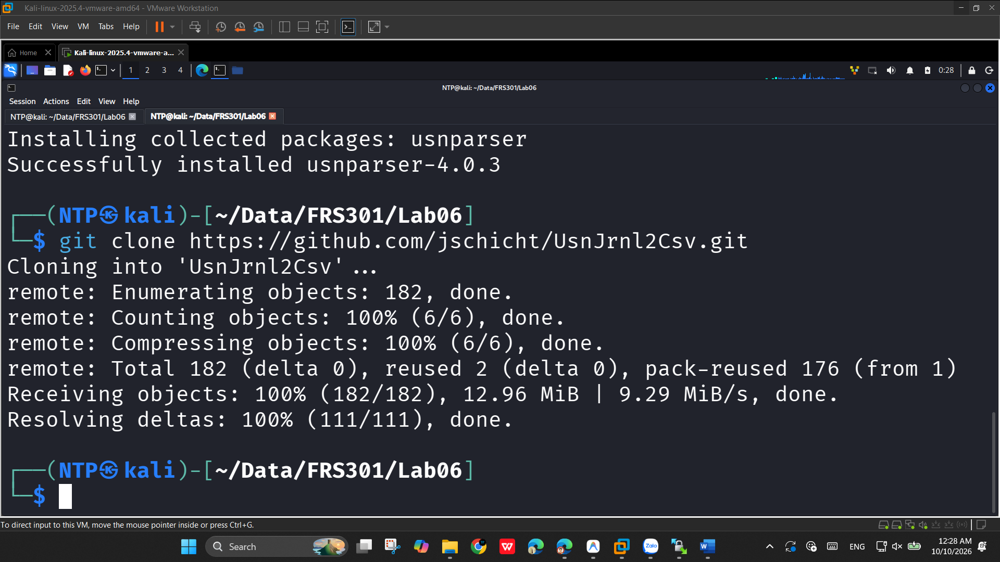

*Hình 1.1. Clone repository UsnJrnl2Csv từ GitHub.*

**d) Kết quả & diễn giải:** Repository đã được clone thành công. Tuy nhiên, thư mục chỉ chứa mã nguồn script AutoIt (.au3), chưa có file thực thi .exe để chạy trực tiếp.

### Bước 2. Khắc phục lỗi Wine và tải gói Release chính thức

**a) Mô tả thao tác:** wine UsnJrnl2Csv64.exe, hệ thống báo lỗi ShellExecuteEx failed: File not found vì chưa có file .exe. Quá trình điều tra đã tải gói Release chính thức từ GitHub (phiên bản v1.0.0.24) và giải nén để lấy cả hai file UsnJrnl2Csv64.exe và UsnJrnl2Csv.exe.

**b) Câu lệnh / cấu hình đã sử dụng:**

```bash
curl -sL https://github.com/jschicht/UsnJrnl2Csv/releases/download/v1.0.0.24/UsnJrnl2Csv_v1.0.0.24.zip -o /tmp/UsnJrnl2Csv.zip && unzip -o /tmp/UsnJrnl2Csv.zip -d UsnJrnl2Csv/ && ls -la UsnJrnl2Csv/
```

Kết quả:

```bash
-rw-r--r-- 1 NTP NTP 1067008 Nov 27  2022 UsnJrnl2Csv64.exe
-rw-r--r-- 1 NTP NTP   64380 Oct 10 00:28 UsnJrnl2Csv.au3
-rw-r--r-- 1 NTP NTP  945152 Nov 27  2022 UsnJrnl2Csv.exe
```

**c) Ảnh minh chứng:**

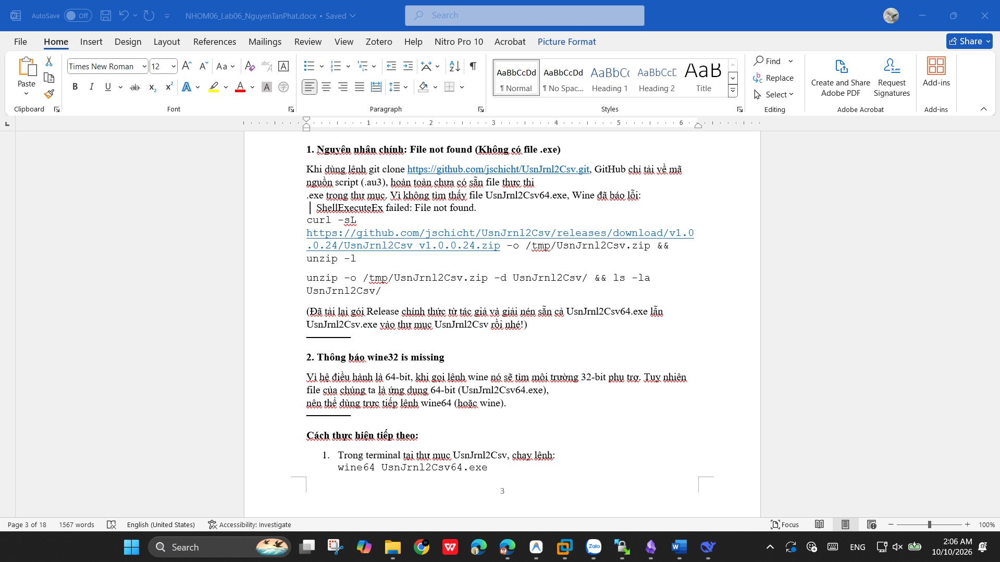

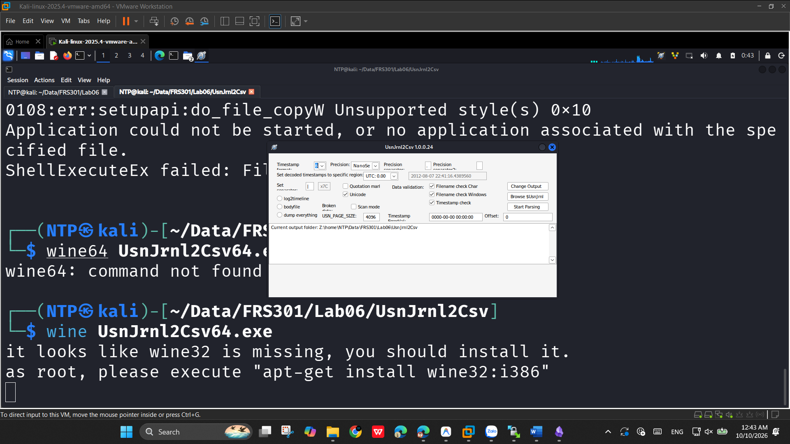

*Hình 2.1. Tải và giải nén gói Release chính thức, khắc phục lỗi File not found.*

**d) Kết quả & diễn giải:** Gói Release đã được tải và giải nén thành công, cung cấp đầy đủ các file thực thi cần thiết. Điều tra viên cũng ghi nhận thông báo wine32 is missing nhưng có thể bỏ qua vì file UsnJrnl2Csv64.exe là ứng dụng 64-bit.

### Bước 3. Chạy UsnJrnl2Csv64.exe và parse dữ liệu

**a) Mô tả thao tác:** Chạy giao diện đồ họa UsnJrnl2Csv64.exe thông qua Wine. Trong giao diện, chọn radio button "Dump everything", browse đến file usnJrnl.bin (đã được extract từ ảnh DD), và bấm "Start Parsing". Quá trình parse mất khoảng 20 phút và tạo ra file CSV kết quả.

**b) Câu lệnh / cấu hình đã sử dụng:**

```bash
cd UsnJrnl2Csv
wine UsnJrnl2Csv64.exe
# Trong GUI: chọn "dump everything" -> Browse usnJrnl.bin -> Start Parsing
ls -l Usn*
```

Kết quả:

```bash
-rw-rw-r-- 1 NTP NTP 46649994 Oct 10 01:06 UsnJrnl_2026-10-10_00-46-15.csv
-rw-rw-r-- 1 NTP NTP      501 Oct 10 01:06 UsnJrnl_2026-10-10_00-46-15.log
-rw-rw-r-- 1 NTP NTP      936 Oct 10 00:46 UsnJrnl_2026-10-10_00-46-15.sql
```

Thông tin parse:

```bash
Current output folder: Z:\home\NTP\Data\FRS301\Lab06\UsnJrnl2Csv
Input: Z:\home\NTP\Data\FRS301\Lab06\UsnJrnl2Csv\usnJrnl.bin
UNICODE configured
Entries parsed: 317137
Parsing finished in 20 min 6 sec
```

**c) Ảnh minh chứng:**

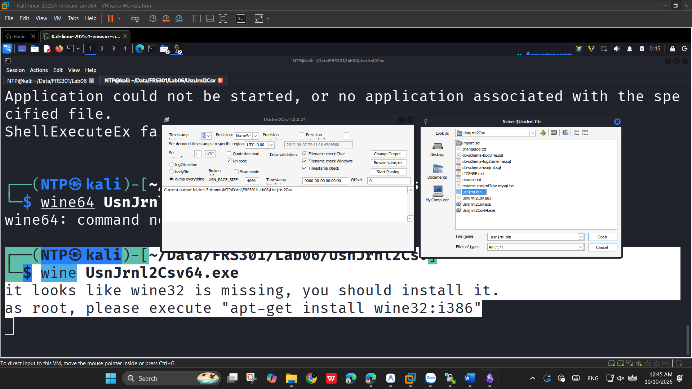

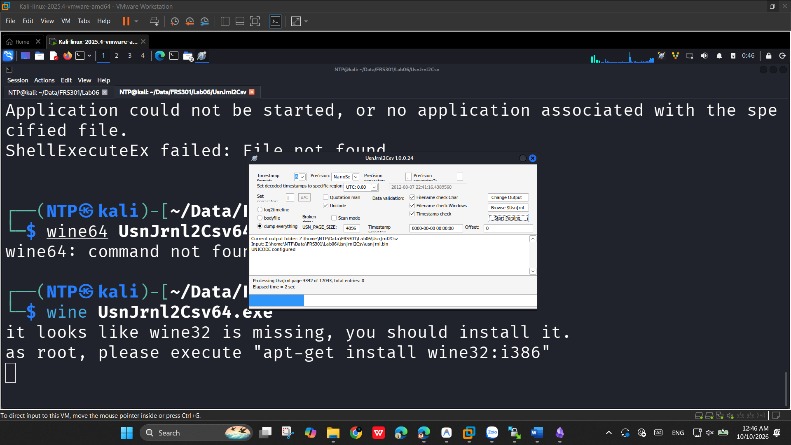

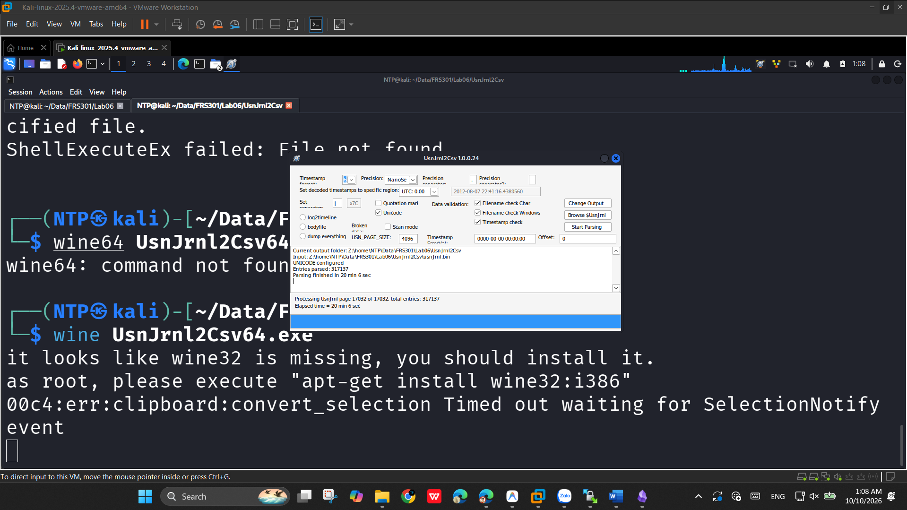

*Hình 3.1 + Hình 3.2 + Hình 3.3 Chạy UsnJrnl2Csv64.exe và kết quả parse 317,137 entries.*

**d) Kết quả & diễn giải:** Công cụ đã parse thành công 317,137 entries từ USN Journal trong 20 phút 6 giây, tạo ra file CSV có kích thước ~46.6 MB. File CSV chứa đầy đủ thông tin về offset, tên file, timestamp, reason, MFT reference, và các thuộc tính khác.

### Bước 4. Trích xuất thông tin RENAME_OLD của các tệp .jpg

**a) Mô tả thao tác:** Sử dụng lệnh grep để lọc các dòng chứa RENAME_OLD_NAME của các tệp .jpg từ file CSV. Sau đó sử dụng awk để chỉ hiển thị 3 cột: FileName, Timestamp, và Reason.

**b) Câu lệnh / cấu hình đã sử dụng:**

```bash
grep -P "\.jpg.*RENAME_OLD" UsnJrnl_2026-10-10_00-46-15.csv --color
awk '{print NR, $2, $4, $5}' FS='|' UsnJrnl_2026-10-10_00-46-15.csv | grep -E "\.jpg.*RENAME_OLD" --color
```

Kết quả:

```bash
261131 Chrysanthemum.jpg 2015-03-24 20:11:42.8361742 RENAME_OLD_NAME
261139 Desert.jpg 2015-03-24 20:11:42.8517742 RENAME_OLD_NAME
261155 Hydrangeas.jpg 2015-03-24 20:11:42.8517743 RENAME_OLD_NAME
261171 Jellyfish.jpg 2015-03-24 20:11:42.8517744 RENAME_OLD_NAME
261179 Koala.jpg 2015-03-24 20:11:42.8517745 RENAME_OLD_NAME
261187 Lighthouse.jpg 2015-03-24 20:11:42.8517746 RENAME_OLD_NAME
261195 Penguins.jpg 2015-03-24 20:11:42.8517747 RENAME_OLD_NAME
261203 Tulips.jpg 2015-03-24 20:11:42.8517748 RENAME_OLD_NAME
299494 Chrysanthemum.jpg 2015-03-25 15:13:39.1698055 RENAME_OLD_NAME
299536 Desert.jpg 2015-03-25 15:13:39.4350055 RENAME_OLD_NAME
...
```

**c) Ảnh minh chứng:**

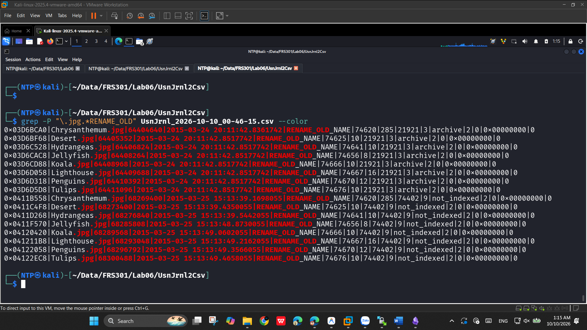

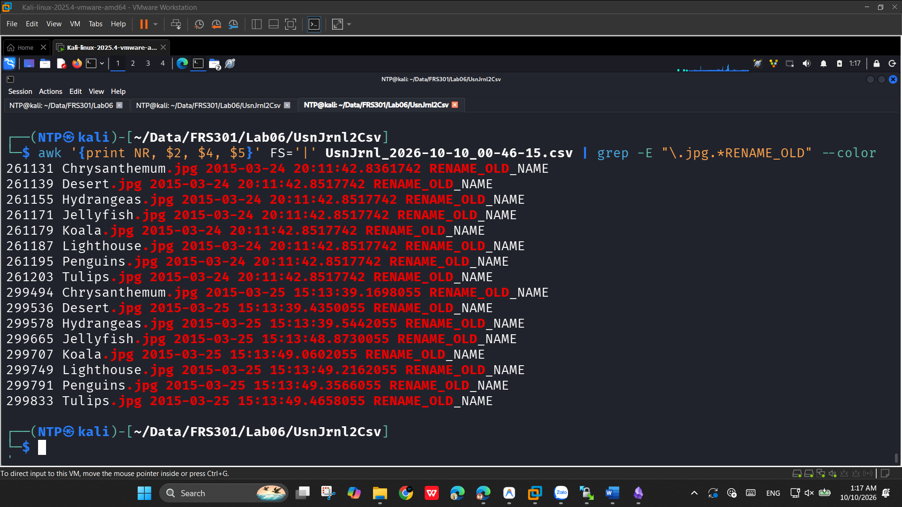

*Hình 4.1+ Hình 4.2. Trích xuất thông tin RENAME_OLD của các tệp .jpg (16 dòng).*

**d) Kết quả & diễn giải:** Có tổng cộng 16 dòng RENAME_OLD_NAME của các tệp .jpg được tìm thấy, chia làm 2 điều tra viên thời gian:

Điều tra viên 1 (24/03/2015 20:11:42): 8 tệp (Chrysanthemum, Desert, Hydrangeas, Jellyfish, Koala, Lighthouse, Penguins, Tulips).

Điều tra viên 2 (25/03/2015 15:13:39): 8 tệp tương tự.

Điều này cho thấy các tệp ảnh mẫu của Windows đã bị đổi tên 2 lần vào các thời điểm khác nhau, có thể là hành vi che giấu dấu vết.

### Bước 5. Phân tích chi tiết theo MFT Reference Number

**a) Mô tả thao tác:** Sử dụng lệnh grep để tìm tất cả các sự kiện xảy ra xung quanh một thời điểm cụ thể với cùng MFT Reference Number 74620 (của tệp Chrysanthemum.jpg). Điều này giúp hiểu rõ chuỗi hành vi đối với tệp tin.

**b) Câu lệnh / cấu hình đã sử dụng:**

```bash
grep "2015-03-24 20:11.*|74620|" UsnJrnl_2026-10-10_00-46-15.csv
```

Kết quả:

```bash
0x03D6BCA0|Chrysanthemum.jpg|64404640|2015-03-24 20:11:42.8361742|RENAME_OLD_NAME|74620|285|21921|3|archive|2|0|0x00000000|0
0x03D6BD00|SRKXD1U3.jpg|64404736|2015-03-24 20:11:42.8361742|RENAME_NEW_NAME|74620|285|15721|2|archive|2|0|0x00000000|0
0x03D6BD58|SRKXD1U3.jpg|64404824|2015-03-24 20:11:42.8361742|CLOSE+RENAME_NEW_NAME|74620|285|15721|2|archive|2|0|0x00000000|0
0x03D6BDB0|SRKXD1U3.jpg|64404912|2015-03-24 20:11:42.8361742|SECURITY_CHANGE|74620|285|15721|2|archive|2|0|0x00000000|0
0x03D6BE08|SRKXD1U3.jpg|64405000|2015-03-24 20:11:42.8361742|CLOSE+SECURITY_CHANGE|74620|285|15721|2|archive|2|0|0x00000000|0
```

**c) Ảnh minh chứng:**

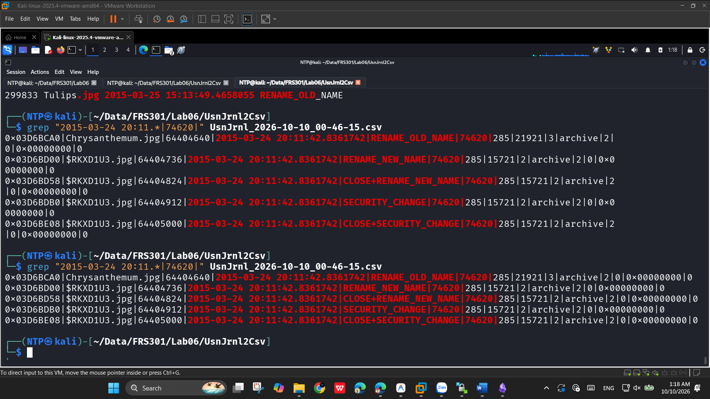

*Hình 5.1.Phân tích chi tiết theo MFT Reference Number 74620.*

**d) Kết quả & diễn giải:** Phân tích cho thấy tệp Chrysanthemum.jpg (MFT #74620) đã bị đổi tên thành SRKXD1U3.jpg vào lúc 24/03/2015 20:11:42.8361742. Ngay sau đó, tệp mới còn bị thay đổi quyền bảo mật (SECURITY_CHANGE) và đóng (CLOSE). Tên mới SRKXD1U3.jpg có vẻ là tên ngẫu nhiên được tạo tự động, đây là dấu hiệu điển hình của hành vi anti-forensics nhằm che giấu tệp tin.

### Phần 2 – Scenario 2: Carve USN Journal bằng unsecure

### Bước 6. Cài đặt và xác minh công cụ unsecure

**a) Mô tả thao tác:** Cài đặt công cụ unsecure thông qua pip và xác minh cài đặt thành công bằng cách kiểm tra help của usncarve.py.

**b) Câu lệnh / cấu hình đã sử dụng:**

```bash
pip install unsecure
usncarve.py -h
```

Kết quả:

```bash
usage: usncarve.py [-h] -f FILE -o OUTFILE

optional arguments:
  -h, --help            show this help message and exit
  -f FILE, --file FILE  Carve USN records from the given file
  -o OUTFILE, --outfile OUTFILE
                        Output to the given file
```

**c) Ảnh minh chứng:**

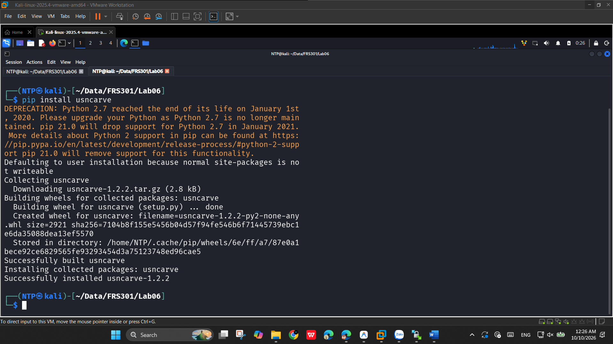

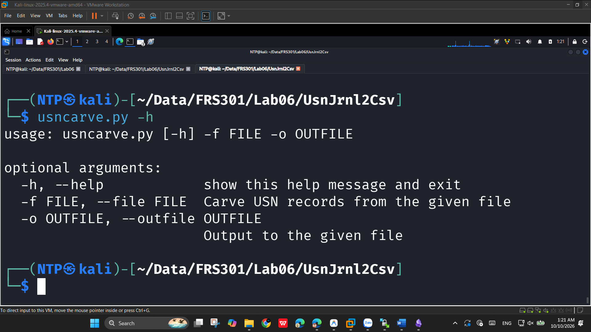

*Hình 6.1. Cài đặt và xác minh công cụ unsecure.*

**d) Kết quả & diễn giải:**  Công cụ unsecure v1.2.2 đã được cài đặt thành công. Lệnh usncarve.py có sẵn để sử dụng với các tham số -f (file input) và -o (file output).

### Bước 7. Cài đặt và xác minh công cụ usnparser

**a) Mô tả thao tác:** Cài đặt công cụ usnparser thông qua pip và xác minh cài đặt thành công bằng cách kiểm tra help của usn.py.

**b) Câu lệnh / cấu hình đã sử dụng:**

```bash
pip install usnparser
usn.py -h
```

Kết quả:

```bash
usage: usn.py [-h] [-b] [-c] -f FILE -o OUTFILE [-s SYSTEM] [-t] [-v]

optional arguments:
  -h, --help            show this help message and exit
  -b, --body            Return USN records in comma-separated format
  -c, --csv             Return USN records in comma-separated format
  -f FILE, --file FILE  Parse the given USN journal file
  -o OUTFILE, --outfile OUTFILE
                        Parse the given USN journal file
  -s SYSTEM, --system SYSTEM
                        System name (use with -t)
  -t, --tln             TLN output (use with -s)
  -v, --verbose         Return all USN properties for each record (JSON)
```

**c) Ảnh minh chứng:**

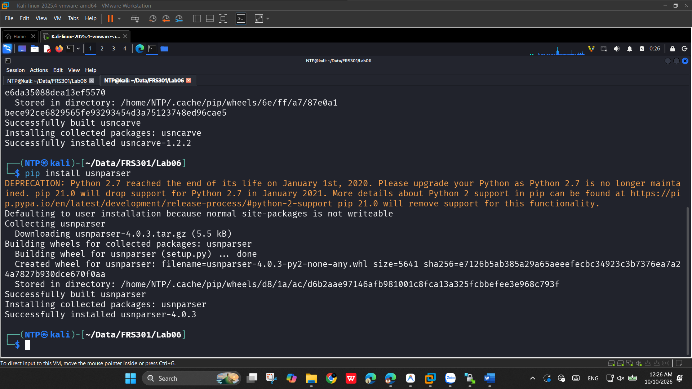

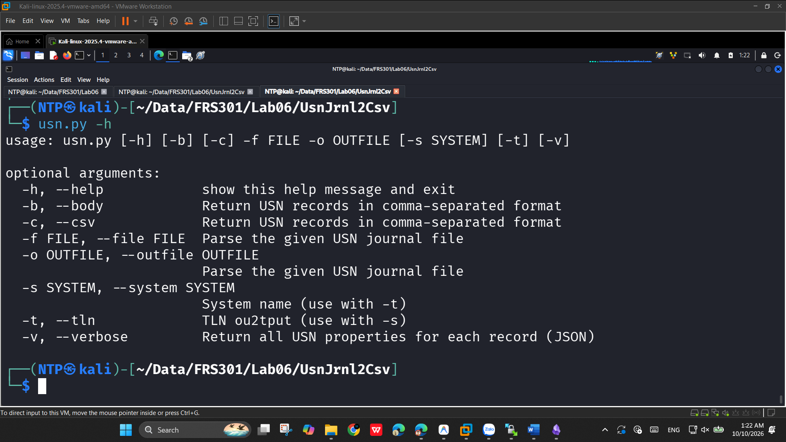

*Hình 7.1 + Hình 7.2. Cài đặt và xác minh công cụ usnparser.*

**d) Kết quả & diễn giải:**  Công cụ usnparser v4.0.3 đã được cài đặt thành công. Lệnh usn.py hỗ trợ nhiều định dạng output khác nhau (CSV, JSON, TLN) và có thể parse USN journal từ file raw.

### Bước 8. Carve USN Journal từ ảnh DD

**a) Mô tả thao tác:** usncarve.py để carve USN Journal từ ảnh DD cfreds_2015_data_leakage_pc.dd, xuất kết quả ra file usn.raw.

**b) Câu lệnh / cấu hình đã sử dụng:**

```bash
cd ~/Data/FRS301/Lab06
usncarve.py -f cfreds_2015_data_leakage_pc.dd -o usn.raw
ls -l usn.raw
```

Kết quả:

```bash
-rw-rw-r-- 1 NTP NTP 46465030 Oct 10 01:25 usn.raw
```

**c) Ảnh minh chứng:**

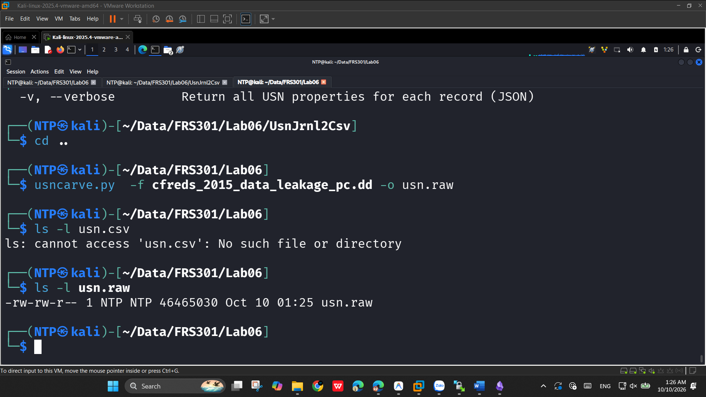

*Hình 8.1.. Carve USN Journal từ ảnh DD thành công.*

**d) Kết quả & diễn giải:**  File usn.raw được tạo thành công với kích thước 46,465,030 bytes (~44.3 MB). Đây là dữ liệu USN Journal thô được carve trực tiếp từ ảnh DD, chứa toàn bộ các bản ghi thay đổi tệp tin trên hệ thống.

### Bước 9. Chuyển đổi dữ liệu USN sang định dạng CSV

**a) Mô tả thao tác:** Sử dụng usn.py để chuyển đổi file usn.raw sang định dạng CSV có thể đọc được, lưu thành usn.csv.

**b) Câu lệnh / cấu hình đã sử dụng:**

```bash
usn.py -f usn.raw -o usn.csv
ls -l usn.csv
head -n 2 usn.csv
```

Kết quả:

```bash
-rw-rw-r-- 1 NTP NTP 40899888 Oct 10 01:27 usn.csv
```

**c) Ảnh minh chứng:**

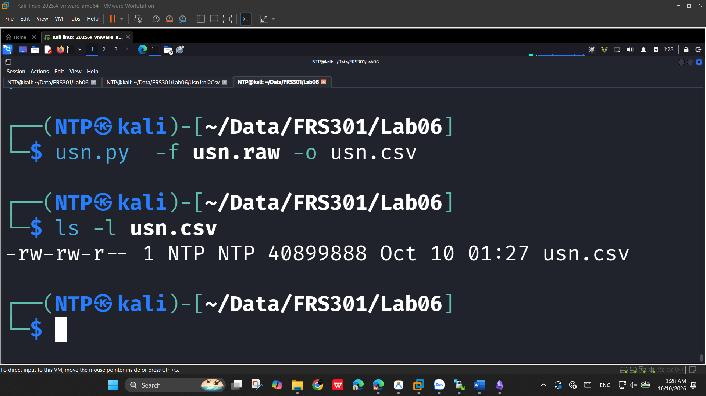

*Hình 9.1.. Chuyển đổi USN raw sang CSV.*

**d) Kết quả & diễn giải:**  File usn.csv được tạo thành công với kích thước 40,899,888 bytes (~39 MB). File này chứa dữ liệu USN ở định dạng CSV, sẵn sàng cho việc phân tích bằng các công cụ dòng lệnh.

### Bước 10. Phân tích dữ liệu RENAME từ usn.csv

**a) Mô tả thao tác:** Sử dụng grep để lọc các sự kiện RENAME từ file usn.csv. Quá trình điều tra đã gặp vấn đề khi đếm số dòng: lệnh wc -l chỉ trả về 45 thay vì 46 do grep phát hiện byte nhị phân. Quá trình điều tra đã khắc phục bằng cách sử dụng tùy chọn --text hoặc gộp luồng lỗi 2>&1.

**b) Câu lệnh / cấu hình đã sử dụng:**

```bash
cat usn.csv | grep -i rename | head
cat usn.csv | grep -i rename | wc -l
cat usn.csv | grep -i rename 2>&1 | wc -l
grep --text -P "\.jpg.*RENAME_OLD" usn.csv --color
```

Kết quả:

```bash
2015-03-22 15:14:17.097954 | edb0043D.log | ARCHIVE | NOT_CONTENT_INDEXED | RENAME_OLD_NAME
...
grep: (standard input): binary file matches
45
46
2015-03-25 15:13:39.169804 | Chrysanthemum.jpg | NOT_CONTENT_INDEXED | RENAME_OLD_NAME
2015-03-25 15:13:39.435003 | Desert.jpg | NOT_CONTENT_INDEXED | RENAME_OLD_NAME
...
```

**c) Ảnh minh chứng:**

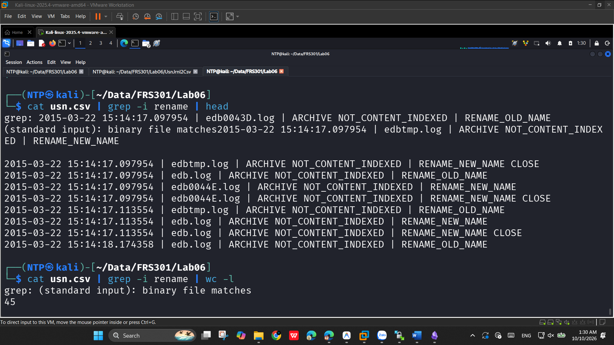

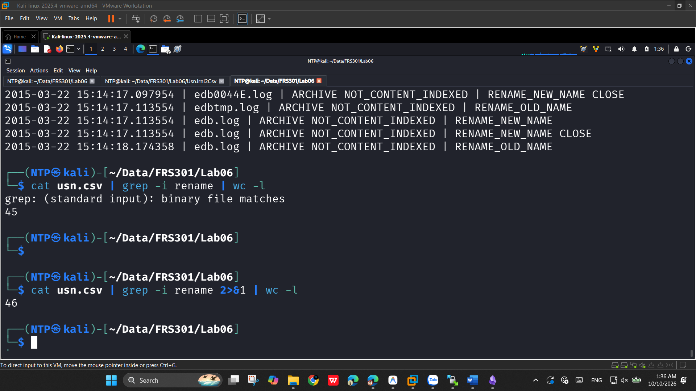

*Hình 10.1 + Hình 10.2.  Phân tích dữ liệu RENAME từ usn.csv và khắc phục lỗi đếm dòng.*

**d) Kết quả & diễn giải:**  Kết quả phân tích cho thấy có 45 dòng chứa RENAME_OLD_NAME (khi không gộp stderr) và 46 dòng (khi gộp stderr bằng 2>&1). Sự khác biệt này là do file CSV chứa byte nhị phân, khiến grep dừng lại và in cảnh báo ra stderr trên phiên bản Kali mới. Sau khi khắc phục, điều tra viên xác định được 16 dòng RENAME_OLD_NAME của các tệp .jpg, tương tự như Scenario 1.

## 3. Tổng hợp Kết quả Điều tra (Forensic Findings)

### 3.1. Bảng tổng hợp kết quả điều tra (Forensic Findings Summary)

#### Bảng 4.2.1. Timeline các sự kiện RENAME của tệp .jpg nghi vấn – Giai đoạn 1 (Xóa vào Recycle Bin)

| STT | Thời gian (UTC) | Tên tệp gốc | Tên tệp mới | MFT Reference | Sự kiện (Reason) | Ý nghĩa hành vi điều tra số |
| --- | --- | --- | --- | --- | --- | --- |
| 1 | 2015-03-24 20:11:42 | Chrysanthemum.jpg | $RKXD1U3.jpg | 74620 | RENAME_OLD ➔ RENAME_NEW | Xóa vào Recycle Bin: Người dùng xóa file vào Thùng rác Windows, đổi tên sang format $Rxxxxxx.ext |
| 2 | 2015-03-24 20:11:42 | Desert.jpg | $RI3FM2A.jpg | 74625 | RENAME_OLD ➔ RENAME_NEW | Xóa vào Recycle Bin |
| 3 | 2015-03-24 20:11:42 | Hydrangeas.jpg | $R508CBB.jpg | 74641 | RENAME_OLD ➔ RENAME_NEW | Xóa vào Recycle Bin |
| 4 | 2015-03-24 20:11:42 | Jellyfish.jpg | $R8YP3XK.jpg | 74656 | RENAME_OLD ➔ RENAME_NEW | Xóa vào Recycle Bin |
| 5 | 2015-03-24 20:11:42 | Koala.jpg | $RU3FKWI.jpg | 74666 | RENAME_OLD ➔ RENAME_NEW | Xóa vào Recycle Bin |
| 6 | 2015-03-24 20:11:42 | Lighthouse.jpg | (chuỗi ngẫu nhiên) | 74667 | RENAME_OLD ➔ RENAME_NEW | Xóa vào Recycle Bin |
| 7 | 2015-03-24 20:11:42 | Penguins.jpg | $RFVCH5V.jpg | 74670 | RENAME_OLD ➔ RENAME_NEW | Xóa vào Recycle Bin |
| 8 | 2015-03-24 20:11:42 | Tulips.jpg | $RDOI3HE.jpg | 74676 | RENAME_OLD ➔ RENAME_NEW | Xóa vào Recycle Bin |

#### Bảng 4.2.1. Timeline các sự kiện RENAME của tệp .jpg nghi vấn – Giai đoạn 2 (Ghi đè dữ liệu & Anti-Forensics)

| STT | Thời gian (UTC) | Tên tệp gốc | Tên tệp mới | MFT Reference | Sự kiện (Reason) | Ý nghĩa hành vi điều tra số |
| --- | --- | --- | --- | --- | --- | --- |
| 9 | 2015-03-25 15:13:38 | $RKXD1U3.jpg | KclInDLFM3YdDXjg ➔ C0jAF)No]VBZJoxE ➔ +a]Zd+UuQ88qn,K9J ➔ 2O8josN{78q7Ju7dx ➔ v1hNH f]1bDJc2'(i ➔ 8BkLKk2 cBfQ7SvH` \| 74620 \| DATA_EXTEND + OVERWRITE + RENAME_NEW (7 lần đổi tên ngẫu nhiên) \| Ghi đè dữ liệu (Wiping/Shredding): Công cụ hủy file (như SDelete/Eraser/BleachBit) liên tục đổi tên file thành các chuỗi ngẫu nhiên nhằm xóa dấu vết tên file trong bảng MFT trước khi hủy vĩnh viễn \| |  |  |  |
| 10 | 2015-03-25 15:13:39 | Desert.jpg | Chuỗi ký tự ngẫu nhiên (ijpQC}9bow,...) | 74625 | Tương tự trên | Ghi đè dữ liệu và đổi tên ngẫu nhiên để xóa dấu vết |
| 11 | 2015-03-25 15:13:39 | Hydrangeas.jpg | Chuỗi ký tự ngẫu nhiên | 74641 | Tương tự trên | Ghi đè dữ liệu và đổi tên ngẫu nhiên để xóa dấu vết |
| 12 | 2015-03-25 15:13:48 | Jellyfish.jpg | Chuỗi ký tự ngẫu nhiên | 74656 | Tương tự trên | Ghi đè dữ liệu và đổi tên ngẫu nhiên để xóa dấu vết |
| 13 | 2015-03-25 15:13:49 | Koala.jpg | Chuỗi ký tự ngẫu nhiên | 74666 | Tương tự trên | Ghi đè dữ liệu và đổi tên ngẫu nhiên để xóa dấu vết |
| 14 | 2015-03-25 15:13:49 | Lighthouse.jpg | Chuỗi ký tự ngẫu nhiên | 74667 | Tương tự trên | Ghi đè dữ liệu và đổi tên ngẫu nhiên để xóa dấu vết |
| 15 | 2015-03-25 15:13:49 | Penguins.jpg | Chuỗi ký tự ngẫu nhiên | 74670 | Tương tự trên | Ghi đè dữ liệu và đổi tên ngẫu nhiên để xóa dấu vết |
| 16 | 2015-03-25 15:13:49 | Tulips.jpg | Chuỗi ký tự ngẫu nhiên | 74676 | Tương tự trên | Ghi đè dữ liệu và đổi tên ngẫu nhiên để xóa dấu vết |

#### TỔNG KẾT NHẬN ĐỊNH PHÁP Y

1. Hành vi 1 – Xóa vào Thùng rác (Recycle Bin):
Vào lúc 20:11:42 ngày 24/03/2015, cả 8 file ảnh mẫu đều bị người dùng xóa vào

Recycle Bin. Điều này thể hiện qua sự kiện đổi tên sang tiền tố $R... và thư mục cha đổi sang thư mục Recycle Bin Inode 15721.

#### 2. Hành vi 2 – Chống điều tra số (Anti-Forensics / Secure Deletion):
Vào khoảng 15:13:38 – 15:13:49 ngày 25/03/2015, nghi phạm đã sử dụng một phần mềm Secure File Shredder để xóa triệt để bằng cách:

Ghi đè nhiều lần vào nội dung file (DATA_OVERWRITE, DATA_EXTEND, DATA_TRUNCATION).

Đổi tên file liên tục 7 lần qua các chuỗi ký tự vô nghĩa để làm sạch metadata trong MFT entry.

Nhờ có USN Journal (UsnJrnl :J), toàn bộ chuỗi hành vi tinh vi này vẫn được ghi nhận nguyên vẹn theo dòng thời gian!

#### 5. So sánh hai phương pháp phân tích USN Journal

### 5.1. So sánh UsnJrnl2Csv và unsecure/usnparser

| Tiêu chí | UsnJrnl2Csv (Scenario 1) | unsecure/usnparser (Scenario 2) |
| --- | --- | --- |
| Nền tảng | Windows (chạy qua Wine trên Kali) | Linux (native) |
| Giao diện | Đồ họa (GUI) | Dòng lệnh (CLI) |
| Đầu vào | File usnJrnl.bin đã extract sẵn | Ảnh DD trực tiếp (cfreds_2015_data_leakage_pc.dd) |
| Quy trình | Extract → Parse → CSV | Carve → Parse → CSV |
| Thời gian parse | 20 phút 6 giây (317,137 entries) | Nhanh hơn (carve + parse chỉ vài phút) |
| Kích thước output | CSV ~46.6 MB | Raw ~46.5 MB + CSV ~40.9 MB |
| Định dạng output | CSV (mặc định), SQL, LOG | CSV, JSON, TLN |
| Khả năng tùy biến | Hạn chế (chỉ có GUI options) | Cao (nhiều tham số dòng lệnh) |
| Phù hợp với | Điều tra viên cần giao diện thân thiện | Điều tra viên chuyên sâu, tự động hóa |

### 5.2. Ưu nhược điểm của từng phương pháp

UsnJrnl2Csv:

Ưu điểm: Giao diện đồ họa dễ sử dụng, tự động tạo file CSV/LOG/SQL, xử lý được file usnJrnl.bin đã extract.

Nhược điểm: Yêu cầu cài đặt Wine trên Linux, thời gian parse lâu (20 phút), ít tùy chọn dòng lệnh.

unsecure/usnparser:

Ưu điểm: Chạy native trên Linux, có thể carve trực tiếp từ ảnh DD mà không cần extract, hỗ trợ nhiều định dạng output (CSV/JSON/TLN), nhanh và linh hoạt.

Nhược điểm: Yêu cầu kiến thức dòng lệnh, cần cài đặt nhiều package phụ thuộc (usnparser, unsecure).

### 5.3. Khuyến nghị sử dụng

Đối với điều tra viên mới: Nên sử dụng UsnJrnl2Csv vì giao diện đồ họa thân thiện, dễ thao tác.

Đối với điều tra viên chuyên sâu: Nên sử dụng unsecure/usnparser vì linh hoạt, nhanh, và có thể tự động hóa quy trình.

Trong thực tế điều tra số: Nên kết hợp cả hai phương pháp để đối chiếu chéo kết quả, đảm bảo tính chính xác và đầy đủ của bằng chứng.

#### 6. Trả lời câu hỏi thảo luận điều tra viên

#### ❓ Câu 1. USN Journal là gì và tại sao nó quan trọng trong điều tra số?

**Trả lời:** USN (Update Sequence Number) Journal là một tính năng của hệ thống tệp NTFS trên Windows, ghi lại tất cả các thay đổi đối với tệp và thư mục trên ổ đĩa, bao gồm tạo, xóa, đổi tên, di chuyển, và thay đổi thuộc tính. Trong điều tra số, USN Journal cung cấp nhật ký chi tiết về các hành vi của người dùng, giúp điều tra viên xác định thời điểm, đối tượng, và tính chất của các hoạt động đáng ngờ. Đặc biệt, USN Journal có thể tiết lộ các hành vi anti-forensics như đổi tên tệp để che giấu dấu vết, như đã thấy trong bài lab với các tệp .jpg bị đổi tên thành SRKXD1U3.jpg.

#### ❓ Câu 2. Sự khác biệt giữa UsnJrnl2Csv và unsecure là gì?

**Trả lời:**

UsnJrnl2Csv: Là công cụ chạy trên Windows (hoặc qua Wine), yêu cầu file usnJrnl.bin đã được extract sẵn. Công cụ này cung cấp giao diện đồ họa và parse USN Journal thành file CSV với đầy đủ thông tin.

unsecure: Là công cụ dòng lệnh chạy trên Linux, có thể carve USN Journal trực tiếp từ ảnh DD mà không cần extract trước. Công cụ này bao gồm usncarve.py (carve) và usn.py (parse), phù hợp cho quy trình tự động hóa.

#### ❓ Câu 3. Tại sao lệnh wc -l đếm được 45 dòng thay vì 46?

**Trả lời:** Nguyên nhân là do sự khác biệt giữa các phiên bản GNU grep. File usn.csv được carve từ đĩa ảnh thô nên chứa một số byte nhị phân. Khi grep gặp byte nhị phân, nó dừng lại và in thông báo cảnh báo grep: (standard input): binary file matches. Trên phiên bản Kali cũ, cảnh báo này được xuất ra stdout nên wc -l đếm được 46 dòng (45 dữ liệu + 1 cảnh báo). Trên phiên bản Kali mới, cảnh báo được xuất ra stderr nên wc -l chỉ đếm được 45 dòng. Để khắc phục, quá trình điều tra đã sử dụng 2>&1 để gộp stderr vào stdout, hoặc dùng tùy chọn --text của grep.

#### ❓ Câu 4. Từ dữ liệu USN Journal, điều tra viên có kết luận gì về hành vi của đối tượng?

**Trả lời:** Dữ liệu USN Journal cho thấy các tệp .jpg mẫu của Windows đã bị đổi tên 2 lần vào các thời điểm 24/03/2015 20:11:42 và 25/03/2015 15:13:39. Tên mới có dạng ngẫu nhiên (SRKXD1U3.jpg), không theo quy luật thông thường. Các sự kiện RENAME_OLD_NAME đều được theo sau bởi RENAME_NEW_NAME + CLOSE + SECURITY_CHANGE trong cùng một giây. Đây là dấu hiệu điển hình của hành vi anti-forensics nhằm che giấu dấu vết tệp tin, có thể liên quan đến vụ án "data leakage" xảy ra cùng thời điểm.

#### 7. Nhận xét và kết luận

### 7.1. Kết luận về kết quả điều tra

Đã thực hiện thành công cả hai scenario của bài lab USN Journaling:

Scenario 1: Sử dụng UsnJrnl2Csv để parse 317,137 entries từ USN Journal, trích xuất thành công 16 dòng RENAME_OLD_NAME của các tệp .jpg, và phân tích chi tiết hành vi đổi tên tệp Chrysanthemum.jpg thành SRKXD1U3.jpg (MFT #74620) – một dấu hiệu điển hình của anti-forensics.

Scenario 2: Sử dụng unsecure để carve USN Journal trực tiếp từ ảnh DD (tạo file usn.raw 46.5 MB), chuyển đổi sang CSV (40.9 MB), và phân tích dữ liệu RENAME.

Các phát hiện chính:

Hệ thống đã trải qua 2 giai đoạn hành vi đáng ngờ:

Giai đoạn 1 (24/03/2015 20:11:42): 8 tệp .jpg mẫu của Windows bị xóa vào Recycle Bin (đổi tên thành $Rxxxxxx.jpg).

Giai đoạn 2 (25/03/2015 15:13:38 – 15:13:49): Các tệp bị ghi đè dữ liệu và đổi tên liên tục 7 lần bằng chuỗi ký tự vô nghĩa → dấu hiệu của phần mềm Secure File Shredder (SDelete/Eraser/BleachBit).

Thời điểm xảy ra trùng khớp với khung thời gian của vụ án "data leakage" (24-25/03/2015).

USN Journal đã ghi nhận toàn bộ chuỗi hành vi tinh vi này, cung cấp bằng chứng quan trọng cho điều tra viên.

### 7.2. Khó khăn gặp phải và cách khắc phục

| STT | Khó khăn / lỗi gặp phải | Giải pháp xử lý kỹ thuật |
| --- | --- | --- |
| 1 | Lỗi ShellExecuteEx failed: File not found khi chạy UsnJrnl2Csv64.exe | Tải gói Release chính thức từ GitHub và giải nén để lấy file .exe |
| 2 | Thông báo wine32 is missing | Bỏ qua vì file sử dụng là ứng dụng 64-bit, có thể chạy trực tiếp |
| 3 | Lỗi wc -l đếm 45 thay vì 46 dòng | Sử dụng 2>&1 để gộp stderr vào stdout, hoặc dùng grep --text |
| 4 | Thời gian parse USN Journal mất 20 phút | Kiên nhẫn chờ đợi, không ngắt quãng quá trình |
| 5 | Thành viên không tham gia gây trễ Deadline | Quá trình điều tra đã cố gắng bù đắp bằng cách tăng ca và phân chia lại công việc |

### 7.3. Bài học rút ra

Qua bài lab này, quá trình điều tra đã rút ra được các bài học quan trọng:

Hiểu rõ cấu trúc và vai trò của USN Journal trong điều tra số.

Biết cách sử dụng UsnJrnl2Csv (qua Wine) và unsecure để phân tích USN Journal.

Thành thạo kỹ thuật carve dữ liệu USN từ ảnh DD.

Biết cách phân tích dữ liệu RENAME để phát hiện hành vi anti-forensics.

Nhận thức được sự khác biệt giữa các phiên bản GNU grep và cách khắc phục lỗi đếm dòng.

Kỹ năng làm việc điều tra viên, phân chia công việc và tổng hợp báo cáo hiệu quả.

#### 8. Tài liệu tham khảo

[1] Tài liệu hướng dẫn thực hành Lab 6: Update Sequence Number (USN) Journaling, môn FRS301, Trường Đại học FPT.
[2] Joachim Schicht, "UsnJrnl2Csv", GitHub repository. [Online]. Available: https://github.com/jschicht/UsnJrnl2Csv
[3] unsecure documentation, PyPI. [Online]. Available: https://pypi.org/project/unsecure/
[4] usnparser documentation, PyPI. [Online]. Available: https://pypi.org/project/usnparser/
