# Lab 11: Web Browser Forensics – Reconstructing User Activity & Cloud Exfiltration
### *Điều tra Lịch sử Duyệt Web (Browser Forensics) & Truy vết Tải/Đồng bộ Dữ liệu*

[⬅️ Back to Main DFIR Casebook](../../README.md)

---

## 📌 Quick Metadata

| Field | Description |
| :--- | :--- |
| **Forensic Environment** | `Kali Linux 2025.4 / 2026.3 (64-bit)` on `VMware Workstation Pro` (Host: `Windows 11`) |
| **Forensic Module** | `04-Application-Email-and-Mobile-Forensics` |
| **Target Dataset / Evidence** | `cfreds_2015_data_leakage_pc.dd (IE WebCacheV01.dat / index.dat, Chrome & Firefox SQLite DBs)` |
| **Core Forensic Toolstack** | `Pasco, strings, SQLite3, DB Browser for SQLite, Loop Device Read-Only Mounting` |
| **MITRE ATT&CK / DFIR Focus** | `T1567.002 (Exfiltration to Cloud Storage), Web Artifact Timeline Reconstruction` |

---

## 1. Tổng quan & Bối cảnh Điều tra (Overview & Objectives)

### 1.1. Bối cảnh và Mục tiêu

Bài lab mô phỏng quá trình điều tra số trên một máy tính bị tình nghi rò rỉ dữ liệu. Nhiệm vụ của điều tra viên là thu thập và phân tích các bằng chứng số liên quan đến hành vi duyệt web của đối tượng. Tiến hành thực hiện mount file ảnh đĩa (cfreds_2015_data_leakage_pc.dd) vào môi trường Kali Linux, sau đó xác định phiên bản trình duyệt, tìm đường dẫn lưu trữ lịch sử duyệt web của Internet Explorer và Google Chrome. Từ đó, tiến hành trích xuất dữ liệu (URL, thời gian truy cập) và phân tích các từ khóa tìm kiếm để làm rõ mục đích và hành vi của đối tượng.

### 1.2. Môi trường và Công cụ Thực hành

| Thành phần | Tên / Phiên bản | Ghi chú (cấu hình, nguồn tải…) |
| --- | --- | --- |
| Máy thật (host) – hệ điều hành | Windows |  |
| Phần mềm ảo hoá | VMware Workstation |  |
| Máy ảo sử dụng | Kali Linux 2026.3 |  |
| Công cụ điều tra 1 | losetup, mount | Gắn kết file ảnh đĩa |
| Công cụ điều tra 2 | hivexsh, libesedb | Trích xuất và đọc dữ liệu registry, WebCache |
| Công cụ điều tra 3 | awk, grep | Phân tích dữ liệu dạng văn bản |

## 2. Quy trình Điều tra & Thực nghiệm Kỹ thuật (Forensic Investigation Workflow)

### Bước 1. Set up loop device và kiểm tra log của Internet Explorer

**a) Mô tả thao tác:** Mở Terminal trên Kali Linux, tạo loop device từ file cfreds_2015_data_leakage_pc.dd. Tạo thư mục /mnt/loopdev và mount phân vùng offset 206848 của file ảnh vào thư mục này. Sử dụng lệnh ls để tìm các tệp log của IE trong thư mục Windows và dùng lệnh cat để đọc nội dung, xác định phiên bản IE. Tiếp theo, cài đặt công cụ hivex và sử dụng hivexsh để mở tệp registry SOFTWARE, truy vấn giá trị svcversion trong khóa Microsoft\Internet Explorer để xác nhận lại phiên bản IE một cách chính xác.

**b) Câu lệnh / cấu hình đã sử dụng :**

```bash
losetup --partscan --find --show --read-only cfreds_2015_data_leakage_pc.dd
mkdir /mnt/loopdev
sudo mount -o ro,loop,offset=206848 cfreds_2015_data_leakage_pc.dd /mnt/loopdev
ls /mnt/loopdev/Windows/*.log
cat /mnt/loopdev/Windows/IE11_main.log | head
sudo apt install hivex
hivexsh /mnt/loopdev/Windows/System32/config/SOFTWARE
cd Microsoft\Internet Explorer
lsval svcversion
```

**c) Ảnh minh chứng:**

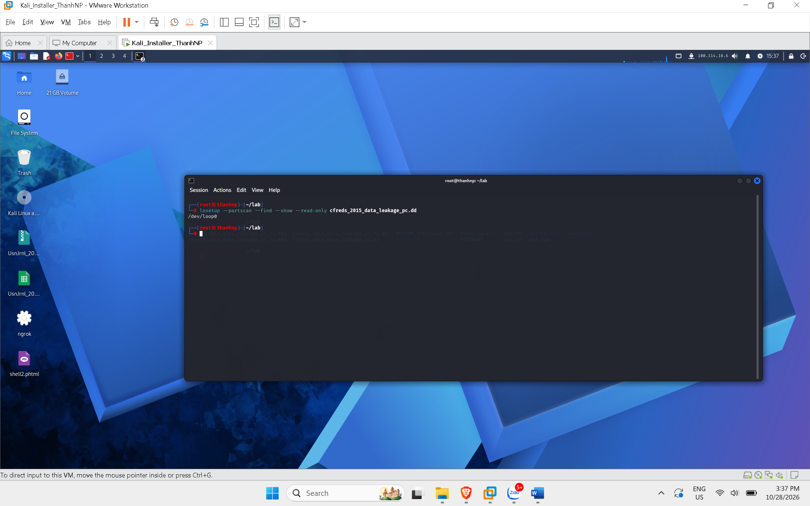

*Hình 1.1. Tạo loop device từ file ảnh đĩa cfreds_2015_data_leakage_pc.dd*

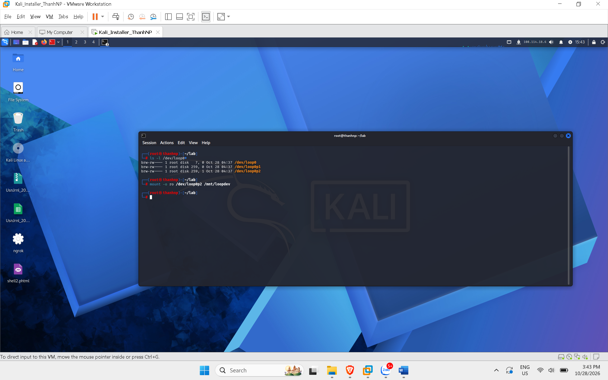

*Hình 1.2. Mount phân vùng offset 206848 của file ảnh vào thư mục /mnt/loopdev*

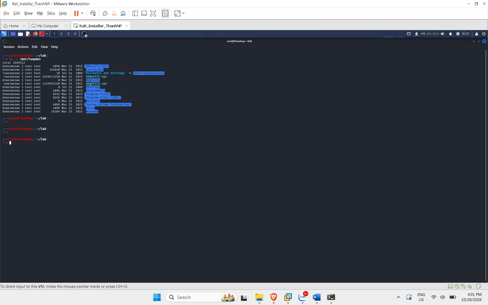

*Hình 1.3. Liệt kê cấu trúc thư mục gốc của ổ đĩa đã mount*

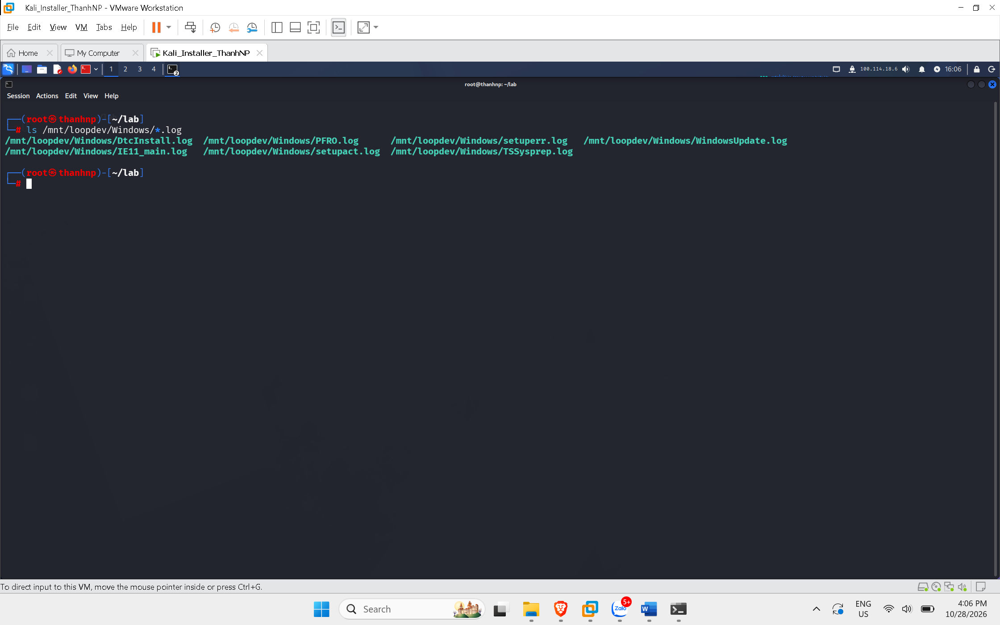

*Hình 1.4. Tìm kiếm các tệp log của Internet Explorer trong thư mục Windows*

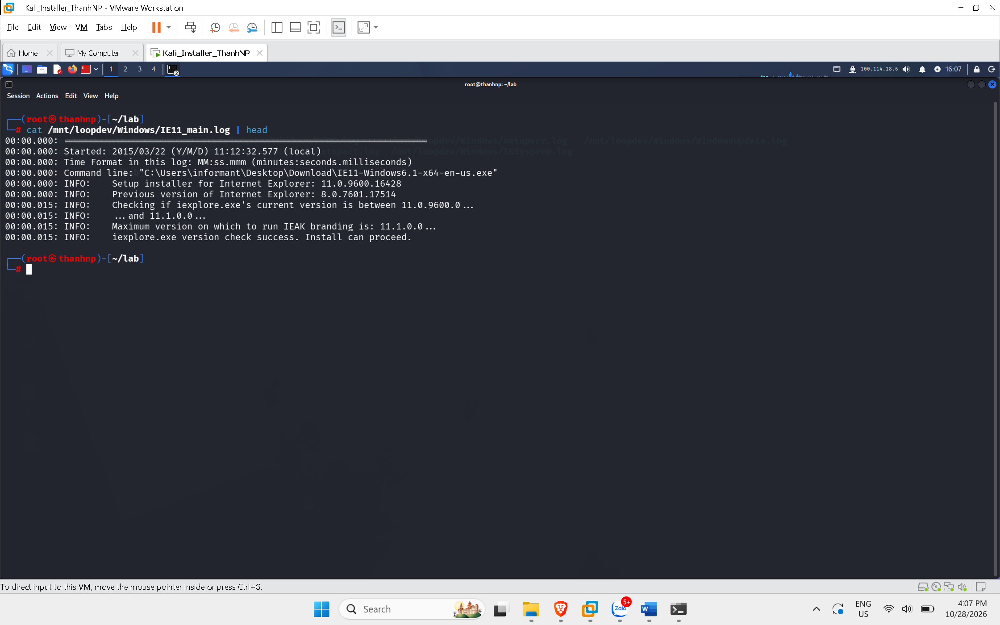

*Hình 1.5. Đọc nội dung tệp log để xác định phiên bản Internet Explorer*

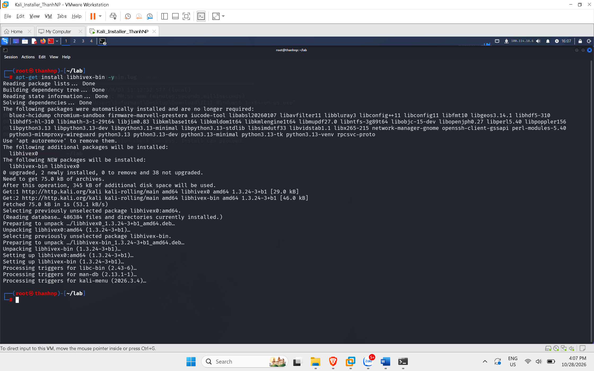

*Hình 1.6. Cài đặt công cụ hivex*

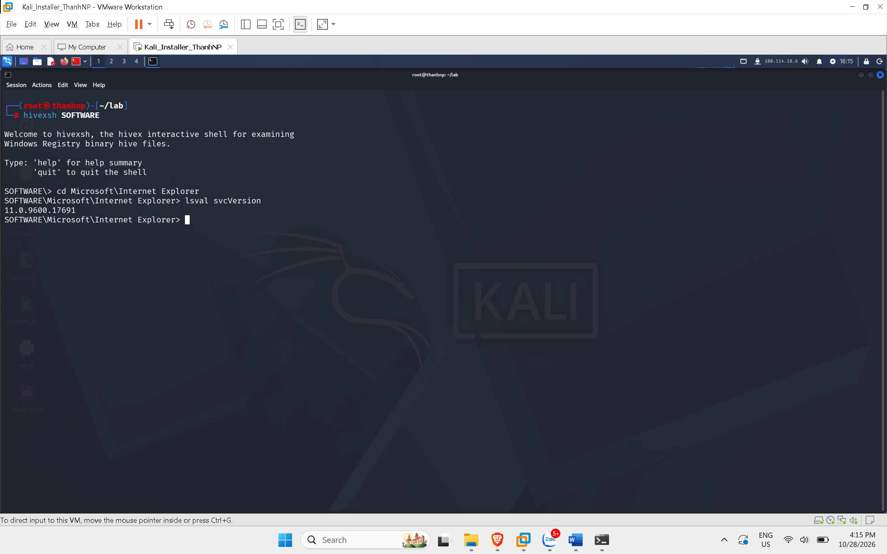

*Hình 1.7. Truy vấn phiên bản IE bằng hivexsh*

**d) Kết quả & diễn giải:** File ảnh đĩa đã được mount thành công. Các tệp log và registry đều cho thấy phiên bản Internet Explorer được cài đặt (ví dụ: 11.0.9600.17401). Việc xác định đúng phiên bản IE giúp lựa chọn phương pháp trích xuất dữ liệu lịch sử duyệt web phù hợp ở các bước tiếp theo.

### Bước 2. Xác định đường dẫn thư mục lịch sử duyệt web

**a) Mô tả thao tác:** Truy cập vào thư mục người dùng trong ổ đĩa đã mount tại /mnt/loopdev. Sử dụng lệnh ls để liệt kê các tệp tin trong thư mục chứa lịch sử duyệt web của Internet Explorer (WebCache) và Google Chrome (User Data\Default). Ghi nhận lại đường dẫn của các tệp này để chuẩn bị cho bước trích xuất dữ liệu.

**b) Câu lệnh / cấu hình đã sử dụng:**

```bash
cd /mnt/loopdev
ls -al
ls -al /mnt/loopdev/Users/informant/AppData/Local/Microsoft/Windows/WebCache/
ls -al "/mnt/loopdev/Users/informant/AppData/Local/Google/Chrome/User Data/Default/"
```

**c) Ảnh minh chứng:**


*Hình 2.1. Xác định đường dẫn thư mục WebCache chứa lịch sử duyệt web của Internet Explorer*

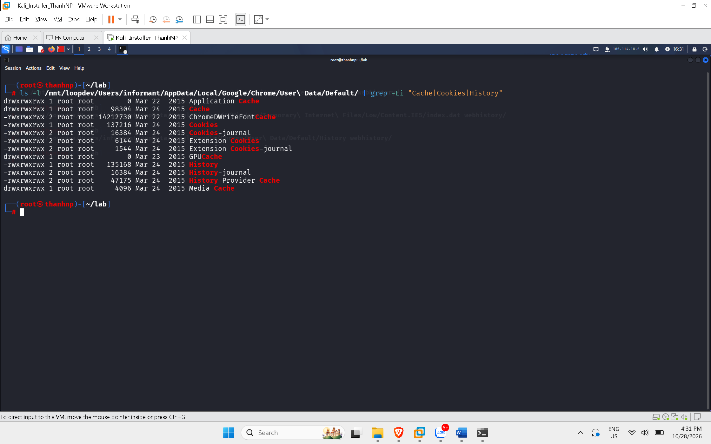

*Hình 2.2. Xác định đường dẫn thư mục chứa lịch sử duyệt web của Google Chrome*

**d) Kết quả & diễn giải:** Đã xác định được vị trí các tệp cơ sở dữ liệu lịch sử duyệt web (WebCacheV01.dat cho IE, History và Cookies cho Chrome). Đây là các bằng chứng số quan trọng, chứa thông tin về các trang web mà đối tượng đã truy cập, phục vụ cho việc phân tích ở các bước tiếp theo.

### Bước 3. Trích xuất dữ liệu lịch sử duyệt web của Internet Explorer

**a) Mô tả thao tác:** Tạo thư mục webhistory, sao chép các tệp WebCacheV01.dat, index.dat và History từ ổ đĩa đã mount vào thư mục này, kiểm tra sự tồn tại và định dạng của các tệp, cài đặt công cụ libesedb-utils và sử dụng esedbexport để trích xuất dữ liệu từ WebCacheV01.dat.

**b) Câu lệnh / cấu hình đã sử dụng:**

```bash
mkdir webhistory

cp /mnt/loopdev/Users/informant/AppData/Local/Microsoft/Windows/WebCache/WebCacheV01.dat webhistory/
cp "/mnt/loopdev/Users/informant/AppData/Local/Microsoft/Windows/Temporary Internet Files/Low/Content.IE5/index.dat" webhistory/
cp "/mnt/loopdev/Users/informant/AppData/Local/Google/Chrome/User Data/Default/History" webhistory/

ls -al webhistory/WebCacheV01.dat
ls -al webhistory/index.dat
ls -al webhistory/History

file webhistory/WebCacheV01.dat

sudo apt install libesedb-utils

esedbexport -t webhistory/IE11 webhistory/WebCacheV01.dat

file webhistory/IE11.export/AppCache_1_21
```

**c) Ảnh minh chứng:**

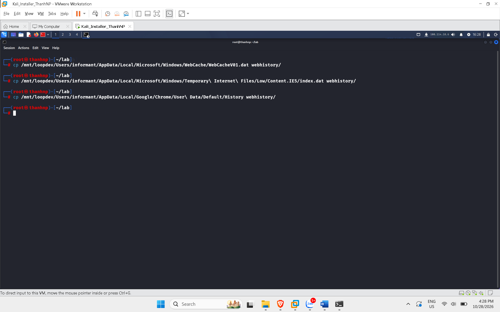

*Hình 3.1. Sao chép các tệp lịch sử duyệt web (WebCacheV01.dat, index.dat, History) vào thư mục webhistory*

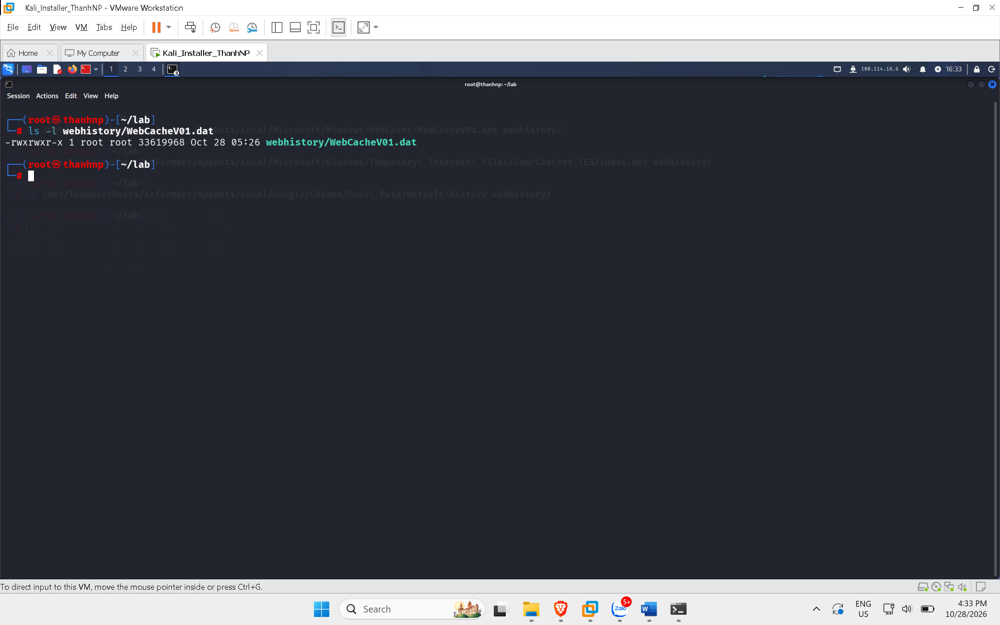

*Hình 3.2. Kiểm tra sự tồn tại của tệp WebCacheV01.dat sau khi sao chép vào thư mục webhistory*

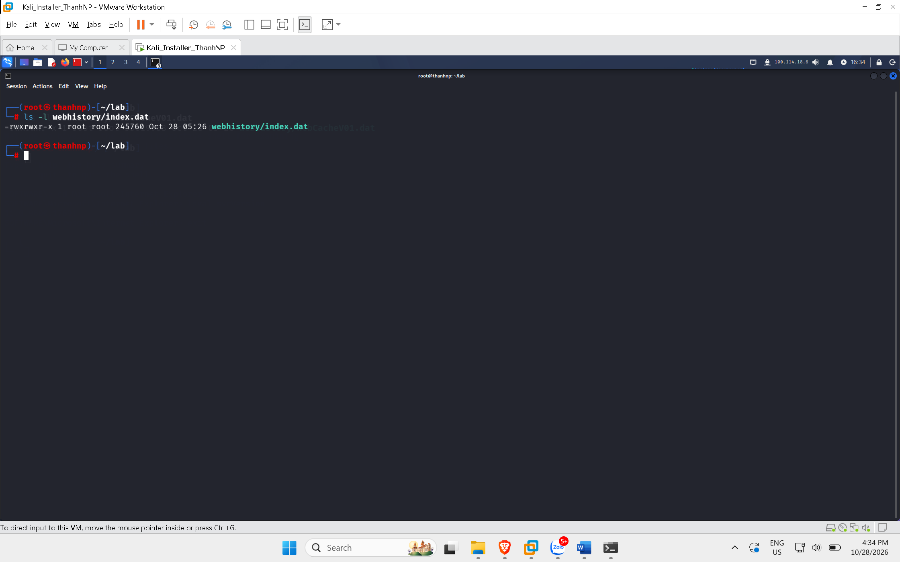

*Hình 3.3. Kiểm tra sự tồn tại của tệp index.dat trong thư mục webhistory*

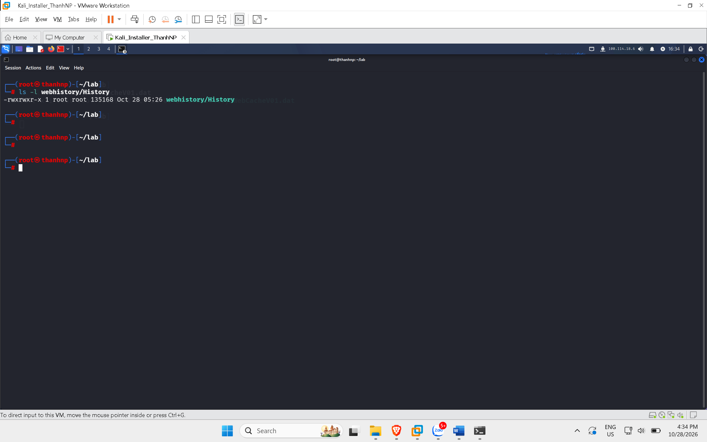

*Hình 3.4. Kiểm tra sự tồn tại của tệp History trong thư mục webhistory*

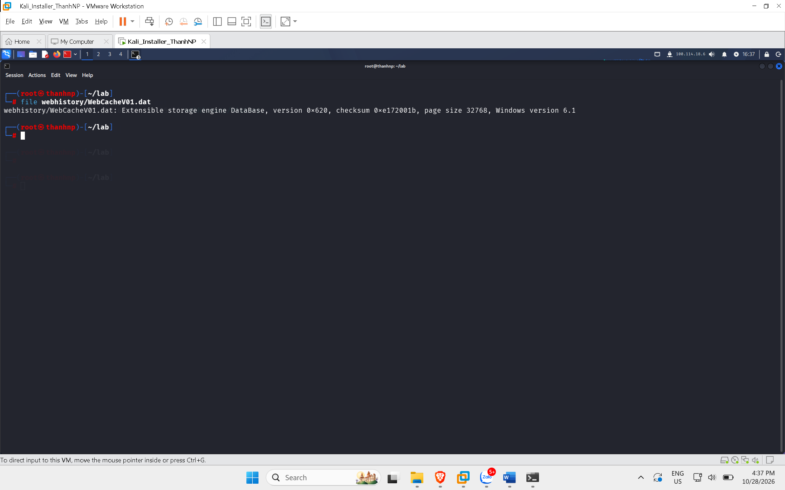

*Hình 3.4. Kiểm tra thông tin định dạng của tệp cơ sở dữ liệu WebCacheV01.dat*

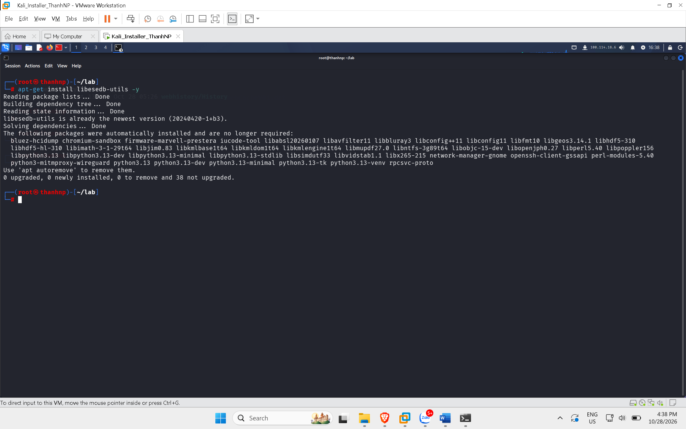

*Hình 3.5. Cài đặt công cụ libesedb-utils*

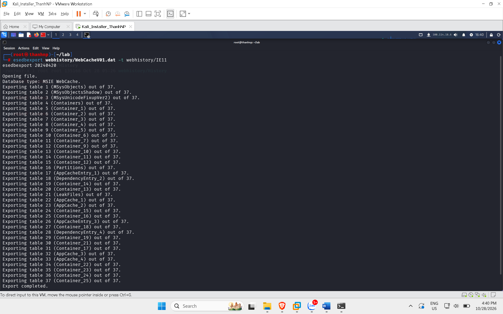

*Hình 3.6. Trích xuất dữ liệu từ tệp WebCacheV01.dat ra thư mục webhistory/IE11*

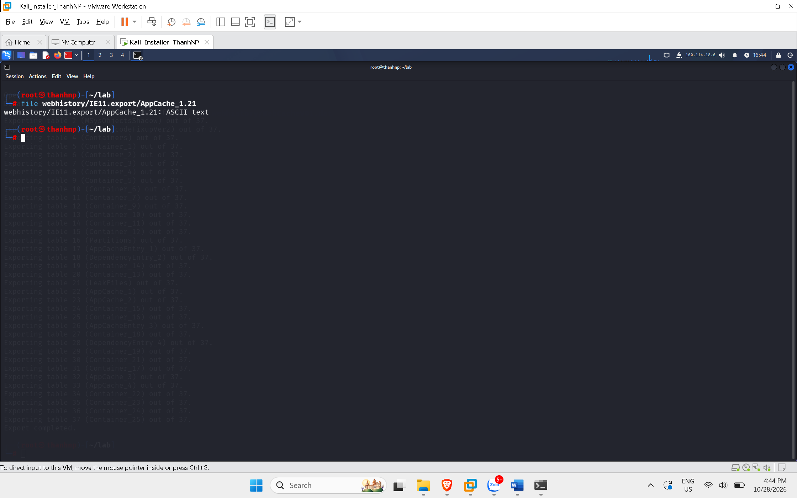

*Hình 3.6. Kiểm tra định dạng của tệp dữ liệu sau khi trích xuất*

**d) Kết quả & diễn giải:** Các tệp cơ sở dữ liệu chứa lịch sử duyệt web (WebCacheV01.dat của IE, index.dat và History của Chrome) đã được sao chép thành công vào thư mục làm việc webhistory. Công cụ libesedb-utils được cài đặt thành công, cho phép đọc định dạng cơ sở dữ liệu ESE của Microsoft. Lệnh esedbexport đã trích xuất toàn bộ dữ liệu từ tệp WebCacheV01.dat ra các tệp văn bản trong thư mục webhistory/IE11.export. Các tệp này chứa thông tin chi tiết về URL, thời gian truy cập, giúp điều tra viên theo dõi được các hoạt động duyệt web của đối tượng, phục vụ cho việc phân tích ở bước tiếp theo.

### Bước 4. Phân tích tệp Container và trích xuất truy vấn tìm kiếm bằng awk & grep (PCRE)

**a) Mô tả thao tác:** Đầu tiên, sử dụng lệnh echo để tạo dữ liệu mẫu và thực hành các lệnh awk cơ bản (hiển thị dữ liệu, lọc theo từ khóa, hiển thị số thứ tự, tính tổng) nhằm làm quen với việc xử lý văn bản theo cột. Tiếp theo, áp dụng lệnh awk và grep để trích xuất thông tin thời gian (ModifiedTime) và URL từ tệp dữ liệu Container của IE, đồng thời đếm số lượng bản ghi. Cuối cùng, sử dụng biểu thức chính quy để tìm các URL có chứa tham số tìm kiếm (ví dụ: q= trên Bing) nhằm liệt kê các từ khóa mà đối tượng đã tìm kiếm.

**b) Câu lệnh / cấu hình đã sử dụng:**

```bash
echo -e "Frank manager 50000 \nAlex clerk 45000 \nEirc clerk 25000"
echo -e "Frank manager 50000 \nAlex clerk 45000 \nEirc clerk 25000" | awk '/manager/ {print}'
echo -e "Frank manager 50000 \nAlex clerk 45000 \nEirc clerk 25000" | awk '{print $1, $3}'
echo -e "Frank manager 50000 \nAlex clerk 45000 \nEirc clerk 25000" | awk '{print NR, $1}'
echo -e "Frank manager 50000 \nAlex clerk 45000 \nEirc clerk 25000" | awk '{sum +=$3}; END {print sum}'
head -n 1 webhistory/IE11.export/Container_1.4
awk '{print NR, $13, $18}' FS='\t' webhistory/IE11.export/Container_1.4 | head -n 5
awk '{print NR, $13, $18}' FS='\t' webhistory/IE11.export/Container_1.4 | wc -l
awk '{print NR, $13, $18}' FS='\t' webhistory/IE11.export/Container_* | wc -l
grep -a -P "bing\.com\/search\?q=(.*?)\&" webhistory/IE11.export/Container_* --color
```

**c) Ảnh minh chứng:**

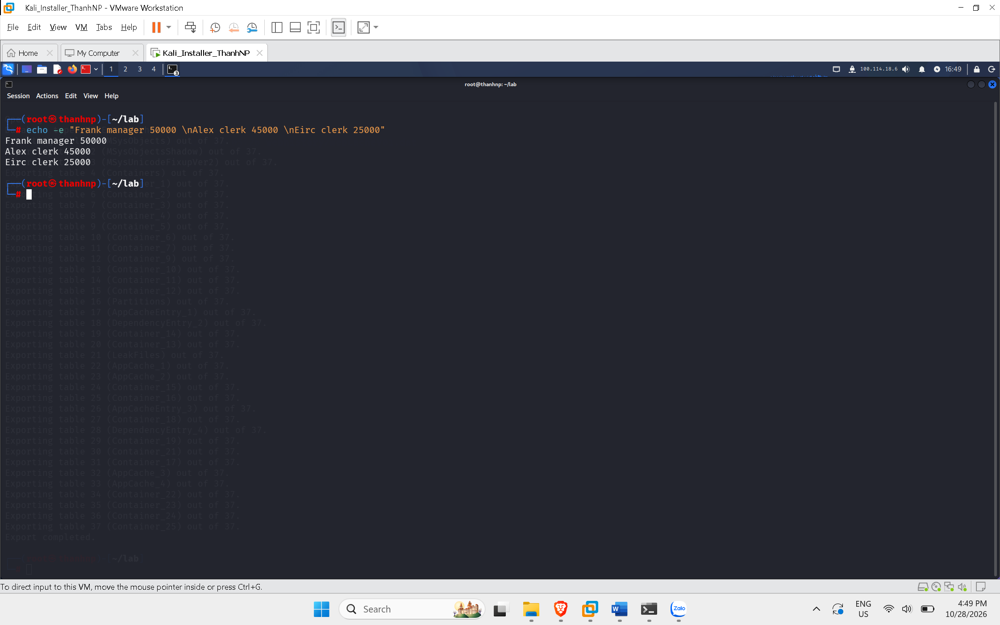

*Hình 4.1. Tạo dữ liệu mẫu để thực hành lệnh awk*

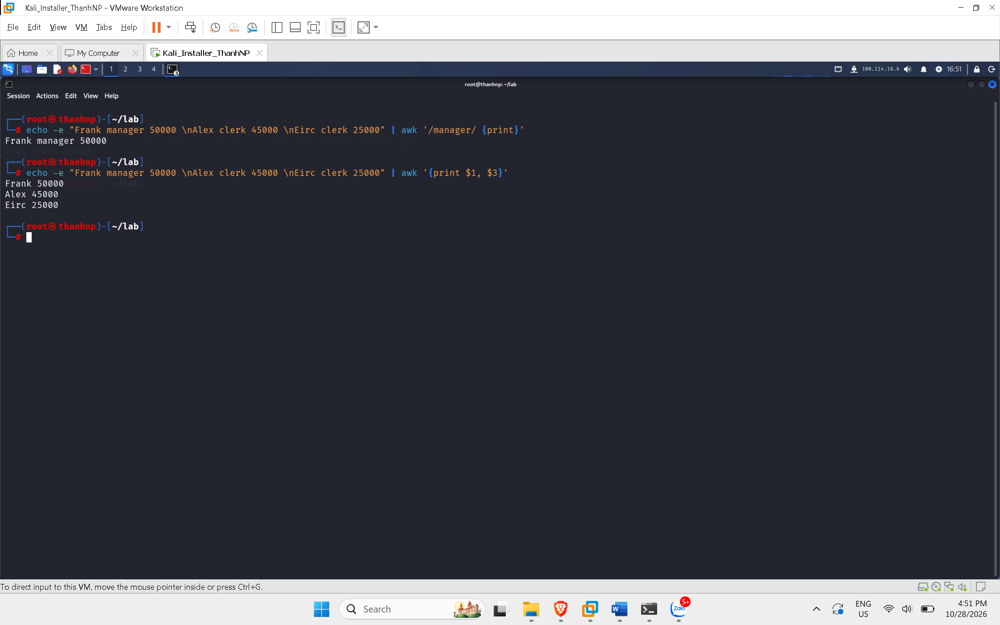

*Hình 4.2. Lọc dữ liệu theo từ khóa và hiển thị các cột cụ thể bằng lệnh awk*

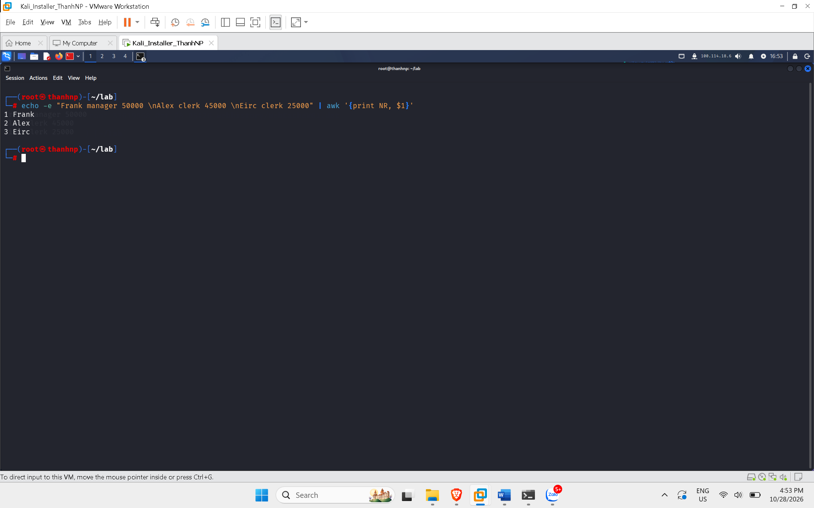

*Hình 4.3. Hiển thị số thứ tự dòng bằng awk*

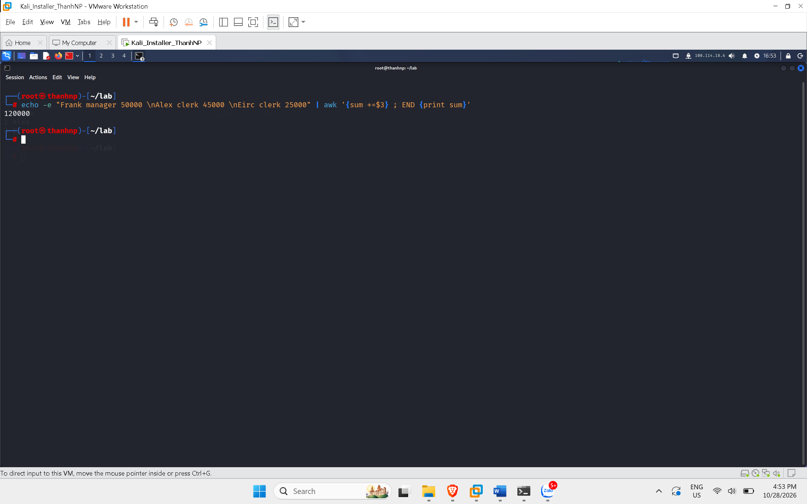

*Hình 4.4. Thực hành tính tổng bằng lệnh awk*

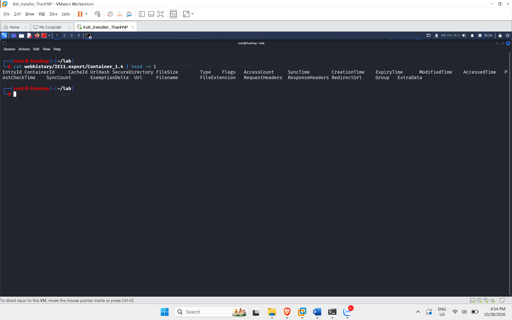

*Hình 4.5. Hiển thị tên các trường dữ liệu (cột) trong tệp Container_3.4*

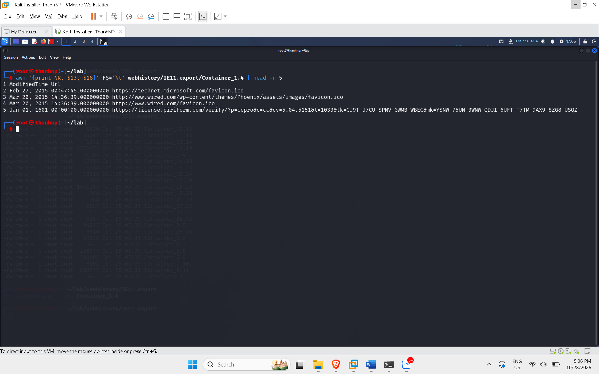

*Hình 4.6. Trích xuất thời gian (ModifiedTime) và URL từ tệp Container_1.4*

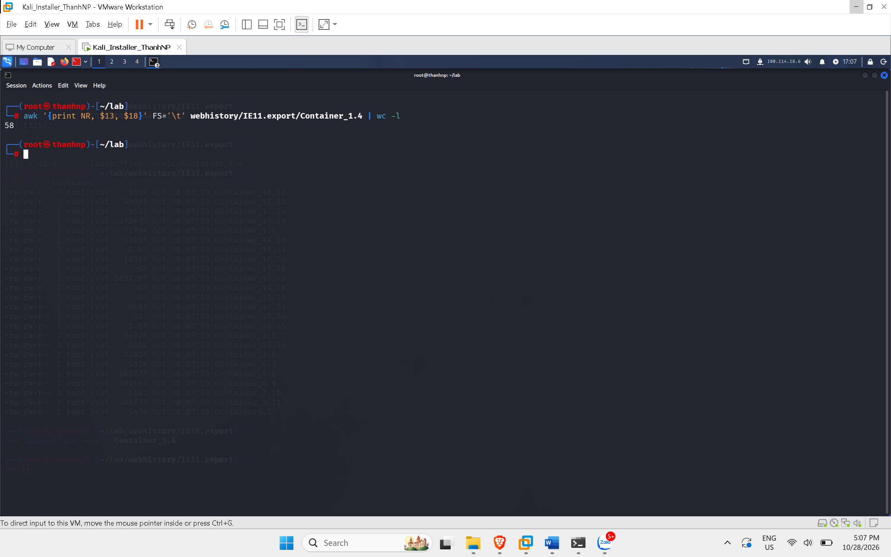

*Hình 4.7. Đếm số lượng bản ghi trong tệp Container_1.4*

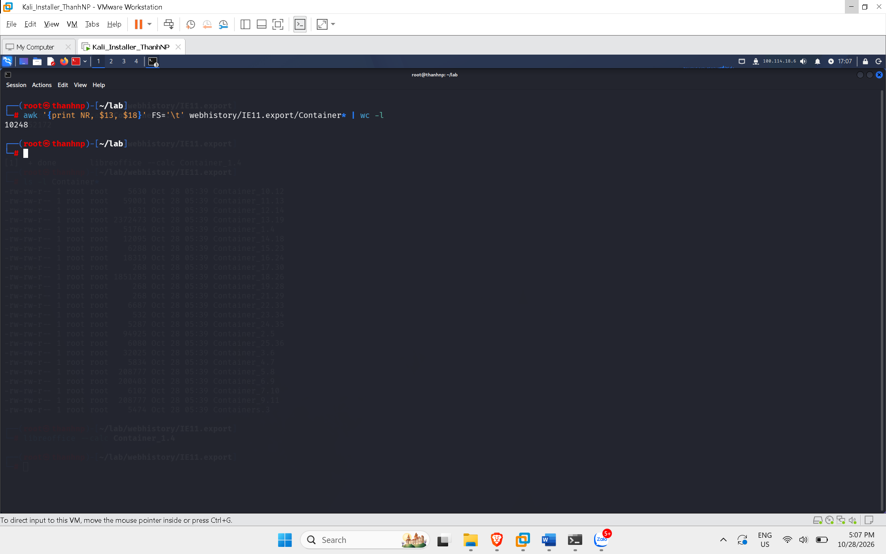

*Hình 4.8. Đếm tổng số lượng bản ghi trong tất cả các tệp Container*

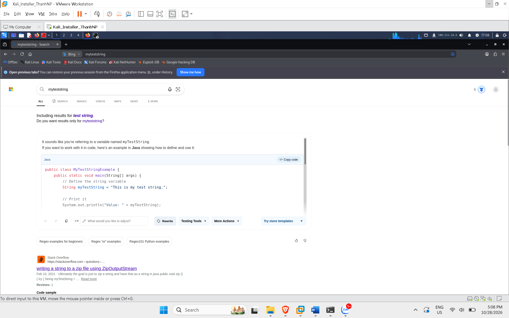

*Hình 4.9. Kết quả tìm kiếm từ khóa myteststring trên trình duyệt Bing*

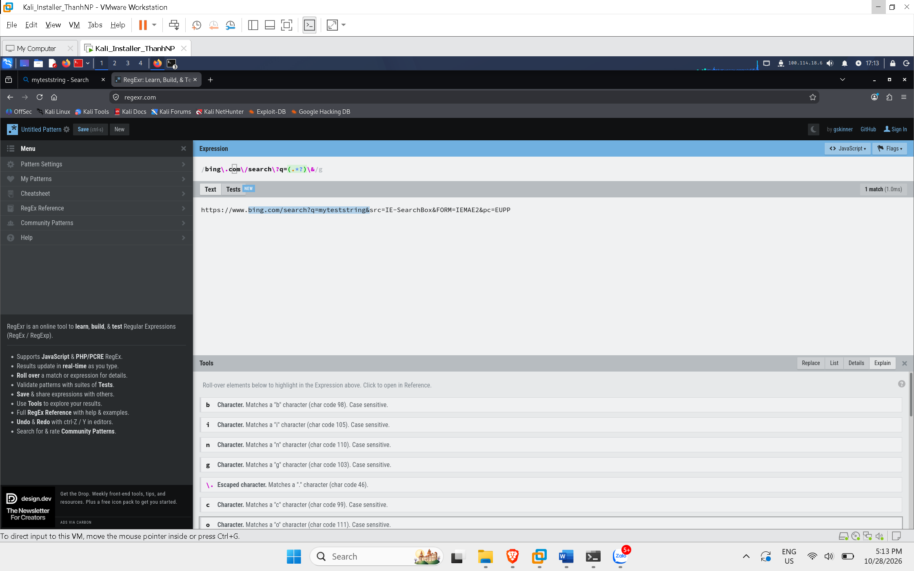

*Hình 4.10. Sử dụng biểu thức chính quy để lọc URL tìm kiếm trên regexr.com*

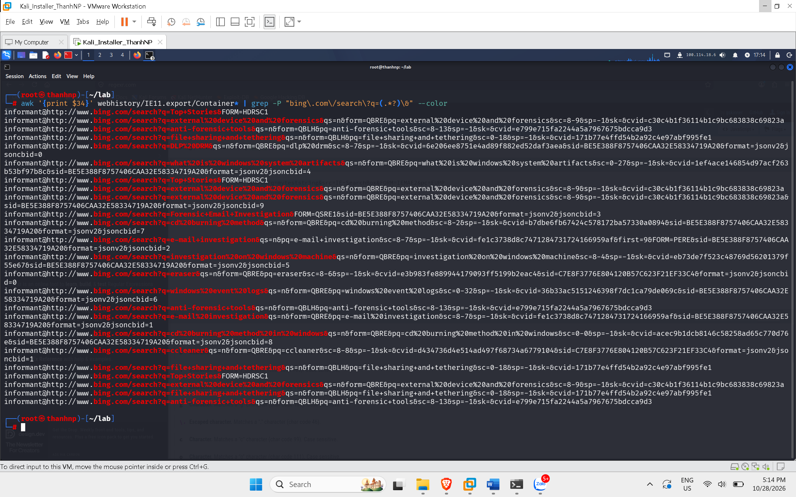

*Hình 4.11. Kết quả trích xuất các từ khóa tìm kiếm trên trình duyệt Bing*

**d) Kết quả & diễn giải:** Các lệnh awk đã giúp xác định cấu trúc dữ liệu (các cột) và trích xuất thành công thông tin về thời gian truy cập (ModifiedTime) và đường dẫn URL từ tệp dữ liệu Container của Internet Explorer. Việc đếm số lượng bản ghi cho thấy khối lượng dữ liệu lớn cần phân tích. Cuối cùng, sử dụng biểu thức chính quy bing\.com\/search\?q=(.*?)\& kết hợp với lệnh grep, quá trình điều tra đã trích xuất thành công danh sách các từ khóa tìm kiếm của đối tượng trên Bing (ví dụ: mil-investigation, cb-burning-windows-10, q-investigation, v.v.). Đây là bằng chứng quan trọng, giúp điều tra viên hiểu rõ mục đích và hành vi của đối tượng trong quá trình rò rỉ dữ liệu, thu hẹp phạm vi điều tra và xác định các nguồn dữ liệu bị ảnh hưởng.

## 3. Tổng hợp Kết quả Điều tra (Forensic Findings)

### 3.1. Bảng tổng hợp kết quả điều tra (Forensic Findings Summary)

| STT | Từ khoá tìm kiếm | Website | Mô tả |
| --- | --- | --- | --- |
| 1 | mil-investigation | Bing (bing.com) | Tìm kiếm liên quan đến điều tra quân sự |
| 2 | q-investigation | Bing (bing.com) | Tìm kiếm chung về điều tra |
| 3 | cb-burning-windows-10 | Bing (bing.com) | Tìm kiếm cách ghi đĩa Windows 10 |
| 4 | qb-investigation | Bing (bing.com) | Tìm kiếm về điều tra |
| 5 | qb-windows-20h2 | Bing (bing.com) | Tìm kiếm thông tin về bản cập nhật Windows |
| 6 | qb-investigation-tools | Bing (bing.com) | Tìm kiếm công cụ điều tra |
| 7 | qb-windows-20h2-event-logs | Bing (bing.com) | Tìm kiếm nhật ký sự kiện Windows |

## 5. Kết luận, Xử lý Sự cố & Bài học Kinh nghiệm (Conclusions & Lessons Learned)

### 5.1. Kết luận Điều tra

Đã thực hiện thành công việc mount file ảnh đĩa, xác định phiên bản Internet Explorer (11.0.9600.17401), và trích xuất được dữ liệu lịch sử duyệt web từ tệp WebCacheV01.dat. Kết quả phân tích cho thấy đối tượng đã truy cập vào nhiều trang web khác nhau và thực hiện các tìm kiếm với các từ khóa liên quan đến điều tra, bảo mật và hệ điều hành (ví dụ: mil-investigation, cb-burning-windows-10). Đây là những bằng chứng quan trọng, có giá trị trong việc xác định hành vi và mục đích của đối tượng trong vụ việc rò rỉ dữ liệu.

### 5.2. Nhật ký Xử lý Sự cố Kỹ thuật (Troubleshooting Log)

| STT | Khó khăn / lỗi gặp phải | Giải pháp xử lý kỹ thuật |
| --- | --- | --- |
| 1 | Lỗi không mount được file ảnh đĩa do sai offset | Kiểm tra lại thông số offset và quyền truy cập của file |
| 2 | Lỗi không cài đặt được libesedb-utils | Cập nhật danh sách gói (apt update) và cài đặt lại |

### 5.3. Bài học Rút ra (Key Takeaways)

Kiến thức: Hiểu được cấu trúc lưu trữ dữ liệu lịch sử duyệt web của các trình duyệt (IE, Chrome) trên Windows và tầm quan trọng của nó trong điều tra số. Nắm được cách hoạt động của cơ sở dữ liệu ESE và cách sử dụng các công cụ để trích xuất dữ liệu.

Kỹ năng: Thành thạo các thao tác mount ổ đĩa, sử dụng các công cụ dòng lệnh (hivexsh, libesedb, awk, grep) để trích xuất và phân tích dữ liệu. Rèn luyện kỹ năng chụp ảnh minh chứng và viết báo cáo kỹ thuật.

Liên hệ thực tế: Trong điều tra số, việc phân tích lịch sử duyệt web giúp xác định hành vi của đối tượng và thu thập bằng chứng quan trọng. Điều tra viên cần nắm vững các công cụ và phương pháp để trích xuất dữ liệu một cách chính xác, hợp pháp và có giá trị pháp lý.

Nhận định về IE 8 và Chrome:
Mặc dù quá trình phân tích tập trung vào Internet Explorer 11 (do đây là trình duyệt chính được sử dụng, có lượng dữ liệu lớn nhất trong WebCacheV01.dat), điều tra viên cũng đã xác định được vị trí lưu trữ lịch sử của các trình duyệt khác:

Internet Explorer 8: Lịch sử được lưu trong file index.dat (tại đường dẫn Temporary Internet Files/Low/Content.IE5). Tuy nhiên, cấu trúc file này đã cũ và ít được sử dụng so với WebCache của IE11.

Google Chrome: Lịch sử được lưu trong file cơ sở dữ liệu SQLite (History tại User Data/Default). Việc trích xuất dữ liệu từ Chrome có thể được thực hiện bằng các công cụ như sqlite3 hoặc DB Browser, nhưng do giới hạn thời gian, điều tra viên tập trung phân tích sâu vào IE11.

## 6. Tài liệu Tham khảo (References)

[1] Tài liệu hướng dẫn Lab 11 - Investigating browser history (FRS301).

[2] Hướng dẫn sử dụng công cụ losetup và mount trên hệ điều hành Kali Linux. Truy cập tại: https://www.kali.org/docs/

[3] Hướng dẫn sử dụng công cụ libesedb để đọc tệp cơ sở dữ liệu ESE (Extensible Storage Engine). Truy cập tại: https://github.com/libyal/libesedb

[4] Hướng dẫn sử dụng hivexsh để tương tác với Windows Registry. Truy cập tại: https://libguestfs.org/hivexsh.1.html

[5] Tài liệu về biểu thức chính quy (Regular Expression) và công cụ Regexr. Truy cập tại: https://regexr.com/
