# Lab 12: Email Forensics – Offline Outlook (.ost) Extraction & MAPI Header Analysis
### *Điều tra Dữ liệu Email (.ost) với pff-tools & Phân tích MAPI Transport Headers*

[⬅️ Back to Main DFIR Casebook](../../README.md)

---

## 📌 Quick Metadata

| Field | Description |
| :--- | :--- |
| **Forensic Environment** | `Kali Linux 2025.4 / 2026.3 (64-bit)` on `VMware Workstation Pro` (Host: `Windows 11`) |
| **Forensic Module** | `04-Application-Email-and-Mobile-Forensics` |
| **Target Dataset / Evidence** | `cfreds_2015_data_leakage_pc.dd -> iaman.informant@nist.gov.ost (16.8 MB)` |
| **Core Forensic Toolstack** | `RegRipper (installer), The Sleuth Kit (fls, icat), libpff / pff-tools (pffexport), grep, sed` |
| **MITRE ATT&CK / DFIR Focus** | `T1114.001 (Local Email Collection), Insider Threat Communication & Deleted Email Recovery` |

---

## 1. Tổng quan & Bối cảnh Điều tra (Overview & Objectives)

### 1.1. Bối cảnh và Mục tiêu

Bài thực hành Lab 12 tập trung vào kỹ thuật Điều tra số ở tầng ứng dụng (Application Layer Forensics), cụ thể là phân tích dữ liệu hộp thư điện tử (Email Forensics). Trong bối cảnh vụ án rò rỉ dữ liệu máy tính ("cfreds_2015_data_leakage_pc"), điều tra viên cần xác định phần mềm email mà nghi phạm đã sử dụng, địa chỉ tài khoản email liên quan và toàn bộ nội dung trao đổi thư tín bất thường. Mục tiêu trọng tâm bao gồm: phân tích Registry Windows và cấu trúc tệp tin để định vị email client cùng tệp lưu trữ ngoại tuyến (.ost); sử dụng bộ công cụ mã nguồn mở pff-tools (pffexport) để bóc tách cấu trúc hộp thư; khảo sát chi tiết các hòm thư Inbox, Sent Items và đặc biệt là Deleted Items để tìm chứng cứ rò rỉ dữ liệu đã bị phi tang; đồng thời giải mã cấu trúc Header MAPI để xác định danh tính và mốc thời gian liên lạc của các bên liên quan.

### 1.2. Môi trường và Công cụ Thực hành

| Thành phần | Tên / Phiên bản | Ghi chú (cấu hình, nguồn tải…) |
| --- | --- | --- |
| Hệ điều hành máy ảo | Kali Linux 2025.4 (64-bit) | Cấu hình RAM 4GB, ổ cứng 80GB trên VMware Workstation |
| Ảnh đĩa bằng chứng | cfreds_2015_data_leakage_pc.dd | Ảnh đĩa thô (DD raw format) dung lượng ~20GB từ vụ án Lab 5 |
| Công cụ phân tích Registry | RegRipper (rip.pl) | Truy vấn nhánh phần mềm đã cài đặt trên hive SOFTWARE |
| Công cụ điều tra tệp tin | The Sleuth Kit (fls, icat) | Định vị đường dẫn và trích xuất inode tệp dữ liệu từ ảnh đĩa |
| Bộ công cụ bóc tách email | pff-tools (libpff, pffexport) | Thư viện giải mã cấu trúc Personal/Offline Folder File (.ost, .pst) |
| Công cụ dòng lệnh hỗ trợ | grep, sed, ls, cat, file | Lọc chuỗi siêu dữ liệu, phân loại Header và định dạng văn bản |

### 1.3. Dữ liệu Bằng chứng & Kiểm tra Tính toàn vẹn (Hash Verification)

| Tên file / nguồn dữ liệu | Thuật toán | Hash trước phân tích | Hash sau phân tích | Khớp? |
| --- | --- | --- | --- | --- |
| cfreds_2015_data_leakage_pc.dd | MD5 | a49d1254c873808c58e6f1b<br>cd60b5bde | a49d1254c873808c58e6f1b<br>cd60b5bde | ☑ Khớp |
| iaman.informant@nist.gov.ost | Kích thước (Bytes) | 16818176 | 16818176 | ☑ Khớp |

Giá trị tham chiếu (theo tài liệu lab, nếu có): MD5 ảnh đĩa = a49d1254c873808c58e6f1bcd60b5bde; Kích thước tệp .ost = 16,818,176 bytes

## 2. Quy trình Điều tra & Thực nghiệm Kỹ thuật (Forensic Investigation Workflow)

### Bước 1. Xác định phần mềm email và tài khoản nghi phạm

**a) Mô tả thao tác:** Sử dụng công cụ rip.pl (RegRipper) để truy vấn Registry (file SOFTWARE) tìm các phần mềm đã cài đặt liên quan đến email. Sử dụng công cụ fls trong bộ The Sleuth Kit (TSK) để quét ảnh đĩa DD cfreds_2015_data_leakage_pc.dd (tại sector offset 206848) tìm kiếm các file có đuôi .ost (Offline Outlook Data File).

**b) Câu lệnh / cấu hình đã sử dụng:**

```bash
rip.pl -r SOFTWARE -p installer | grep -i outlook
fls -rF -o 206848 ~/Downloads/cfreds_2015_data_leakage_pc.dd | grep -E "\.ost$"
```

**c) Ảnh minh chứng:**

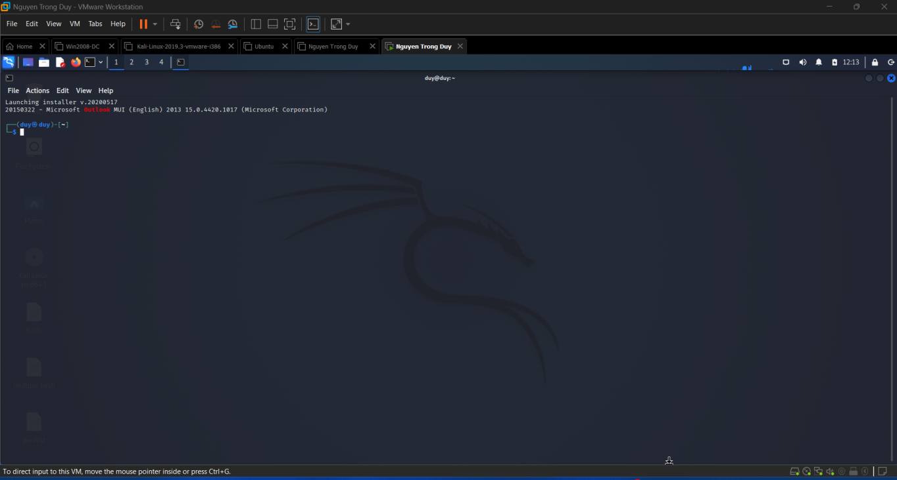

*Hình 1.1. Truy vấn Registry phát hiện phần mềm Microsoft Outlook 2013*

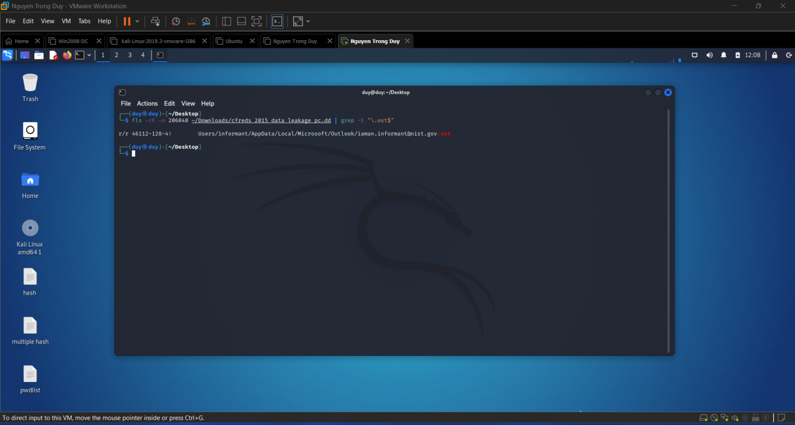

*Hình 1.2. Định vị file dữ liệu email .ost của nghi phạm trên ảnh đĩa bằng lệnh fls*

**d) Kết quả & diễn giải:** Phần mềm email được nghi phạm sử dụng là Microsoft Outlook 2013 (Phiên bản 15.0.4420.1017). Tìm thấy file lưu trữ email tại đường dẫn: Users/informant/AppData/Local/Microsoft/Outlook/iaman.informant@nist.gov.ost (inode 46112-128-4). Từ đây xác định được tài khoản email của nghi phạm (user informant) là: iaman.informant@nist.gov.

### Bước 2. Cài đặt công cụ trích xuất email và copy file

**a) Mô tả thao tác:** Cài đặt bộ công cụ pff-tools. Sau đó, trích xuất (copy) file .ost từ ảnh đĩa DD (đang được mount tại thư mục /media/...) ra thư mục làm việc hiện tại (~/lab/).

**b) Câu lệnh / cấu hình đã sử dụng:**

```bash
sudo apt-get update && sudo apt-get install -y pff-tools
pffexport -h
icat -o 206848 ~/Downloads/cfreds_2015_data_leakage_pc.dd 46112-128-4 > iaman.informant@nist.gov.ost
ls -l iaman.informant@nist.gov.ost
```

**c) Ảnh minh chứng:**

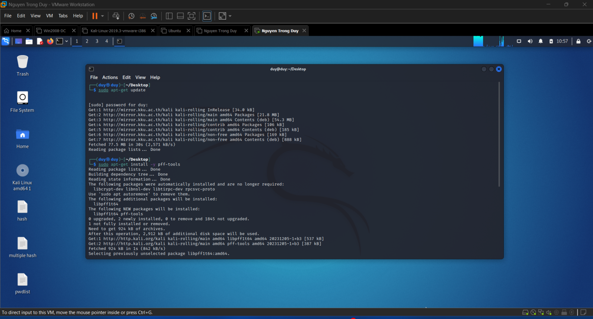

*Hình 2.1. Cài đặt bộ công cụ pff-tools trên hệ điều hành Kali Linux*

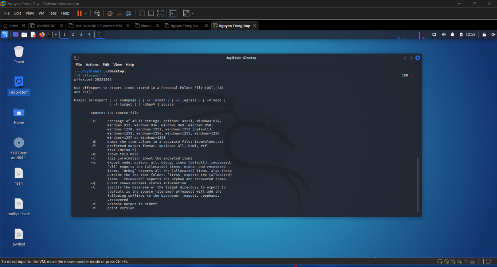

*Hình 2.2. Kiểm tra thông tin phiên bản và hướng dẫn sử dụng công cụ pffexport*

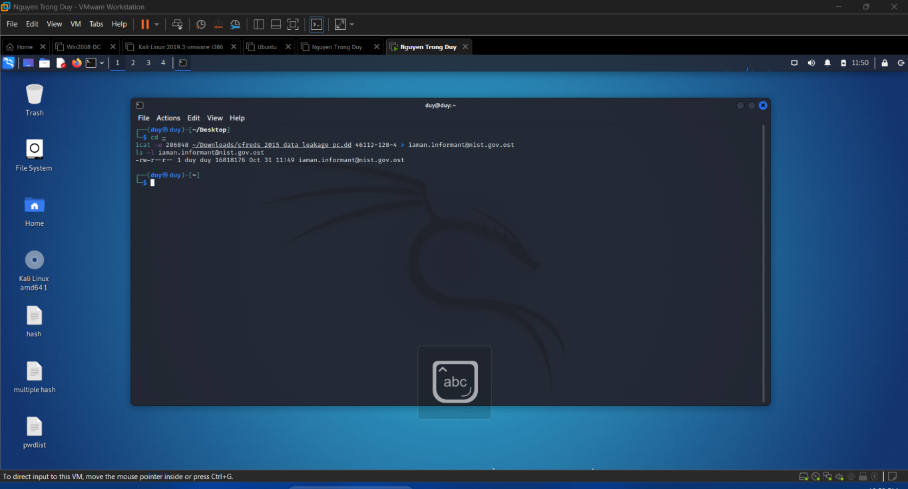

*Hình 2.3. Trích xuất file iaman.informant@nist.gov.ost và kiểm tra dung lượng tệp tin*

**d) Kết quả & diễn giải:** Cài đặt công cụ thành công. File iaman.informant@nist.gov.ost có kích thước chính xác là 16,818,176 bytes (~16.04 MB) đã được đưa ra thư mục làm việc an toàn, sẵn sàng để phân tích bóc tách dữ liệu.

### Bước 3. Trích xuất toàn bộ email bằng pffexport

**a) Mô tả thao tác:** Sử dụng công cụ pffexport để bóc tách toàn bộ nội dung file .ost thành các thư mục và file văn bản có thể đọc được.

**b) Câu lệnh / cấu hình đã sử dụng:**

```bash
pffexport iaman.informant@nist.gov.ost
ls -l
```

**c) Ảnh minh chứng:**

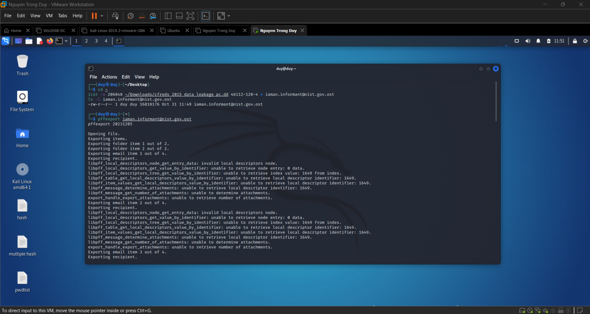

*Hình 3.1. Thực thi lệnh pffexport bóc tách toàn bộ cấu trúc dữ liệu email*

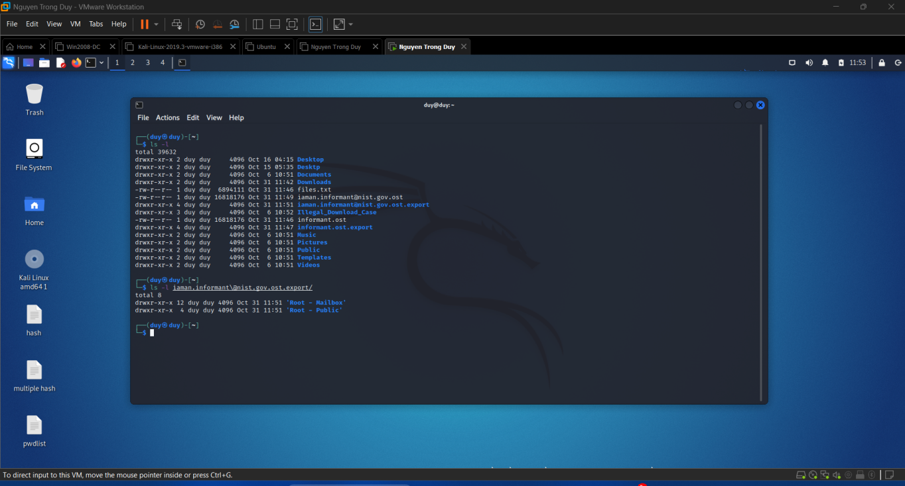

*Hình 3.2. Kiểm tra thư mục đầu ra iaman.informant@nist.gov.ost.export sau quá trình xuất*

**d) Kết quả & diễn giải:** Công cụ chạy thành công, báo cáo xuất các mục dữ liệu (Exporting items, Exporting folder items, Exporting email items), khởi tạo thư mục đầu ra mới có tên iaman.informant@nist.gov.ost.export.

### Bước 4. Phân tích cấu trúc thư mục sau khi trích xuất

**a) Mô tả thao tác:** Liệt kê các thư mục được tạo ra để tìm ra nơi chứa các email (Inbox, Sent Items, Deleted Items...). Sử dụng grep quét thông tin Header trong từng thư mục.

**b) Câu lệnh / cấu hình đã sử dụng:**

```bash
ls -l iaman.informant@nist.gov.ost.export/
ls -l iaman.informant@nist.gov.ost.export/Root\ -\ Mailbox/IPM_SUBTREE/
ls -l iaman.informant@nist.gov.ost.export/Root\ -\ Mailbox/IPM_SUBTREE/Inbox/
grep -r -H -E "^(Subject|Sender name|Client submit time):" --include=OutlookHeaders.txt iaman.informant\@nist.gov.ost.export/Root\ -\ Mailbox/IPM_SUBTREE/Deleted\ Items/ | sed 's/.*IPM_SUBTREE\///; s/OutlookHeaders.txt://'
grep -r -H -E "^(Subject|Sender name|Client submit time):" --include=OutlookHeaders.txt iaman.informant\@nist.gov.ost.export/Root\ -\ Mailbox/IPM_SUBTREE/Inbox/ | sed 's/.*IPM_SUBTREE\///; s/OutlookHeaders.txt://'
grep -r -H -E "^(Subject|Sender name|Client submit time):" --include=OutlookHeaders.txt iaman.informant\@nist.gov.ost.export/Root\ -\ Mailbox/IPM_SUBTREE/Sent\ Items/ | sed 's/.*IPM_SUBTREE\///; s/OutlookHeaders.txt://'
```

**c) Ảnh minh chứng:**

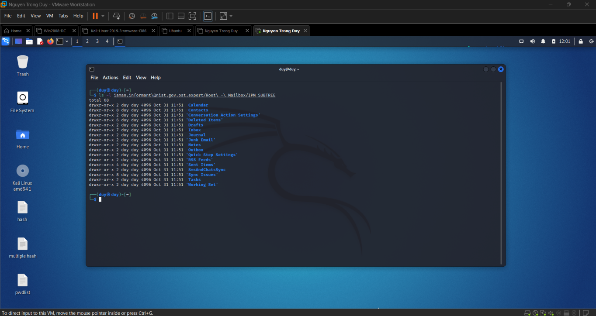

*Hình 4.1. Cấu trúc các thư mục hộp thư của nghi phạm bên trong IPM_SUBTREE*

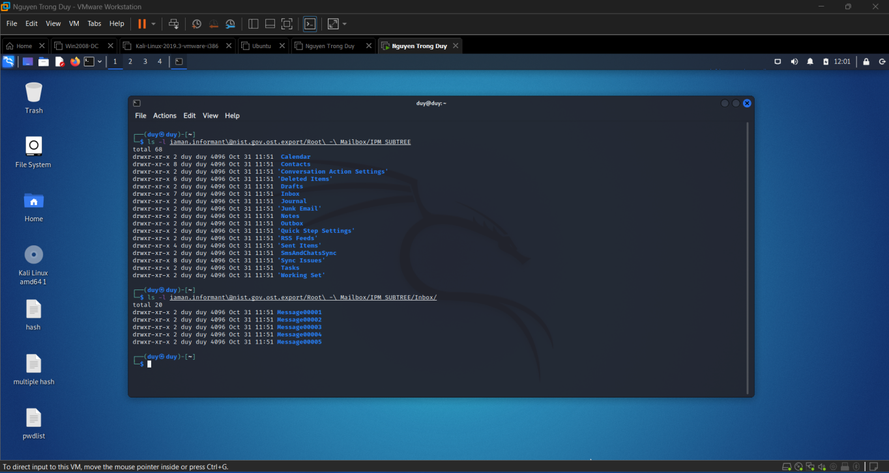

*Hình 4.2. Danh sách các bức thư Message00001 đến Message00005 trong thư mục Inbox*

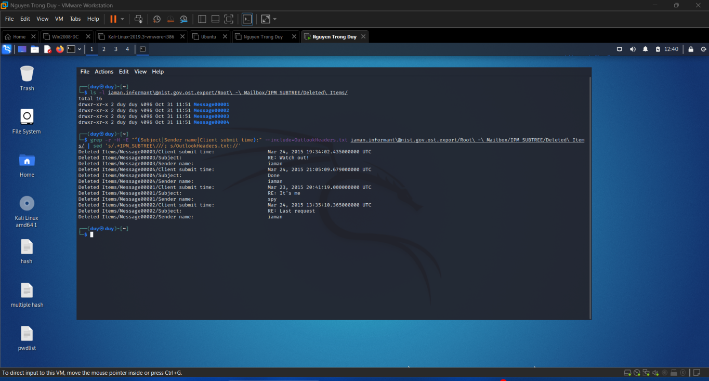

*Hình 4.3. Phát hiện và trích xuất thông tin các email đã bị xóa trong Deleted Items*

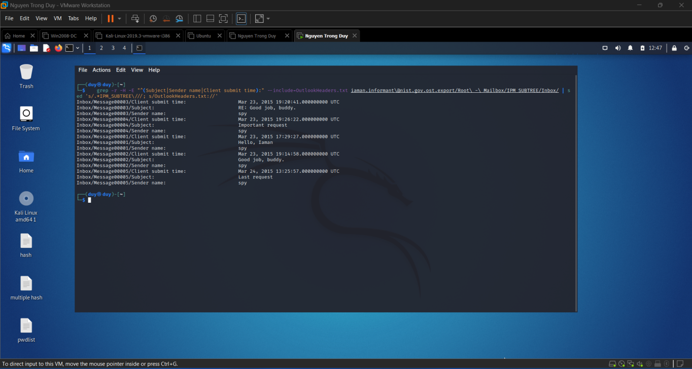

*Hình 4.4. Tổng hợp siêu dữ liệu header của 5 bức thư trong Hộp thư đến*

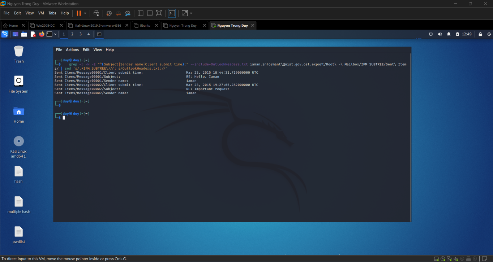

*Hình 4.5. Phân tích các email phản hồi được gửi đi trong thư mục Sent Items*

**d) Kết quả & diễn giải:** Thư mục gốc gồm Root - Mailbox và Root - Public. Bên trong IPM_SUBTREE có các thư mục: Inbox (Hộp thư đến có 5 email từ 'spy'), Sent Items (Đã gửi 2 email), Deleted Items (Đã xóa 4 email, đặc biệt có 2 email quan trọng nghi phạm đã xóa nhằm phi tang: 'RE: Watch out!' và 'Done' ngày 24/03/2015), Drafts và Outbox.

### Bước 5. Đọc nội dung Header của Email để trích xuất thông tin

**a) Mô tả thao tác:** Truy cập vào thư mục Inbox, mở file OutlookHeaders.txt của Message00001 để trích xuất các thông tin về thời gian, người gửi, tiêu đề. Đồng thời dùng grep kiểm tra chuỗi thân thư trong Message*.

**b) Câu lệnh / cấu hình đã sử dụng:**

```bash
cat iaman.informant@nist.gov.ost.export/Root\ -\ Mailbox/IPM_SUBTREE/Inbox/Message00001/OutlookHeaders.txt | grep -Ei "time|subject|name"
grep -Ei "how are you|hello" iaman.informant@nist.gov.ost.export/Root\ -\ Mailbox/IPM_SUBTREE/Inbox/Message00001/Message*
```

**c) Ảnh minh chứng:**

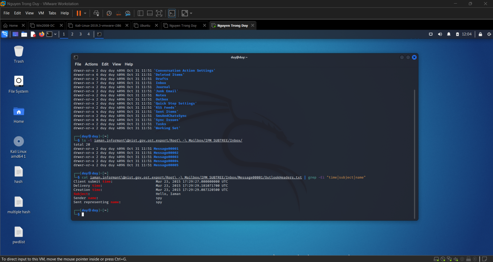

*Hình 5.1. Trích xuất thông tin Header chi tiết của bức thư Message00001*

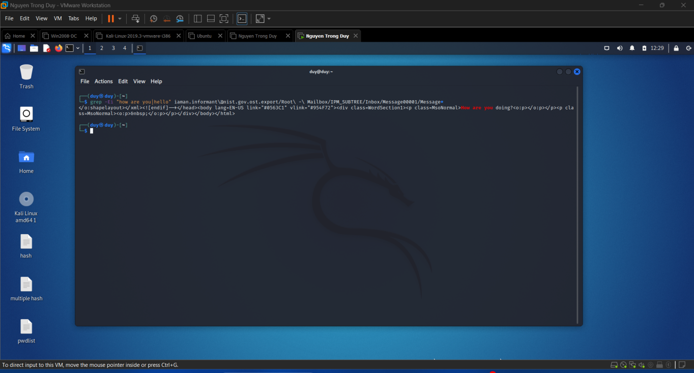

*Hình 5.2. Đọc nội dung tệp tin thân thư (Message Body) của Message00001*

**d) Kết quả & diễn giải:** Thư mục Inbox chứa 5 email (Message00001 đến Message00005). Phân tích Header của email đầu tiên cho thấy: Thời gian gửi (Client submit time): Mar 23, 2015 17:29:27 UTC; Tên người gửi (Sender name): 'spy' (đây là một cái tên rất đáng ngờ, ám chỉ gián điệp hoặc kẻ thu thập dữ liệu rò rỉ); Tên đại diện gửi (Sent representing name): 'spy'; Tiêu đề thư: 'Hello, Iaman'. Nội dung thân thư bắt đầu quá trình tiếp xúc và đòi hỏi tuồn tài liệu.

## 3. Tổng hợp Kết quả Điều tra (Forensic Findings)

### 3.1. Bảng tổng hợp kết quả điều tra (Forensic Findings Summary)

## 4. Phân tích Chuyên sâu & Giải đáp Kỹ thuật (In-Depth Forensic Analysis)

#### ❓ Câu 1. Phần mềm email nào được nghi phạm sử dụng và bằng chứng số nào chứng minh điều đó?
Trả lời: Nghi phạm sử dụng phần mềm Microsoft Outlook 2013 (phiên bản 15.0.4420.1017). Bằng chứng số được xác lập dựa trên hai phát hiện độc lập:
- Thứ nhất, phân tích Registry hive SOFTWARE bằng công cụ RegRipper (khóa Installer\Products) phát hiện bản ghi cài đặt của gói phần mềm 'Microsoft Outlook MUI (English) 2013 15.0.4420.1017'.
- Thứ hai, kết quả quét hệ thống tệp tin NTFS bằng công cụ fls phát hiện tệp tin lưu trữ ngoại tuyến iaman.informant@nist.gov.ost tại đường dẫn tiêu chuẩn Users/informant/AppData/Local/Microsoft/Outlook/. Cấu trúc tệp tin và vị trí lưu trữ hoàn toàn khớp với cơ chế hoạt động của Microsoft Outlook.

Câu 2. Tệp tin .ost là gì và tại sao điều tra viên cần công cụ chuyên dụng như pffexport (libpff) để phân tích thay vì mở trực tiếp bằng trình đọc văn bản?
Trả lời: Tệp tin .ost (Offline Storage Table) là cơ sở dữ liệu nhị phân độc quyền của Microsoft được sử dụng để đồng bộ hóa và lưu trữ cục bộ các hòm thư của người dùng khi kết nối với máy chủ Microsoft Exchange Server.
- Cấu trúc bên trong tệp .ost bao gồm các bảng B-tree, node phân cấp phức tạp và dữ liệu được nén/mã hóa theo chuẩn MAPI (Messaging Application Programming Interface), không phải văn bản thuần (plain text). Do đó, các trình soạn thảo thông thường hoàn toàn không thể đọc hay hiển thị nội dung.
- Thư viện libpff và công cụ pffexport là bộ công cụ mã nguồn mở được thiết kế chuyên biệt để phân tích cú pháp PFF/OFF, có khả năng duyệt qua cây B-tree nhị phân, giải mã các thuộc tính MAPI, tái tạo lại cấu trúc thư mục hòm thư và trích xuất từng tin nhắn ra định dạng tệp văn bản tiêu chuẩn (.txt, .html) kèm đầy đủ siêu dữ liệu Header.

Câu 3. Tại sao việc phân tích thư mục Deleted Items lại mang ý nghĩa then chốt trong các vụ án điều tra rò rỉ dữ liệu nội bộ?
Trả lời: Trong các vụ án rò rỉ thông tin hoặc gián điệp nội bộ (Insider Threat), đối tượng phạm tội thường có xu hướng chủ động xóa các email trao đổi sau khi hoàn tất hành vi nhằm che giấu chứng cứ và qua mặt các cuộc kiểm tra thông thường.
- Tuy nhiên, trong Microsoft Outlook, thao tác xóa thông thường chỉ chuyển tin nhắn vào thư mục 'Deleted Items' (hoặc vùng Dumpster). Cho đến khi tệp .ost được nén (compacted), các khối dữ liệu của tin nhắn vẫn được lưu giữ nguyên vẹn.
- Bằng cách trích xuất thư mục Deleted Items, điều tra viên điều tra đã phát hiện được 4 email, trong đó có 2 email quan trọng nhất: 'RE: Watch out!' và 'Done' gửi hồi đáp cho đối tượng spy vào ngày 24/03/2015. Đây là bằng chứng trực tiếp khẳng định nghi phạm đã hoàn thành việc rò rỉ dữ liệu mật và tìm cách phi tang chứng cứ.

Câu 4. Phân tích mối liên hệ giữa thời gian gửi email và đối tượng 'spy' với bối cảnh vụ án rò rỉ dữ liệu.
Trả lời: Chuỗi email trao đổi diễn ra tập trung trong hai ngày 23/03/2015 và 24/03/2015:
- Bắt đầu vào lúc 17:29:27 UTC ngày 23/03/2015 với email 'Hello, Iaman' từ người gửi bí danh 'spy', tiếp tục với các yêu cầu 'Important request', 'Good job, buddy.', và kết thúc bằng 'Last request' vào 13:25:57 UTC ngày 24/03/2015.
- Nghi phạm 'iaman' đã phản hồi tích cực và gửi xác nhận 'Done' vào 21:05:09 UTC ngày 24/03/2015.
- Mốc thời gian này hoàn toàn trùng khớp với nhật ký cắm thiết bị lưu trữ USB và trích xuất tệp dữ liệu mật đã được điều tra trong các bài Lab trước. Bí danh 'spy' là danh tính ngụy trang nhằm che giấu đối tượng bên ngoài, minh chứng rõ ràng cho một kế hoạch đánh cắp và rò rỉ dữ liệu có tổ chức.

## 5. Kết luận, Xử lý Sự cố & Bài học Kinh nghiệm (Conclusions & Lessons Learned)

### 5.1. Kết luận Điều tra

Quá trình điều tra đã hoàn thành toàn diện quy trình điều tra dữ liệu email (Email Forensics) đối với vụ án rò rỉ dữ liệu máy tính. Bằng việc phối hợp linh hoạt giữa phân tích Registry Windows (rip.pl) và hệ thống tệp tin (fls, icat), quá trình điều tra đã xác định chính xác ứng dụng Microsoft Outlook 2013 và tệp lưu trữ ngoại tuyến iaman.informant@nist.gov.ost. Thông qua bộ công cụ chuyên dụng pff-tools (pffexport), toàn bộ cấu trúc hòm thư đã được bóc tách và giải mã nguyên vẹn. Đặc biệt, việc phân tích chi tiết Header MAPI và rà soát thư mục Deleted Items đã cung cấp chứng cứ số đanh thép về mối quan hệ liên lạc giữa nghi phạm 'iaman' và đối tượng móc nối 'spy' trong khoảng thời gian từ 23/03/2015 đến 24/03/2015, phục vụ đắc lực cho công tác kết luận vụ án.

Bài thực hành Lab 12 tập trung vào kỹ thuật Điều tra số ở tầng ứng dụng (Application Layer Forensics), cụ thể là phân tích dữ liệu hộp thư điện tử (Email Forensics). Trong bối cảnh vụ án rò rỉ dữ liệu máy tính ("cfreds_2015_data_leakage_pc"), điều tra viên cần xác định phần mềm email mà nghi phạm đã sử dụng, địa chỉ tài khoản email liên quan và toàn bộ nội dung trao đổi thư tín bất thường. Mục tiêu trọng tâm bao gồm: phân tích Registry Windows và cấu trúc tệp tin để định vị email client cùng tệp lưu trữ ngoại tuyến (.ost); sử dụng bộ công cụ mã nguồn mở pff-tools (pffexport) để bóc tách cấu trúc hộp thư; khảo sát chi tiết các hòm thư Inbox, Sent Items và đặc biệt là Deleted Items để tìm chứng cứ rò rỉ dữ liệu đã bị phi tang; đồng thời giải mã cấu trúc Header MAPI để xác định danh tính và mốc thời gian liên lạc của các bên liên quan.

### 5.2. Nhật ký Xử lý Sự cố Kỹ thuật (Troubleshooting Log)

| STT | Khó khăn / lỗi gặp phải | Giải pháp xử lý kỹ thuật |
| --- | --- | --- |
| 1 | Lỗi đường dẫn mount ổ đĩa DD trên Kali phiên bản mới (/media/... thành /run/media/...) | Đã dùng lệnh lsblk hoặc xem trong File Manager để tìm đúng đường dẫn mount thực tế, hoặc trích xuất trực tiếp qua inode bằng lệnh icat. |
| 2 | File .ost có kích thước lớn, chứa nhiều email rác/email hệ thống | Chỉ tập trung phân tích các thư mục quan trọng (Inbox, Deleted Items, Sent Items) và lọc các file OutlookHeaders.txt để tìm từ khóa. |
| 3 | Lỗi font chữ hoặc mã hóa khi đọc file text | Sử dụng kết hợp lệnh cat và grep để trích xuất chính xác các dòng chứa thông tin cần tìm thay vì mở toàn bộ file. |

### 5.3. Bài học Rút ra (Key Takeaways)

- Hiểu được cấu trúc lưu trữ của phần mềm Microsoft Outlook (file .ost).
- Thành thạo công cụ mã nguồn mở pff-tools (pffexport) để phân tích cấu trúc email mà không cần mở Outlook.
- Biết cách phân tích Email Header để xác định thời gian, người gửi, người nhận - những thông tin không thể bị làm giả dễ dàng.
- Nhận thức được tầm quan trọng của việc kiểm tra các thư mục Deleted Items (vì kẻ tấn công thường xóa email để phi tang, nhưng dữ liệu vẫn còn trong file lưu trữ).

## 6. Tài liệu Tham khảo (References)

[1] Tài liệu hướng dẫn thực hành Lab 12: Email forensics, môn FRS301, Trường Đại học FPT.

[2] Joachim Metz, "libpff - Library and tools to access the Personal Folder File (PFF) and the Offline Folder File (OFF) format".
[3] Microsoft Documentation, "Outlook Data Files (.pst and .ost)".
