# Lab 14: Mobile Forensics – Android SMS/MMS Database (mmssms.db) Investigation
### *Điều tra Thiết bị Di động Android – Phân tích Cơ sở dữ liệu Tin nhắn SQLite (mmssms.db)*

[⬅️ Back to Main DFIR Casebook](../../README.md)

---

## 📌 Quick Metadata

| Field | Description |
| :--- | :--- |
| **Forensic Environment** | `Kali Linux 2025.4 / 2026.3 (64-bit)` on `VMware Workstation Pro` (Host: `Windows 11`) |
| **Forensic Module** | `04-Application-Email-and-Mobile-Forensics` |
| **Target Dataset / Evidence** | `Google Pixel 3 Android Forensic Image -> bugle_db / mmssms.db SQLite Databases` |
| **Core Forensic Toolstack** | `Autopsy, DB Browser for SQLite, SQLite3 CLI, Linux date / Epoch Timestamp Converter` |
| **MITRE ATT&CK / DFIR Focus** | `Mobile Messaging Artifact Extraction, Relational SQLite Schema Correlation (sms, threads, part)` |

---

## 1. Tổng quan & Bối cảnh Điều tra (Overview & Objectives)

### 1.1. Bối cảnh và Mục tiêu

Bài lab mô phỏng quá trình điều tra dữ liệu tin nhắn (SMS, MMS) trên thiết bị di động Android. Tiến hành thực hiện trích xuất dữ liệu từ file ảnh đĩa của máy Pixel 3, truy cập vào cơ sở dữ liệu mmssms.db để phân tích các bảng sms, threads, canonical_addresses và part. Mục tiêu là hiểu được cấu trúc lưu trữ tin nhắn, xác định được nội dung, người gửi/nhận và thời gian của các cuộc hội thoại, phục vụ cho công tác điều tra số.

### 1.2. Môi trường và Công cụ Thực hành

| Thành phần | Tên / Phiên bản | Ghi chú (cấu hình, nguồn tải…) |
| --- | --- | --- |
| Máy thật (host) – hệ điều hành | Windows |  |
| Phần mềm ảo hoá | VMWare |  |
| Máy ảo sử dụng | Kali Linux 2025.4 |  |
| Công cụ điều tra 1 | hashdeep | Kiểm tra hash file ảnh đĩa |
| Công cụ điều tra 2 | unzip, tree | Giải nén và xem cấu trúc thư mục |
| Công cụ điều tra 3 | DB Browser for SQLite | Đọc và phân tích cơ sở dữ liệu mmssms.db |
| Công cụ điều tra 4 | EpochConverter | Chuyển đổi timestamp |

### 1.3. Dữ liệu Bằng chứng & Kiểm tra Tính toàn vẹn (Hash Verification)

| Tên file / nguồn dữ liệu | Thuật toán | Hash trước phân tích | Hash sau phân tích | Khớp? |
| --- | --- | --- | --- | --- |
| Pixel 3.zip | MD5 | 9cc37ebbbc4e918e5e427de1fe1deecc | 9cc37ebbbc4e918ee5427de1fe1deecc | ☑ Có |
| Pixel 3.zip | SHA-1 |  | 2b52893b1bc438ec399a77de0a108e73695af96f |  |
| Pixel 3.zip | SHA-256 | ca6918ef8b20486b6a5ded15609ac5<br>1318f377829480f93be3ba15364a8aa00a | ca6918ef8b20486b6a5ded15609ac5<br>1318f377829480f93be3ba15364a8aa00a | ☑ Có |

Giá trị tham chiếu (theo tài liệu lab, nếu có): Không có

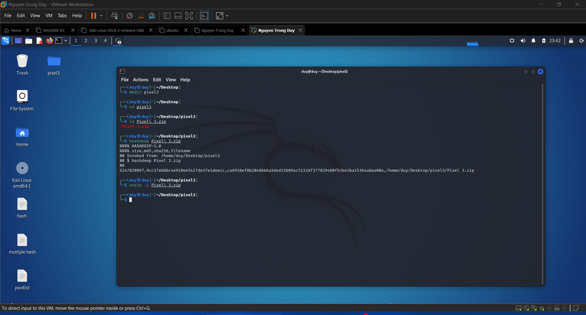

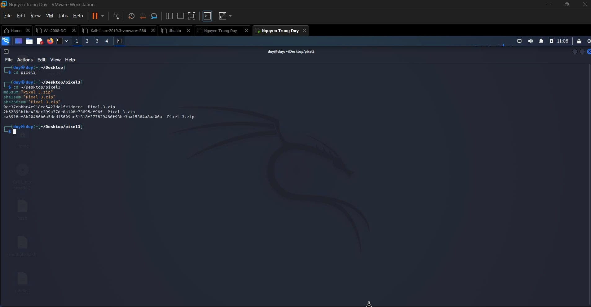

*Hình 1: Xác minh mã băm MD5, SHA1, SHA256 của file Pixel 3.zip*

## 2. Quy trình Điều tra & Thực nghiệm Kỹ thuật (Forensic Investigation Workflow)

### Bước 1. Tải và kiểm tra file ảnh đĩa Pixel 3

**a) Mô tả thao tác:** Tải file Pixel 3.zip từ đường link được cung cấp trong tài liệu. Sử dụng công cụ hashdeep để kiểm tra tính toàn vẹn của file. Sau đó, giải nén file zip để lấy được thư mục chứa dữ liệu của máy Pixel 3. Sử dụng lệnh ls để kiểm tra cấu trúc thư mục.

**b) Câu lệnh / cấu hình đã sử dụng :**

```bash
mkdir pixel3
cd pixel3
ls
hashdeep Pixel\ 3.zip
unzip -q Pixel\ 3.zip
ls-l
ls 'Pixel 3/data/data'
```

**c) Ảnh minh chứng:**

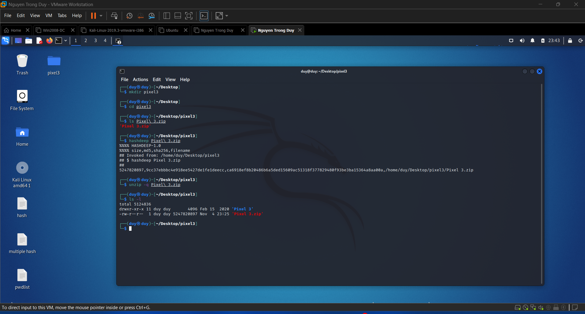

*Hình 1.1. Kiểm tra hash và giải nén file Pixel 3.zip*

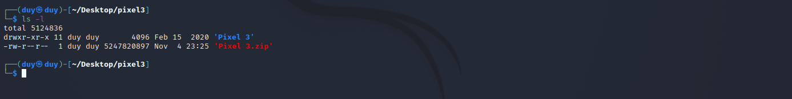

*Hình 1.2. Kiểm tra sự tồn tại của file nén và thư mục dữ liệu Pixel 3*

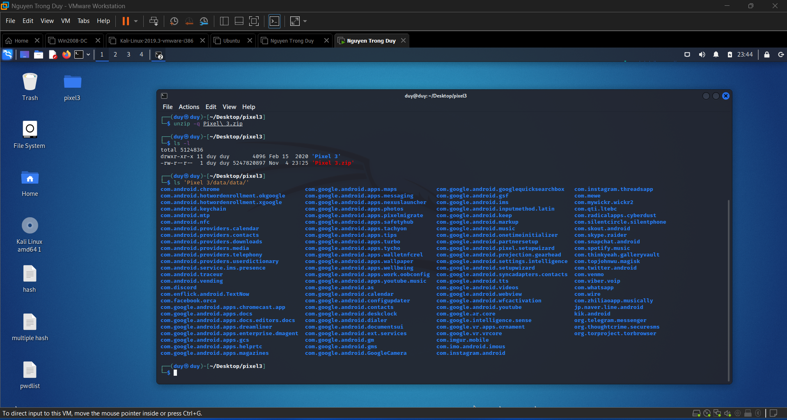

*Hình 1.3. Liệt kê cấu trúc thư mục dữ liệu của các ứng dụng trên Pixel 3*

**d) Kết quả & diễn giải:** File ảnh đĩa đã được tải và giải nén thành công. Cấu trúc thư mục data/data chứa dữ liệu của các ứng dụng, trong đó có thư mục com.android.providers.telephony chứa cơ sở dữ liệu tin nhắn.

### Bước 2. Truy cập cơ sở dữ liệu tin nhắn (mmssms.db)

**a) Mô tả thao tác:** Sử dụng lệnh ls kết hợp grep để liệt kê các gói ứng dụng hệ thống Android (com.android.*) nhằm xác định thư mục chứa dữ liệu điện thoại. Tiếp theo, dùng lệnh tree để xem cấu trúc thư mục của ứng dụng com.android.providers.telephony và thư mục databases, từ đó xác định được tệp cơ sở dữ liệu tin nhắn mmssms.db. Cuối cùng, mở tệp này bằng công cụ DB Browser for SQLite (thông qua lệnh sqlitebrowser) để xem các bảng dữ liệu bên trong.

**b) Câu lệnh / cấu hình đã sử dụng :**

```bash
ls | grep com.android
tree 'Pixel 3/data/data/com.android.providers.telephony' -L 1
tree 'Pixel 3/data/data/com.android.providers.telephony/databases' -L 1
sqlitebrowser 'Pixel 3/data/data/com.android.providers.telephony/databases/mmssms.db'
```

**c) Ảnh minh chứng:**

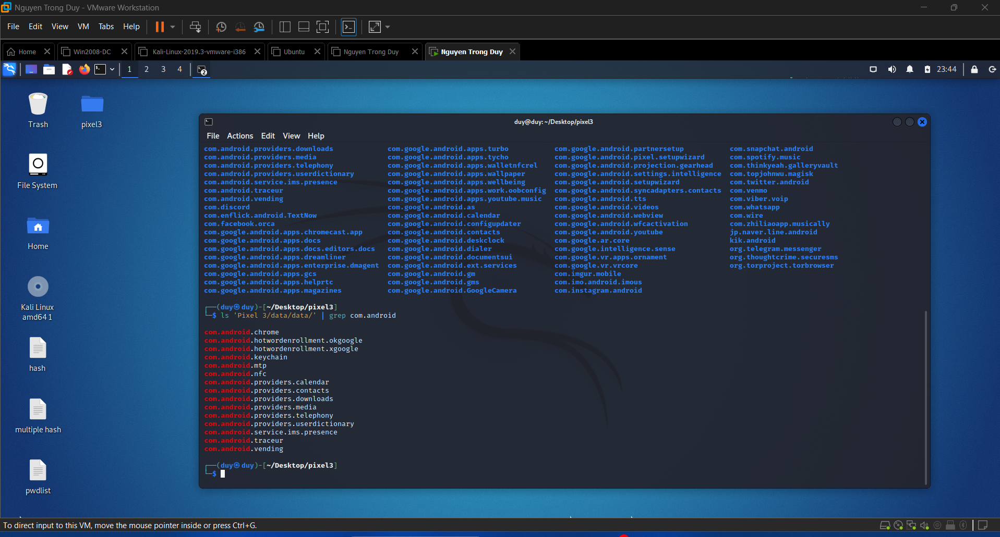

*Hình 2.1. Liệt kê các gói ứng dụng hệ thống Android (com.android.*)*

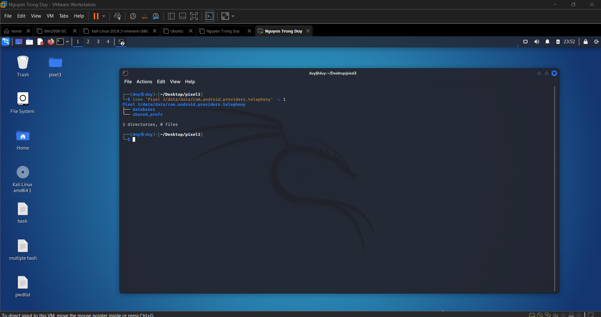

*Hình 2.2. Xem cấu trúc thư mục chứa cơ sở dữ liệu tin nhắn*

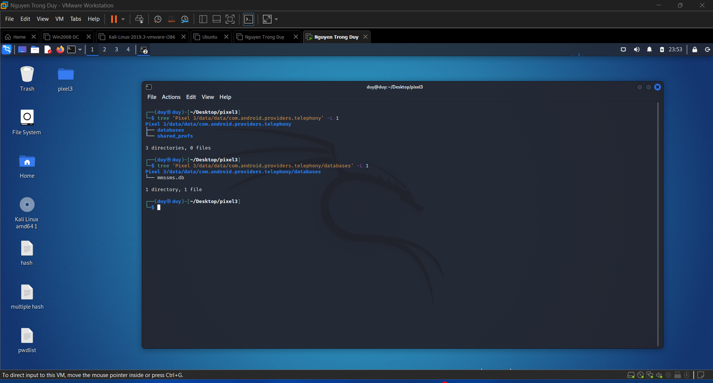

*Hình 2.3. Xác định tệp cơ sở dữ liệu mmssms.db trong thư mục databases*

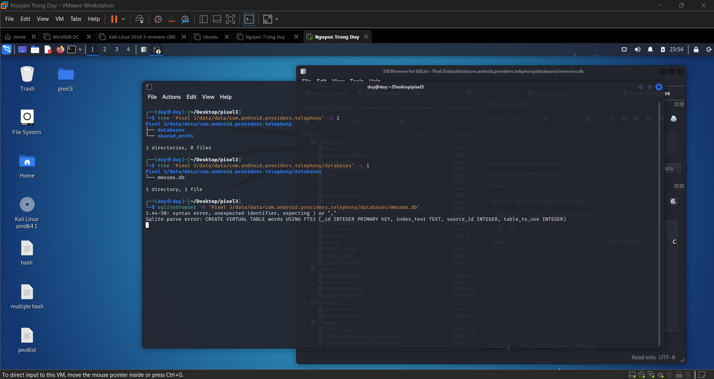

*Hình 2.4. Mở tệp mmssms.db bằng DB Browser for SQLite*

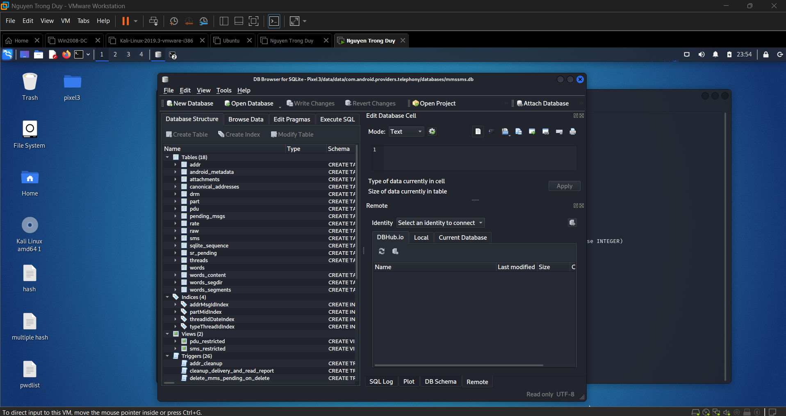

*Hình 2.5. Giao diện DB Browser hiển thị các bảng dữ liệu trong mmssms.db*

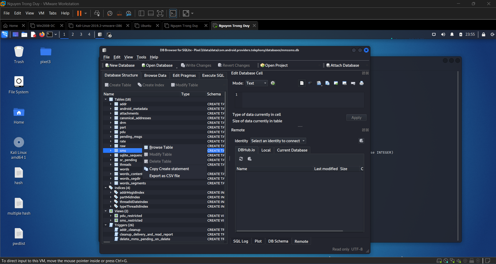

*Hình 2.6. Chọn bảng dữ liệu trong DB Browser for SQLite để thao tác*

**d) Kết quả & diễn giải:** Đã xác định được thư mục chứa cơ sở dữ liệu tin nhắn của hệ điều hành Android là com.android.providers.telephony/databases và tìm thấy tệp mmssms.db. Tệp này đã được mở thành công bằng công cụ DB Browser for SQLite. Giao diện hiển thị danh sách các bảng dữ liệu quan trọng bao gồm sms, threads, canonical_addresses và part. Đây là các bảng chứa thông tin cốt lõi về nội dung tin nhắn, người gửi/nhận và thời gian, tạo tiền đề cho việc phân tích chi tiết ở các bước tiếp theo.

### Bước 3. Phân tích bảng sms và threads

**a) Mô tả thao tác:** Trong giao diện DB Browser for SQLite, chọn tab Browse Data và chọn bảng sms để xem nội dung các tin nhắn. Ghi nhận các thông tin như _id, thread_id, address, body, date. Tiếp theo, chọn bảng threads để xem thông tin về các cuộc hội thoại. Xác định mối liên hệ giữa cột thread_id trong bảng sms và cột _id trong bảng threads để điều tra viên các tin nhắn theo từng cuộc hội thoại.

**b) Câu lệnh / cấu hình đã sử dụng :** Không có do thao tác trên giao diện DB Browser.

**c) Ảnh minh chứng:**

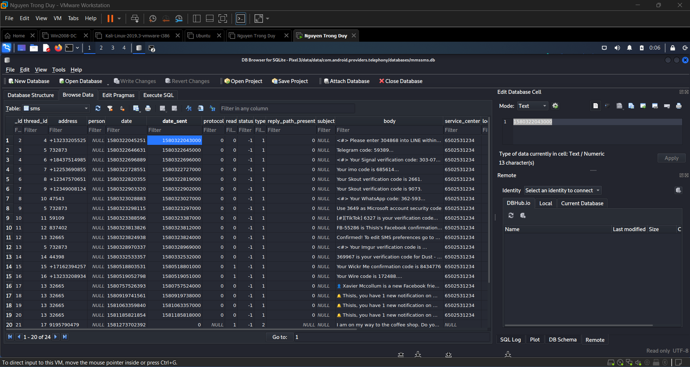

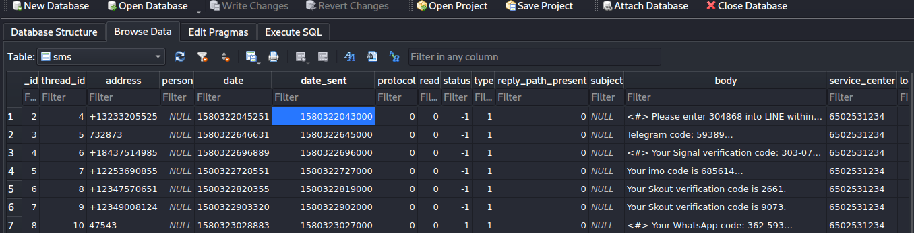

*Hình 3.1. Nội dung bảng sms hiển thị các tin nhắn và thông tin liên quan*

**d) Kết quả & diễn giải:** Bảng sms chứa nội dung chi tiết của từng tin nhắn, bao gồm số điện thoại người gửi/nhận (address), nội dung tin nhắn (body) và thời gian (date dưới dạng timestamp). Bảng threads điều tra viên các tin nhắn theo cuộc hội thoại, với mỗi dòng đại diện cho một cuộc hội thoại. Mối liên hệ giữa thread_id và _id giúp xác định được các tin nhắn thuộc cùng một cuộc trò chuyện, từ đó có cái nhìn tổng quan về các hoạt động liên lạc của đối tượng.

### Bước 4. Xác định người gửi và chuyển đổi timestamp

**a) Mô tả thao tác:** Trong DB Browser, mở bảng sms để xem số điện thoại người gửi/nhận tại cột address, sau đó đối chiếu với bảng canonical_addresses để xác nhận. Để chuyển đổi giá trị timestamp tại cột date sang thời gian thực, mở trình duyệt web và truy cập trang epochconverter.com, nhập giá trị timestamp vào ô tìm kiếm. Ngoài ra, có thể sử dụng lệnh date trên Linux kết hợp tùy chọn -u để kiểm tra chéo kết quả.

**b) Câu lệnh / cấu hình đã sử dụng :**

```bash
date -d '@1580322045' -u
```

**c) Ảnh minh chứng:**

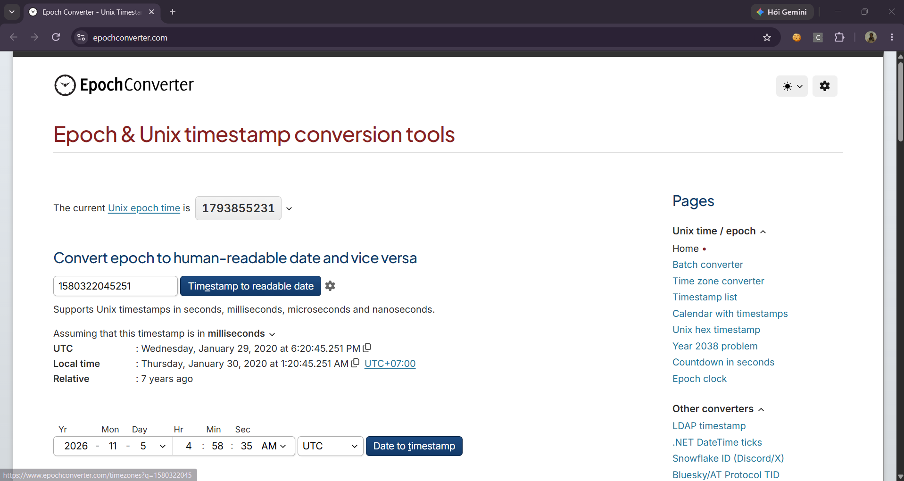

*Hình 4.1. Chuyển đổi timestamp sang thời gian thực bằng EpochConverter*

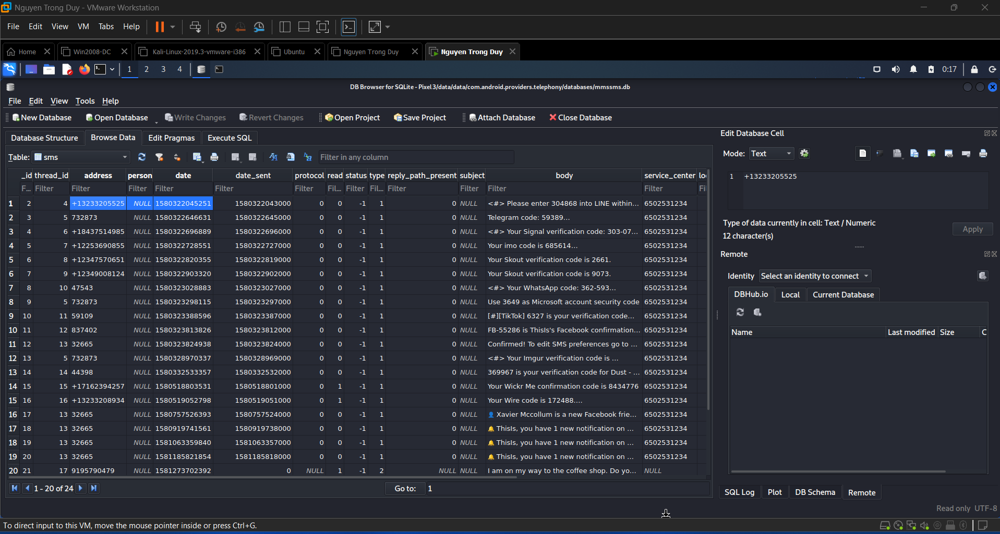

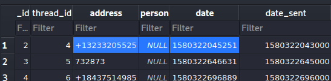

*Hình 4.2. Xác định số điện thoại người gửi/nhận từ bảng sms*

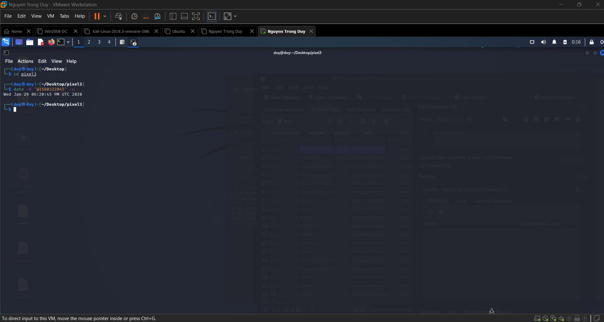

*Hình 4.3. Chuyển đổi timestamp sang thời gian thực bằng lệnh date trên Linux*

**d) Kết quả & diễn giải:** Đã xác định được số điện thoại của người gửi : +13233205525 và thời gian chính xác của các tin nhắn. Việc chuyển đổi timestamp giúp điều tra viên dễ dàng theo dõi diễn biến và thời điểm của các cuộc hội thoại.

## 3. Tổng hợp Kết quả Điều tra (Forensic Findings)

### 3.1. Bảng tổng hợp kết quả điều tra (Forensic Findings Summary)

## 4. Phân tích Chuyên sâu & Giải đáp Kỹ thuật (In-Depth Forensic Analysis)

#### ❓ Câu 1. What table describes conversation?

**Trả lời:** The threads table describes conversations. Each row is one conversation, grouping all messages with the same contact, and sms.thread_id links each message to it.

#### ❓ Câu 2. Where to find sender’s phone number?

**Trả lời:** The sender’s phone number is stored in the canonical_addresses table. threads.recipient_ids points to the matching _id there, and the address column holds the number. For this message it is +13233205525. The number also appears in sms.address.

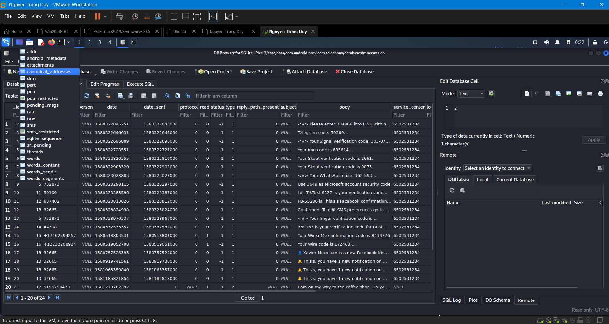

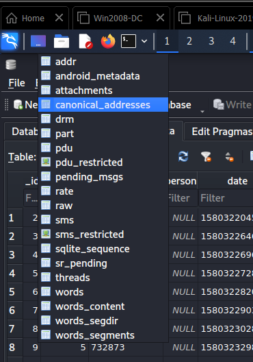

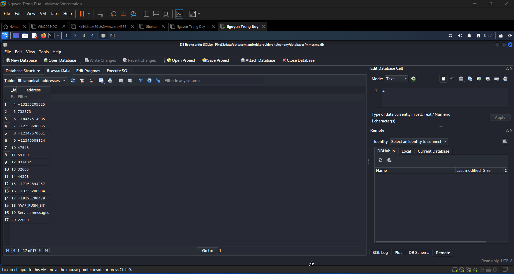

#### ❓ Câu 3. Which table contains MMS information ?

**Trả lời:** The part table contains the MMS information. It stores the content of each multimedia message: _id distinguishes the different attachments of one MMS, ct shows the attachment type (text, picture, audio, video), _data gives where the attachment is stored on the phone, and text holds the body of the MMS. The related pdu table only holds the message headers.

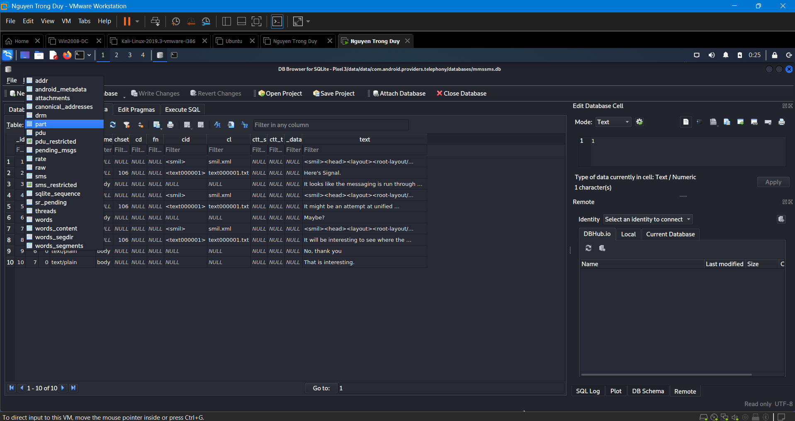

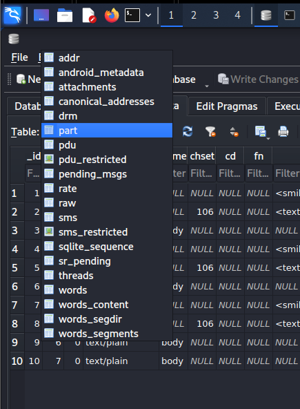

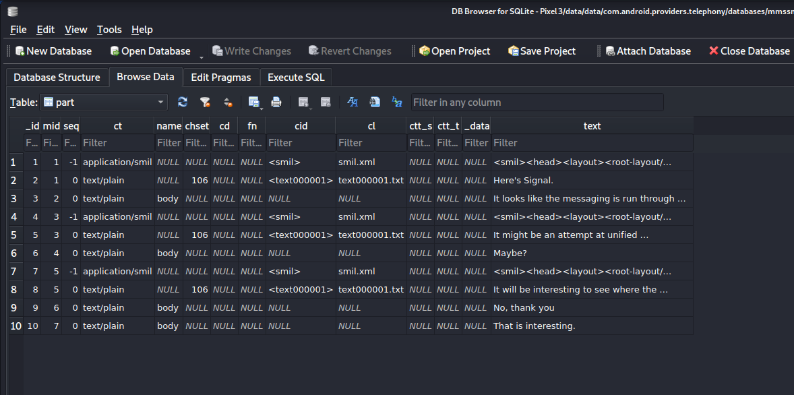

Part table stores below information:

_id: Distinguish between different attachments of a multimedia message (including text, picture, audio, video and other formats)

ct: indicates what type of attachment

data: indicate where the attachment is stored on the phone

text: Represents the body of the MMS.

## 5. Kết luận, Xử lý Sự cố & Bài học Kinh nghiệm (Conclusions & Lessons Learned)

### 5.1. Kết luận Điều tra

Đã thực hiện thành công việc trích xuất và phân tích dữ liệu tin nhắn từ file ảnh đĩa của máy Pixel 3. Các thông tin quan trọng như nội dung tin nhắn (mã xác thực từ nhiều ứng dụng như LINE, Telegram, WhatsApp, Signal, Viber...), số điện thoại người gửi/nhận (+13233205525) và thời gian chính xác (29/01/2020 18:20:45) đã được xác định rõ ràng. Bài lab giúp điều tra viên hiểu được cấu trúc lưu trữ dữ liệu tin nhắn trên Android (mmssms.db) và quy trình điều tra dữ liệu di động, từ đó có thể áp dụng vào thực tế công tác điều tra số.

### 5.2. Nhật ký Xử lý Sự cố Kỹ thuật (Troubleshooting Log)

| STT | Khó khăn / lỗi gặp phải | Giải pháp xử lý kỹ thuật |
| --- | --- | --- |
| 1 | Lỗi không mở được file mmssms.db bằng DB Browser | Kiểm tra lại quyền truy cập và cài đặt DB Browser for SQLite |
| 2 | Lỗi timestamp không chuyển đổi được sang thời gian thực | Kiểm tra lại định dạng timestamp (mili giây) và sử dụng đúng công cụ EpochConverter |

### 5.3. Bài học Rút ra (Key Takeaways)

Kiến thức: Hiểu được cấu trúc cơ sở dữ liệu tin nhắn trên Android (mmssms.db) và mối liên hệ giữa các bảng (sms, threads, canonical_addresses, part). Nắm được quy trình trích xuất và phân tích dữ liệu tin nhắn từ thiết bị di động.

Kỹ năng: Sử dụng thành thạo DB Browser for SQLite để truy vấn dữ liệu, công cụ EpochConverter và lệnh date trên Linux để chuyển đổi thời gian. Rèn luyện kỹ năng chụp ảnh minh chứng và viết báo cáo kỹ thuật.

Liên hệ thực tế: Trong điều tra số, việc phân tích dữ liệu tin nhắn giúp xác định các cuộc hội thoại, đối tượng liên lạc và thời gian, phục vụ cho việc làm rõ các vụ án. Điều tra viên cần nắm vững các công cụ và phương pháp để trích xuất dữ liệu một cách chính xác, hợp pháp và có giá trị pháp lý.

## 6. Tài liệu Tham khảo (References)

[1] Tài liệu hướng dẫn Lab 14 - Mobile App Investigations - Messaging (FRS301).

[2] Hướng dẫn sử dụng DB Browser for SQLite. Truy cập tại: https://sqlitebrowser.org/

[3] Tài liệu về cấu trúc cơ sở dữ liệu tin nhắn trên Android (mmssms.db). Truy cập tại: https://developer.android.com/
