# Lab 09: Windows Offline Credential Auditing & SAM NTLM Hash Extraction
### *Trích xuất Mã băm NTLM từ Registry (SAM/SYSTEM) & Kiểm thử Độ mạnh Mật khẩu*

[⬅️ Back to Main DFIR Casebook](../../README.md)

---

## 📌 Quick Metadata

| Field | Description |
| :--- | :--- |
| **Forensic Environment** | `Kali Linux 2025.4 / 2026.3 (64-bit)` on `VMware Workstation Pro` (Host: `Windows 11`) |
| **Forensic Module** | `05-Credential-and-Firmware-Auditing` |
| **Target Dataset / Evidence** | `Windows Registry SAM & SYSTEM Hives (NIST Data Leakage Case / Windows Lab)` |
| **Core Forensic Toolstack** | `Mimikatz (lsadump::sam), Hashcat (Mode 1000 - NTLM), Kali Linux Wordlists (rockyou.txt)` |
| **MITRE ATT&CK / DFIR Focus** | `T1003.002 (OS Credential Dumping: Security Account Manager), Offline Password Auditing` |

---

## 1. Tổng quan & Bối cảnh Điều tra (Overview & Objectives)

### 1.1. Bối cảnh và Mục tiêu

Bài lab mô phỏng quá trình bẻ khóa (crack) mật khẩu của hệ điều hành Windows. Tiến hành thực hiện trích xuất các tệp SAM và SYSTEM từ Registry, sử dụng công cụ Mimikatz để lấy mã hash NTLM của tài khoản người dùng. Sau đó, sử dụng công cụ Hashcat trên môi trường Kali Linux kết hợp với từ điển mật khẩu (wordlist) để tìm ra mật khẩu dạng plaintext (văn bản thuần). Mục tiêu là hiểu rõ các kỹ thuật tấn công mật khẩu như Brute force, Dictionary technique và cách thức lưu trữ mật khẩu của Windows.

### 1.2. Môi trường và Công cụ Thực hành

| Thành phần | Tên / Phiên bản | Ghi chú (cấu hình, nguồn tải…) |
| --- | --- | --- |
| Máy thật (host) – hệ điều hành | Windows 11 | Hỗ trợ chạy máy ảo |
| Phần mềm ảo hoá | VMware Workstation | Quản lý máy ảo |
| Máy ảo sử dụng | Windows 10 Pro & Kali Linux 2025.4 (64-bit) | Máy ảo Windows để lấy hash, Kali để crack |
| Công cụ điều tra 1 | Registry Editor (regedit) | Trích xuất SAM/SYSTEM |
| Công cụ điều tra 2 | Mimikatz (2.2.0) | Lấy mã hash NTLM |
| Công cụ điều tra 3 | Hashcat | Bẻ khóa hash |

## 2. Quy trình Điều tra & Thực nghiệm Kỹ thuật (Forensic Investigation Workflow)

### Bước 1. Trích xuất tệp SAM và SYSTEM từ Registry

**a) Mô tả thao tác:** Trên máy ảo Windows 10, mở hộp thoại Run (Windows + R) và gõ regedit để mở Registry Editor. Điều hướng đến đường dẫn HKEY_LOCAL_MACHINE\SAM\SAM và HKEY_LOCAL_MACHINE\SYSTEM. Cấp quyền Full Control và Read cho tài khoản hiện tại. Click chuột phải vào tệp SAM, chọn Export, lưu với tên SAM và định dạng Registry Hive Files. Làm tương tự để xuất tệp SYSTEM.

**b) Câu lệnh / cấu hình đã sử dụng :** Không có

**c) Ảnh minh chứng:**

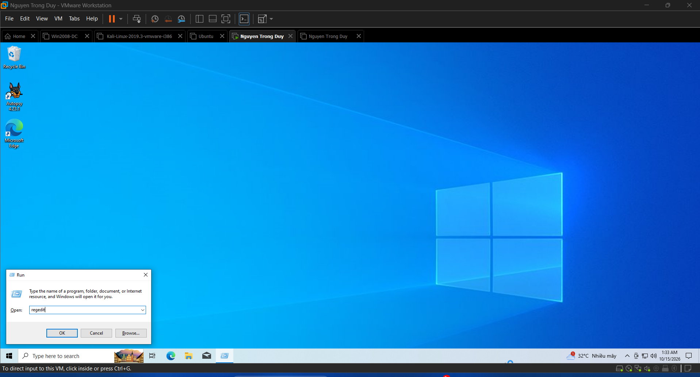

*Hình 1.1. Mở hộp thoại Run và gõ lệnh regedit để mở Registry Editor*

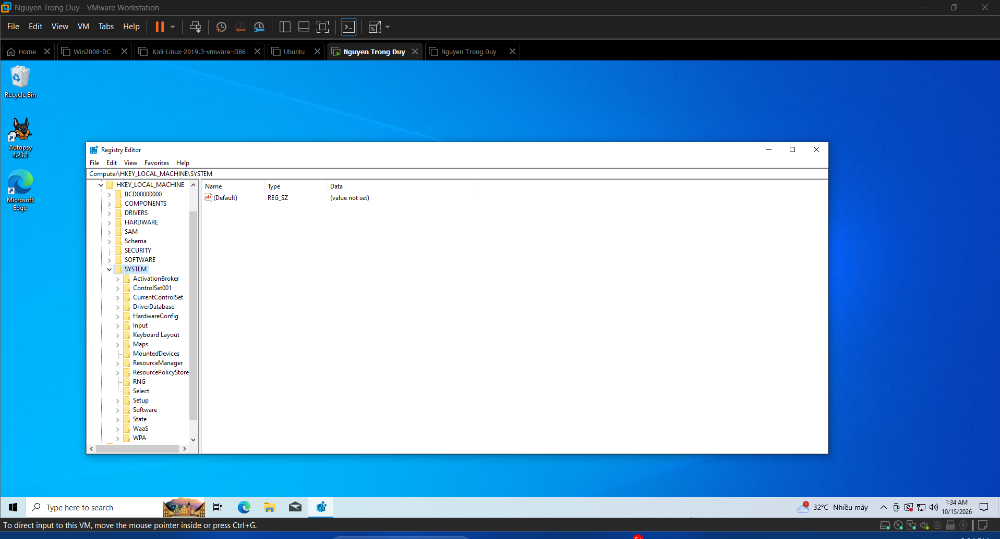

*Hình 1.2. Giao diện Registry Editor sau khi mở thành công*

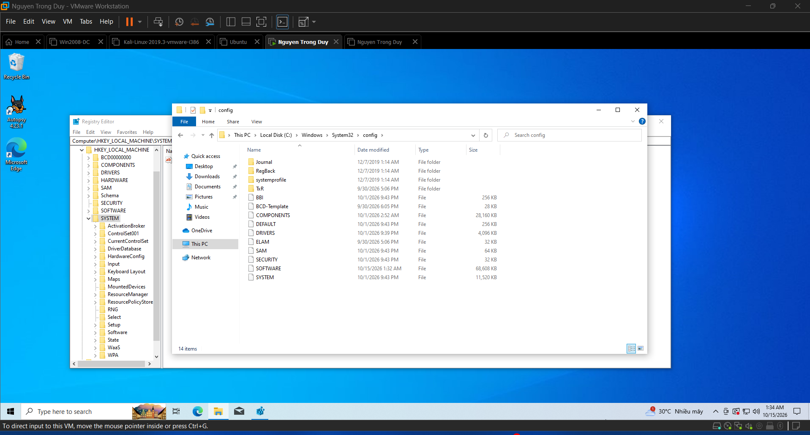

*Hình 1.3. Thư mục config chứa các tệp SAM và SYSTEM trên ổ đĩa*

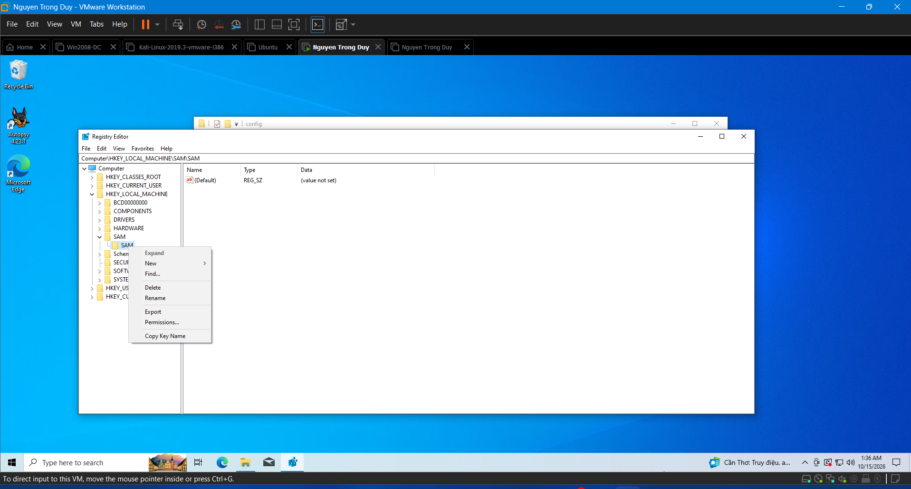

*Hình 1.4. Menu chuột phải trên tệp SAM, chọn Export để xuất tệp*

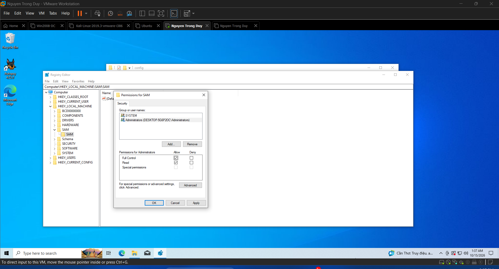

*Hình 1.5. Cửa sổ cấp quyền (Permissions) cho tệp SAM*

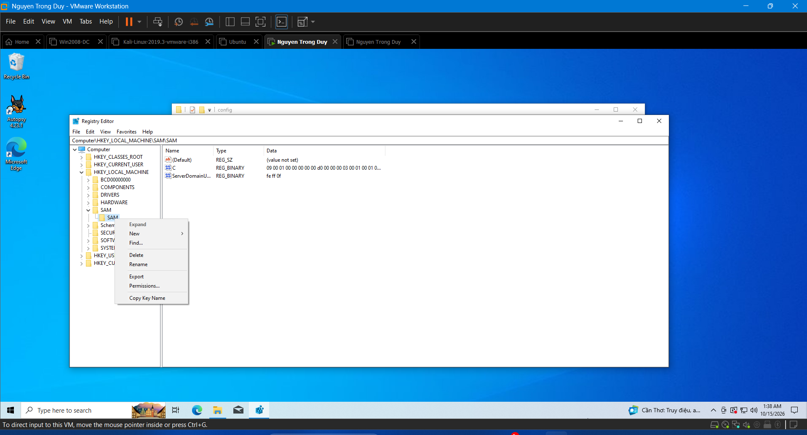

*Hình 1.6. Menu chuột phải trên tệp SAM sau khi đã cấp quyền, chọn Export để xuất tệp*


*Hình 1.7. Lưu tệp SAM với định dạng Registry Hive Files*

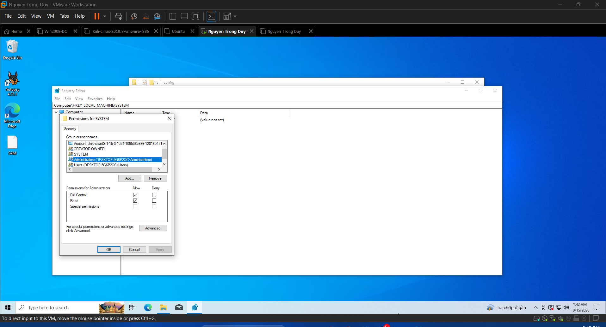

*Hình 1.8. Cửa sổ cấp quyền (Permissions) cho tệp SYSTEM*


*Hình 1.9. Menu chuột phải trên tệp SYSTEM, chọn Export để xuất tệp*

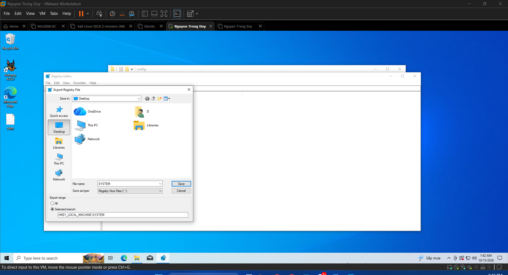

*Hình 1.10. Lưu tệp SYSTEM với định dạng Registry Hive Files*

**d) Kết quả & diễn giải:** Hai tệp SAM và SYSTEM đã được trích xuất thành công ra Desktop. Đây là các tệp cơ sở dữ liệu chứa thông tin tài khoản người dùng và mã hash mật khẩu của Windows, cần thiết cho bước phân tích tiếp theo.

### Bước 2. Sử dụng Mimikatz để lấy mã hash NTLM

**a) Mô tả thao tác:** Truy cập trang GitHub để tải công cụ Mimikatz (file mimikatz_trunk.zip). Giải nén file, mở thư mục x64 và chạy file mimikatz.exe với quyền Administrator. Tại giao diện dòng lệnh của Mimikatz, gõ lệnh lsadump::sam /system:C:\Users\D\Desktop\SYSTEM /SAM:C:\Users\D\Desktop\SAM và nhấn Enter. Kết quả sẽ hiển thị các thông tin tài khoản và mã hash NTLM.

**b) Câu lệnh / cấu hình đã sử dụng :**

```bash
lsadump::sam/system:C:\Users\NITTTR\Desktop\SYSTEM/SAM:C:\Users\NITTTR\Desktop\SAM
```

**c) Ảnh minh chứng:**

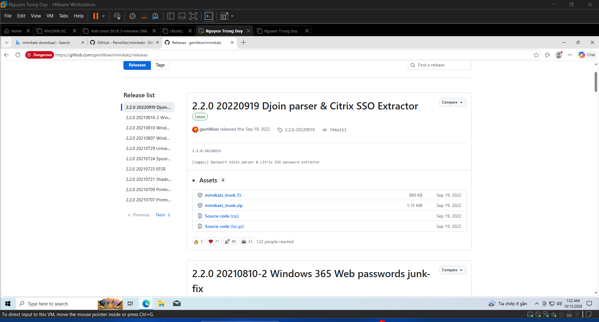

*Hình 2.1. Trang web tải công cụ Mimikatz*

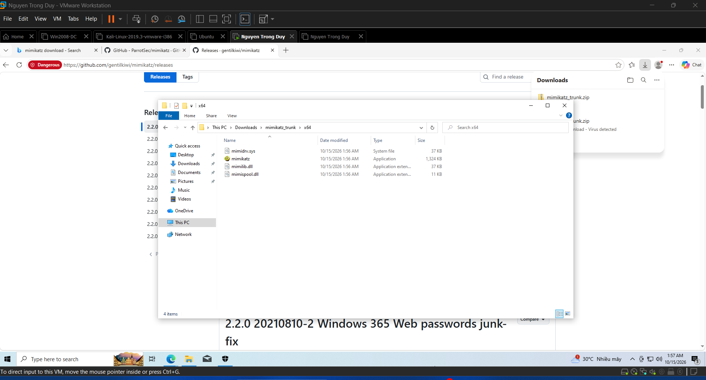

*Hình 2.2. Mở thư mục x64 chứa file thực thi mimikatz.exe*

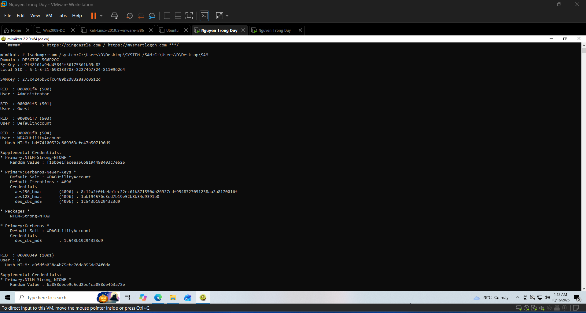

*Hình 2.3. Kết quả trích xuất mã hash NTLM bằng Mimikatz*

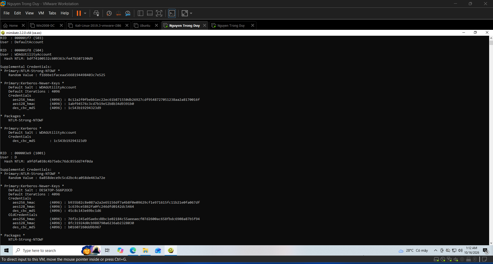

*Hình 2.4. Thông tin chi tiết và mã hash NTLM của tài khoản người dung*

**d) Kết quả & diễn giải:** Sau khi chạy lệnh lsadump::sam, Mimikatz đã trích xuất thành công cơ sở dữ liệu SAM và hiển thị thông tin tài khoản cùng mã hash NTLM tương ứng.

Ý nghĩa câu lệnh: lsadump::sam là module của Mimikatz dùng để dump (trích xuất) dữ liệu từ tệp SAM. Tham số /system:... và /SAM:... trỏ đến đường dẫn của hai tệp SYSTEM và SAM đã export ở Bước 1.

Kết quả: Hệ thống ghi nhận tài khoản NITTTR (RID 1001) với mã hash NTLM là a9fd...df0da. Đây là dạng hash một chiều, không thể dịch ngược mà phải dùng phương pháp bẻ khóa (crack).

### Bước 3. Chuẩn bị môi trường và Wordlist trên Kali Linux

**a) Mô tả thao tác:** Khởi động máy ảo Kali Linux. Tạo một tệp văn bản mới trên Desktop, dán mã hash NTLM vừa tìm được vào và lưu với tên hash. Mở trình duyệt web, tìm kiếm và tải xuống từ điển mật khẩu (wordlist) từ GitHub (Probable-Wordlists). Giải nén file, sao chép tệp Top12Thousand-probable-v2.txt ra Desktop và đổi tên thành pwdlist.

**b) Câu lệnh / cấu hình đã sử dụng :** Không có

**c) Ảnh minh chứng:**

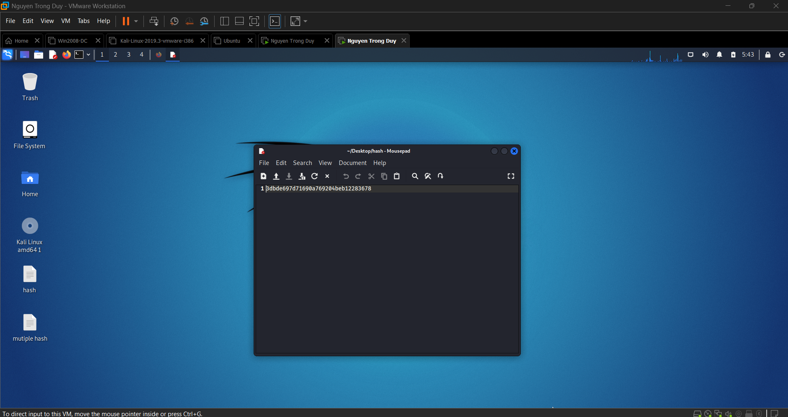

*Hình 3.1. Tệp hash chứa mã NTLM của tài khoản người dùng*

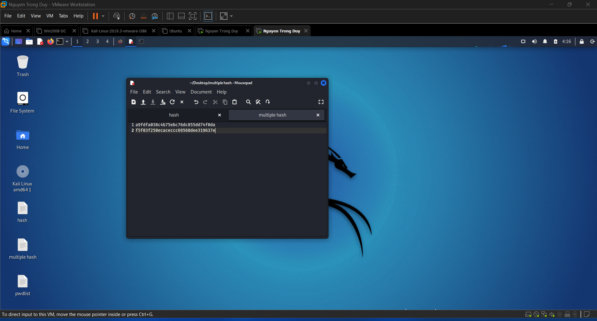

*Hình 3.2. Tệp multiplehash chứa 2 mã hash NTLM trên Desktop*

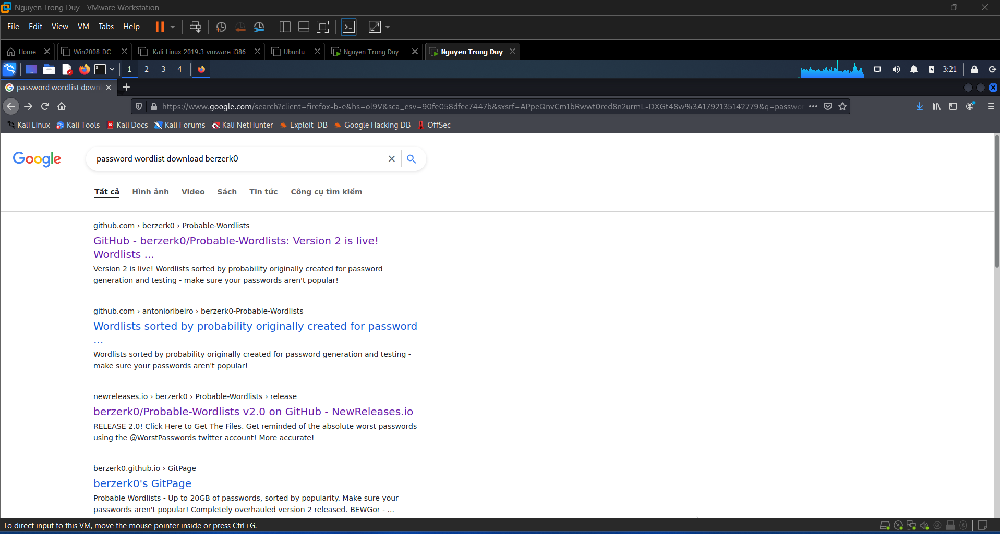

*Hình 3.3. Tìm kiếm wordlist trên Google.*

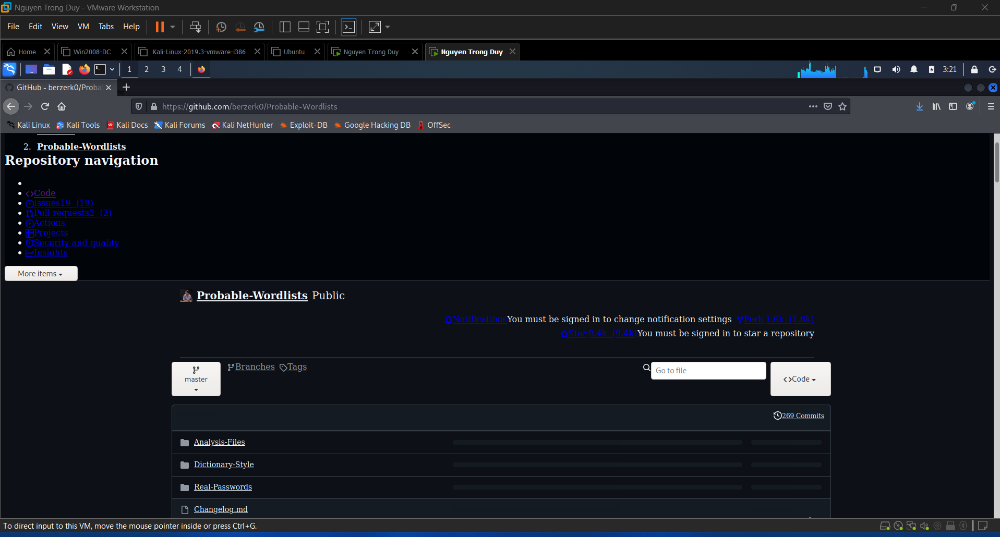

*Hình 3.4. Trang GitHub chứa kho lưu trữ từ điển mật khẩu (Probable-Wordlists)*

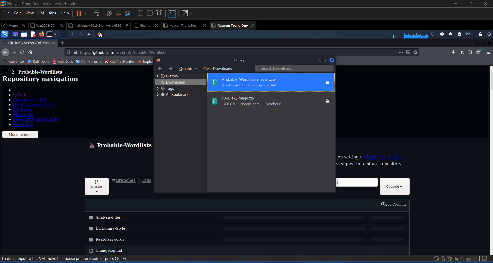

*Hình 3.5. Tải xuống thành công tệp nén chứa từ điển mật khẩu*

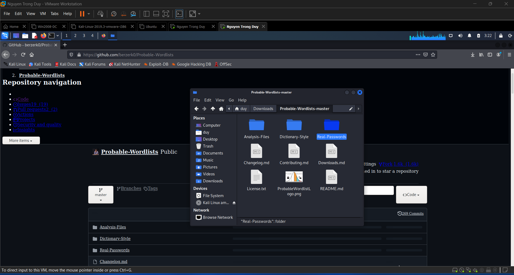

*Hình 3.6. Mở thư mục Real-Passwords sau khi giải nén từ điển*

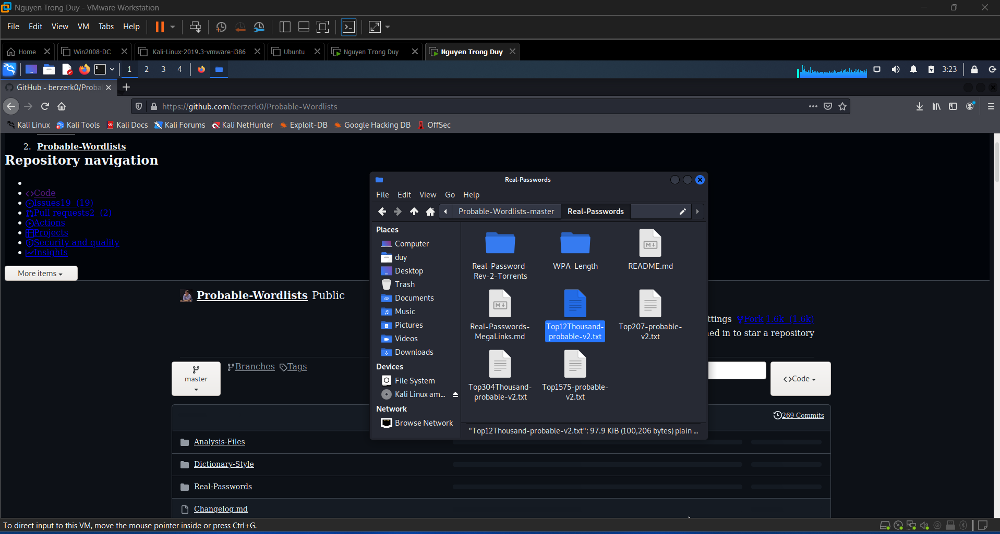

*Hình 3.7. Chọn tệp Top12Thousand-probable-v2.txt làm từ điển mật khẩu*

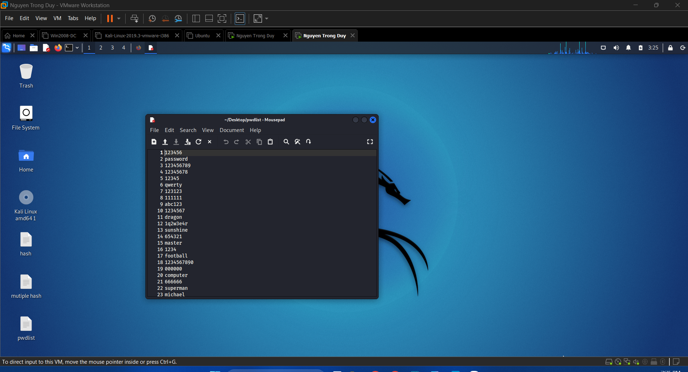

*Hình 3.8. Sao chép tệp pwdlist chứa danh sách các mật khẩu phổ biến ra ngoài desktop*

**d) Kết quả & diễn giải:** Đã chuẩn bị đầy đủ các tệp tin cần thiết (hash và wordlist) trên môi trường Kali Linux, sẵn sàng cho việc sử dụng công cụ Hashcat để bẻ khóa

### Bước 4. Sử dụng Hashcat để bẻ khóa mật khẩu

**a) Mô tả thao tác:** Trên Kali Linux, mở Terminal và chạy công cụ Hashcat với hash mode 1000 (NTLM) và attack mode 0 (Straight) để tấn công từ điển vào tệp hash. Sau khi chạy xong, sử dụng tùy chọn --show để hiển thị mật khẩu dạng plaintext.

**b) Câu lệnh / cấu hình đã sử dụng :**

```bash
hashcat -m 1000 -a 0 ~/Desktop/hash ~/Desktop/pwdlist --force
hashcat -m 1000 -a 0 ~/Desktop/hash ~/Desktop/pwdlist --force --show
```

**c) Ảnh minh chứng:**

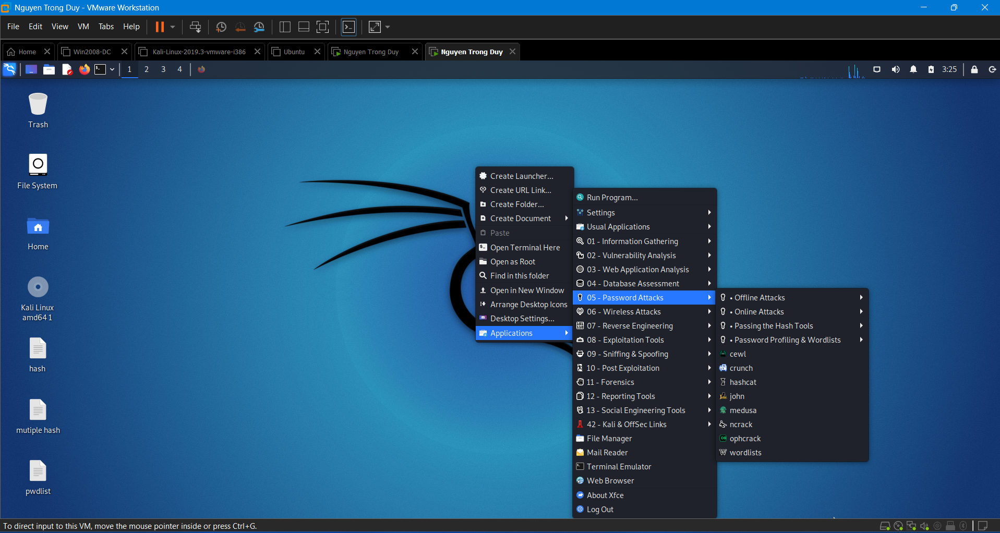

*Hình 4.1. Mở công cụ Hashcat từ menu Applications trên Kali Linux*

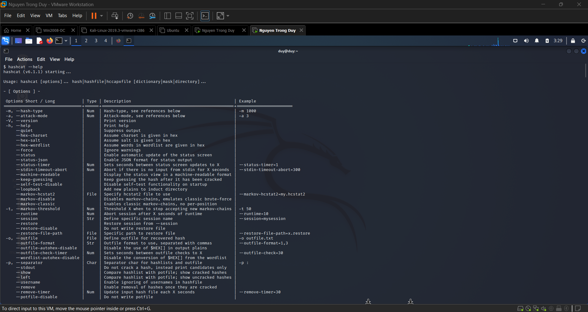

*Hình 4.2. Giao diện dòng lệnh của công cụ Hashcat*

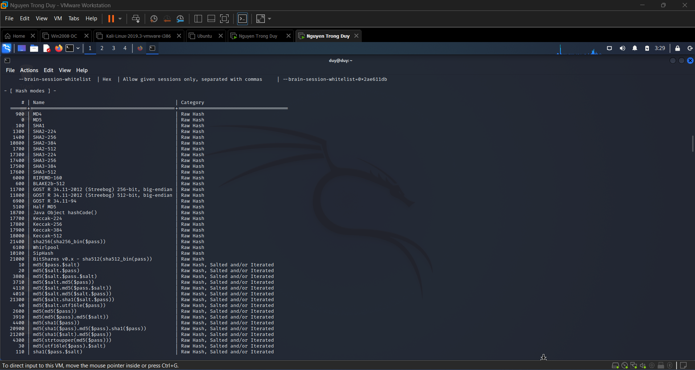

*Hình 4.3. Danh sách các hash mode của Hashcat*

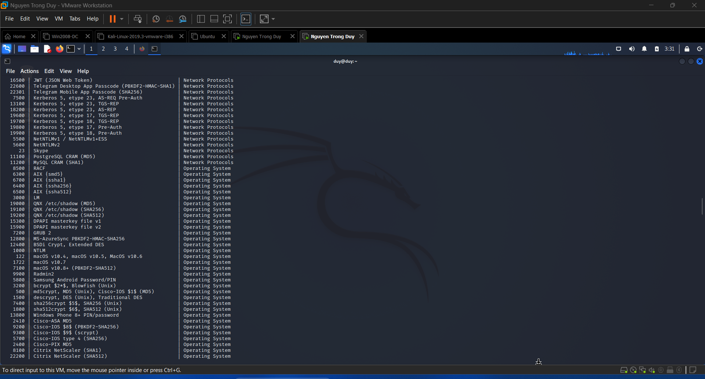

*Hình 4.4. Danh sách các hash mode (tiếp theo) bao gồm NTLM với id là 1000*

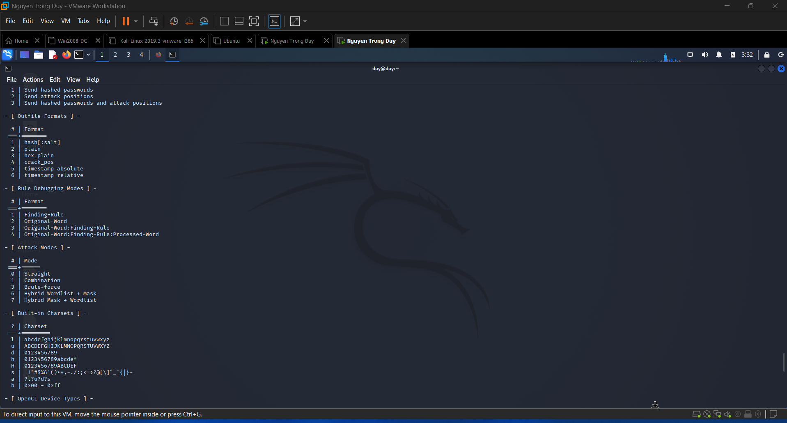

*Hình 4.5. Danh sách các attack mode của Hashcat (Straight có ID là 0)*

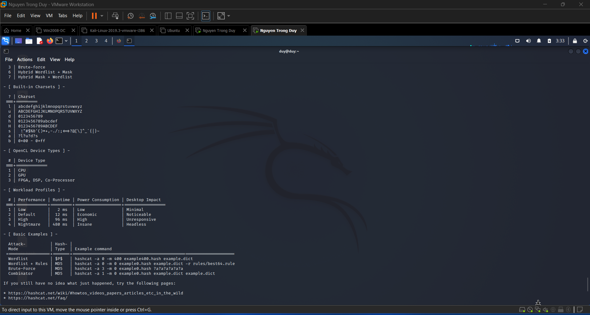

*Hình 4.6. Các ví dụ cơ bản về câu lệnh Hashcat*

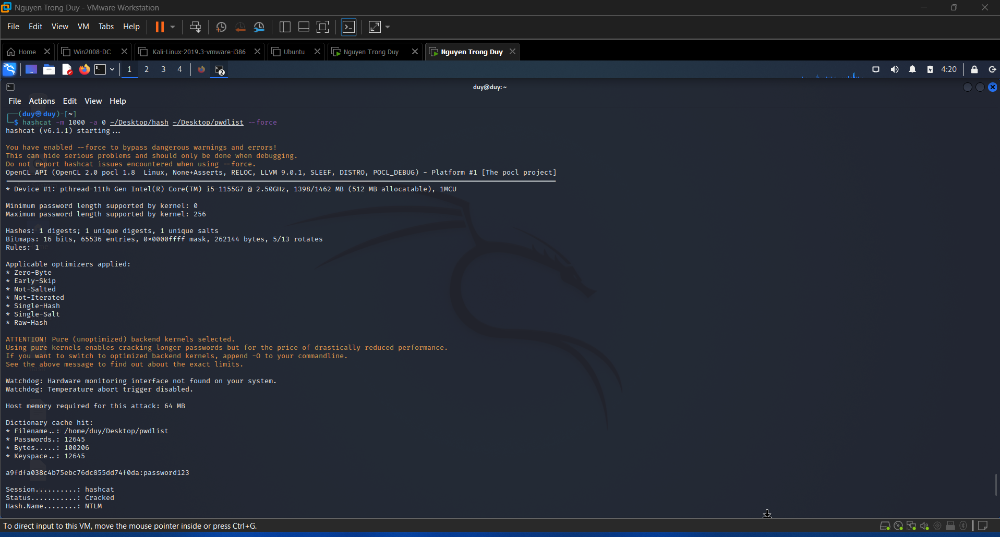

*Hình 4.7. Kết quả Hashcat tìm ra mật khẩu plaintext là password123*

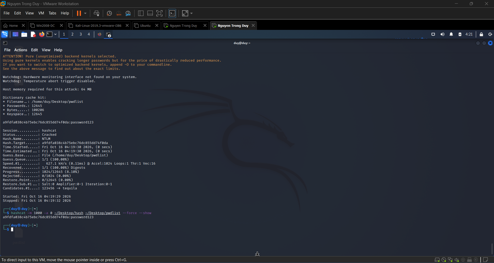

*Hình 4.8. Hiển thị mật khẩu plaintext sau khi crack thành công bằng tùy chọn –show*

**d) Kết quả & diễn giải :** Hashcat đã tìm thấy mật khẩu trong từ điển. Mật khẩu plaintext của tài khoản là password123. Điều này cho thấy sức mạnh của phương pháp tấn công từ điển đối với các mật khẩu yếu và phổ biến.

### Bước 5. Bẻ khóa nhiều mã hash cùng lúc

**a) Mô tả thao tác:** Tạo một tệp văn bản mới trên Desktop chứa nhiều mã hash NTLM khác nhau, đặt tên là multiplehash. Chạy lại lệnh Hashcat với tệp multiplehash thay vì tệp hash. Sử dụng tùy chọn --show để hiển thị tất cả các mật khẩu plaintext tìm được.

**b) Câu lệnh / cấu hình đã sử dụng :**

```bash
hashcat -m 1000 -a 0 ~/Desktop/’multiplehash’ ~/Desktop/pwdlist --force
hashcat -m 1000 -a 0 ~/Desktop/’multiplehash’ ~/Desktop/pwdlist --force --show
```

**c) Ảnh minh chứng:**

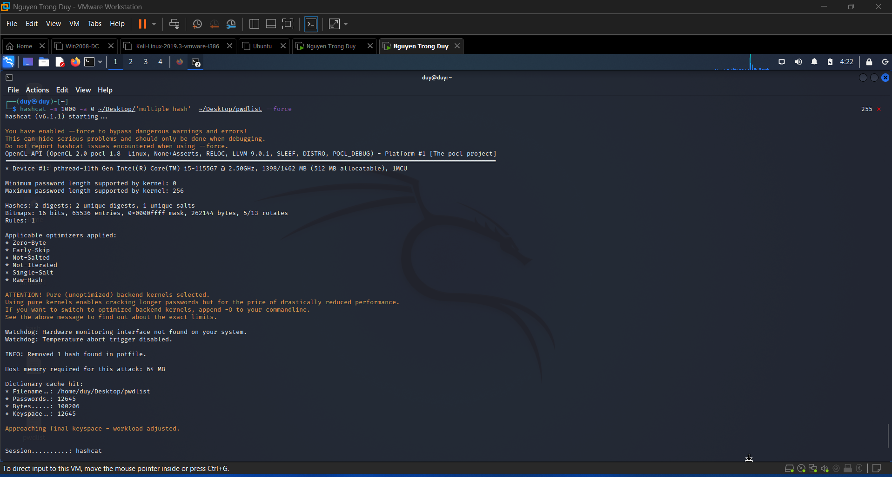

*Hình 5.1. Chạy lệnh Hashcat để bẻ khóa tệp multiplehash chứa nhiều mã hash*

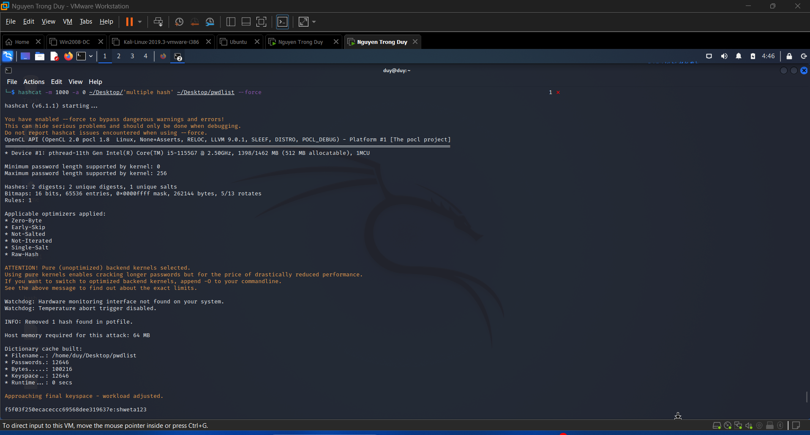

*Hình 5.2. Kết quả Hashcat bẻ khóa thành công mã hash đầu tiên (shweta123)*

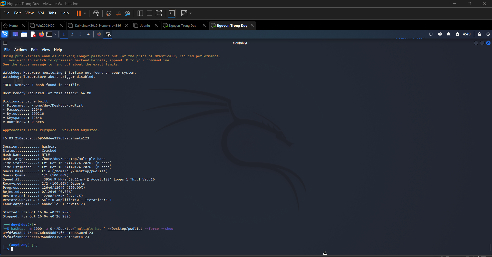

*Hình 5.3. Hiển thị các mật khẩu plaintext (shweta123 và password123) sau khi crack thành công*

**d) Kết quả & diễn giải:** Hashcat đã bẻ khóa thành công 2 mã hash cùng lúc, trả về trạng thái Cracked và tìm ra 2 mật khẩu plaintext là shweta123 và password123. Điều này chứng minh khả năng xử lý hàng loạt của công cụ Hashcat khi thực hiện tấn công từ điển. Trong thực tế điều tra số, khi thu giữ được tệp SAM chứa thông tin nhiều tài khoản, điều tra viên có thể đưa toàn bộ mã hash vào Hashcat để trích xuất mật khẩu nhanh chóng.

## 3. Tổng hợp Kết quả Điều tra (Forensic Findings)

### 3.1. Bảng tổng hợp kết quả điều tra (Forensic Findings Summary)

| STT | Mã Hash NTLM | Mật khẩu Plaintext | Phương pháp / Công cụ | Nhận định |
| --- | --- | --- | --- | --- |
| 1 | a9fd...df0da | password123 | Dictionary Attack (Hashcat) | Mật khẩu yếu, nằm trong top 10 phổ biến nhất |
| 2 | f5f03...37e | shweta123 | Dictionary Attack (Hashcat) | Mật khẩu yếu, dễ dàng tìm thấy trong từ điển |

## 4. Phân tích Chuyên sâu & Giải đáp Kỹ thuật (In-Depth Forensic Analysis)

Đánh giá mức độ mạnh/yếu của mật khẩu tìm được trong bài lab và đề xuất biện pháp phòng chống?

Đánh giá: Cả hai mật khẩu tìm được là password123 và shweta123 đều được đánh giá là RẤT YẾU. Chúng đều là sự kết hợp của một từ phổ biến (password, shweta) và một dãy số dễ đoán (123), nằm trong danh sách các mật khẩu bị rò rỉ nhiều nhất. Chúng dễ dàng bị bẻ khóa trong vài giây bằng phương pháp từ điển.

Biện pháp phòng chống:

Chính sách mật khẩu mạnh: Yêu cầu tối thiểu 12 ký tự, bao gồm chữ hoa, chữ thường, số và ký tự đặc biệt. Không chứa từ ngữ phổ biến.

Xác thực đa yếu tố (MFA): Bật MFA (ví dụ: mã OTP qua điện thoại) để ngăn chặn kẻ tấn công ngay cả khi có mật khẩu.

Giới hạn số lần đăng nhập (Account Lockout): Khóa tài khoản sau 5 lần nhập sai liên tiếp để chống Brute Force.

Sử dụng Password Manager: Khuyến khích người dùng dùng các trình quản lý mật khẩu để tạo mật khẩu ngẫu nhiên, phức tạp.

## 5. Kết luận, Xử lý Sự cố & Bài học Kinh nghiệm (Conclusions & Lessons Learned)

### 5.1. Kết luận Điều tra

Đã thực hiện thành công quy trình bẻ khóa mật khẩu Windows: trích xuất tệp SAM/SYSTEM, lấy mã hash NTLM bằng Mimikatz và khôi phục mật khẩu plaintext bằng Hashcat. Kết quả cho thấy các mật khẩu yếu, phổ biến (password123, shweta123) rất dễ bị tấn công bằng phương pháp từ điển. Bài lab nhấn mạnh sự cần thiết của việc sử dụng mật khẩu mạnh và xác thực đa yếu tố để bảo vệ hệ thống.

### 5.2. Nhật ký Xử lý Sự cố Kỹ thuật (Troubleshooting Log)

| STT | Khó khăn / lỗi gặp phải | Giải pháp xử lý kỹ thuật |
| --- | --- | --- |
| 1 | Không thể truy cập tệp SAM/SYSTEM từ Registry Editor | Cấp quyền "Full Control" và "Read" cho tài khoản Administrators ở mục Permissions. |
| 2 | Hashcat báo lỗi "No devices found/left" hoặc "Outdated" | Thêm tham số --force vào cuối câu lệnh để bỏ qua cảnh báo của OpenCL. |
| 3 | Lệnh Mimikatz báo lỗi đường dẫn | Kiểm tra lại đường dẫn tuyệt đối của tệp SAM/SYSTEM (ví dụ: C:\Users\NITTTR\Desktop\...). |

### 5.3. Bài học Rút ra (Key Takeaways)

Kiến thức: Hiểu được cơ chế lưu trữ mật khẩu của Windows (mã hash NTLM) và nguyên lý của các kỹ thuật tấn công mật khẩu như Dictionary Attack.

Kỹ năng: Thành thạo thao tác trích xuất tệp SAM/SYSTEM từ Registry, sử dụng công cụ Mimikatz để lấy hash và Hashcat để bẻ khóa mật khẩu.

Liên hệ thực tế: Trong điều tra số, việc bẻ khóa mật khẩu giúp truy cập dữ liệu từ các thiết bị bị khóa. Tuy nhiên, điều tra viên cần tuân thủ nghiêm ngặt quy định pháp lý và đạo đức nghề nghiệp, đồng thời nhận thức được tầm quan trọng của việc xây dựng chính sách mật khẩu mạnh để phòng chống tấn công.

## 6. Tài liệu Tham khảo (References)

[1] Tài liệu hướng dẫn thực hành Lab 9: Password Cracking of Windows Operating System, môn FRS301, Trường Đại học FPT.
[2] Benjamin Delpy, "Mimikatz", GitHub repository. [Online]. Available: https://github.com/gentilkiwi/mimikatz
[3] Hashcat Documentation. [Online]. Available: https://hashcat.net/wiki/
[4] Microsoft Docs, "Windows Password Hashing (NTLM)".
