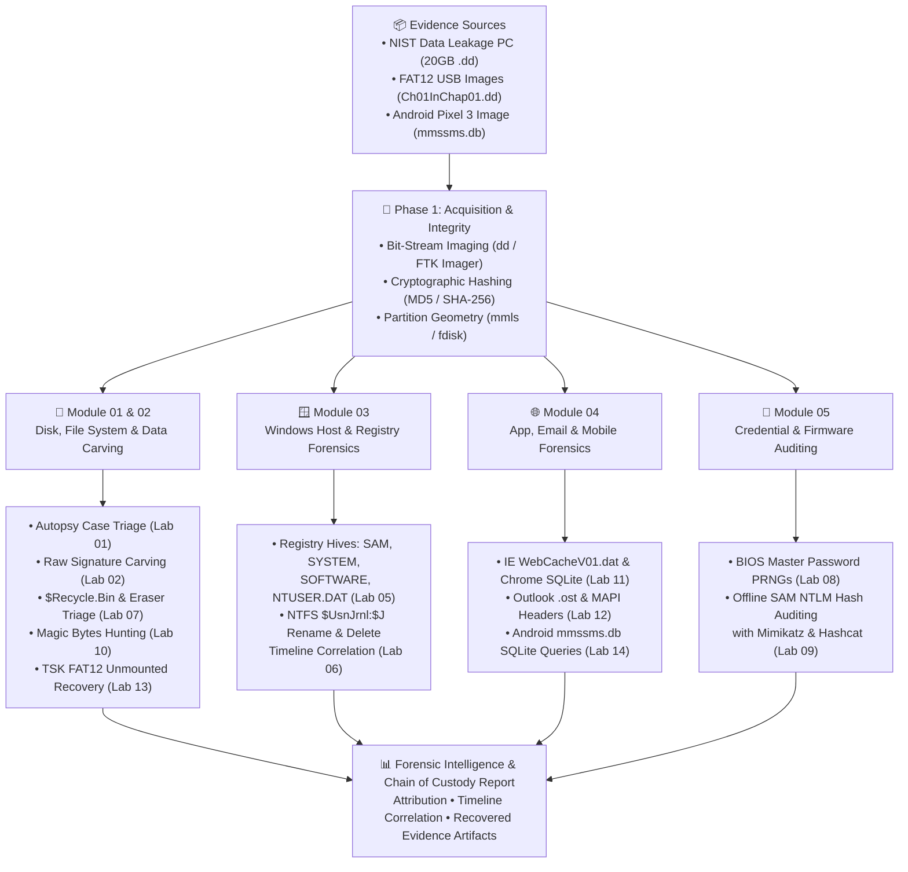

# 🕵️‍♂️ DFIR-Forensics-Casebook: End-to-End Digital Forensics & Incident Response Playbook

**Multi-Layer Forensic Investigation of the NIST CFReDS Data Leakage Case, Windows Registry/NTFS Artifacts, Linux File Systems (TSK), Email (`.ost`), Browser & Android Mobile Forensics**

[**🎯 Executive Summary**](#-1-executive-summary-tldr-for-security-engineers--recruiters) •
[**💻 Kali Linux & Lab Specs**](#-2-forensic-workstation--environment-specifications) •
[**🏗️ DFIR Architecture**](#️-3-investigation-architecture--workflow) •
[**📂 15-Lab Case Matrix**](#-4-complete-15-lab-investigation-matrix) •
[**⚡ Forensic Scripts**](#-5-custom-forensic-automation-scripts) •
[**🇻🇳 Tóm Tắt Tiếng Việt (FRS301)**](#-6-tóm-tắt-tiếng-việt-fpt-university---frs301)

---

## 🎯 1. Executive Summary (TL;DR for Security Engineers & Recruiters)

Modern insider threat and data exfiltration investigations require correlating volatile and non-volatile artifacts across heterogeneous layers: raw storage geometry (MBR/GPT, FAT12, NTFS), operating system internals (Windows Registry hives, `$UsnJrnl`, `$Recycle.Bin`, Prefetch, Event Logs), application containers (Outlook `.ost`, browser SQLite/ESE databases), and mobile endpoints (Android `mmssms.db`).

**`DFIR-Forensics-Casebook`** is a comprehensive, hands-on engineering portfolio comprising **15 end-to-end forensic lab investigations** and **285 verified full-screen evidence captures**, centered around the industry-standard **[NIST CFReDS Data Leakage Case](https://cfreds-archive.nist.gov/data_leakage_case/data-leakage-case.html)** (`cfreds_2015_data_leakage_pc.dd`) alongside specialized Linux, firmware, and Android mobile datasets.

### 🔥 Core Engineering Highlights

1. **Non-Invasive Low-Level File System & Unallocated Space Recovery:**
   - Executed bit-stream forensic acquisition (`dd`, `FTK Imager`) with strict cryptographic chain-of-custody verification (`MD5` / `SHA-1` / `SHA-256`).
   - Performed multi-layer **The Sleuth Kit (TSK)** analysis (`img_stat`, `mmls`, `fsstat`, `fls`, `istat`, `dstat`, `dls`, `dcat`, `icat`) to reconstruct deleted files directly from unallocated clusters without mounting the evidence media.
   - Carved fragmented binary payloads and corrupted documents using header/footer magic bytes (`0xFFD8`–`0xFFD9`) via `foremost`, `ghex`, and custom Python parsers.
2. **Windows Insider Threat & Anti-Forensics Timeline Reconstruction:**
   - Extracted and parsed offline Windows Registry hives (`SAM`, `SYSTEM`, `SOFTWARE`, `SECURITY`, `NTUSER.DAT`) using **RegRipper 3.0** (`rip.pl`) to attribute suspect user accounts (`informant`, SID `S-1-5-21-...-1000`), network configurations, timezone offsets, and unauthorized USB storage mounts (`USBSTOR`).
   - Reconstructed file manipulation and anti-forensic wiping timelines (`ERASER.EXE`, `CCLEANER64.EXE`) by correlating NTFS **`$UsnJrnl:$J`** change journals (`UsnJrnl2Csv`), **`$Recycle.Bin`** (`$I`/`$R` metadata), **Shimcache** (`appcompatcache`), and **UserAssist** (ROT13-encoded execution counts).
3. **Application, Email (`.ost`) & Mobile (`mmssms.db`) Communications Triage:**
   - Located and extracted offline Microsoft Outlook 2013 data files (`iaman.informant@nist.gov.ost`) from raw disk images using TSK `fls`/`icat` and `libpff` (`pffexport`), analyzing MAPI transport headers across `Inbox`, `Sent Items`, and `Deleted Items` to uncover covert intellectual property leaks.
   - Parsed Internet Explorer ESE databases (`WebCacheV01.dat` via `esedbexport`), Chrome SQLite `History`, and Google Pixel 3 Android messaging databases (`mmssms.db` / `bugle_db`) to correlate suspect search queries and SMS/MMS conversations.

---

## 💻 2. Forensic Workstation & Environment Specifications

All 15 forensic investigations were executed on an isolated, virtualized DFIR workstation built around **Kali Linux Rolling (`2025.4` / `2026.3`, 64-bit)** and **Windows 10/11 Forensic VMs** hosted on **VMware Workstation Pro**:

| Component | Version / Specification | Forensic Role & Configuration |
| :--- | :--- | :--- |
| **Host Workstation** | **Windows 11 Home** (`Build 26200`, 64-bit) | 13th Gen Intel Core i7-1355U, 16 GB RAM; runs native `Autopsy 4.21.0` & `Exterro FTK Imager 8.3.0.27` |
| **Hypervisor** | **VMware Workstation Pro** | Isolated Host-Only / NAT sandboxed virtual network; snapshot-protected evidence states |
| **Primary Forensic OS** | **Kali Linux `2025.4` / `2026.3` (64-bit Rolling)** | 4 GB RAM, **80 GB Primary OS Disk + 80 GB Secondary Evidence Disk** (dedicated to storing the unpacked 20 GB `cfreds_2015_data_leakage_pc.dd` raw image and carved outputs) |
| **Secondary Guest VM** | **Windows 10 Pro (64-bit)** | Used for live/offline SAM & SYSTEM hive extraction, Phoenix BIOS challenge auditing (Lab 08), and `Mimikatz` credential dumping (Lab 09) |

### 🛠️ Engineering Adaptations: Modern Kali Linux (`2025.4` / `2026.3`) vs. Legacy Lab Baseline (`2021.4`)

While standard academic forensic curricula (including the original NIST CFReDS lab guides) were authored for **Kali Linux `2020.x` / `2021.4`**, executing these investigations on modern **Kali Linux `2025.4` / `2026.3`** required solving several real-world OS and package deprecation challenges:

1. **Hex Editor Package Deprecation (`bless` $\rightarrow$ `ghex`):**
   - *Challenge:* The legacy GTK2/Mono-based `bless` hex editor referenced in Lab 02 and Lab 10 has been removed from modern Kali Rolling (`2025.4` / `2026.3`) APT repositories.
   - *Adaptation:* Migrated binary header/trailer inspection (`0xFFD8`–`0xFFD9`) and magic byte verification workflows to **`ghex` (GNOME Hex Editor)** alongside CLI hex utilities (`dcat -h`, `xxd`, `hexdump -C`) and `scalpel`/`foremost`.
2. **`udisks2` Loop Device Auto-Mount Path Migration (`/media/` $\rightarrow$ `/run/media/`):**
   - *Challenge:* In Kali `2021.4`, read-only loop partitions mounted under `/media/<username>/<volume>`. In Kali `2025.4` / `2026.3`, the updated `udisks2` daemon relocates user loop mounts to `/run/media/<username>/<volume>` (or requires explicit manual mount points via `losetup --partscan --find --show --read-only`).
   - *Adaptation:* Standardized all partition mounting workflows in Labs 05, 10, 11, and 12 using explicit read-only loop bindings (`/mnt/loopdev`, `/mnt/nist_dataleak_pc_dd2`) and escaped spaces/special characters in bash paths.
3. **Cross-Platform PE Execution & Perl Registry Dependencies:**
   - *Challenge:* Running 64-bit Windows forensic CLI parsers (`UsnJrnl2Csv64.exe` in Lab 06) and legacy Perl plugins (`RegRipper 3.0` in Labs 00, 05, 07, 12) on modern Kali Rolling.
   - *Adaptation:* Configured `wine64` execution wrappers for `$UsnJrnl` parsing and bundled custom `Parse::Win32Registry` Perl library paths (`perl -I`) for seamless `rip.pl` execution on Linux.

---

## 🏗️ 3. Investigation Architecture & Workflow

---

## 📂 4. Complete 15-Lab Investigation Matrix

The 15 hands-on investigations are organized into **5 functional DFIR domains**. Click any Lab title below to view its full technical write-up, CLI commands, and verified evidence screenshots:

### 💽 Module 01: Evidence Acquisition & Disk/File System Forensics (`01-Disk-and-FileSystem-Forensics/`)

| Lab | Case Study & Technical Write-Up | Target Dataset | Key Tools & Techniques | Figures |
| :-: | :--- | :--- | :--- | :-: |
| **00** | [**Lab 00: Forensic Environment Setup & NIST Data Leakage Triage**](01-Disk-and-FileSystem-Forensics/Lab00-NIST-Data-Leakage-Environment-Setup/README.md) | `cfreds_2015_data_leakage_pc.dd` (20 GB) | `losetup`, `fls`, `RegRipper 3.0`, `Windows-Prefetch-Parser`, `python-evtx` | Schema |
| **01** | [**Lab 01: Digital Forensics Case Management with Autopsy**](01-Disk-and-FileSystem-Forensics/Lab01-Autopsy-Digital-Forensics-Triage/README.md) | `Ch01InChap01.dd` (1.44 MB) | `Autopsy 4.21`, MD5/SHA-1 Verification, Deleted File Extraction, Tagging | 10 |
| **03** | [**Lab 03: Bit-Stream USB Image Acquisition & Verification**](01-Disk-and-FileSystem-Forensics/Lab03-BitStream-USB-Image-Acquisition/README.md) | Physical USB $\rightarrow$ `usb_image.001` | `FTK Imager`, `dd`, `fdisk -l`, Bit-stream Hash Verification | 16 |
| **04** | [**Lab 04: Disk Image Geometry & Partition Table Analysis**](01-Disk-and-FileSystem-Forensics/Lab04-Disk-Image-and-Partition-Analysis/README.md) | `cfreds_2015_data_leakage_pc.dd` | `mmls`, `fsstat`, `fls -o 206848`, Boot vs. System Volume Analysis | 8 |
| **13** | [**Lab 13: Multi-Layer FAT12 Analysis & Unmounted File Recovery with TSK**](01-Disk-and-FileSystem-Forensics/Lab13-The-Sleuth-Kit-FAT12-Unmounted-Recovery/README.md) | `Ch01InChap01.dd` (FAT12) | `img_stat`, `fsstat`, `fls -d`, `istat`, `dstat`, `dls`, `dcat -h`, `icat`, `strings` | 28 |

### 🧩 Module 02: Data Carving & Anti-Forensics Triage (`02-Data-Carving-and-AntiForensics/`)

| Lab | Case Study & Technical Write-Up | Target Dataset | Key Tools & Techniques | Figures |
| :-: | :--- | :--- | :--- | :-: |
| **02** | [**Lab 02: Raw Data Carving & Unallocated Space File Reconstruction**](02-Data-Carving-and-AntiForensics/Lab02-Raw-Data-Carving-and-File-Recovery/README.md) | `usb_fat_carving.001` (120 MB) | `Bless` / `GHex`, JPEG SOI (`FFD8`) & EOI (`FFD9`) Carving, `foremost` | 11 |
| **07** | [**Lab 07: Windows `$Recycle.Bin` (`$I`/`$R`) & Anti-Forensics Detection**](02-Data-Carving-and-AntiForensics/Lab07-Windows-Recycle-Bin-and-AntiForensics/README.md) | `cfreds_2015_data_leakage_pc.dd` | `TestDisk`, `$I`/`$R` Parsing, `Shimcache`, `UserAssist` (ROT13), `Eraser` Detection | 20 |
| **10** | [**Lab 10: Metadata, Inode, MACB Timestamps & Magic Bytes File Hunting**](02-Data-Carving-and-AntiForensics/Lab10-Metadata-and-Magic-Bytes-File-Hunting/README.md) | Mounted Loop Disk Image | `find`, `file`, `stat`, `ls -li`, `GHex`, Extension Masquerading Detection | 23 |

### 🪟 Module 03: Windows Endpoint & Host Forensics (`03-Windows-Host-and-Registry-Forensics/`)

| Lab | Case Study & Technical Write-Up | Target Dataset | Key Tools & Techniques | Figures |
| :-: | :--- | :--- | :--- | :-: |
| **05** | [**Lab 05: Windows Registry Hive Investigation (`SAM`, `SYSTEM`, `SOFTWARE`, `NTUSER.DAT`)**](03-Windows-Host-and-Registry-Forensics/Lab05-Windows-Registry-Hive-Investigation/README.md) | Extracted Windows 7 Registry Hives | `RegRipper` (`winver`, `compname`, `samparse`, `profilelist`, `lastloggedon`, `nic2`) | 15 |
| **06** | [**Lab 06: NTFS `$UsnJrnl` Change Journal Forensics & Rename/Delete Timeline**](03-Windows-Host-and-Registry-Forensics/Lab06-NTFS-USN-Journal-Timeline-Forensics/README.md) | NTFS `$UsnJrnl:$J` Artifact | `UsnJrnl2Csv64.exe`, `RENAME_OLD_NAME` / `FILE_DELETE` MFT Correlation | 17 |

### 🌐 Module 04: Application, Email & Mobile Forensics (`04-Application-Email-and-Mobile-Forensics/`)

| Lab | Case Study & Technical Write-Up | Target Dataset | Key Tools & Techniques | Figures |
| :-: | :--- | :--- | :--- | :-: |
| **11** | [**Lab 11: Web Browser Artifacts (`WebCacheV01.dat`, `index.dat`, Chrome SQLite)**](04-Application-Email-and-Mobile-Forensics/Lab11-Web-Browser-Artifacts-and-History/README.md) | IE11 & Chrome User Profile Artifacts | `hivexsh`, `libesedb-utils` (`esedbexport`), `awk`, PCRE `grep` Search Extraction | 28 |
| **12** | [**Lab 12: Outlook `.ost` Email Extraction & MAPI Transport Header Forensics**](04-Application-Email-and-Mobile-Forensics/Lab12-Outlook-OST-Email-and-MAPI-Forensics/README.md) | `iaman.informant@nist.gov.ost` (16.8 MB) | `rip.pl -p installer`, `fls`/`icat`, `pff-tools` (`pffexport`), MAPI Header Triage | 14 |
| **14** | [**Lab 14: Android Mobile Forensics – SQLite Messaging (`mmssms.db`) Analysis**](04-Application-Email-and-Mobile-Forensics/Lab14-Android-SQLite-Messaging-Forensics/README.md) | Google Pixel 3 Image (`mmssms.db`) | `Autopsy`, `DB Browser for SQLite`, Relational SQL Joins (`sms`, `threads`, `part`) | 23 |

### 🔑 Module 05: System Access & Credential Recovery (`05-Credential-and-Firmware-Auditing/`)

| Lab | Case Study & Technical Write-Up | Target Dataset | Key Tools & Techniques | Figures |
| :-: | :--- | :--- | :--- | :-: |
| **08** | [**Lab 08: Firmware Forensics – BIOS Master Password Recovery Algorithms**](05-Credential-and-Firmware-Auditing/Lab08-BIOS-Firmware-Master-Password-Analysis/README.md) | System Disabled BIOS Challenge Codes | `bios-pwgen` (Dell, Asus, FSI, Insyde, Samsung, Sony PRNG Algorithms) | 39 |
| **09** | [**Lab 09: Offline Windows Credential Auditing & SAM NTLM Hash Recovery**](05-Credential-and-Firmware-Auditing/Lab09-Windows-SAM-NTLM-Hash-Auditing/README.md) | Windows `SAM` & `SYSTEM` Hives | `Mimikatz` (`lsadump::sam`), `Hashcat` (`-m 1000` NTLM), Dictionary Auditing | 33 |

---

## ⚡ 5. Custom Forensic Automation Scripts (`scripts/`)

To accelerate repetitive forensic triage tasks across the 15 labs, this repository includes standalone Python and Bash automation utilities in [`scripts/`](scripts/):

| Script | Purpose & Forensic Application | Usage Example |
| :--- | :--- | :--- |
| [`scripts/fat12_deleted_recovery.py`](scripts/fat12_deleted_recovery.py) | Parses raw FAT12 BIOS Parameter Blocks (BPB) and Root Directory entries for `0xE5` deleted markers, carving unallocated clusters with automatic MD5/SHA-256 hashing (Lab 13). | `python3 scripts/fat12_deleted_recovery.py Ch01InChap01.dd -o recovered/` |
| [`scripts/forensic_time_decoder.py`](scripts/forensic_time_decoder.py) | Converts Unix Epoch (s/ms/µs), Windows 64-bit `FILETIME` (NTFS/Registry), and Chrome/WebKit timestamps to normalized UTC and UTC+7 ISO-8601 strings (Labs 05, 06, 11, 14). | `python3 scripts/forensic_time_decoder.py 1583173251501 -t unix` |
| [`scripts/magic_bytes_hunter.py`](scripts/magic_bytes_hunter.py) | Recursively scans mounted evidence directories to detect anti-forensic file extension masquerading (MITRE ATT&CK `T1036.008`) by comparing binary magic headers against extensions (Labs 02, 10). | `python3 scripts/magic_bytes_hunter.py /mnt/forensic_mount` |
| [`scripts/ost_mapi_header_parser.sh`](scripts/ost_mapi_header_parser.sh) | Automates `pffexport` folder statistics (`Inbox`, `Sent Items`, `Deleted Items`) and extracts MAPI sender/recipient anomalies and delivery timestamps (Lab 12). | `bash scripts/ost_mapi_header_parser.sh ./ost.export` |

---

## 🇻🇳 6. Tóm Tắt Tiếng Việt (FPT University - FRS301)

Kho lưu trữ này tổng hợp hệ thống **15 bài thực hành Điều tra số & Ứng cứu sự cố (Digital Forensics & Incident Response - FRS301)** kèm theo **285 ảnh chụp bằng chứng thực nghiệm** và bộ công cụ script tự động hóa:

- **Bảo toàn chuỗi hành trình bằng chứng (Chain of Custody):** Mọi quy trình thu thập ảnh đĩa (`FTK Imager`, `dd`) và trích xuất tập tin đều được đối chiếu mã băm (`MD5`, `SHA-1`, `SHA-256`) và thực hiện ở chế độ phi can thiệp (*read-only loop mount* hoặc *unmounted analysis* qua `The Sleuth Kit`).
- **Tái dựng toàn cảnh vụ án rò rỉ dữ liệu NIST CFReDS (`cfreds_2015_data_leakage_pc`):** Kết hợp dấu vết từ **Windows Registry** (`SAM`, `SYSTEM`, `SOFTWARE`, `NTUSER.DAT`), nhật ký **`$UsnJrnl`**, thùng rác **`$Recycle.Bin`**, lịch sử trình duyệt (**`WebCacheV01.dat`**, Chrome SQLite) và hộp thư **Microsoft Outlook (`.ost`)** để chứng minh hành vi sao chép tài liệu mật và sử dụng công cụ xóa dấu vết (`Eraser`) của nghi phạm `informant`.
- **Tuân thủ Đạo đức & Bảo mật dữ liệu:** Toàn bộ tệp ảnh đĩa thô dung lượng lớn (`.dd`, `.001`, `.ost`) được loại trừ qua `.gitignore` và dẫn nguồn trực tiếp từ kho lưu trữ công khai của **NIST CFReDS**. Tất cả các kỹ thuật kiểm thử trong dự án chỉ phục vụ mục đích học thuật, nghiên cứu điều tra số và phòng thủ an ninh mạng.

---

## 👤 Author & Contact

* **Author:** **Tan Phat Nguyen** ([`@phat0x8`](https://github.com/phat0x8))
* **Focus Areas:** Digital Forensics & Incident Response (DFIR), Cyber Threat Intelligence (CTI), Binary Analysis & AI Security
* **LinkedIn:** [nguyen-tan-phat-6a4860252](https://www.linkedin.com/in/nguyen-tan-phat-6a4860252/)
* **License:** Released under the [MIT License](LICENSE).
